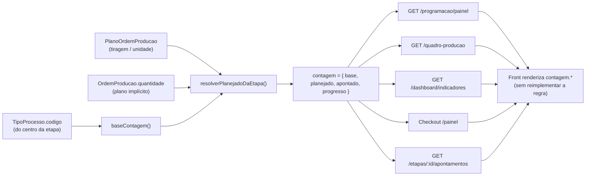

# Design Document — Base de Contagem por Tipo de Processo

## Overview
## Visão geral

Esta feature cria uma **fonte única de verdade** para a *base de contagem* de
produção (Tiragem vs Unidade) no módulo PCP, derivada **exclusivamente do Tipo
de Processo** do centro, e a aplica de forma consistente em todas as superfícies
que exibem progresso/meta de produção.

Regra travada (confirmada nos requisitos e já parcialmente existente no front):

- **Colagem** (`TipoProcesso.codigo === 'COLAGEM'`) → base **UNIDADE** (peças
  montadas finais).
- **Qualquer outro** Tipo de Processo (Cortadeira, Impressão, Acabamento,
  Acoplagem, Corte Vinco, Verniz, …) → base **TIRAGEM** (folhas/passagens).

### O que o levantamento do código real mostrou (fatos, não suposições)

1. **A regra já existe — mas só no frontend e sem reuso.** Em
   `VisioFab.Wms.Front/src/app/(interna)/pcp/programacao/page.tsx` há
   `unidadeContagem(tipoProcessoCodigo)` que compara
   `tipoProcessoCodigo === 'COLAGEM'` para rotular o campo de apontamento como
   "embalagem" (unidade) vs "folhas" (tiragem). Essa lógica está isolada nessa
   tela e **não é compartilhada** com o backend nem com as outras superfícies —
   exatamente o risco de divergência que o Requirement 6 quer eliminar.

2. **Os códigos reais de `TipoProcesso`** criados pelo seed
   (`prisma/migrate-prod.ts`, ~L2203) são, por empresa: `CORTADEIRA` (pos 0),
   `IMPRESSAO` (1), `ACABAMENTO` (2), `COLAGEM` (3), `VERNIZ` (4). **`ACOPLAGEM`
   e `CORTE_VINCO` NÃO são códigos de `TipoProcesso`** — máquinas de acoplagem/
   corte-e-vinco são classificadas sob `ACABAMENTO` (ex.: "CVMR (Corte e vinco)"
   → `ACABAMENTO` no seed de centros). `CORTE_VINCO`/`ACOPLAGEM` só aparecem como
   acabamentos do Orçamento Gráfico / catálogo, nunca como processo de chão de
   fábrica. **Consequência de design:** a regra "demais → Tiragem" cobre
   naturalmente Acoplagem e Corte Vinco, pois eles chegam como `ACABAMENTO` (ou
   qualquer código ≠ `COLAGEM`). A função só precisa testar "é COLAGEM?".

3. **Hoje o denominador de progresso é sempre `OrdemProducao.quantidade`**
   (peças). No `GET /programacao/painel`
   (`etapa-operacional.routes.ts`), cada etapa calcula:
   `quantidade = quantidadePrevista > 0 ? quantidadePrevista : ordemProducao.quantidade`
   e `percentual = quantidadeProduzida / quantidade`. O `plano.tiragem` (folhas)
   é retornado no payload e **somado só no frontend** para a linha-pai de OPs
   multi-plano; **não há conversão peças↔folhas no backend**. Ou seja: a meta
   exibida hoje é, de fato, a **Unidade** (peças) para todos os centros —
   inclusive os que deveriam exibir Tiragem.

4. **`PlanoOrdemProducao` tem `tiragem` mas não tem campo de "unidade/peças".**
   A Unidade do plano é a quantidade de peças; a tiragem é folhas/passagens. Não
   existe campo persistido de unidade por plano. Fonte da Unidade: para plano
   único/legado é `OrdemProducao.quantidade`; para planos múltiplos, hoje não há
   quantidade de peças por plano no schema (ver "Modelo de dados" e "Riscos").

5. **Superfícies reais que exibem número de produção** (confirmadas no código):
   Programação (painel), Painel de Produção (TV), Quadro de Produção (TV),
   Dashboard (`/dashboard` e `/dashboard/indicadores`), Apontamentos, Checkout
   (terminal), e `GET /etapas/:id/apontamentos`. Timeline/Gantt medem **tempo**
   (`percentualConcluido` por minutos), **não** quantidade — ficam fora do
   escopo de base de contagem, exceto se exibirem quantidade/meta (não exibem
   hoje). **Não há "relatórios de produção"** no PCP hoje (só relatórios do Mapa
   de Custos RKW, que não tratam de progresso/meta).

### Princípio da solução

Criar no backend **uma função pura** `baseContagem(tipoProcessoCodigo)` e **um
resolvedor** `resolverPlanejadoDaEtapa(etapa, plano, op)` que devolvem, para
cada etapa, um objeto derivado `{ base, planejado, apontado, progresso }`. Esse
objeto é **anexado ao payload de cada superfície pelo backend** (campo derivado
`contagem`), de modo que o frontend apenas **renderiza** — nunca reimplementa a
regra. Isso garante a fonte única (R6) e elimina o literal `=== 'COLAGEM'`
espalhado no front.

Feature **aditiva**: não altera apontamento, não altera schema (preferência),
preserva plano único/legado e centros por quantidade, e isola por `empresaId`.

## Architecture
## Arquitetura

### Função única (fonte de verdade)

Novo serviço: `src/modules/pcp/base-contagem.service.ts` (funções **puras**, sem
Prisma, 100% testáveis):

```ts
export type BaseContagem = 'UNIDADE' | 'TIRAGEM'

/** Regra travada: só COLAGEM conta em Unidade; todo o resto em Tiragem. */
export function baseContagem(tipoProcessoCodigo: string | null | undefined): BaseContagem {
  return tipoProcessoCodigo === 'COLAGEM' ? 'UNIDADE' : 'TIRAGEM'
}

export interface PlanoLike {
  tiragem: number | null        // folhas/passagens do plano
  // unidade de peças do plano, quando houver (ver Modelo de Dados); null = usar OP
  unidade?: number | null
}
export interface OpLike {
  quantidade: number            // peças planejadas da OP (unidade da OP)
}
export interface EtapaLike {
  tipoProcessoCodigo: string | null
  quantidadePrevista: number    // > 0 em desmembramento
  quantidadeProduzida: number   // dado bruto apontado (nunca convertido)
}

export interface ContagemResolvida {
  base: BaseContagem
  planejado: number             // denominador na base do processo
  apontado: number              // = quantidadeProduzida (bruto, inalterado)
  progresso: number             // 0..100, 0 quando planejado <= 0
}

/**
 * Resolve o planejado/progresso de uma etapa na base do seu processo.
 * - base = baseContagem(tipoProcessoCodigo)
 * - plano implícito: se plano == null, usa a OP como plano único (R5.2)
 * - UNIDADE: usa unidade do plano (se houver) senão quantidade da OP
 * - TIRAGEM: usa tiragem do plano (se houver) senão a unidade como fallback
 *   não-regressão (ver nota de fallback)
 * - desmembramento: quantidadePrevista > 0 sobrepõe o planejado de unidade
 */
export function resolverPlanejadoDaEtapa(
  etapa: EtapaLike,
  plano: PlanoLike | null,
  op: OpLike,
): ContagemResolvida
```

**Decisão de fallback (não-regressão, R5):** quando a base é `TIRAGEM` mas o
plano não tem `tiragem` (OP legada/plano único sem tiragem parseada), o
resolvedor cai para a mesma quantidade que o painel usa hoje
(`quantidadePrevista > 0 ? quantidadePrevista : op.quantidade`). Assim nenhuma
tela existente muda de número onde não há tiragem disponível — a feature só
*passa a exibir Tiragem* onde a tiragem existe (OPs com plano/`[Tiragem]`),
mantendo o comportamento atual no resto.

### Fluxo back → front (campo derivado)



Cada rota de superfície passa a chamar o resolvedor e anexar `contagem` ao item
já existente (aditivo — os campos atuais `quantidade/quantidadeProduzida/
percentual/tiragem` continuam no payload para não quebrar nada). O front migra
gradualmente para ler `contagem.base`/`contagem.planejado`/`contagem.progresso`.

## Data Models
## Modelo de dados

**Sem mudança de schema (preferível).** A base é **derivável** do
`TipoProcesso.codigo` já existente, e o planejado vem de campos já existentes
(`PlanoOrdemProducao.tiragem`, `OrdemProducao.quantidade`,
`EtapaOrdemProducao.quantidadePrevista/quantidadeProduzida`). Portanto **não há
alteração em `prisma/schema.prisma` nem em `prisma/migrate-prod.ts`** para o
núcleo da feature.

Campos reais usados (confirmados no schema):

| Entidade | Campo | Papel na feature |
|---|---|---|
| `TipoProcesso` | `codigo` (`COLAGEM`/outros) | **Única** entrada da regra de base |
| `CentroProducao` | `tipoProcessoId` → `tipoProcesso` | Liga a etapa ao Tipo de Processo |
| `PlanoOrdemProducao` | `tiragem` | Planejado quando base = TIRAGEM |
| `PlanoOrdemProducao` | `aproveitamento`/`montagem` | (Opcional) derivar peças↔folhas se necessário |
| `OrdemProducao` | `quantidade` | Planejado base UNIDADE / plano implícito (R5.2) |
| `EtapaOrdemProducao` | `quantidadePrevista` | Sobrepõe planejado em desmembramento |
| `EtapaOrdemProducao` | `quantidadeProduzida` | **Dado bruto apontado — nunca convertido** (R3) |
| `OrdemProducao`/filhas | `empresaId` | Isolamento de toda agregação (R14) |

**Lacuna conhecida (ver Riscos):** não existe "unidade de peças por plano" no
schema. Para plano único/legado, Unidade = `OrdemProducao.quantidade` (correto).
Para OPs com múltiplos planos COMPONENTE, não há peças por plano persistidas —
tratado como decisão aberta (D1), sem bloquear a feature, pois o único processo
que usa base UNIDADE é COLAGEM e, nas OPs reais da Carton Wega, a colagem
tipicamente opera sobre o produto final (plano único/implícito).

## Decisão do congelamento por apontamento (R3.4 / R3.5)

**Requisito (comportamento):** após uma reclassificação do Tipo de Processo de
um centro, os valores históricos de progresso/meta de apontamentos anteriores
devem permanecer **congelados** (sem recálculo retroativo); o dado bruto nunca
muda.

**Análise do risco real:** a base é determinística pelo `TipoProcesso.codigo`
*atual* do centro. Reclassificar um centro de, por exemplo, `COLAGEM` para
`ACABAMENTO` faria o resolvedor passar a devolver base `TIRAGEM`, mudando o
denominador de progresso **inclusive de apontamentos antigos** — violando R3.4.

**Opções consideradas:**

- **(A) Persistir a base vigente no apontamento** — adicionar
  `baseContagem`/`planejadoNaBase` ao `ApontamentoEtapa` no momento da gravação.
  Congelamento perfeito, mas **toca schema + migração** e adiciona escrita no
  caminho quente de apontamento.
- **(B) Derivar por histórico de reclassificação** — manter log de troca de
  `tipoProcessoId` com timestamp e resolver a base pela data do apontamento.
  Correto, porém exige nova tabela de auditoria e consultas por janela temporal
  (complexo, propenso a borda).
- **(C) Base derivada do estado atual, sem congelamento ativo** — aceitar que a
  base acompanha o Tipo de Processo atual.

**Decisão recomendada (menor risco): (A) de forma MÍNIMA e opcional, só se o
usuário exigir congelamento efetivo.** Na prática a reclassificação de Tipo de
Processo de um centro de chão de fábrica é **rara e administrativa** (não é parte
do fluxo diário). Para a entrega inicial, adotamos **(C)** como padrão
documentado — a base reflete o Tipo de Processo atual — e deixamos **(A)**
desenhada e pronta: se/quando o congelamento for exigido, adiciona-se ao
`ApontamentoEtapa` as colunas `base_contagem VARCHAR(10)` e
`planejado_na_base DECIMAL(14,4)` (ambas *nullable*, backfill não necessário),
gravadas na criação do apontamento a partir do mesmo `resolverPlanejadoDaEtapa`.
Essa adição **exigiria** o par `schema.prisma` + `migrate-prod.ts` idempotente
(`ADD COLUMN IF NOT EXISTS`), conforme o steering de migrações.

Justificativa: a opção (A) é a única que satisfaz R3.4/R3.5 *literalmente* sem a
complexidade temporal de (B); mantê-la *opcional e aditiva* evita custo e risco
enquanto o comportamento não for demandado na prática. O design fica coerente
com o requisito (o COMO está definido) sem obrigar mudança de schema agora.

> **Confirmar com o usuário (D2):** aceitar (C) na entrega inicial, ou já
> implementar (A) com a coluna persistida? A recomendação é (C) + (A) pronto.

## Components and Interfaces
## Componentes por superfície — mapa de alteração

Tabela superfície → ponto exato no backend que serve o dado → arquivo frontend
que exibe. Em todos, a mudança é **anexar `contagem` via
`resolverPlanejadoDaEtapa`** e, no front, **ler `contagem.*`**.

| # | Superfície (Req) | Backend — arquivo / rota | Frontend — arquivo |
|---|---|---|---|
| 1 | Painel de Programação (R9.1/9.2) | `src/modules/pcp/etapa-operacional.routes.ts` → `GET /programacao/painel` (montagem da etapa ~L2180–2250; já faz `select` do `plano` e do `tipoProcesso.codigo`) | `src/app/(interna)/pcp/programacao/page.tsx` (hoje tem `unidadeContagem`/`=== 'COLAGEM'` — substituir por `contagem.base`) |
| 2 | Painel de Produção / TV (R10) | reusa `GET /programacao/painel` | `src/app/(interna)/pcp/painel-producao/page.tsx` |
| 3 | Quadro de Produção / TV (R9.3) | `etapa-operacional.routes.ts` → `GET /quadro-producao` (cálculo ~L1586–1655; incluir `tipoProcesso.codigo` e `plano` no select) | `src/app/(interna)/pcp/quadro-producao/page.tsx` |
| 4 | Dashboard do PCP (R7) | `src/modules/pcp/dashboard-unificado.routes.ts` → `GET /dashboard` e `GET /dashboard/indicadores` (agrega por `TipoProcesso`) | `src/app/(interna)/pcp/dashboard/page.tsx` |
| 5 | Apontamentos do PCP (R11.3) | `etapa-operacional.routes.ts` → `GET /etapas/:id/apontamentos` (hoje só totais; anexar `contagem` com planejado/base) e `src/modules/apontamento-producao/apontamento-producao.routes.ts` → `GET /apontamentos-producao` | `src/app/(interna)/pcp/apontamentos/page.tsx` |
| 6 | Checkout (R11.1/11.2/11.4) | `src/modules/checkout/checkout.service.ts` → `listarPainelCheckout` (anexar `contagem`); `checkout.routes.ts` → `GET /painel`. Apontamento (`POST /checkout/etapas/:id/apontar`) **inalterado** (grava bruto, R11.4) | app de terminal (fora de `(interna)/pcp`) |
| 7 | Gantt / Timeline (R13) | `src/modules/pcp/timeline-producao.routes.ts` → `GET /timeline` — mede **tempo**, não quantidade | `src/app/(interna)/pcp/gantt/page.tsx`, `.../timeline/page.tsx` — **sem mudança** de base (não exibe meta de quantidade). Registrado aqui por R13.2. |
| 8 | Relatórios de produção (R12) | **Não existe** rota de relatório de produção hoje (só Mapa de Custos RKW, fora de escopo). Registrado por R6.3/R13.2 como inexistente — nada a alterar. |

Pontos de comparação literal `'COLAGEM'`/`'CORTADEIRA'` a revisar (todos passam a
usar o serviço único): back `etapa-operacional.routes.ts` (~L856 filtro COLAGEM,
~L2535 CORTADEIRA), `scripts/backfill-tipo-colagem.ts`; front
`programacao/page.tsx` (`unidadeContagem`, `getCategoriaCentro`).

## Não-regressão

- **Plano único / legado (R5.1/R5.2):** `resolverPlanejadoDaEtapa` trata
  `plano == null` como **plano implícito** usando `OrdemProducao.quantidade` —
  **mesma estrutura de cálculo**, sem caminho separado. O resultado numérico
  para esses casos é idêntico ao atual (fallback descrito na Arquitetura).
- **Centros por quantidade (R5.3):** a base é só de *exibição*; o fluxo de
  apontamento (`modoContagem` QUANTIDADE/CONTADOR) permanece intacto.
- **OPs antigas não reimportadas (R5.4):** sem plano e sem `[Tiragem]`, a base
  TIRAGEM cai para a quantidade da OP (igual ao de hoje) — nenhuma tela muda de
  número.
- **Campos atuais preservados:** `contagem` é **aditivo**; nenhum campo
  existente do payload é removido ou renomeado. O front antigo continua
  funcionando até migrar para `contagem.*`.

## Multi-tenant (R14)

- Toda consulta que alimenta o resolvedor **filtra `empresaId` explicitamente**
  pela OP real (`ordemProducao: { empresaId }` ou `empresaId` direto), seguindo
  o padrão do steering `ATENCAO-pontos-verificar.md` — nunca confiar apenas no
  `prismaScoped` (que faz bypass para SUPER_ADMIN e vazaria dados).
- O `empresaId` de referência é o **da Ordem de Produção real** (R14.2), não o
  do usuário logado — relevante quando um SUPER_ADMIN opera em outra empresa.
- Agregações do Dashboard/Quadro já recebem `user.empresaId` e devem manter o
  filtro explícito em cada `aggregate`/`groupBy`/`count`.
- **Escopo obrigatório (R14.3):** o resolvedor e as rotas de agregação **rejeitam
  com erro explícito** (ex.: 400) quando o `empresaId` de escopo não puder ser
  determinado — nunca retornam vazio nem assumem uma empresa padrão.


## Correctness Properties

*Uma propriedade é uma característica ou comportamento que deve ser verdadeiro em
todas as execuções válidas do sistema — essencialmente, uma afirmação formal
sobre o que o sistema deve fazer. Propriedades são a ponte entre a especificação
legível por humanos e as garantias de correção verificáveis por máquina.*

As propriedades abaixo são todas sobre as **funções puras**
`baseContagem()` e `resolverPlanejadoDaEtapa()` (fonte única), que são o
coração testável desta feature. Após a reflexão de redundância, as 14 critérios
testáveis foram consolidados em 9 propriedades independentes (ex.: 1.2 e 1.4 são
o complemento de 1.1; 6.1/6.2/11.3/13.1 são a mesma invariante de fonte única;
3.1/3.2/3.3/11.4 são a mesma invariante de preservação do bruto).

### Property 1: Colagem conta em Unidade

*Para todo* código de Tipo de Processo igual a `'COLAGEM'`, `baseContagem(codigo)`
retorna `'UNIDADE'`.

**Validates: Requirements 1.1, 7.1, 8.1, 9.1, 10.1, 11.1, 12.1**

### Property 2: Todo processo diferente de Colagem conta em Tiragem

*Para todo* código de Tipo de Processo diferente de `'COLAGEM'` (incluindo
`CORTADEIRA`, `IMPRESSAO`, `ACABAMENTO`, `VERNIZ`, Acoplagem/Corte Vinco que
chegam como `ACABAMENTO`, códigos arbitrários e `null`/`undefined`),
`baseContagem(codigo)` retorna `'TIRAGEM'`.

**Validates: Requirements 1.2, 1.4, 7.2, 8.2, 9.2, 10.2, 11.2, 12.2**

### Property 3: A base é função determinística apenas do Tipo de Processo (fonte única)

*Para toda* entrada, `baseContagem(codigo)` e `resolverPlanejadoDaEtapa(...)` são
determinísticos e idempotentes: chamadas repetidas com a mesma entrada produzem
sempre o mesmo resultado, sem depender de máquina específica, de estado externo
ou de qual superfície as invoca. Em particular, a base não varia se qualquer dado
da etapa que não seja o código do Tipo de Processo mudar.

**Validates: Requirements 1.3, 6.1, 6.2, 11.3, 13.1**

### Property 4: Planejado na base Tiragem usa a Tiragem do plano

*Para todo* plano com `tiragem` definida e centro de Tipo de Processo diferente de
Colagem, `resolverPlanejadoDaEtapa` retorna `base = 'TIRAGEM'` e `planejado`
igual à tiragem do plano — exceto quando a etapa é um desmembramento
(`quantidadePrevista > 0`), caso em que `planejado` é a quantidade prevista da
parte.

**Validates: Requirements 2.1, 2.3, 4.1, 4.3**

### Property 5: Planejado na base Unidade usa a Unidade do plano/OP

*Para todo* centro de Tipo de Processo Colagem, `resolverPlanejadoDaEtapa` retorna
`base = 'UNIDADE'` e `planejado` igual à unidade do plano quando existir, ou à
`quantidade` da Ordem de Produção no caso de plano único/implícito (sobreposto
pela `quantidadePrevista` em desmembramento).

**Validates: Requirements 2.2, 2.4, 4.1, 4.3**

### Property 6: O dado bruto apontado é preservado, independentemente da base

*Para toda* etapa e *para toda* base de contagem, `resolverPlanejadoDaEtapa`
retorna `apontado` exatamente igual a `quantidadeProduzida` bruto da etapa, sem
qualquer conversão em função da base. A base afeta apenas `planejado` e
`progresso`, nunca o valor apontado.

**Validates: Requirements 3.1, 3.2, 3.3, 11.4**

### Property 7: Plano implícito reproduz o comportamento legado (não-regressão)

*Para toda* etapa com `planoId` nulo, `resolverPlanejadoDaEtapa(etapa, null, op)`
produz o mesmo resultado que a mesma função aplicada a um plano implícito
construído a partir da Ordem de Produção, e o `planejado` resultante é igual ao
cálculo legado atual (`quantidadePrevista > 0 ? quantidadePrevista : op.quantidade`)
na base correspondente — garantindo que OPs/etapas sem plano não mudem de número.

**Validates: Requirements 5.1, 5.2, 5.4**

### Property 8: Planos de uma mesma OP são calculados de forma independente

*Para toda* Ordem de Produção com dois ou mais planos, o resultado de
`resolverPlanejadoDaEtapa` para a etapa de um plano depende somente dos valores
daquele plano (e da etapa): alterar a tiragem/unidade de outro plano da mesma OP
não altera o `planejado`/`progresso` da etapa do primeiro plano. Não há
consolidação de uma base única no nível da OP.

**Validates: Requirements 4.2**

### Property 9: Agregação sem escopo de empresa falha explicitamente

*Para toda* resolução/agregação de produção em que o `empresaId` de escopo (o da
Ordem de Produção real) não puder ser determinado, o Sistema lança um erro
explícito, nunca retornando resultado vazio nem aplicando um escopo de empresa
padrão.

**Validates: Requirements 14.3**

## Error Handling

- **Escopo de empresa ausente (R14.3):** `resolverPlanejadoDaEtapa` e as rotas de
  agregação exigem `empresaId` da OP; se ausente/indeterminável, retornam erro
  explícito (HTTP 400 com mensagem clara), seguindo Property 9. Nunca `[]` nem
  empresa default.
- **Tiragem/unidade ausente:** quando a base é TIRAGEM e não há `plano.tiragem`,
  o resolvedor aplica o fallback de não-regressão (quantidade da OP) — não é
  erro, é comportamento definido (R5). Logar em nível debug para rastreabilidade.
- **`planejado <= 0`:** `progresso` retorna `0` (evita divisão por zero), igual
  ao comportamento atual do painel.
- **Tipo de Processo nulo/código desconhecido:** `baseContagem` trata como
  `'TIRAGEM'` (base padrão, R1.2/1.4) — nunca lança por código inesperado.
- **Isolamento multi-tenant:** filtro `empresaId` explícito em toda query de
  agregação (não confiar em `prismaScoped` por causa do bypass SUPER_ADMIN).

## Testing Strategy

Abordagem dupla (unit + property), com biblioteca de PBT já usada no projeto
(**fast-check** com Vitest — ver `src/modules/checkout/contador-maquina.service.test.ts`
e a suíte do Mapa de Custos). O núcleo da feature é purо, logo PBT é apropriado.

**Property-based tests** (mínimo 100 iterações cada, tag referenciando a
propriedade do design):
- Alvo: `src/modules/pcp/base-contagem.service.test.ts` cobrindo as Properties
  1–9 sobre `baseContagem` e `resolverPlanejadoDaEtapa` (funções puras, sem
  Prisma — geradores de código de processo, tiragem, unidade, quantidade,
  quantidadePrevista, presença/ausência de plano).
- Cada teste anota: `// Feature: base-contagem-por-tipo-processo, Property N: <texto>`.
- Property 9 (erro sem escopo) é testada como *error condition* (gerar entradas
  sem `empresaId` e exigir que lance).

**Unit tests (exemplos e wiring):**
- Exemplos concretos da regra: COLAGEM→UNIDADE, CORTADEIRA/IMPRESSAO/ACABAMENTO/
  VERNIZ→TIRAGEM (tabela de verdade pequena).
- Wiring por superfície (exemplo/integração, 1–3 casos): o `GET /programacao/painel`,
  `GET /quadro-producao`, `GET /dashboard/indicadores`, `listarPainelCheckout` e
  `GET /etapas/:id/apontamentos` **anexam** o objeto `contagem` com a base/
  planejado corretos (R7–R11).
- **Isolamento multi-tenant (R14.1/14.2):** teste de exemplo garantindo que a
  agregação da empresa A não inclui registros da empresa B e que o `empresaId`
  usado é o da OP real.
- **Não-regressão:** teste de exemplo confirmando que OP legada sem plano/sem
  `[Tiragem]` mantém exatamente os números atuais do painel.

**Property Test Configuration:** fast-check, `numRuns >= 100`, geradores que
cobrem bordas (string vazia, `null`, códigos arbitrários, tiragem/quantidade 0 e
grandes, com e sem plano, com e sem desmembramento).

## Riscos e decisões abertas

- **D1 — Unidade de peças por plano múltiplo:** o schema não persiste "peças por
  plano". Para plano único/implícito, Unidade = `OrdemProducao.quantidade`
  (correto). Para OPs com vários planos COMPONENTE e um deles em COLAGEM, não há
  peças por plano no banco. Mitigação atual: na Carton Wega a colagem opera sobre
  o produto final (plano único/implícito), então `OrdemProducao.quantidade`
  atende. Se surgir OP multi-plano com colagem por plano, decidir entre (a)
  derivar peças = `tiragem × aproveitamento` do plano, ou (b) persistir unidade
  no plano (tocaria schema + `migrate-prod.ts`). **Confirmar com o usuário se
  esse cenário é real antes de complicar.**
- **D2 — Congelamento por apontamento (R3.4/R3.5):** recomendação é entregar com
  base derivada do Tipo de Processo atual (opção C) e deixar a persistência da
  base no `ApontamentoEtapa` (opção A) pronta/opcional. **Confirmar** se o
  congelamento efetivo é exigido já na entrega inicial (A, com migração) ou pode
  ficar documentado (C).
- **R3 — Comparação por string literal `'COLAGEM'`:** a regra depende do `codigo`
  do `TipoProcesso`. Se o usuário renomear o código de Colagem no cadastro, a
  regra deixa de valer. Mitigação: centralizar o literal no serviço único
  (`baseContagem`) — assim há um só ponto a ajustar, e documenta-se que o código
  `COLAGEM` é reservado/semântico. (Decisão aberta: tornar isso uma flag de
  cadastro no `TipoProcesso` — fora do escopo inicial.)
- **Gantt/Timeline:** medem tempo, não quantidade. Ficam fora da base de
  contagem hoje; se passarem a exibir meta de quantidade, aplicam a mesma função
  única (registrado por R13).
- **Relatórios de produção (R12):** não existem hoje no PCP. Quando criados,
  devem consumir o campo `contagem` da fonte única — registrado para não ficar
  ponto fora da regra.
