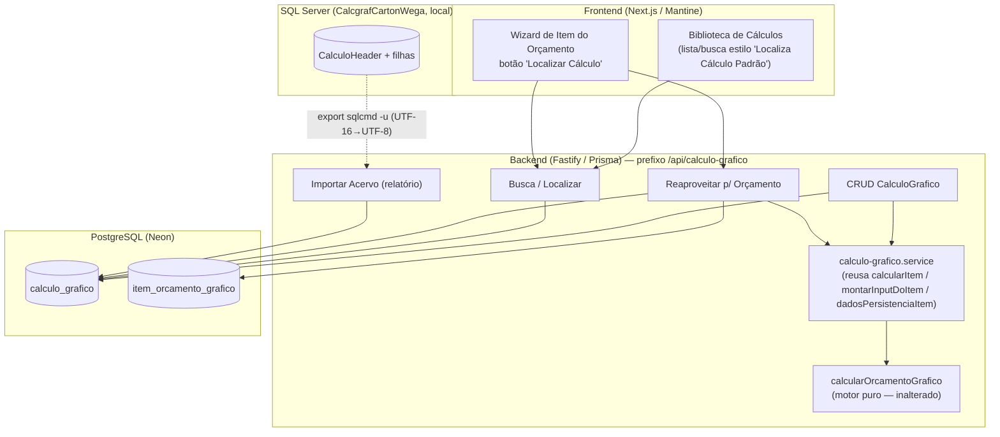
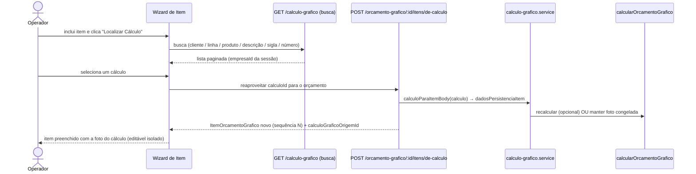

# Design Document — Biblioteca de Cálculos Gráficos

## Overview

Esta feature cria no Vizor o conceito de **Cálculo Gráfico** reutilizável e
independente do orçamento — o equivalente ao "Cálculo Padrão" do Calcgraf — e
importa o acervo histórico de 11.561 cálculos da Carton Wega para essa
biblioteca, preservando a **foto congelada** de cada cálculo.

O design parte de duas realidades já existentes no Vizor:

1. **O motor de cálculo já é fiel ao Calcgraf.** `calcularOrcamentoGrafico`
   (função pura) foi calibrado por golden cases (6 cálculos reais, incluindo o
   7343, desvio ≤0,5%). O `ItemOrcamentoGrafico` já guarda *praticamente todos*
   os campos de engenharia de um cálculo (tipo/produto, suporte, cores,
   acabamentos ricos, faca/montagem, formato, matriz, tinta, `resultadoCalculo`
   como foto JSON). O serviço `calcularItem`/`montarInputDoItem`/
   `dadosPersistenciaItem` já encapsula o fluxo "input → motor → persistência".

2. **O padrão de reaproveitamento já existe.** `POST /orcamento-grafico/:id/
   reaproveitar` clona um orçamento inteiro (cabeçalho + itens) para um número
   novo, copiando as colunas persistidas e recalculando. Esta feature reusa
   exatamente esse padrão de **cópia**, mas partindo de um `CalculoGrafico` da
   biblioteca em vez de um orçamento inteiro.

A decisão central de modelagem é introduzir uma **entidade nova `CalculoGrafico`**
— a "versão solta" (sem orçamento pai) do mesmo shape do `ItemOrcamentoGrafico` —
em vez de reaproveitar `ItemOrcamentoGrafico` marcado como template. As
justificativas estão em [Decisões de Design](#decisões-de-design-pontos-a-esclarecer).

### Escopo

Dentro do escopo:
- Model `CalculoGrafico` (biblioteca) + alteração idempotente no `migrate-prod.ts`.
- CRUD de `CalculoGrafico`, busca/localizar estilo Calcgraf, reaproveitar-para-
  orçamento, importar-acervo com relatório.
- Fluxo do operador (localizar → selecionar → vira item do orçamento).
- Telas de frontend (lista/busca da biblioteca; botão "Localizar Cálculo" no
  wizard de item).
- Importador de migração (fonte, idempotência, foto congelada, relatório, corte).
- Isolamento multi-tenant (`empresaId` explícito).

Fora do escopo (inalterado):
- O motor `calcularOrcamentoGrafico` (consumido, não reescrito).
- A migração de OPs/pedidos/NF-e (decisão do roadmap mantida).
- O mundo A das máquinas (códigos numéricos do PDF) — a biblioteca usa o mesmo
  conjunto de cadastros do orçamento (mundo B).

## Decisões de Design (pontos [A ESCLARECER])

O design toma posição sobre os 5 pontos abertos do requirements, com a
recomendação e o trade-off registrados. **Todas são recomendações sujeitas a
confirmação do usuário na revisão desta fase.**

### 3.A — Reaproveitar = CÓPIA (recomendado), não vínculo

**Decisão: CÓPIA (foto congelada).** Ao reaproveitar um `CalculoGrafico` num
orçamento, o Vizor **copia** os campos e a foto do cálculo para um
`ItemOrcamentoGrafico` novo, editável de forma isolada. Editar o cálculo da
biblioteca depois **não** altera orçamentos já feitos.

- **Por quê:** espelha o Calcgraf, onde cada orçamento carrega sua própria foto
  do cálculo; alterar o cálculo-template não deve reescrever a engenharia de
  orçamentos já emitidos/aprovados (risco fiscal/comercial). Também reusa o
  padrão já existente `POST /:id/reaproveitar` (clona colunas + recalcula), sem
  acoplar o item do orçamento ao ciclo de vida do cálculo.
- **Trade-off:** correção feita num cálculo da biblioteca não se propaga
  automaticamente a itens já criados a partir dele (o operador reaproveita de
  novo se quiser a versão corrigida). É o comportamento esperado pela Wega.
- **Rastreabilidade:** o item copiado grava `calculoGraficoOrigemId` (de onde
  veio), sem criar dependência de integridade que impeça editar/excluir o
  cálculo-origem.

### 5.A — Todo cálculo salvo entra na biblioteca (recomendado), com rascunho futuro

**Decisão: todo `CalculoGrafico` salvo é localizável na biblioteca**, com um
campo `status` que já prevê, para o futuro, marcar um cálculo como
`RASCUNHO`/descartável sem exibi-lo na busca padrão.

- **Por quê:** no Calcgraf todo cálculo tem número e é localizável — é o valor do
  acervo. Opt-in por cálculo adicionaria fricção ao fluxo que a Wega já conhece.
- **Trade-off:** a biblioteca cresce com cálculos exploratórios. Mitigado pelo
  `status` (default `ATIVO`): a busca padrão lista `ATIVO`; `RASCUNHO`/`ARQUIVADO`
  só aparecem com filtro explícito. O comportamento "opt-in" pode ser habilitado
  depois sem mudança de schema.

### 6.A — Migrar TODOS os 11.561, em lotes idempotentes, com corte opcional

**Decisão: migrar TODOS os cálculos**, em lotes idempotentes, com um parâmetro
de corte **opcional** (`--desde-ano`, `--desde-numero`) caso o usuário prefira
restringir.

- **Por quê:** o valor da biblioteca é ter o acervo de engenharia inteiro
  localizável. A idempotência (Req 6.4) permite rodar em lotes e repetir sem
  duplicar.
- **Trade-off:** volume (11.561 cálculos + filhas) exige processamento em lotes e
  um relatório de erros (cálculos com dado corrompido não abortam a carga). O
  corte opcional é uma válvula de escape, não o padrão.

### 6.B — Extração via banco restaurado; `sqlcmd -u` (UTF-16 LE) → UTF-8

**Decisão:** a fonte de extração é o **banco restaurado localmente**
(`CalcgrafCartonWega`, SQL Server `localhost`). Quando a extração passar por
export de arquivo, usar **`sqlcmd -u`** (UTF-16 LE) lido em Node como `utf16le` e
convertido para UTF-8 — nunca `FOR JSON` padrão (corrompe acentos — lição
registrada no steering). O importador roda contra **produção Neon**
(`DATABASE_URL` via env, nunca hardcode), é **idempotente**, suporta `--dry-run`,
e o script é **versionado** (prefixo definitivo, ex.: `importar-calculos-calcgraf.ts`,
não `_tmp-`).

- **Trade-off:** extração em duas etapas (export + importação) é mais lenta que um
  ETL direto, mas evita a classe de bug de encoding já sofrida (42 preços com `�`
  em produção) e mantém a carga auditável.

### 7.A — Número PRÓPRIO do Vizor + `numeroCalcgraf` de referência (recomendado)

**Decisão: cada `CalculoGrafico` tem `numero` PRÓPRIO** da sequência do Vizor por
empresa, **mais** um campo `numeroCalcgraf` (nullable) com o número original do
Calcgraf (ex.: 7343). A busca por número aceita **ambos**.

- **Por quê:** evita colisão entre cálculos novos do Vizor (Req 5.2 — número
  próprio na criação) e os migrados. Preservar o número do Calcgraf como `numero`
  do Vizor quebraria a sequência (um cálculo novo nasceria colidindo com um
  migrado, ou a sequência saltaria para 11.562).
- **Rastreabilidade (Req 7):** `numeroCalcgraf` preserva o número que a Wega
  conhece e é um critério de busca de primeira classe.
- **Trade-off:** o operador vê dois números num cálculo migrado (o do Vizor e o
  "ref. Calcgraf 7343"). Mitigado na UI exibindo "Nº 12040 · Calcgraf 7343".

## Architecture

### Visão de componentes



### Decisão de modelagem: entidade nova vs reuso de `ItemOrcamentoGrafico`

O `ItemOrcamentoGrafico` já guarda quase todos os campos de um cálculo. Duas
opções foram avaliadas:

| Opção | Descrição | Avaliação |
|---|---|---|
| **A — Entidade nova `CalculoGrafico`** (ESCOLHIDA) | Tabela própria, "solta" (sem `orcamentoId`), com o mesmo shape de engenharia do item + campos de biblioteca (`numero`, `numeroCalcgraf`, `origem`, `status`, cliente/linha). | Semântica limpa: o cálculo tem vida própria (Req 1.1). Não polui o `item_orcamento_grafico` com linhas órfãs (sem orçamento) nem exige tornar `orcamentoId` nullable (quebraria FK/cascade e todas as queries que assumem orçamento pai). Isolamento e busca próprios. |
| B — `ItemOrcamentoGrafico` marcado como template | Reusar a tabela, com `orcamentoId` nullable + flag `ehBiblioteca`. | Rejeitada: tornar `orcamentoId` nullable enfraquece a relação `Cascade` existente, obriga a filtrar `ehBiblioteca` em TODAS as queries de item de orçamento (risco de vazar template em orçamento e vice-versa), e sobrecarrega uma tabela que já tem ~40 colunas e relações (planos, troca de suporte). |

**Trade-off da opção A (duplicação de shape):** `CalculoGrafico` e
`ItemOrcamentoGrafico` compartilham ~30 campos de engenharia. Isso é duplicação
de *estrutura de dados*, mas **não** de *lógica*: o motor, a montagem de input e
a persistência de resultado são reaproveitados via os serviços existentes
(`montarInputDoItem`, `calcularItem`, `dadosPersistenciaItem`). Para minimizar a
duplicação e o risco de divergência, o design extrai um **tipo TS compartilhado**
`CamposEngenhariaCalculo` (as colunas comuns) e funções de mapeamento
`calculoParaItemBody(calculo)` / `itemBodyParaCalculo(body)` — de modo que copiar
nos dois sentidos (biblioteca ↔ item do orçamento) seja uma transformação única e
testada, não dois blocos de código paralelos que podem divergir (lição do
steering sobre `pcp-wms-integration.service.ts`).

### Fluxo do operador (localizar → selecionar → vira item do orçamento)



## Components and Interfaces

### Backend — `src/modules/orcamento-grafico/calculo-grafico/`

Novo submódulo (ao lado do código existente de orçamento gráfico, para reusar os
serviços `calcularItem`/`montarInputDoItem`/`dadosPersistenciaItem` sem import
circular).

Arquivos:
- `calculo-grafico.routes.ts` — rotas HTTP (prefixo `/api/calculo-grafico`),
  `authenticate` + `moduloGuard` do orçamento gráfico, **`empresaId` explícito em
  toda query** (nunca só `prismaScoped` — steering ATENCAO §2.1).
- `calculo-grafico.service.ts` — mapeamento `CalculoGrafico` ↔ item body,
  criação/numeração atômica, busca, reaproveitamento.
- `calculo-grafico-import.service.ts` — importador do acervo (idempotente,
  relatório, corte, foto congelada).

#### Rotas

| Método | Rota | Descrição | Req |
|---|---|---|---|
| GET | `/api/calculo-grafico` | Busca/lista paginada por critérios (cliente, linhaProduto, produto, descrição, siglaAcabado, numero, numeroCalcgraf). Sem critério → lista paginada. Filtro `empresaId` da sessão. | 2, 8 |
| GET | `/api/calculo-grafico/:id` | Detalhe de um cálculo (exibe a foto congelada, Req 4.2). | 4 |
| POST | `/api/calculo-grafico` | Cria cálculo novo: atribui `numero` próprio e grava foto — **operação atômica** (transação), `origem='VIZOR'`. | 1, 5 |
| PUT | `/api/calculo-grafico/:id` | Atualiza dados de engenharia de um cálculo da biblioteca. | 1 |
| POST | `/api/calculo-grafico/:id/recalcular` | Recalcula com cadastros atuais: preserva a foto original como histórico e cria nova foto/versão. | 4.3 |
| DELETE | `/api/calculo-grafico/:id` | Remove/arquiva um cálculo (filtrado por empresa). | 8 |
| POST | `/api/calculo-grafico/importar-acervo` | Dispara a importação do acervo (parâmetros de lote/corte/dry-run); retorna o resumo (importados/atualizados/erro). Restrita a ADMIN. | 6 |

Reaproveitamento (vive junto do orçamento, pois cria um item de orçamento):

| Método | Rota | Descrição | Req |
|---|---|---|---|
| POST | `/api/orcamento-grafico/:id/itens/de-calculo` | Cria um `ItemOrcamentoGrafico` novo no orçamento `:id`, **copiando** os campos e a foto de um `CalculoGrafico` (`{ calculoId, novaQuantidade? }`). Bloqueia se o cálculo for de outra empresa (403). | 3 |

#### Contratos (resumo)

Busca (`GET /api/calculo-grafico`) — query params:
```ts
{
  cliente?: string        // contém, case-insensitive
  linhaProduto?: string   // contém, case-insensitive
  produto?: string        // contém, case-insensitive
  descricao?: string      // contém, case-insensitive
  siglaAcabado?: string   // contém, case-insensitive
  numero?: number         // número do Vizor (exato)
  numeroCalcgraf?: number // número original do Calcgraf (exato)
  status?: 'ATIVO' | 'RASCUNHO' | 'ARQUIVADO'  // default: ATIVO
  pagina?: number; tamanho?: number
}
// Resposta: { itens: ResumoCalculo[], total, pagina, tamanho }
// ResumoCalculo: { id, numero, numeroCalcgraf, cliente, produto, descricao,
//                  linhaProduto, siglaAcabado, dataCalculo, origem }
```

Reaproveitar (`POST /api/orcamento-grafico/:id/itens/de-calculo`):
```ts
// body: { calculoId: uuid, novaQuantidade?: number }
// 403 se calculo.empresaId !== sessao.empresaId (Req 3.4)
// Efeito: ItemOrcamentoGrafico novo (próxima sequência), colunas copiadas do
// cálculo via calculoParaItemBody + dadosPersistenciaItem; grava
// calculoGraficoOrigemId; reconsolida o orçamento.
```

### Frontend — `VisioFab.Wms.Front`

- **Nova tela `pcp/orcamento-grafico/biblioteca-calculos/page.tsx`** — lista/busca
  no estilo "Localiza o Cálculo Padrão" do Calcgraf: campo de busca por critérios
  (cliente, linha de produto, produto, descrição, sigla do acabado, número),
  tabela paginada exibindo Nº Vizor + "Calcgraf NNNN" + cliente + produto/
  descrição + data + origem (badge MIGRADO/VIZOR). Ação por linha: "Abrir"
  (detalhe/foto) e "Usar em orçamento".
- **Botão "Localizar Cálculo"** no wizard de item do orçamento
  (`orcamento-grafico/.../ItemWizardModal`): abre um modal com a mesma busca; ao
  selecionar, chama `POST /orcamento-grafico/:id/itens/de-calculo` e fecha o
  wizard com o item já preenchido (foto). O botão "Criar cálculo novo" (fluxo
  atual do wizard) permanece — Req 3.3.
- Reuso do padrão de chamada (`api` direto + `useState`), igual ao resto do PCP.

## Data Models

### Novo model Prisma `CalculoGrafico`

Espelha o shape de engenharia do `ItemOrcamentoGrafico` ("solto", sem orçamento
pai), acrescido dos campos de biblioteca. Isolamento por `empresaId`
denormalizado. Enums como VARCHAR (padrão do projeto). Campos de engenharia que
afetam/descrevem o cálculo seguem a mesma nomenclatura/tipos do item para que o
mapeamento `calculoParaItemBody`/`itemBodyParaCalculo` seja 1:1.

```prisma
/// Cálculo Gráfico reutilizável, independente do Orçamento (biblioteca estilo
/// "Cálculo Padrão" do Calcgraf). Mesmo shape de engenharia do
/// ItemOrcamentoGrafico, porém SEM orçamento pai. Isolamento por empresaId.
/// Spec biblioteca-calculos-graficos.
model CalculoGrafico {
  id        String @id @default(uuid())
  empresaId String @map("empresa_id")

  // ── Identificação / biblioteca ──
  numero         Int                       // sequência PRÓPRIA do Vizor por empresa (Req 5.2 / 7.A)
  numeroCalcgraf Int?    @map("numero_calcgraf") // nº original do Calcgraf, p/ busca (Req 7)
  origem         String  @default("VIZOR") @db.VarChar(20) // MIGRADO_CALCGRAF | VIZOR (Req 8.3)
  status         String  @default("ATIVO") @db.VarChar(20) // ATIVO | RASCUNHO | ARQUIVADO (Req 5.A)

  // ── Cliente / classificação de busca (Req 2.2) ──
  clienteId    String? @map("cliente_id")
  clienteNome  String? @map("cliente_nome") @db.VarChar(200)
  linhaProduto String? @map("linha_produto") @db.VarChar(120)
  produto      String? @db.VarChar(200)
  descricao    String? @db.VarChar(200)
  siglaAcabado String? @map("sigla_acabado") @db.VarChar(60)

  // ── Geometria / produto (espelha item) ──
  tipoEmbalagemId String @map("tipo_embalagem_id")
  medidas         Json

  // ── Papel / suporte ──
  papelId        String?  @map("papel_id")
  papelDescricao String?  @map("papel_descricao") @db.VarChar(200)
  suporteId      String?  @map("suporte_id")
  gramatura      Decimal? @db.Decimal(6, 2)

  // ── Impressão / cores / máquina ──
  numCores  Int     @default(4) @map("num_cores")
  cores     Json?   // [{nome, tipo, cobertura%, precoKg, ...}]
  maquinaId String? @map("maquina_id")

  // ── Matriz / tinta ──
  matrizQuantidade    Decimal? @map("matriz_quantidade") @db.Decimal(12, 3)
  matrizPrecoUnitario Decimal? @map("matriz_preco_unitario") @db.Decimal(14, 4)
  tintaModo           String?  @map("tinta_modo") @db.VarChar(20)
  tintaConsumoKg      Decimal? @map("tinta_consumo_kg") @db.Decimal(12, 3)

  // ── Acabamentos ricos / faca / montagem ──
  acabamentosRicos   Json?   @map("acabamentos_ricos")
  modeloFacaId       String? @map("modelo_faca_id")
  aproveitamentoManual Decimal? @map("aproveitamento_manual") @db.Decimal(12, 3)
  montagemLinhas     Int?    @map("montagem_linhas")
  montagemColunas    Int?    @map("montagem_colunas")
  formatoCorteLarguraMm Decimal? @map("formato_corte_largura_mm") @db.Decimal(10, 2)
  formatoCorteAlturaMm  Decimal? @map("formato_corte_altura_mm") @db.Decimal(10, 2)

  // ── Itens diversos / fornecidos / campos livres ──
  itensDiversos   Json? @map("itens_diversos")
  itensFornecidos Json? @map("itens_fornecidos")
  camposLivres    Json? @map("campos_livres")

  // ── Tiragem e FOTO congelada ──
  quantidade       Int
  resultadoCalculo Json? @map("resultado_calculo") // FOTO congelada (Req 4) — não recalcular
  custoProducao    Decimal? @map("custo_producao") @db.Decimal(14, 2)
  valorTotal       Decimal? @map("valor_total") @db.Decimal(14, 2)
  margemSelecionada Decimal? @map("margem_selecionada") @db.Decimal(5, 2)

  // ── Dados da memória que NÃO são recalculados (Req 4.4) ──
  // aproveitamento/folhas já em aproveitamentoManual; laminação/verniz vivem
  // dentro de acabamentosRicos/resultadoCalculo (foto). Documentado aqui para
  // deixar explícito que são preservados da foto, não recalculados.

  // ── Histórico de recálculo (Req 4.3) ──
  fotosAnteriores Json? @map("fotos_anteriores") // [{resultadoCalculo, custoProducao, valorTotal, em}]
  dataCalculo     DateTime @default(now()) @map("data_calculo")

  criadoPorId  String?  @map("criado_por_id")
  criadoEm     DateTime @default(now()) @map("criado_em")
  atualizadoEm DateTime @updatedAt @map("atualizado_em")

  @@unique([empresaId, numero])
  @@unique([empresaId, numeroCalcgraf])   // idempotência da migração (Req 6.4)
  @@index([empresaId, status])
  @@index([empresaId, clienteNome])
  @@index([empresaId, numeroCalcgraf])
  @@map("calculo_grafico")
}
```

Alteração aditiva no `ItemOrcamentoGrafico` (rastreabilidade do reaproveitamento,
Decisão 3.A):

```prisma
// em model ItemOrcamentoGrafico:
calculoGraficoOrigemId String? @map("calculo_grafico_origem_id") // de qual CalculoGrafico este item foi copiado
```

**Nota sobre `@@unique([empresaId, numeroCalcgraf])`:** garante a idempotência da
migração — um cálculo do Calcgraf já importado não é reinserido (Req 6.4). Como
`numeroCalcgraf` é nullable, cálculos novos do Vizor (`numeroCalcgraf = NULL`) não
colidem entre si no Postgres (NULLs não violam unique). No `migrate-prod.ts` o
índice é criado como parcial (`WHERE numero_calcgraf IS NOT NULL`) para deixar a
intenção explícita e portável.

### Alteração no `migrate-prod.ts` (idempotente — mesmo commit do schema)

Seguindo o steering `database-migrations` (schema.prisma + migrate-prod.ts no
mesmo commit; idempotente; testado 2× local):

```ts
// ── Biblioteca de Cálculos Gráficos (spec biblioteca-calculos-graficos) ──
await prisma.$executeRawUnsafe(`
  CREATE TABLE IF NOT EXISTS "calculo_grafico" (
    "id" TEXT NOT NULL,
    "empresa_id" TEXT NOT NULL,
    "numero" INTEGER NOT NULL,
    "numero_calcgraf" INTEGER,
    "origem" VARCHAR(20) NOT NULL DEFAULT 'VIZOR',
    "status" VARCHAR(20) NOT NULL DEFAULT 'ATIVO',
    "cliente_id" TEXT,
    "cliente_nome" VARCHAR(200),
    "linha_produto" VARCHAR(120),
    "produto" VARCHAR(200),
    "descricao" VARCHAR(200),
    "sigla_acabado" VARCHAR(60),
    "tipo_embalagem_id" TEXT NOT NULL,
    "medidas" JSONB NOT NULL,
    "papel_id" TEXT,
    "papel_descricao" VARCHAR(200),
    "suporte_id" TEXT,
    "gramatura" DECIMAL(6,2),
    "num_cores" INTEGER NOT NULL DEFAULT 4,
    "cores" JSONB,
    "maquina_id" TEXT,
    "matriz_quantidade" DECIMAL(12,3),
    "matriz_preco_unitario" DECIMAL(14,4),
    "tinta_modo" VARCHAR(20),
    "tinta_consumo_kg" DECIMAL(12,3),
    "acabamentos_ricos" JSONB,
    "modelo_faca_id" TEXT,
    "aproveitamento_manual" DECIMAL(12,3),
    "montagem_linhas" INTEGER,
    "montagem_colunas" INTEGER,
    "formato_corte_largura_mm" DECIMAL(10,2),
    "formato_corte_altura_mm" DECIMAL(10,2),
    "itens_diversos" JSONB,
    "itens_fornecidos" JSONB,
    "campos_livres" JSONB,
    "quantidade" INTEGER NOT NULL,
    "resultado_calculo" JSONB,
    "custo_producao" DECIMAL(14,2),
    "valor_total" DECIMAL(14,2),
    "margem_selecionada" DECIMAL(5,2),
    "fotos_anteriores" JSONB,
    "data_calculo" TIMESTAMP(3) NOT NULL DEFAULT CURRENT_TIMESTAMP,
    "criado_por_id" TEXT,
    "criado_em" TIMESTAMP(3) NOT NULL DEFAULT CURRENT_TIMESTAMP,
    "atualizado_em" TIMESTAMP(3) NOT NULL DEFAULT CURRENT_TIMESTAMP,
    CONSTRAINT "calculo_grafico_pkey" PRIMARY KEY ("id")
  )
`)
await prisma.$executeRawUnsafe(`CREATE UNIQUE INDEX IF NOT EXISTS "calculo_grafico_empresa_id_numero_key" ON "calculo_grafico"("empresa_id","numero")`)
await prisma.$executeRawUnsafe(`CREATE UNIQUE INDEX IF NOT EXISTS "calculo_grafico_empresa_numcalcgraf_key" ON "calculo_grafico"("empresa_id","numero_calcgraf") WHERE "numero_calcgraf" IS NOT NULL`)
await prisma.$executeRawUnsafe(`CREATE INDEX IF NOT EXISTS "idx_calculo_grafico_empresa_status" ON "calculo_grafico"("empresa_id","status")`)
await prisma.$executeRawUnsafe(`CREATE INDEX IF NOT EXISTS "idx_calculo_grafico_empresa_cliente" ON "calculo_grafico"("empresa_id","cliente_nome")`)
await prisma.$executeRawUnsafe(`ALTER TABLE "item_orcamento_grafico" ADD COLUMN IF NOT EXISTS "calculo_grafico_origem_id" TEXT`)
console.log('✅ Biblioteca de Cálculos Gráficos: tabela calculo_grafico + coluna de origem no item')
```

### Mapeamento de origem (Calcgraf → `CalculoGrafico`)

Fonte: `CalculoHeader` (cabeçalho) + filhas `CalculoAtividades`
(centro + `tempoPorAcerto` + `tempoPrimeiroAcerto` + `producaoHora`),
`CalculoPlanos`, `CalculoTintas`, `CalculoMatAcabamento`; `CentrosCusto` resolve o
nome da máquina. Mapeamento por campo:

| Destino `CalculoGrafico` | Origem Calcgraf |
|---|---|
| `numeroCalcgraf` | `CalculoHeader.NumCalculo` (o nº que a Wega conhece) |
| `numero` | sequência própria do Vizor (atribuída na importação por empresa) |
| `origem` | constante `MIGRADO_CALCGRAF` |
| `clienteNome` / `clienteId` | `Nomes`/`NomesxClientes` (de-para por doc quando houver; senão só o nome) |
| `linhaProduto` / `produto` / `descricao` | campos descritivos de `CalculoHeader` |
| `siglaAcabado` | sigla do acabado do `CalculoHeader`/`CalculoAcabados` |
| `cores` | `CalculoTintas` (nome/Pantone/cobertura) |
| `acabamentosRicos` | `CalculoMatAcabamento` + `CalculoAtividades` (centro/tempos) |
| `aproveitamentoManual` / `montagem*` | `CalculoPlanos` (imposição/encaixe real) |
| `resultadoCalculo` (FOTO) | agregados do cálculo (custo/valor) preservados da origem — **não recalculados** (Req 6.2/4) |
| `quantidade` | tiragem base do cálculo (`CalculoTiragens`/`CalculoPlanos`) |

> A foto (`resultadoCalculo`) na migração preserva os valores **da origem**
> (Req 6.2), não roda o motor. Para cálculos migrados em que a estrutura da foto
> precise ser reconstruída, o importador grava os totais conhecidos
> (custo/valor) e marca a origem como `MIGRADO_CALCGRAF` para a UI exibir "foto
> arquivada — não recalcular" (mesmo tratamento do 7343 no steering).

## Importador de migração

`calculo-grafico-import.service.ts` + script versionado
`scripts/importar-calculos-calcgraf.ts`.

Características (Req 6, Decisões 6.A/6.B):
- **Fonte:** banco restaurado `CalcgrafCartonWega`. Export por `sqlcmd -u`
  (UTF-16 LE) → UTF-8 quando passar por arquivo (nunca `FOR JSON` padrão).
- **Destino:** produção Neon via `DATABASE_URL` (env; nunca hardcode/commit).
- **Idempotência (Req 6.4):** `upsert`/`skip` por `(empresaId, numeroCalcgraf)`
  — cálculo já importado é ignorado e mantido inalterado, sem duplicar.
- **Lotes:** processa em páginas (ex.: 500) com `comRetry` (pooler Neon derruba
  conexão em loop longo — lição do steering).
- **Corte opcional:** `--desde-numero N` / `--desde-ano AAAA` restringe o acervo;
  sem corte = todos os 11.561.
- **Foto congelada (Req 6.2):** grava os valores da origem; não recalcula.
- **Relatório (Req 6.5/6.6):** cálculos com dado corrompido/ausente entram num
  relatório (`numeroCalcgraf` + motivo) e a carga continua; ao final, resumo
  `{ importados, atualizados, ignorados, erros }`.
- **`--dry-run`:** simula sem gravar, imprime o resumo.
- **`empresaId`:** sempre o da Carton Wega real (parametrizado), nunca inferido do
  usuário.

## Isolamento multi-tenant (Req 8)

Regra do steering ATENCAO §2.1: nunca confiar só em `prismaScoped` (bypass
SUPER_ADMIN). Todas as rotas de `CalculoGrafico` filtram `empresaId` **explícito**
da sessão em TODA query (`findMany`/`findFirst`/`update`/`delete`), e o
reaproveitamento valida `calculo.empresaId === sessao.empresaId` antes de copiar
(403 caso contrário — Req 3.4). A consulta à biblioteca usa uma transação de
leitura consistente (snapshot) para o Req 1.7.

## Correctness Properties

*Uma propriedade é uma característica ou comportamento que deve valer para todas
as execuções válidas do sistema — um enunciado formal do que o software deve
fazer. Propriedades são a ponte entre a especificação legível por humanos e
garantias de correção verificáveis por máquina.*

As propriedades abaixo derivam do prework (análise de testabilidade de cada
critério de aceitação) e foram consolidadas para eliminar redundância (ex.: os
vários invariantes de isolamento viraram P1/P2; os round-trips de shape viraram
P3/P4; as buscas por número exato viraram P6).

### Property 1: Isolamento de consulta por empresa

*Para toda* base de Cálculos Gráficos contendo cálculos de empresas distintas e
*para toda* consulta/busca executada na sessão de uma empresa E, todo cálculo
retornado tem `empresaId == E` — inclusive quando a sessão é SUPER_ADMIN (vale a
empresa selecionada na sessão, nunca visão cross-empresa).

**Validates: Requirements 1.6, 8.1, 8.2**

### Property 2: Cálculo sempre carrega empresa e origem corretas

*Para toda* criação de Cálculo Gráfico, o registro resultante tem
`empresaId == empresaId da sessão` e `origem == 'VIZOR'`; e *para toda* linha
importada do acervo, o registro tem `empresaId == empresa alvo` e
`origem == 'MIGRADO_CALCGRAF'`.

**Validates: Requirements 1.5, 6.3, 8.3**

### Property 3: Round-trip do mapeamento biblioteca ↔ item do orçamento

*Para todo* Cálculo Gráfico válido, aplicar `calculoParaItemBody` e em seguida
`itemBodyParaCalculo` reproduz um cálculo equivalente em todos os campos de
engenharia (tipo/produto, descrição, suporte, cores, acabamentos, faca/montagem,
formato, matriz, tinta, itens diversos/fornecidos).

**Validates: Requirements 1.3, 3.2**

### Property 4: Reaproveitar copia campos e foto (cópia, não vínculo)

*Para todo* Cálculo Gráfico da própria empresa, reaproveitá-lo num orçamento
produz um `ItemOrcamentoGrafico` novo cujos campos de engenharia e cuja
`resultadoCalculo` (foto) são iguais aos do cálculo de origem, e cujo
`calculoGraficoOrigemId` referencia o cálculo; alterações posteriores no cálculo
de origem não alteram o item já criado.

**Validates: Requirements 3.2**

### Property 5: Numeração própria única e atômica por empresa

*Para toda* sequência de criações de Cálculo Gráfico na mesma empresa, os
`numero` atribuídos são únicos (sem colisão) e, após cada criação, o cálculo tem
número atribuído **e** está localizável na biblioteca (nunca um estado em que
exista com número mas ausente da busca).

**Validates: Requirements 1.2, 5.2**

### Property 6: Busca por número exato retorna exatamente o cálculo

*Para todo* Cálculo Gráfico existente na empresa, buscar pelo seu `numero`
(Vizor) ou pelo seu `numeroCalcgraf` (quando presente) com correspondência exata
retorna exatamente aquele cálculo; e um cálculo recém-criado é imediatamente
localizável por busca na mesma empresa.

**Validates: Requirements 2.4, 5.1, 7.2**

### Property 7: Resultados da busca satisfazem todos os critérios (conjunção, case-insensitive)

*Para toda* base e *para toda* combinação de critérios informados, todo cálculo
retornado satisfaz **todos** os critérios simultaneamente; e para critérios
textuais (cliente, linha de produto, produto, descrição, sigla), o resultado
contém o termo sem diferenciar maiúsculas de minúsculas.

**Validates: Requirements 2.1, 2.5**

### Property 8: Sem critérios, a paginação cobre o conjunto da empresa sem perdas nem duplicatas

*Para toda* base, uma busca sem critérios, percorrida página a página, produz a
união exata dos cálculos (ativos) da empresa da sessão — sem omitir nem duplicar
nenhum cálculo.

**Validates: Requirements 2.3**

### Property 9: Foto congelada é imutável na leitura

*Para todo* Cálculo Gráfico, qualquer número de operações de consulta/exibição
mantém `resultadoCalculo` inalterado — incluindo os valores que vêm da memória e
não são recalculados (aproveitamento/folhas e laminação/verniz). Nenhuma leitura
dispara o motor de cálculo.

**Validates: Requirements 4.1, 4.4, 6.2**

### Property 10: Recalcular preserva a foto original como histórico

*Para todo* Cálculo Gráfico, recalcular explicitamente substitui
`resultadoCalculo` pela saída do motor com os cadastros atuais **e** anexa a foto
anterior a `fotosAnteriores` (a foto original nunca é perdida).

**Validates: Requirements 4.3**

### Property 11: Importação idempotente

*Para todo* acervo de origem, importar duas vezes produz o mesmo conjunto final
de Cálculos Gráficos que importar uma vez: cálculos já importados (mesmo
`numeroCalcgraf` na mesma empresa) são ignorados e mantidos inalterados, sem
duplicar.

**Validates: Requirements 6.4**

### Property 12: Importação resiliente com relatório e contagens conservadas

*Para todo* acervo contendo registros válidos e registros corrompidos/ausentes, a
importação processa todos os válidos e registra cada inválido no relatório sem
abortar; e o resumo final satisfaz
`importados + atualizados + ignorados + erros == total de linhas processadas`
(nenhuma linha some ou é contada duas vezes).

**Validates: Requirements 6.5, 6.6**

## Error Handling

- **Cálculo de outra empresa no reaproveitamento (Req 3.4):** 403 "Acesso
  negado", sem copiar nem adaptar.
- **Cálculo inexistente / de outra empresa (GET/PUT/DELETE):** 404 (não revela
  existência cross-tenant).
- **Criação atômica (Req 5.2):** numeração + gravação numa transação; falha →
  rollback (nunca um cálculo com número mas fora da biblioteca).
- **Recalcular (Req 4.3):** se o motor falhar por cadastro ausente
  (`ItemOrcamentoError`), a foto original é preservada e o erro é retornado sem
  perder o cálculo (mesma tolerância do `/reaproveitar` atual).
- **Importação (Req 6.5):** erro por cálculo isolado não aborta a carga; vai para
  o relatório e segue.
- **Validação de entrada:** Zod nas rotas (400 com mensagem do campo).

## Testing Strategy

Abordagem dupla (unit + property-based). PBT **é aplicável** aqui porque o núcleo
é lógica pura e transformacional: o **mapeamento** `CalculoGrafico` ↔
`ItemOrcamentoGrafico` body (round-trip), a **foto congelada** (idempotência do
recálculo preservando original), a **idempotência da importação** e os
**invariantes de isolamento/numeração**. As partes de I/O (SQL Server, Neon,
telas) ficam com testes de integração/exemplo e mocks.

**Property-based tests (fast-check / vitest):** uma property test por
propriedade da seção Correctness Properties (P1–P12), mapeando diretamente:
- P1 Isolamento de consulta (inclui SUPER_ADMIN restrito à sessão).
- P2 empresaId + origem corretos na criação e na importação.
- P3 Round-trip `calculoParaItemBody` / `itemBodyParaCalculo`.
- P4 Reaproveitar copia campos + foto (cópia, não vínculo).
- P5 Numeração própria única e atômica por empresa.
- P6 Busca por número exato (Vizor e Calcgraf) retorna o cálculo.
- P7 Resultados satisfazem todos os critérios (conjunção, case-insensitive).
- P8 Paginação sem critérios cobre o conjunto da empresa sem perdas/duplicatas.
- P9 Foto congelada imutável na leitura (sem disparar motor).
- P10 Recalcular preserva a foto original em `fotosAnteriores`.
- P11 Importação idempotente.
- P12 Importação resiliente + conservação das contagens do resumo.

Configuração dos property tests:
- Mínimo **100 iterações** por property (randomização).
- Cada teste anotado com `Feature: biblioteca-calculos-graficos, Property N:
  <texto da propriedade>`.
- Cada propriedade implementada por **UM** único property test.
- **Não** implementar PBT do zero — usar **fast-check** (já no projeto).
- Nas properties que tocam camada de dados (isolamento, numeração, busca,
  importação), testar a lógica pura/serviço com repositório em memória ou mocks;
  a verificação transacional real (1.7 snapshot, 5.2 rollback) fica com os testes
  de integração abaixo.

**Unit/integração (exemplos):**
- Reaproveitar bloqueia 403 cross-tenant (Req 3.4).
- Recalcular preserva a foto original em `fotosAnteriores` (Req 4.3).
- Importador: relatório lista o cálculo com dado corrompido e continua (Req 6.5);
  resumo final com contagens (Req 6.6).
- `migrate-prod.ts` roda 2× local sem erro (idempotência da migração).
- Busca textual case-insensitive e por `numeroCalcgraf` (Req 2.4/2.5/7.2).
