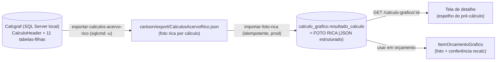

# Design — Cálculo Gráfico: Foto Rica + Conferência

## Objetivo

Tornar possível **reproduzir no Vizor qualquer orçamento do Calcgraf**, usando
os cálculos já migrados (ou novos). Isso significa trazer para o Vizor TODO o
detalhamento do pré-cálculo (hoje faltando: planos, suportes, tintas,
mat.acabamento, impressão, acabamentos, decomposição MD/CT/SE, CEV, margens) e
exibi-lo igual ao Calcgraf, com valores que batem 100% (são os do próprio
Calcgraf).

Resolve os 5 gaps identificados (Cliente, Planos, Acabamentos, Decomposição,
Suportes/tintas) de uma vez — todos vêm das tabelas-filhas do cálculo no
Calcgraf, já mapeadas (caso de prova: cálculo 11121 / ESAB).

## Arquitetura (ADITIVA — não toca motor, PCP, nem a estrutura existente)



Nada de novo no schema: a foto rica é gravada na coluna `resultado_calculo`
(Json, já existe, hoje nula nos migrados). O importador atualiza essa coluna
(idempotente). O frontend lê e renderiza.

## O formato da FOTO RICA (contrato do JSON)

Estrutura única, estável, que espelha o pré-cálculo do Calcgraf. Gravada em
`calculo_grafico.resultado_calculo`:

```ts
interface FotoRicaCalculo {
  versaoFoto: 2                      // 1 = foto simples antiga; 2 = rica
  origem: 'MIGRADO_CALCGRAF'
  cabecalho: {
    numeroCalcgraf: number
    cliente: string | null           // Nomes.RazaoSocial (CodNome), null = sem cliente
    contato?: string | null
    linhaProduto: string | null
    produto: string | null           // Produtos.Nome (tipo)
    descricao: string | null
    siglaAcabado: string | null
    formatoFinal?: string | null      // ex.: "68 x 68 x 360 mm"
    tiragem: number
    tributacao?: string | null        // ex.: "ICMS + IPI"
    dataCalculo?: string | null
  }
  planos: Array<{                     // CalculoPlanos
    nome: string                      // "Cartão"
    suporte: string | null            // "Stora Enzo Bobina 181" (resolvido)
    gramatura: number | null
    coresFV?: string | null           // "2x0 +V"
    formatoAberto?: string | null     // "284 x 488"
    formatoCorte?: string | null      // "1092 x 887"
    aproveitamento: number | null
    ocorrencias: number | null
    tiragem: number | null
    micro?: boolean
  }>
  suportes: Array<{                   // linhas SUPORTE do pré-cálculo (peso/kg)
    nome: string                      // "Stora Enzo Bobina 181"
    formato?: string | null           // "1092 x 887"
    folhas?: number | null
    quantidade?: number | null        // kg
    unidade?: string | null           // "KG"
    precoUnitario?: number | null
    subtotal?: number | null
  }>
  matriz?: { descricao: string; quantidade: number; precoUnitario: number; subtotal: number } | null
  tintas: Array<{                     // CalculoTintas
    nome: string                      // "IRO 18 - AMARELO" / "Escala" / "Preto"
    coberturaPercent: number | null
    quantidadeKg?: number | null
    precoUnitario?: number | null
    subtotal?: number | null
  }>
  matAcabamento: Array<{              // CalculoMatAcabamento + Itc.Descritivo
    nome: string                      // "Cola Branca (360 mm)"
    quantidade?: number | null
    unidade?: string | null
    precoUnitario?: number | null
    subtotal?: number | null
  }>
  impressao: Array<{                  // CalculoAtvImpressao + máquina
    descricao: string                 // "Offset Plana Heidelberg CD 5cores (Cartão)"
    cores?: string | null             // "5x0"
    horas?: number | null
    producaoHora?: number | null
    precoUnitario?: number | null     // custo/hora
    subtotal?: number | null
  }>
  acabamentos: Array<{                // CalculoAtividades tipo A/M + Atividades/Centros
    descricao: string                 // "Cortadeira (Grande)"
    centro?: string | null
    horas?: number | null
    producaoHora?: number | null
    precoUnitario?: number | null
    subtotal?: number | null
  }>
  itensDiversos?: Array<{ descricao: string; valor: number }>
  custos: {                           // decomposição (CalculoResAgrupamento)
    materialDireto: number            // MD
    custoTransformacao: number        // CT
    servicoExterno: number            // SE
    custoProducao: number             // C.PROD = MD + CT + SE (foto)
    creditoIcms?: number | null
    creditoIpi?: number | null
    creditoPisCofins?: number | null
    custoFinanceiro?: number | null
    total?: number | null             // TOTAL (C.PROD - créditos + fin)
  }
  cev?: {                             // CalculoTaxas
    icms?: number; juros?: number; pisCofins?: number; comissoes?: number
    totalPercent?: number             // ex.: 21,25%
  }
  margens: Array<{                    // CalculoTiragens/Margens — faixas
    margemPercent: number             // 10 / selecionada / 30
    cmPercent?: number | null
    valorUnitario: number
    valorTotal: number
    selecionada?: boolean
  }>
}
```

**Regra de ouro (anti-vergonha):** os valores da foto são EXATAMENTE os que o
Calcgraf gravou (não recalculamos na migração). Logo, exibir a foto bate 100%
com o pré-cálculo do Calcgraf — por definição.

## Mapeamento Calcgraf → Foto rica (validado no 11121)

| Seção da foto | Origem Calcgraf | Observação |
|---|---|---|
| cabecalho.cliente | `Nomes.RazaoSocial` via `CalculoHeader.CodNome` | null quando CodNome nulo/−1 |
| cabecalho.* | `CalculoHeader` + `CalculoAcabados` + `_LinhasProduto` + `Produtos` + tributação | |
| planos[] | `CalculoPlanos` (+ `Suportes.Nome`) | formato aberto/corte, gramatura, aprov. |
| suportes[] | `CalculoPlanos` + peso calculado OU linhas do resAgrupamento de MD | peso/kg/subtotal |
| matriz | `CalculoAtvImpressao`/`Itc` MATRIZ | qtd × preço |
| tintas[] | `CalculoTintas` (+ `Itc.Descritivo`) | cobertura %, Pantone |
| matAcabamento[] | `CalculoMatAcabamento` + `Itc.Descritivo` | |
| impressao[] | `CalculoAtvImpressao` + `CalculoAtividades` tipo I + `CentrosProducao` | horas, prod/h |
| acabamentos[] | `CalculoAtividades` tipo A/M + `Atividades` + `CentrosProducao` | horas (acerto+op), prod/h |
| custos | `CalculoResAgrupamento` (agrup 1=CT, 2=MD, 3=SE) | C.PROD = soma(fixo + unit×tiragem) |
| cev | `CalculoTaxas` (−7 comissão, 2 pis/cofins, etc.) | percentuais |
| margens[] | `CalculoTiragens` + `CalculoMargens` | faixas de margem |

> Os subtotais detalhados por linha (peso do papel, horas de cada acabamento,
> custo por linha) que aparecem no PDF vêm de campos derivados do Calcgraf. Onde
> o valor exato por linha não estiver numa coluna direta, extraímos o que há
> (quantidade, prod/hora, tempos) e marcamos como "detalhe informativo"; os
> AGREGADOS (MD/CT/SE/C.PROD/Valor Total/margens) vêm das tabelas de resultado
> (`CalculoResAgrupamento`/`CalculoTiragens`) e batem exato. A fidelidade
> obrigatória é nos agregados e na receita (planos/suportes/tintas/acabamentos
> nominais); os subtotais por linha são best-effort a partir do que o Calcgraf
> expõe.

## Camada 2 — Conferência ao recriar (anti-vergonha, Req 4)

Quando o operador usa um cálculo num orçamento:
- O item nasce com a FOTO (valores Calcgraf) — sempre exibível e correto.
- Em paralelo, o Vizor tenta recalcular com o motor (`calcularOrcamentoGrafico`)
  a partir da receita. A tela mostra duas colunas: **Calcgraf (foto)** ×
  **Vizor (recalc)** + **desvio %** por componente e total.
- ≤ 0,5% → "confere" (verde). > 0,5% ou recálculo impossível → alerta com
  motivo; o operador escolhe qual valor vai pra proposta (foto ou recalc).

Isso garante: ou mostra a foto exata, ou recalcula com o desvio visível ANTES
de enviar. Nunca surpresa na frente do cliente.

## Componentes

### Backend
- `scripts/exportar-calculos-acervo-rico.mjs` — exportador que, por cálculo
  (maior Codigo por NumCalculo, não cancelado), monta a `FotoRicaCalculo`
  completa via `sqlcmd -u` (UTF-16→UTF-8), resolvendo todos os nomes. Gera
  `cartoon/export/CalculosAcervoRico.json`.
- `src/modules/orcamento-grafico/calculo-grafico/foto-rica.types.ts` — o tipo
  `FotoRicaCalculo`.
- `src/modules/orcamento-grafico/calculo-grafico/foto-rica-import.service.ts` —
  grava/atualiza a foto rica em `resultado_calculo` por `(empresaId,
  numeroCalcgraf)`, idempotente, em lote.
- `scripts/importar-foto-rica-calcgraf.ts` — script de carga (dry-run, lotes,
  retry Neon), mesmo padrão do importador do acervo.
- Rota `GET /calculo-grafico/:id` já retorna `resultadoCalculo` — passa a conter
  a foto rica (nenhuma mudança de contrato).

### Frontend
- Tela de detalhe do cálculo (modal/página) renderiza a `FotoRicaCalculo` em
  seções (espelho do pré-cálculo) + botão "Imprimir/PDF".
- Conferência no item do orçamento: colunas Calcgraf × Vizor + desvio.

## Validação (Req 5)
1. Exportar + gravar a foto rica SÓ do 11121; conferir contra o PDF (planos,
   suportes, tintas, acabamentos, C.PROD 64.491,72, Valor Total 100.580,00,
   margens 10/15,93/30%).
2. Aprovado o 11121 → rodar a foto rica nos 7.951 (idempotente, prod, sem PCP).
3. Relatório: quantos receberam foto rica, quantos ficaram sem e por quê.

## Correctness Properties
- **P1 — Fidelidade dos agregados:** para todo cálculo, os agregados da foto
  (MD, CT, SE, C.PROD, Valor Total) são exatamente os do Calcgraf (tolerância 0
  — são os mesmos números da origem).
- **P2 — Completude da receita:** a foto contém todas as linhas de planos,
  tintas, mat.acabamento, impressão e acabamentos que existem no cálculo de
  origem (contagem conservada por seção).
- **P3 — Idempotência:** reprocessar a foto rica não duplica nem altera
  `numero`/`numeroCalcgraf`; só atualiza `resultado_calculo`.
- **P4 — Resiliência:** cálculo sem uma seção produz a seção vazia, sem erro; a
  carga não aborta por um cálculo com dado faltante.
- **P5 — Conferência visível:** ao recriar, o desvio foto×recalc é exibido por
  componente e total; ≤0,5% = confere; senão = alerta com motivo.
