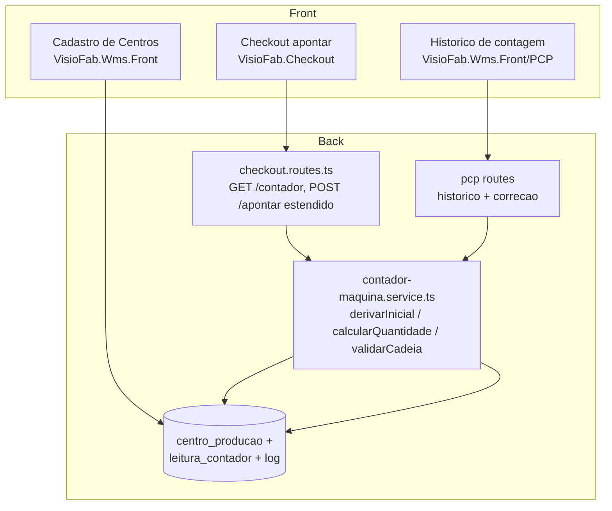
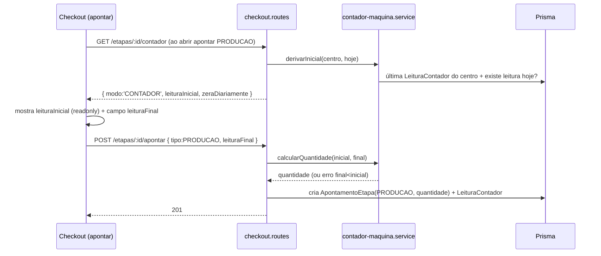

# Design — Contagem por Contador de Máquina (Checkout)

## Overview

Recurso aditivo ao Checkout e ao cadastro de Centros de Produção. Introduz um
**modo de contagem por centro** (`QUANTIDADE` | `CONTADOR`). No modo contador, a
Produção é apontada pela **leitura final do display**; a quantidade é derivada
(`final − inicial`), e a inicial vem automaticamente da última final (ou 0 no
1º apontamento do dia quando o centro zera diariamente). Nenhuma lógica
existente de apontamento por quantidade é alterada — o padrão continua
`QUANTIDADE`.

Alinhado ao padrão de MES de mercado (Sepasoft/Vorne/Industrial Shields): o
display é um **odômetro acumulativo** e a produção do intervalo = diferença
entre leituras; a última leitura é persistida para servir de base à próxima.

## Architecture

Camadas (todas aditivas, sem alterar o fluxo de quantidade digitada):



O motor de regra é puro (`contador-maquina.service.ts`), separado do I/O, para
teste isolado. As rotas do Checkout reaproveitam `buscarEtapaDoTerminal`
(isolamento multi-tenant já existente). A correção vive no ERP (perfil PCP),
não no terminal do operador.

## Data Models

### Extensão — `CentroProducao` (aditiva, idempotente)

```prisma
model CentroProducao {
  // ...campos existentes inalterados...
  /// QUANTIDADE (digitada, padrão) | CONTADOR (leitura do display)
  modoContagem            String  @default("QUANTIDADE") @map("modo_contagem") @db.VarChar(20)
  /// Só relevante em CONTADOR: display reseta no início do 1º turno do dia.
  contadorZeraDiariamente Boolean @default(false) @map("contador_zera_diariamente")
}
```

Migração (`migrate-prod.ts`, idempotente):
```sql
ALTER TABLE "centro_producao" ADD COLUMN IF NOT EXISTS "modo_contagem" VARCHAR(20) DEFAULT 'QUANTIDADE';
ALTER TABLE "centro_producao" ADD COLUMN IF NOT EXISTS "contador_zera_diariamente" BOOLEAN DEFAULT false;
```

### Novo — `LeituraContador`

Registro por apontamento em modo contador. Fonte do histórico e da derivação da
próxima inicial. Isolamento por `empresaId` (da OP/centro real).

```prisma
model LeituraContador {
  id                   String   @id @default(uuid())
  empresaId            String   @map("empresa_id")
  centroProducaoId     String   @map("centro_producao_id")
  etapaOrdemProducaoId String   @map("etapa_ordem_producao_id")
  apontamentoEtapaId   String?  @map("apontamento_etapa_id") // vínculo com o ApontamentoEtapa de PRODUCAO
  leituraInicial       Decimal  @map("leitura_inicial") @db.Decimal(14, 2)
  leituraFinal         Decimal  @map("leitura_final") @db.Decimal(14, 2)
  quantidade           Decimal  @db.Decimal(14, 2) // = final − inicial (>= 0)
  resetDoDia           Boolean  @default(false) @map("reset_do_dia") // inicial assumida 0 por zera-diário
  funcionarioId        String?  @map("funcionario_id")
  dataHora             DateTime @default(now()) @map("data_hora")
  criadoEm             DateTime @default(now()) @map("criado_em")
  atualizadoEm         DateTime @updatedAt @map("atualizado_em")

  @@index([empresaId])
  @@index([centroProducaoId, dataHora])
  @@index([etapaOrdemProducaoId])
  @@map("leitura_contador")
}
```

> **Decisão: "Último Contador do Centro" NÃO é tabela separada.** É derivado da
> `LeituraContador` mais recente do centro (`ORDER BY dataHora DESC LIMIT 1`).
> Evita um segundo estado para manter em sincronia (fonte única = o histórico).

### Novo — `LogLeituraContador` (auditoria de correção, Req 4.3)

```prisma
model LogLeituraContador {
  id                 String   @id @default(uuid())
  empresaId          String   @map("empresa_id")
  leituraContadorId  String   @map("leitura_contador_id")
  campo              String   @db.VarChar(30) // 'leituraInicial' | 'leituraFinal'
  valorAnterior      Decimal  @db.Decimal(14, 2)
  valorNovo          Decimal  @db.Decimal(14, 2)
  usuarioId          String?  @map("usuario_id")
  criadoEm           DateTime @default(now()) @map("criado_em")

  @@index([empresaId])
  @@index([leituraContadorId])
  @@map("log_leitura_contador")
}
```

## Lógica — derivação da inicial e cálculo (função pura testável)

Módulo novo `src/modules/checkout/contador-maquina.service.ts` (puro + I/O
separados), para testar a regra sem Prisma.

### Derivar a leitura inicial

```
derivarInicial({ ultimaLeituraFinalDoCentro, zeraDiariamente, jaTemLeituraHoje }):
  se zeraDiariamente E NÃO jaTemLeituraHoje  → 0        (1º do dia, display resetou)
  senão se ultimaLeituraFinalDoCentro != null → ultimaFinal
  senão → 0                                              (primeira vez do centro)
```

- "jaTemLeituraHoje" = existe `LeituraContador` do centro com `dataHora` na data
  civil local (America/Sao_Paulo) de hoje. "Hoje" calculado no servidor com
  offset -3h (mesmo padrão de `fmtDataHora` do CT-e/NF-e no projeto).

### Calcular quantidade

```
calcularQuantidade(inicial, final):
  se final < inicial → ERRO "Leitura final menor que a inicial" (sem rollover nesta fase)
  retorna final − inicial
```

### Validar consistência na correção (Req 4.4/4.5)

```
validarCadeia(leituras ordenadas por dataHora do centro):
  para cada par (anterior, atual):
    esperadoInicialAtual = atual.resetDoDia ? 0 : anterior.leituraFinal
    se atual.leituraInicial != esperadoInicialAtual → inconsistente (informar esperado)
    se atual.leituraFinal < atual.leituraInicial     → inconsistente (quantidade negativa)
```

Ao editar uma leitura pelo histórico, o service recalcula a cadeia e só grava se
`validarCadeia` passar; retorna o **valor esperado** quando bloqueia (Req 4.5).
A `quantidade` da leitura e o total da etapa são recalculados (Req 4.6) via o
mesmo caminho de ajuste de `EtapaOrdemProducao.quantidadeProduzida` já usado nos
apontamentos (diferença aplicada com `increment`/`decrement`).

## Fluxo de Apontamento (modo CONTADOR)



- A rota `POST /etapas/:id/apontar` passa a aceitar, para PRODUCAO em centro
  CONTADOR, `leituraFinal` em vez de `quantidade`. Backend deriva a inicial
  (nunca confia numa inicial vinda do cliente) e calcula a quantidade. Mantém
  compat.: se vier `quantidade` (modo quantidade), fluxo atual intacto.
- PERDA/RETRABALHO ignoram o modo contador (sempre `quantidade`).

## Components and Interfaces

### Backend
- `contador-maquina.service.ts` (novo): `derivarInicial`, `calcularQuantidade`,
  `validarCadeia`, `registrarLeitura`, `corrigirLeitura`, `historicoDoCentro`.
- `checkout.routes.ts`: `GET /etapas/:id/contador` (modo + inicial derivada);
  `POST /etapas/:id/apontar` estendida (aceita `leituraFinal`).
- Histórico/correção (perfil supervisor/PCP): `GET /pcp/centros/:id/contador/historico`,
  `PATCH /pcp/contador/leituras/:id` (correção + log + validação). Decisão:
  correção fica no ERP (perfil PCP/supervisor), não no terminal do operador.
- Testes: `contador-maquina.service.test.ts` (vitest + fast-check): derivação
  da inicial (com/sem zera-diário, 1ª vez), cálculo, consistência da cadeia.

### Frontend
- **Cadastro de Centros** (`VisioFab.Wms.Front .../pcp/cadastros/centros`):
  campos `modoContagem` (select) + `contadorZeraDiariamente` (switch, visível só
  em CONTADOR).
- **Checkout `apontar/page.tsx`**: quando `GET /contador` responde
  `modo:'CONTADOR'` e tipo = Produção, troca o campo "Quantidade" por "Leitura
  inicial" (readonly) + "Leitura final" (editável). Demais tipos inalterados.
- **Histórico de contagem** (ERP, PCP): tela/aba por centro listando as
  `LeituraContador`, com edição validada + exibição do valor esperado.

## Error Handling

- `leituraFinal < leituraInicial` no apontamento → `CheckoutError(400,
  "Leitura final menor que a inicial")` (sem rollover nesta fase).
- Correção no histórico que quebra a cadeia → `CheckoutError(409, ...)` com o
  **valor esperado** no corpo, sem gravar (o front mostra o esperado).
- Etapa/centro de outra empresa → 404 indistinguível (padrão do módulo).
- `GET /contador` para centro em modo QUANTIDADE → retorna `{ modo:'QUANTIDADE' }`
  e o front mantém o campo de quantidade (nenhum erro).

## Testing Strategy

- **Unit (vitest + fast-check)** no motor puro `contador-maquina.service.ts`:
  derivação da inicial (1ª vez, sequência, zera-diário), `calcularQuantidade`
  (incl. final<inicial e final=inicial), `validarCadeia` (consistente e
  inconsistente com valor esperado).
- **Não-regressão**: suíte do checkout/pcp deve seguir verde (centros
  QUANTIDADE inalterados).
- **QA manual**: centro CONTADOR com e sem zera-diário; correção pelo histórico
  bloqueando inconsistência; centro QUANTIDADE byte-a-byte igual.

## Correctness Properties

### Property 1: Cadeia contígua
Para leituras consecutivas do mesmo centro sem reset, a inicial de uma é igual à
final da anterior. **Validates: Requirements 3.1, 4.4**

### Property 2: Reset diário
A 1ª leitura de um dia num centro `zeraDiariamente` tem inicial 0
(`resetDoDia = true`), independente da final do dia anterior. **Validates: Requirements 3.2**

### Property 3: Quantidade não-negativa
Toda `LeituraContador` persistida tem `final >= inicial` ⇒ `quantidade >= 0`.
**Validates: Requirements 2.4, 2.5, 4.4**

### Property 4: Não-regressão quantidade
Centros `QUANTIDADE` produzem exatamente os mesmos `ApontamentoEtapa` de antes
(sem `LeituraContador`). **Validates: Requirements 1.3, 5.2**

### Property 5: Reconciliação
Soma das `quantidade` das `LeituraContador` de uma etapa = soma das quantidades
dos `ApontamentoEtapa` de PRODUCAO vinculados. **Validates: Requirements 2.3, 2.6, 4.6**

### Property 6: Isolamento multi-tenant
Nenhuma leitura/log de outra empresa é lido ou gravado. **Validates: Requirements 5.1**

## Migrações (idempotentes, no mesmo commit do schema)

- `ALTER TABLE centro_producao ADD COLUMN IF NOT EXISTS modo_contagem/contador_zera_diariamente`.
- `CREATE TABLE IF NOT EXISTS leitura_contador` + índices.
- `CREATE TABLE IF NOT EXISTS log_leitura_contador` + índices.
- Testar `npx tsx prisma/migrate-prod.ts` 2× local.
