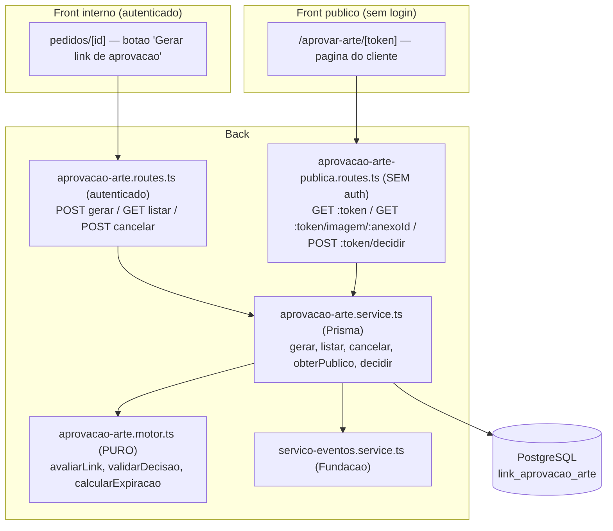

# Design Document — Aprovação de arte pelo cliente (link que expira)

## Overview

Frente 3 do fluxo comercial (item 4 da §20.4). Acrescenta um canal direto de
aprovação de arte pelo **cliente**, por meio de um **link público com token que
expira**. É **aditivo e não-regressivo**: reusa o `Servico_Eventos` e a máquina
de estados da Fundação (`comercial-pedido-status-fiel`) sem alterá-los, e o
registro manual de aprovação de arte continua existindo.

Fluxo:
1. Comercial/representante gera o link na tela do Pedido (interno, autenticado).
2. Envia o link por fora (WhatsApp/e-mail) — o sistema só gera a URL.
3. Cliente abre a **página pública** `/aprovar-arte/<token>` (sem login), vê as
   imagens de arte do pedido e **Aprova** ou **Pede ajuste** (com motivo).
4. Aprovar → registra aprovação de arte no Pedido (habilita `APROVADO`).
   Pedir ajuste → devolve o Pedido para a Pré-Impressão (nova rodada).

### Decisões de design

**D1 — Token opaco e não-enumerável.** `Token_Aprovacao` é um UUID v4 (mesma
escolha do `acompanhamento-cliente` do PCP). Vai na URL pública; não revela
nada do pedido. Índice único.

**D2 — Expiração calculada, não job.** O Link guarda `expiraEm` (criação + 7
dias). A expiração é verificada na leitura/decisão (função pura
`avaliarLink(status, expiraEm, agora)`), sem cron. Padrão idêntico ao
"cálculo esperto" já usado no projeto.

**D3 — Reuso do PENDENTE.** Gerar link quando já há um `PENDENTE` não expirado
retorna o mesmo token (evita múltiplos links válidos). "Gerar novo"
explícito cancela os `PENDENTE` anteriores e cria um novo (um único link válido
por vez por pedido).

**D4 — Decisão aciona o status fiel via Servico_Eventos (best-effort no status).**
A decisão do cliente é gravada **primeiro** no Link (fonte da evidência). Em
seguida, chama o Servico_Eventos: aprovar → `registrarEvento('APROVACAO_ARTE')`
+ grava `aprovacaoArteEm/Forma=CLIENTE_LINK` no Pedido; pedir ajuste →
`solicitarTransicao({ setor: PRE_IMPRESSAO, intencao: DEVOLVER })`. Se o pedido
estiver terminal, a decisão fica registrada no Link mas a transição não é
aplicada (Req 4.4). Falha de status é logada, não reverte a decisão do cliente
(Req 3.6).

**D5 — Página e imagens públicas só pelo token.** O GET público resolve o Pedido
pelo token e serve as imagens de arte (os `AnexoPedidoProposta`, binário já
existente) por uma rota pública parametrizada pelo token + id do anexo — sem
exigir JWT de usuário. Nenhum dado interno (custo/margem) é retornado.

**D6 — Idempotência da decisão.** Reenvio do POST com o mesmo token já decidido
retorna o estado atual sem duplicar eventos (o status do Link já não é
`PENDENTE`).

## Architecture



## Components and Interfaces

### Módulo PURO — `aprovacao-arte.motor.ts` (sem Prisma)

```ts
export type StatusLink = 'PENDENTE' | 'APROVADA' | 'AJUSTE_SOLICITADO' | 'CANCELADO'
export type DecisaoCliente = 'APROVADA' | 'AJUSTE_SOLICITADO'

export class AprovacaoArteError extends Error {
  constructor(public statusCode: number, message: string, public code: string) { super(message) }
}

export const VALIDADE_PADRAO_DIAS = 7

export function calcularExpiracao(criadoEm: Date, dias = VALIDADE_PADRAO_DIAS): Date

/** Estado efetivo do link considerando a expiração. */
export function avaliarLink(status: StatusLink, expiraEm: Date, agora: Date):
  { estado: 'PENDENTE' | 'EXPIRADO' | 'APROVADA' | 'AJUSTE_SOLICITADO' | 'CANCELADO' }

/** Valida se é possível decidir agora; lança AprovacaoArteError (410/409/400). */
export function validarDecisao(
  status: StatusLink, expiraEm: Date, agora: Date,
  decisao: DecisaoCliente, motivo?: string,
): void
```

Regras puras:
- `avaliarLink`: `PENDENTE` + `agora > expiraEm` ⇒ `EXPIRADO`; senão o próprio status.
- `validarDecisao`: expirado ⇒ 410 `LINK_EXPIRADO`; status ≠ `PENDENTE` ⇒ 409
  `LINK_JA_RESPONDIDO`; `AJUSTE_SOLICITADO` sem motivo (1..500 após trim) ⇒ 400
  `MOTIVO_OBRIGATORIO`.

### Service de I/O — `aprovacao-arte.service.ts` (Prisma, empresaId explícito)

```ts
gerarLink(empresaId, pedidoId, usuarioId, novo?: boolean): { token, url, expiraEm, reaproveitado }
listarLinks(empresaId, pedidoId): LinkResumo[]
cancelarLinksPendentes(empresaId, pedidoId, usuarioId): number
obterPublico(token): DadosPublicos            // resolve pedido+anexos; aplica avaliarLink
obterImagemPublica(token, anexoId): Buffer    // valida token, devolve binario do anexo
decidir(token, decisao, nome, motivo?, ip?): ResultadoDecisao
```

- `gerarLink`: resolve o Pedido por `{ id, empresaId }` (404 se não for da
  empresa); aplica D3 (reuso/cancelar+novo); grava Link; chama
  `registrarEvento('LINK_APROVACAO_GERADO')`. Monta a URL com a base pública
  (`PUBLIC_WEB_URL` do env, com fallback).
- `decidir`: carrega o Link pelo token; `validarDecisao`; grava
  status/decisão/evidência; dispara o status fiel (D4); idempotente (D6).

### Rotas

Internas — `aprovacao-arte.routes.ts` (prefixo `/api/orcamento-grafico`,
`authenticate` + `verificarPermissaoComercial('podeVerComercial')`):

| Método | Rota | Descrição |
|---|---|---|
| POST | `/pedidos-proposta/:id/link-aprovacao` | Gera (ou reusa) o link. `?novo=1` força novo. |
| GET | `/pedidos-proposta/:id/link-aprovacao` | Lista os links do pedido. |
| POST | `/pedidos-proposta/:id/link-aprovacao/cancelar` | Cancela os pendentes. |

Públicas — `aprovacao-arte-publica.routes.ts` (prefixo `/api/aprovar-arte`,
SEM authenticate):

| Método | Rota | Descrição |
|---|---|---|
| GET | `/:token` | Dados públicos do pedido + lista de imagens (metadados). |
| GET | `/:token/imagem/:anexoId` | Serve o binário da imagem de arte (por token). |
| POST | `/:token/decidir` | `{ decisao, nome, motivo? }` — aprova/pede ajuste. |

Registradas em `server.ts`: a interna junto das demais de orçamento-grafico; a
pública ao lado de `acompanhamentoClienteRoutes` (grupo público sem auth).

## Data Models

### Nova tabela `LinkAprovacaoArte` (schema.prisma)

```prisma
model LinkAprovacaoArte {
  id               String    @id @default(uuid())
  empresaId        String    @map("empresa_id")
  pedidoPropostaId String    @map("pedido_proposta_id")
  token            String    @unique @db.VarChar(40)       // UUID v4
  status           String    @default("PENDENTE") @db.VarChar(20) // PENDENTE|APROVADA|AJUSTE_SOLICITADO|CANCELADO
  expiraEm         DateTime  @map("expira_em")
  // Evidencia da decisao do cliente
  decididoEm       DateTime? @map("decidido_em")
  decididoNome     String?   @map("decidido_nome") @db.VarChar(160)
  decididoIp       String?   @map("decidido_ip") @db.VarChar(64)
  motivoAjuste     String?   @map("motivo_ajuste") @db.Text
  criadoPorId      String    @map("criado_por_id")
  criadoEm         DateTime  @default(now()) @map("criado_em")

  pedidoProposta PedidoProposta @relation(fields: [pedidoPropostaId], references: [id], onDelete: Cascade)

  @@index([empresaId, pedidoPropostaId])
  @@index([token])
  @@map("link_aprovacao_arte")
}
```

Relação inversa em `PedidoProposta`: `linksAprovacaoArte LinkAprovacaoArte[]`.

### `migrate-prod.ts` (idempotente)

```ts
await prisma.$executeRawUnsafe(`CREATE TABLE IF NOT EXISTS "link_aprovacao_arte" (
  "id" TEXT PRIMARY KEY, "empresa_id" TEXT NOT NULL, "pedido_proposta_id" TEXT NOT NULL,
  "token" VARCHAR(40) NOT NULL, "status" VARCHAR(20) NOT NULL DEFAULT 'PENDENTE',
  "expira_em" TIMESTAMP(3) NOT NULL, "decidido_em" TIMESTAMP(3), "decidido_nome" VARCHAR(160),
  "decidido_ip" VARCHAR(64), "motivo_ajuste" TEXT, "criado_por_id" TEXT NOT NULL,
  "criado_em" TIMESTAMP(3) NOT NULL DEFAULT CURRENT_TIMESTAMP
)`)
await prisma.$executeRawUnsafe(`CREATE UNIQUE INDEX IF NOT EXISTS "link_aprovacao_arte_token_key" ON "link_aprovacao_arte"("token")`)
await prisma.$executeRawUnsafe(`CREATE INDEX IF NOT EXISTS "link_aprovacao_arte_empresa_pedido_idx" ON "link_aprovacao_arte"("empresa_id","pedido_proposta_id")`)
// FK em try/catch (Postgres nao tem ADD CONSTRAINT IF NOT EXISTS)
```

Schema + migrate-prod no MESMO commit; rodar 2x local (ou roda no deploy).

## Front

### Interno — `pedidos/[id]/page.tsx` (estende a tela de detalhe da Fundação)

- Seção "Aprovação de arte do cliente": botão **Gerar link** (POST), exibe a URL
  com **CopyButton**, lista os links (status/validade/decisão). Botão "Gerar
  novo" chama `?novo=1`. Quando não há anexos de arte, mostra aviso (Req 6.2).

### Público — `src/app/(public)/aprovar-arte/[token]/page.tsx` (rota NOVA, sem login)

- Fora do grupo `(interna)` — não passa pelo guard de autenticação do ERP.
- `GET /api/aprovar-arte/:token`: renderiza as imagens (via
  `/api/aprovar-arte/:token/imagem/:anexoId`), os dados essenciais e os botões.
- Estados: válido (mostra botões), expirado (410), já respondido (409),
  inválido (404) → mensagem correspondente, sem botões.
- Aprovar: pede o nome do responsável; Pedir ajuste: nome + motivo obrigatório.
- Pós-decisão: confirmação e botões desabilitados.
- `api` público: usa `fetch`/axios sem Authorization (a página não tem sessão).

## Correctness Properties

| # | Propriedade | Req |
|---|---|---|
| P1 | `avaliarLink` idempotente e determinística | 7.1 |
| P2 | PENDENTE + agora>expira ⇒ EXPIRADO; senão status | 2.4/3.4 |
| P3 | `validarDecisao` rejeita expirado (410), decidido (409), ajuste sem motivo (400) | 3.3/3.4 |
| P4 | `calcularExpiracao` = criado + N dias (N=7 default) | 1.1 |

## Error handling

- Motor puro lança `AprovacaoArteError(status, msg, code)`.
- Rotas mapeiam para HTTP+code; ZodError → 400.
- Status fiel na decisão em try/catch (best-effort, Req 3.6).
- Público: mensagens neutras (não vaza existência do pedido).

## Testing Strategy

- Unit + property (`aprovacao-arte.motor.test.ts`): P1–P4 (vitest + fast-check).
- Integração com mock de Prisma (`aprovacao-arte.service.test.ts`): isolamento
  por empresaId na geração; idempotência da decisão; reuso de PENDENTE.
- Fumaça da migração: `npx tsx prisma/migrate-prod.ts` 2x.
- Verificação preferida: `get_diagnostics` nos arquivos tocados; `--reporter=dot`.

## Rastreabilidade

| Requisito | Onde |
|---|---|
| 1 Geração | `aprovacao-arte.routes.ts` + `gerarLink` + evento |
| 2 Página pública | `aprovacao-arte-publica.routes.ts` GET + `obterPublico`/`obterImagemPublica` |
| 3 Decisão | `aprovacao-arte-publica.routes.ts` POST + `decidir` + `validarDecisao` |
| 4 Integração status | `decidir` → Servico_Eventos |
| 5 Schema/migração | schema.prisma + migrate-prod.ts |
| 6 Front | `pedidos/[id]` + `aprovar-arte/[token]` |
| 7 Qualidade | motor puro + testes |
