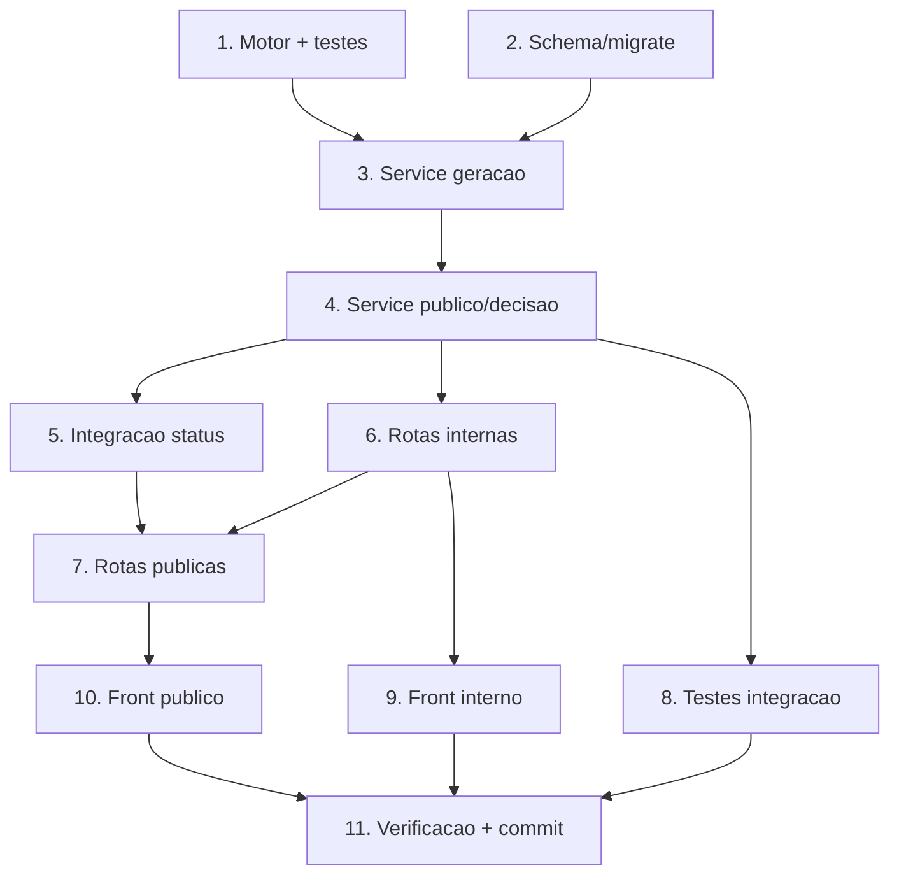

# Implementation Plan

## Overview

Frente 3: aprovação de arte pelo cliente via link com token que expira.
Ordem: motor puro + testes → schema/migração → service de I/O → rotas (interna
e pública) → integração com o status fiel → front interno → front público →
verificação/commit. Reusa o Servico_Eventos da Fundação sem alterá-lo.

## Tasks

- [x] 1. Motor puro `aprovacao-arte.motor.ts` + testes
  - Criar `src/modules/orcamento-grafico/pedido-proposta/aprovacao-arte.motor.ts` com `StatusLink`, `DecisaoCliente`, `AprovacaoArteError`, `VALIDADE_PADRAO_DIAS`, `calcularExpiracao`, `avaliarLink`, `validarDecisao` (puros).
  - Criar `aprovacao-arte.motor.test.ts` (vitest + fast-check) cobrindo P1–P4: idempotência de `avaliarLink`, expiração, rejeição de decisão (410/409/400), cálculo de expiração.
  - _Requirements: 7.1, 7.2, 2.4, 3.3, 3.4, 1.1_

- [x] 2. Schema Prisma + migrate-prod (tabela link_aprovacao_arte)
  - Adicionar model `LinkAprovacaoArte` ao `schema.prisma` + relação inversa em `PedidoProposta`; replicar `CREATE TABLE/INDEX IF NOT EXISTS` + FK try/catch no `migrate-prod.ts` (mesmo commit); `prisma generate`.
  - Testar `npx tsx prisma/migrate-prod.ts` 2x local (ou validar idempotência pelos IF NOT EXISTS).
  - _Requirements: 5.1, 5.2, 5.3, 5.4, 5.5_

- [x] 3. Service de I/O `aprovacao-arte.service.ts`
  - Implementar `gerarLink` (resolve pedido por empresaId→404; reuso de PENDENTE/`novo` cancela e recria; grava Link; evento LINK_APROVACAO_GERADO; monta URL com base pública), `listarLinks`, `cancelarLinksPendentes`.
  - empresaId EXPLÍCITO em toda query.
  - _Requirements: 1.1, 1.2, 1.3, 1.4, 1.5, 1.6, 1.7, 1.8, 3.8_

- [x] 4. Service de I/O — leitura pública e decisão
  - Implementar `obterPublico(token)` (dados públicos + metadados das imagens; aplica `avaliarLink`; nunca expõe custo/margem), `obterImagemPublica(token, anexoId)` (binário do anexo validando o token), `decidir(token, decisao, nome, motivo?, ip?)` (valida pelo motor; grava status/evidência; idempotente).
  - _Requirements: 2.1, 2.2, 2.3, 2.4, 2.5, 2.6, 3.1, 3.2, 3.3, 3.4, 3.6, 3.7_

- [x] 5. Integração da decisão com o status fiel (Servico_Eventos)
  - Em `decidir`: aprovar → registrarEvento('APROVACAO_ARTE', forma CLIENTE_LINK) + grava aprovacaoArteEm/Forma no Pedido; pedir ajuste → solicitarTransicao({ setor: PRE_IMPRESSAO, intencao: DEVOLVER }). Best-effort no status; se pedido terminal, grava decisão mas não transiciona.
  - _Requirements: 4.1, 4.2, 4.3, 4.4_

- [x] 6. Rotas internas `aprovacao-arte.routes.ts`
  - POST `/pedidos-proposta/:id/link-aprovacao` (gera/reusa; `?novo`), GET lista, POST cancelar; authenticate + `verificarPermissaoComercial('podeVerComercial')`; mapear AprovacaoArteError→HTTP+code; registrar no server.ts.
  - _Requirements: 1.1, 1.6, 1.8_

- [x] 7. Rotas públicas `aprovacao-arte-publica.routes.ts`
  - GET `/:token`, GET `/:token/imagem/:anexoId`, POST `/:token/decidir` SEM authenticate; prefixo `/api/aprovar-arte`; registrar no server.ts ao lado do acompanhamento público; mensagens neutras.
  - _Requirements: 2.1, 2.3, 2.4, 2.5, 2.6, 2.7, 3.1, 3.2, 3.3, 3.4, 3.5, 3.7_

- [x] 8. Testes de integração do service (mock de Prisma)
  - `aprovacao-arte.service.test.ts`: isolamento por empresaId na geração (404 cross-empresa), reuso de PENDENTE, idempotência da decisão (reenvio não duplica evento).
  - _Requirements: 7.3, 1.3, 1.4, 3.7_

- [x] 9. Front interno — seção de link na tela do pedido
  - Em `orcamento-grafico/pedidos/[id]/page.tsx`: botão "Gerar link de aprovação", exibir URL com CopyButton, listar links (status/validade/decisão), botão "Gerar novo"; aviso quando não há anexos de arte.
  - _Requirements: 6.1, 6.2_

- [x] 10. Front público — página de aprovação do cliente
  - Criar `src/app/(public)/aprovar-arte/[token]/page.tsx` (sem login): mostra imagens + dados essenciais + botões Aprovar / Pedir ajuste (motivo); trata expirado/respondido/inválido; confirmação pós-decisão; operável por teclado.
  - Garantir que o grupo de rota público não passa pelo guard de autenticação.
  - _Requirements: 6.3, 6.4, 6.5, 6.6_

- [x] 11. Verificação final e commit
  - Rodar testes (motor + integração); `get_diagnostics` limpo (back e front); `next build` do front; confirmar migrate-prod idempotente.
  - Commits separados (back: schema+migrate juntos; front à parte); não commitar configurador/produtos nem useProduto.
  - _Requirements: 5.1, 7.2, 7.3, 7.4_

## Task Dependency Graph

```json
{
  "waves": [
    { "wave": 1, "tasks": ["1", "2"] },
    { "wave": 2, "tasks": ["3"] },
    { "wave": 3, "tasks": ["4"] },
    { "wave": 4, "tasks": ["5", "6"] },
    { "wave": 5, "tasks": ["7", "8", "9"] },
    { "wave": 6, "tasks": ["10"] },
    { "wave": 7, "tasks": ["11"] }
  ]
}
```



## Notes

- Back e Front são repositórios separados. Tarefas 1–8 no Back; 9–10 no Front; 11 fecha os dois.
- `schema.prisma` + `migrate-prod.ts` sempre no mesmo commit; idempotente.
- Multi-tenant: empresaId explícito; público resolve por token.
- Reusa o Servico_Eventos da Fundação — não alterar a máquina de estados.
- Base pública da URL via env (`PUBLIC_WEB_URL`), com fallback.
- Scripts temporários com prefixo `_tmp-`, removidos após uso.
