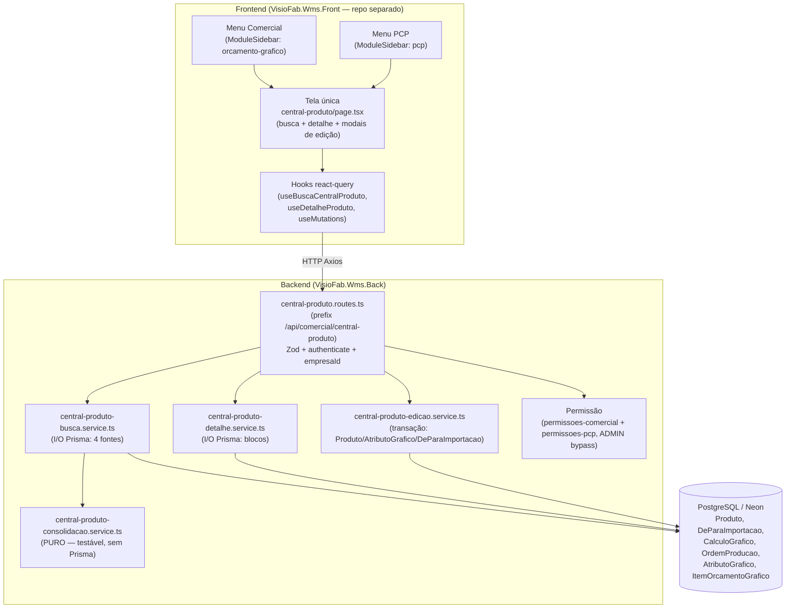
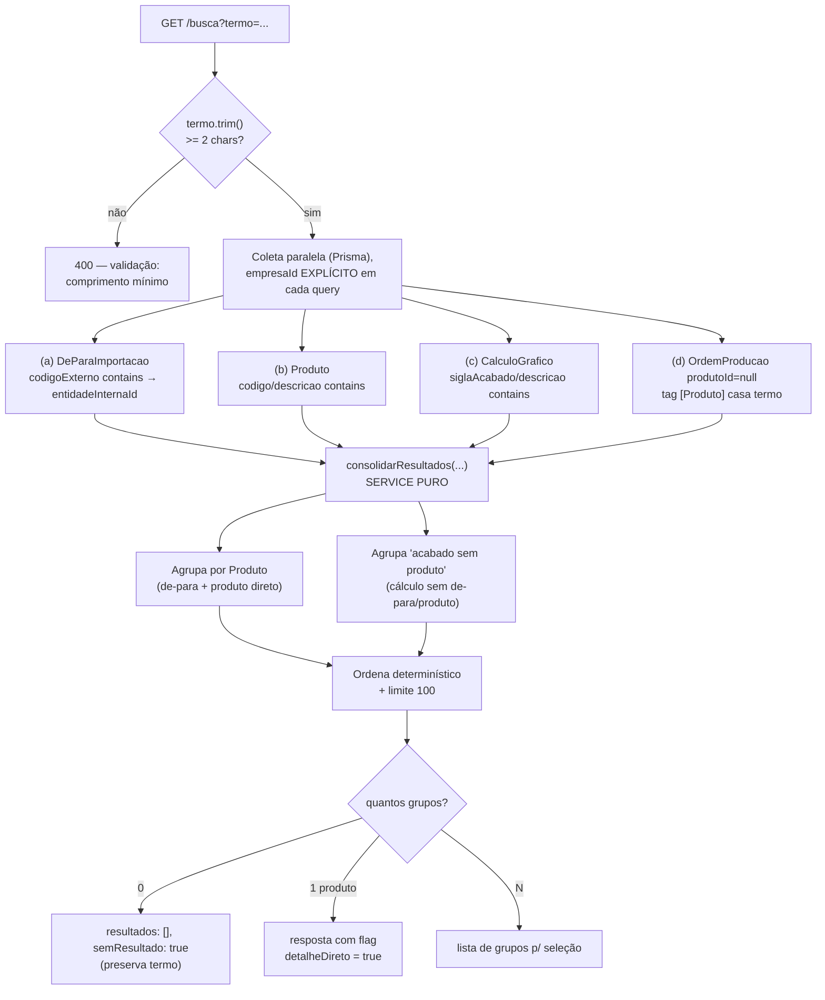

# Design Document

## Overview

A **Central de Consulta do Produto/Acabado** é uma tela de busca única (Comercial
e PCP) que consolida, a partir de um termo que pode ser um **Código de Acabado**
ou um **nome/descrição**, as informações de um produto/embalagem da Carton Wega:
identificação, arte, ficha técnica, histórico de OPs e cálculos/orçamentos — com
edição dos campos cadastrais (descrição, arte, ficha técnica e vínculos de código
de acabado).

A feature é **majoritariamente de leitura**, reutilizando entidades que **já
existem** no Vizor. **Decisão central de design: ZERO mudança de schema.** Todas
as informações necessárias já estão modeladas:

| Informação | Fonte reutilizada |
|---|---|
| Vínculo código acabado ↔ produto | `DeParaImportacao` (`tipoEntidade='PRODUTO'`, `sistemaOrigem='GPRINT'`) |
| Produto (código/descrição/arte/cliente) | `Produto` |
| Ficha técnica gráfica | `AtributoGrafico` + cadastros (`TipoCartao`/`TipoFormato`/`TipoGramatura`/`TipoPolicromia`/`TipoVerniz`/`TipoCor`) |
| Engenharia/medidas/arte de cálculo | `CalculoGrafico` (campo `siglaAcabado`, `medidas`, `resultadoCalculo`) |
| Histórico produtivo | `OrdemProducao` (por `produtoId` e por tag `[Produto]` em `observacoes`) |
| Cálculos/orçamentos | `CalculoGrafico` + `ItemOrcamentoGrafico` (`calculoGraficoOrigemId`) |
| Permissão de edição | `Parametro` `comercial.permissoes.<usuarioId>` + PCP, ADMIN bypass |

O backend expõe um **service de busca/consolidação PURO e testável** (lógica de
agrupamento sem Prisma), um **service de edição transacional**, rotas Fastify sob
`/api/comercial/central-produto` e schemas Zod. O frontend (`VisioFab.Wms.Front`,
repo separado) tem uma **tela única** reaproveitada nos dois módulos e um item de
menu em ambos (`orcamento-grafico` e `pcp`).

### Pesquisa e decisões de design

**Por que reutilizar `DeParaImportacao` e NÃO criar um campo `codigoAcabado` no
`Produto`?** (Req 13.3)

- Um produto tem **vários** códigos de acabado (OP 3.070 da NATIVITA tem 4294,
  4297, 4298). Um campo escalar no `Produto` não modela cardinalidade N; exigiria
  uma tabela filha nova — exatamente o que `DeParaImportacao` já é
  (`@@unique([empresaId, sistemaOrigem, tipoEntidade, codigoExterno])` garante
  unicidade do código de acabado por empresa).
- `DeParaImportacao` já é a fonte do vínculo usado pela importação de OP; manter
  uma única fonte evita divergência (dois lugares com o "código de acabado"
  dessincronizando).
- **Alternativa considerada e rejeitada:** adicionar `Produto.codigoAcabado` e/ou
  uma tabela `ProdutoCodigoAcabado`. Rejeitada porque (a) duplica o que
  `DeParaImportacao` já guarda, (b) obrigaria migração de schema + `migrate-prod.ts`
  e um backfill a partir do próprio `DeParaImportacao`, (c) a importação de OP
  continuaria gravando no `DeParaImportacao`, criando a necessidade de
  sincronização. O custo não se justifica: a leitura e a edição de vínculos sobre
  `DeParaImportacao` atendem todos os requisitos sem nova estrutura.

**Fallback "acabado sem produto".** Nem todo código de acabado tem `Produto`
cadastrado — o acervo migrado do Calcgraf vive em `CalculoGrafico.siglaAcabado`
sem `DeParaImportacao` correspondente. O design trata esses como um grupo de
resultado próprio ("acabado sem produto"), construído a partir do `CalculoGrafico`
(Req 1.3, 3.5, 4.3).

**Busca única.** Um único termo alimenta quatro fontes (de-para, produto,
cálculo, OP por tag) e os resultados são consolidados por produto (quando existe)
ou por acabado-sem-produto (Req 2.4). A consolidação é a parte com regra de
negócio não-trivial → é onde o PBT agrega valor (service puro).

## Architecture

### Diagrama de componentes



### Fluxo de busca e consolidação



### Camadas e responsabilidades

- **Rotas** (`central-produto.routes.ts`): validação Zod, `authenticate`,
  resolução de `empresaId`/perfil, avaliação de permissão de edição, tradução de
  erros de domínio → HTTP. Sem regra de negócio.
- **Service de busca** (`central-produto-busca.service.ts`): executa as 4 queries
  (empresaId explícito), monta os registros brutos e delega a consolidação ao
  service puro.
- **Service de consolidação** (`central-produto-consolidacao.service.ts`):
  **função pura** `consolidarResultados(entradas)` — recebe os 4 conjuntos já
  carregados e produz os grupos ordenados. É o alvo principal do PBT.
- **Service de detalhe** (`central-produto-detalhe.service.ts`): monta os blocos
  (Identificação, Arte, Ficha, OPs, Cálculos) de um produto/acabado selecionado.
- **Service de edição** (`central-produto-edicao.service.ts`): aplica alterações
  em `Produto`/`AtributoGrafico`/`DeParaImportacao` numa única transação, validando
  `empresaId` da entidade real.

## Components and Interfaces

### Backend — Service de consolidação (PURO)

Arquivo: `src/modules/comercial/central-produto/central-produto-consolidacao.service.ts`

```ts
/** Vínculo código acabado → produto (de DeParaImportacao). */
export interface DeParaAcabado {
  codigoExterno: string          // = Cód_Acabado
  nomeExterno: string
  produtoId: string              // = entidadeInternaId
}

/** Produto já carregado (campos de identificação). */
export interface ProdutoResumo {
  id: string
  codigo: string
  nome: string
  descricao: string | null
  imagemUrl: string | null
  clienteId: string | null
}

/** Cálculo gráfico (acervo) carregado para fallback/ficha. */
export interface CalculoResumo {
  id: string
  numero: number
  numeroCalcgraf: number | null
  siglaAcabado: string | null
  descricao: string | null
  produto: string | null
  clienteNome: string | null
}

/** OP com produtoId nulo cuja tag [Produto] casou o termo. */
export interface OpTagResumo {
  id: string
  numero: number
  produtoTag: string             // valor extraído de [Produto]
}

export interface EntradasConsolidacao {
  termoNormalizado: string       // trim + lower
  deParas: DeParaAcabado[]
  produtos: ProdutoResumo[]
  calculos: CalculoResumo[]
  opsSemProduto: OpTagResumo[]
}

/** Grupo de resultado — por Produto OU por acabado-sem-produto. */
export interface GrupoResultado {
  tipo: 'PRODUTO' | 'ACABADO_SEM_PRODUTO'
  chave: string                  // produtoId | 'calc:'+calculoId
  produtoId: string | null
  codigo: string | null          // Produto.codigo
  descricao: string | null
  codigosAcabado: string[]       // todos os Cód_Acabado do grupo (ordenados, sem repetição)
  semProdutoCadastrado: boolean  // Req 1.3 indicador
}

export interface ResultadoConsolidado {
  resultados: GrupoResultado[]
  semResultado: boolean          // Req 1.4 / 3.5
  detalheDireto: boolean         // Req 3.4 (exatamente 1 produto)
  limiteAplicado: boolean        // true se cortou em 100
}

/**
 * Consolida as 4 fontes em grupos determinísticos.
 * PURA (sem Prisma/IO). Alvo do property-based testing.
 */
export function consolidarResultados(
  e: EntradasConsolidacao,
  limite?: number,              // default 100
): ResultadoConsolidado
```

Regras da consolidação (determinísticas):

1. Todo `DeParaAcabado` e todo `Produto` casado mapeia para um grupo
   `tipo='PRODUTO'` chaveado por `produtoId` (um produto nunca aparece em dois
   grupos — Req 3.1/3.2). `codigosAcabado` reúne todos os `codigoExterno` dos
   de-paras daquele produto (ordenados asc, sem duplicatas).
2. Um `CalculoResumo` cujo `siglaAcabado` **não** aparece em nenhum
   `DeParaAcabado` e que não resolve para produto gera um grupo
   `tipo='ACABADO_SEM_PRODUTO'` (`semProdutoCadastrado=true`, Req 1.3/3.5).
3. Ordenação determinística: grupos `PRODUTO` primeiro, ordenados por `codigo`
   asc; depois `ACABADO_SEM_PRODUTO` por `siglaAcabado` asc; empate resolvido por
   `chave` asc (Req 3.3).
4. `semResultado = resultados.length === 0` (Req 1.4/3.5).
5. `detalheDireto = (há exatamente 1 grupo e ele é PRODUTO)` (Req 3.4).
6. `limiteAplicado = total > limite`; a lista é truncada após a ordenação (Req 1.1).

### Backend — Service de busca (I/O)

Arquivo: `src/modules/comercial/central-produto/central-produto-busca.service.ts`

```ts
export interface BuscaParams {
  empresaId: string              // EXPLÍCITO (multi-tenant)
  termo: string
}

/** Lança CentralProdutoError(400) se termo.trim() < 2 chars (Req 1.5). */
export async function buscarCentralProduto(
  p: BuscaParams,
): Promise<ResultadoConsolidado>
```

Executa (empresaId explícito em TODAS):
- `deParaImportacao.findMany` — `{ empresaId, sistemaOrigem:'GPRINT', tipoEntidade:'PRODUTO', codigoExterno: { contains, mode:'insensitive' } }`.
- `produto.findMany` — `{ empresaId, OR:[{codigo:{contains,insensitive}}, {descricao:{contains,insensitive}}, {nome:{contains,insensitive}}] }`.
- `calculoGrafico.findMany` — `{ empresaId, OR:[{siglaAcabado:{contains,insensitive}}, {descricao:{contains,insensitive}}] }`.
- `ordemProducao.findMany` — `{ empresaId, produtoId: null, observacoes: { contains: termo, mode:'insensitive' } }` + filtro fino pela tag `[Produto]` (regex) no pós-processamento. **`select` explícito SEM `pdfData`**.

Carrega também os `produtoId` referenciados pelos de-paras encontrados (para
resolver código/descrição do grupo).

### Backend — Service de detalhe (I/O)

Arquivo: `src/modules/comercial/central-produto/central-produto-detalhe.service.ts`

```ts
export interface DetalheParams {
  empresaId: string
  // um dos dois:
  produtoId?: string
  calculoId?: string             // fallback acabado-sem-produto
}

export interface DetalheProduto {
  identificacao: {
    produtoId: string | null
    codigo: string | null
    descricao: string | null
    codigosAcabado: string[]
    clienteNome: string | null
    semProdutoCadastrado: boolean
  }
  arte: { fonte: 'PRODUTO' | 'CALCULO' | 'NENHUMA'; imagemUrl: string | null }
  fichaTecnica: {
    temFicha: boolean
    atributoGrafico: FichaAtributos | null   // tipoCartao, formato, gramatura, policromia, verniz, cores
    engenhariaCalculo: FichaEngenharia | null // medidas, aproveitamento, cores do cálculo
  }
  historicoOps: OpHistorico[]    // somente leitura — SELECT sem pdfData
  calculos: CalculoHistorico[]   // somente leitura — CalculoGrafico + ItemOrcamentoGrafico
}

export async function obterDetalhe(p: DetalheParams): Promise<DetalheProduto>
```

Blocos (Req 4–8), empresaId explícito:
- **Identificação** (Req 4): de `Produto` + de-paras; cliente resolvido por
  `clienteId`; se vier de cálculo, usa `siglaAcabado`/`descricao`/`clienteNome`.
- **Arte** (Req 5): `Produto.imagemUrl` → fallback imagem do `CalculoGrafico`
  (`resultadoCalculo`/campo de foto) → `NENHUMA`.
- **Ficha** (Req 6): `AtributoGrafico` (1:1 por `[empresaId, produtoId]`) + nomes
  dos cadastros gráficos; e/ou engenharia do `CalculoGrafico` (`medidas`, cores,
  aproveitamento).
- **Histórico de OPs** (Req 7): `OrdemProducao` por `produtoId` **união** OPs
  `produtoId=null` cuja tag `[Produto]` casa a descrição do produto. **`select`
  explícito sem `pdfData`** (steering: nunca materializar BYTEA). Somente leitura.
- **Cálculos** (Req 8): `CalculoGrafico` do produto/acabado + `ItemOrcamentoGrafico`
  com `calculoGraficoOrigemId` nesses cálculos. Somente leitura.

### Backend — Service de edição (transacional)

Arquivo: `src/modules/comercial/central-produto/central-produto-edicao.service.ts`

```ts
export interface EdicaoParams {
  empresaId: string
  produtoId: string
  descricao?: string                      // 1..200
  imagemUrl?: string | null               // 1..500 quando presente
  fichaTecnica?: {                        // upsert/limpa AtributoGrafico
    tipoCartaoId?: string | null
    tipoFormatoId?: string | null
    tipoGramaturaId?: string | null
    tipoPolicromiaId?: string | null
    tipoVernizId?: string | null
    tipoCoresIds?: string[]
  }
  adicionarAcabados?: string[]            // novos codigoExterno
  removerAcabados?: string[]              // codigoExterno a remover
}

/** Erro de domínio (statusCode mapeado pela rota). */
export class CentralProdutoError extends Error {
  constructor(message: string, public statusCode = 400) { super(message) }
}

/**
 * Aplica TODAS as alterações numa única $transaction.
 * - Valida que o Produto pertence a empresaId (senão 404/403).
 * - Produto.descricao / imagemUrl.
 * - AtributoGrafico upsert por [empresaId, produtoId].
 * - DeParaImportacao add (create, 409 em duplicado) / remove (deleteMany por empresaId).
 * NÃO toca OrdemProducao/CalculoGrafico/ItemOrcamentoGrafico (Req 9.4).
 * Rollback total em falha (Req 9.5).
 */
export async function aplicarEdicao(p: EdicaoParams): Promise<DetalheProduto>
```

### Backend — Rotas

Arquivo: `src/modules/comercial/central-produto/central-produto.routes.ts`
Prefixo (proposto): **`/api/comercial/central-produto`** — namespace novo,
neutro em relação a módulo (a mesma rota serve Comercial e PCP; Req 12.3). Hook
`authenticate`. (Não usa `moduloGuard` fixo de um módulo único, para ser acessível
pelos dois; a permissão de edição é verificada no handler de escrita.)

| Método | Rota | Descrição | Permissão |
|---|---|---|---|
| GET | `/busca?termo=` | Busca única consolidada (Req 1,2,3) | leitura (autenticado) |
| GET | `/detalhe?produtoId=` \| `?calculoId=` | Detalhe consolidado (Req 4–8) | leitura |
| GET | `/permissao` | Retorna `{ podeEditar }` p/ o front mostrar/ocultar edição | leitura |
| PATCH | `/produto/:produtoId` | Edição transacional (Req 9) | `podeEditar` |

`podeEditar` = `perfil ∈ {ADMIN, SUPER_ADMIN}` **OU**
`verificarPermissaoComercial(empresaId, userId, perfil, 'podeEditarCadastros')`
**OU** a permissão equivalente do PCP (`getPermissoes(...).podeEditarCadastros`
quando existir; hoje o PCP não tem essa flag, então o critério efetivo é ADMIN +
flag do Comercial). Default liberado (não-regressão), igual aos dois módulos.

### Schemas Zod

```ts
const buscaQuerySchema = z.object({
  termo: z.string().min(1),      // o "min 2 após trim" é validado no service (Req 1.5)
})

const detalheQuerySchema = z.object({
  produtoId: z.string().uuid().optional(),
  calculoId: z.string().uuid().optional(),
}).refine(d => !!d.produtoId !== !!d.calculoId, 'Informe produtoId OU calculoId')

const edicaoBodySchema = z.object({
  descricao: z.string().min(1).max(200).optional(),
  imagemUrl: z.string().min(1).max(500).nullable().optional(),
  fichaTecnica: z.object({
    tipoCartaoId: z.string().uuid().nullable().optional(),
    tipoFormatoId: z.string().uuid().nullable().optional(),
    tipoGramaturaId: z.string().uuid().nullable().optional(),
    tipoPolicromiaId: z.string().uuid().nullable().optional(),
    tipoVernizId: z.string().uuid().nullable().optional(),
    tipoCoresIds: z.array(z.string().uuid()).optional(),
  }).optional(),
  adicionarAcabados: z.array(z.string().min(1).max(100)).optional(),
  removerAcabados: z.array(z.string().min(1).max(100)).optional(),
})
```

### Frontend — Componentes

Repo `VisioFab.Wms.Front` (Next.js 15 App Router + Mantine 7 + react-query +
Axios). Rota única `app/(interna)/comercial/central-produto/page.tsx`
(reaproveitada pelos dois módulos — Req 12.3).

- **Tela de busca + detalhe** (`page.tsx`): campo de busca (debounce) →
  `useBuscaCentralProduto`. Se `detalheDireto`, abre o detalhe direto; se N grupos,
  lista selecionável; se `semResultado`, mensagem preservando o termo.
- **Detalhe consolidado**: blocos Identificação, Arte, Ficha Técnica, Histórico de
  OPs (tabela só leitura), Cálculos/Orçamentos (tabela só leitura).
- **Modais de edição** (visíveis só quando `podeEditar`): editar descrição/arte;
  editar ficha técnica (selects dos cadastros gráficos); gerenciar vínculos de
  código acabado (adicionar/remover chips).
- **Itens de menu** no `ModuleSidebar.tsx`, nas DUAS chaves:
  - `'orcamento-grafico'` (Comercial): item "Central do Produto" →
    `/comercial/central-produto`.
  - `'pcp'` (PCP): item "Central do Produto" → `/comercial/central-produto`
    (mesma rota; `detectModule` mantém o destaque conforme a origem; aceitável
    reutilizar a rota do Comercial, Req 12.3).

Hooks react-query (`src/hooks/central-produto/`):
- `useBuscaCentralProduto(termo)` — `GET /busca` (enabled quando `termo.trim().length >= 2`).
- `useDetalheProduto({ produtoId | calculoId })` — `GET /detalhe`.
- `usePermissaoCentralProduto()` — `GET /permissao`.
- `useEditarProduto()` — `PATCH /produto/:id` + `invalidateQueries` do detalhe.

## Data Models

**Nenhuma tabela nova. Nenhuma coluna nova. Nenhuma migração.** (Req 13.3/13.4)

Mapa de qual entidade existente alimenta cada bloco:

| Bloco / dado | Entidade (campos) | Filtro multi-tenant |
|---|---|---|
| Busca por código acabado | `DeParaImportacao` (`codigoExterno`, `nomeExterno`, `entidadeInternaId`) com `sistemaOrigem='GPRINT'`, `tipoEntidade='PRODUTO'` | `empresaId` explícito |
| Busca por nome | `Produto` (`codigo`, `nome`, `descricao`) | `empresaId` explícito |
| Fallback acabado-sem-produto | `CalculoGrafico` (`siglaAcabado`, `descricao`, `produto`, `clienteNome`, `numero`, `numeroCalcgraf`) | `empresaId` explícito |
| Busca OP por tag | `OrdemProducao` (`produtoId=null`, `observacoes` tag `[Produto]`) — SELECT sem `pdfData` | `empresaId` explícito |
| Identificação | `Produto` + `DeParaImportacao` + cliente (`clienteId`) | `empresaId` explícito |
| Arte | `Produto.imagemUrl` → `CalculoGrafico` (imagem em `resultadoCalculo`) | `empresaId` explícito |
| Ficha técnica | `AtributoGrafico` (`[empresaId, produtoId]`) + `TipoCartao`/`TipoFormato`/`TipoGramatura`/`TipoPolicromia`/`TipoVerniz`/`TipoCor`; engenharia de `CalculoGrafico.medidas`/`cores` | `empresaId` explícito (AtributoGrafico isola via produto do mesmo empresaId) |
| Histórico de OPs | `OrdemProducao` por `produtoId` + por tag `[Produto]` — SELECT sem `pdfData` | `empresaId` explícito |
| Cálculos/orçamentos | `CalculoGrafico` + `ItemOrcamentoGrafico` (`calculoGraficoOrigemId`) | `empresaId` explícito em ambos |
| Edição descrição/arte | `Produto` (`descricao`, `imagemUrl`) | valida `empresaId` da entidade real |
| Edição ficha | `AtributoGrafico` (upsert `[empresaId, produtoId]`) | valida `empresaId` do produto |
| Edição vínculos | `DeParaImportacao` (create/delete) | valida `empresaId` do produto/registro |

Observações sobre `DeParaImportacao` como vínculo de código acabado:
- `codigoExterno` = o Cód_Acabado; `entidadeInternaId` = `Produto.id`;
  `nomeExterno` = rótulo livre (pode receber a descrição do produto na criação).
- A unicidade `@@unique([empresaId, sistemaOrigem, tipoEntidade, codigoExterno])`
  já impede dois produtos reivindicarem o mesmo código de acabado na mesma empresa
  → a validação de "vínculo duplicado" (Req 9.7) é o erro `P2002` traduzido em 409.

## Correctness Properties

*Uma propriedade é uma característica ou comportamento que deve valer para todas
as execuções válidas do sistema — uma afirmação formal sobre o que o software
deve fazer. As propriedades são a ponte entre a especificação legível por humanos
e as garantias de correção verificáveis por máquina.*

As propriedades abaixo incidem sobre as funções **puras e testáveis** da feature:
o service de consolidação (`consolidarResultados`), a validação do termo e da
edição, a seleção de arte/ficha, o casamento pela tag `[Produto]`, a função de
permissão e o não-vazamento multi-tenant (verificado com repositório mockado). A
camada de I/O (consultas Prisma, transação, tempo de resposta) é coberta por
testes de integração/exemplo (ver Testing Strategy).

### Property 1: Validação do termo de busca

*Para qualquer* string de termo cujo valor, após remoção de espaços no início e
no fim, tenha menos de 2 caracteres (incluindo string vazia ou composta só de
espaços), a busca SHALL ser rejeitada com erro de validação e nenhuma consulta
SHALL ser executada; e *para qualquer* termo com 2 ou mais caracteres após o trim,
a busca SHALL prosseguir.

**Validates: Requirements 1.5**

### Property 2: Agrupamento único por produto

*Para qualquer* conjunto de vínculos de código acabado e produtos casados, cada
`produtoId` SHALL aparecer em no máximo um grupo de resultado, e o `codigosAcabado`
desse grupo SHALL conter exatamente o conjunto (ordenado e sem duplicatas) de
todos os códigos de acabado associados àquele produto.

**Validates: Requirements 3.1, 3.2, 2.4**

### Property 3: Fallback de acabado sem produto

*Para qualquer* conjunto de cálculos e vínculos, todo cálculo cujo `siglaAcabado`
não corresponda a nenhum vínculo de código acabado e que não resolva para um
produto SHALL gerar um grupo do tipo `ACABADO_SEM_PRODUTO` com o indicador
`semProdutoCadastrado = true`, e nenhum grupo do tipo `PRODUTO` SHALL ter esse
indicador verdadeiro.

**Validates: Requirements 1.3, 3.5**

### Property 4: Ausência de resultados

*Para qualquer* execução da consolidação, `semResultado` SHALL ser verdadeiro se
e somente se a lista de resultados estiver vazia.

**Validates: Requirements 1.4, 3.5**

### Property 5: Ordenação determinística e limite

*Para qualquer* conjunto de entradas, consolidar as entradas e consolidar
qualquer permutação das mesmas entradas SHALL produzir exatamente a mesma
sequência de grupos (mesmas chaves, na mesma ordem); e o número de grupos
retornados SHALL ser no máximo o limite (100), com `limiteAplicado` verdadeiro se
e somente se o total antes do corte exceder o limite.

**Validates: Requirements 3.3, 1.1**

### Property 6: Detalhe direto com produto único

*Para qualquer* execução da consolidação, `detalheDireto` SHALL ser verdadeiro se
e somente se houver exatamente um grupo e esse grupo for do tipo `PRODUTO`.

**Validates: Requirements 3.4**

### Property 7: Prioridade da fonte de arte

*Para qualquer* combinação de presença/ausência de `Produto.imagemUrl` e de imagem
do cálculo, a fonte de arte resolvida SHALL ser `PRODUTO` quando houver
`imagemUrl` do produto; `CALCULO` quando não houver imagem do produto mas houver
imagem do cálculo; e `NENHUMA` quando nenhuma das duas existir.

**Validates: Requirements 5.1, 5.2, 5.3**

### Property 8: Indicador de ficha técnica

*Para qualquer* combinação de presença/ausência de `AtributoGrafico` e de
engenharia de cálculo, o indicador `temFicha` SHALL ser verdadeiro se e somente se
ao menos uma dessas fontes estiver presente.

**Validates: Requirements 6.3**

### Property 9: Extração e casamento pela tag `[Produto]`

*Para qualquer* texto de `observacoes` contendo uma tag `[Produto] <valor>`, a
extração SHALL recuperar `<valor>` (sem espaços nas bordas); e *para qualquer*
conjunto de OPs com `produtoId` nulo, uma OP SHALL ser associada a um produto se e
somente se o valor normalizado (trim + case-insensitive) da sua tag `[Produto]`
corresponder à descrição normalizada daquele produto.

**Validates: Requirements 2.3, 7.2**

### Property 10: Validação dos campos de edição

*Para qualquer* entrada de edição, a alteração SHALL ser rejeitada quando a
`descricao` informada tiver comprimento fora de 1..200, quando a `imagemUrl`
informada (não nula) tiver comprimento fora de 1..500, ou quando a lista de
códigos de acabado a adicionar contiver duplicata (entre si ou com um vínculo já
existente); e SHALL ser aceita quando todos os campos informados estiverem dentro
dos limites e sem duplicidade.

**Validates: Requirements 9.1, 9.7**

### Property 11: Decisão de permissão de edição

*Para qualquer* combinação de perfil e flags de permissão, `permitirEdicao` SHALL
ser verdadeiro quando o perfil for ADMIN ou SUPER_ADMIN (independentemente das
flags), e caso contrário SHALL refletir a flag `podeEditarCadastros` (do Comercial
e/ou do PCP), com a consulta de leitura sempre permitida independentemente da
permissão de edição.

**Validates: Requirements 9.6, 10.1, 10.2, 10.3, 10.4**

### Property 12: Não-vazamento multi-tenant na leitura

*Para qualquer* conjunto de dados de duas empresas distintas A e B (inclusive com
códigos de acabado ou nomes de produto idênticos), uma busca executada no contexto
da empresa A — inclusive quando o usuário é SUPER_ADMIN — SHALL retornar somente
grupos cujas entidades pertencem a A, nunca entidades de B.

**Validates: Requirements 11.1, 11.2, 11.3**

### Property 13: Não-vazamento multi-tenant na escrita

*Para qualquer* tentativa de edição de uma entidade (Produto, AtributoGrafico ou
vínculo DeParaImportacao) que pertença a uma empresa diferente da empresa do
usuário, a operação SHALL ser rejeitada e nenhuma gravação SHALL ocorrer.

**Validates: Requirements 11.4**

## Error Handling

- **Validação de termo (Req 1.5):** `buscarCentralProduto` lança
  `CentralProdutoError(400)` quando `termo.trim().length < 2`. A rota traduz em
  HTTP 400 com `{ campo: 'termo', motivo: 'mínimo de 2 caracteres' }`. Nenhuma
  query é executada.
- **Validação Zod (Req 9.7):** body/query inválidos → 400 com mensagem
  "campo: motivo" (mesmo padrão `formatarErroZod` já usado em CT-e/orçamento).
- **Vínculo de código acabado duplicado (Req 9.7):** `create` em
  `DeParaImportacao` que viole `@@unique([empresaId, sistemaOrigem, tipoEntidade,
  codigoExterno])` captura `P2002` → `CentralProdutoError(409)` "código de acabado
  já vinculado".
- **Permissão ausente (Req 9.6/10.2):** handler de escrita verifica `podeEditar`
  antes de qualquer gravação; se falso → 403 "sem permissão para editar cadastros",
  valor anterior intacto.
- **Isolamento multi-tenant (Req 11.4):** a edição resolve o produto por
  `findFirst({ where: { id, empresaId } })`; se não encontrado (ou de outra
  empresa) → 404 (sem revelar existência cross-tenant), nenhuma gravação.
- **Rollback transacional (Req 9.5):** toda a edição roda numa única
  `prisma.$transaction`; qualquer erro aborta a transação inteira, preservando o
  estado anterior; a rota devolve 400/409/500 conforme o erro, com mensagem.
- **Detalhe não encontrado:** `produtoId`/`calculoId` inexistente ou de outra
  empresa → 404.
- **Performance/BYTEA:** toda leitura de `OrdemProducao` usa `select` explícito
  **sem `pdfData`** (steering pcp-modulo §9.1) — evita materializar BYTEA.
- **Conteúdo não confiável:** `observacoes` é dado livre; a extração por regex é
  defensiva (retorna `null` quando a tag não existe) e o valor é tratado só como
  texto (sem interpretação/execução).

## Multi-tenant Isolation

Segue rigorosamente o steering `ATENCAO-pontos-verificar` §1/§2.1: **filtro
`empresaId` EXPLÍCITO em toda query**, nunca confiando apenas no `prismaScoped`
(bypass SUPER_ADMIN).

| Entidade | Como isola |
|---|---|
| `DeParaImportacao` | `where.empresaId = empresaId` (do usuário/sessão) |
| `Produto` | `where.empresaId = empresaId` |
| `CalculoGrafico` | `where.empresaId = empresaId` |
| `OrdemProducao` | `where.empresaId = empresaId` (entidade tem coluna própria) |
| `AtributoGrafico` | filha de `Produto`; leitura por `{ empresaId, produtoId }` (tem `empresaId` próprio no `@@unique`) |
| `ItemOrcamentoGrafico` | tem `empresaId` denormalizado → `where.empresaId` + `calculoGraficoOrigemId ∈` cálculos da empresa |
| cadastros gráficos (`TipoCartao`...) | `where.empresaId` ao resolver nomes da ficha |

Na **escrita**, o `empresaId` validado é o da **entidade real** (o `Produto`
resolvido por `{ id, empresaId }`), não simplesmente o do usuário — e o
`AtributoGrafico`/`DeParaImportacao` gravados herdam esse `empresaId`. Produto de
outra empresa ⇒ 404, sem gravação (Req 11.4). SUPER_ADMIN **não** faz bypass:
todas as queries recebem o `empresaId` da empresa selecionada na sessão
(Req 11.2). O service de consolidação é puro e só recebe dados já filtrados; a
propriedade de não-vazamento (Property 12) é testada com repositório mockado que
confirma que todas as queries recebem o `empresaId` correto e que nenhum dado de
outra empresa entra no resultado.

## Testing Strategy

Abordagem dual (testes de propriedade + testes de exemplo/integração), conforme o
padrão de PBT do projeto (Vitest + **fast-check**).

### Property-based tests (fast-check)

Alvo: as funções **puras** descritas nas Correctness Properties, extraídas para
módulos sem Prisma:
- `central-produto-consolidacao.service.ts` — Properties 2, 3, 4, 5, 6.
- `central-produto-validacao.ts` (termo + edição) — Properties 1, 10.
- `central-produto-arte-ficha.ts` (seleção de arte/ficha) — Properties 7, 8.
- `central-produto-tag.ts` (extração/casamento `[Produto]`) — Property 9.
- `central-produto-permissao.ts` (`permitirEdicao`) — Property 11.
- não-vazamento (Properties 12, 13) — teste com **repositório mockado**
  (gerador de dados de 2 empresas) verificando que o resultado nunca contém
  entidades da empresa B e que toda query recebeu o `empresaId` de A.

Requisitos dos testes de propriedade:
- Mínimo **100 iterações** por propriedade (`fc.assert(..., { numRuns: 100 })`).
- Cada teste anotado com o comentário:
  `// Feature: comercial-central-produto-acabado, Property {N}: {texto da propriedade}`.
- Cada propriedade implementada por **um único** teste de propriedade.
- Geradores cobrem edge cases: termos só-espaços, acentuação/case misto,
  descrições duplicadas entre produtos, múltiplos códigos por produto, listas
  vazias, códigos idênticos entre empresas, permutações das entradas.

### Unit tests (exemplos e edge cases)

- Montagem dos blocos de detalhe (Req 4.1/4.2/4.3, 6.1/6.2, 8.4): exemplos com
  produto completo, produto sem cliente, acabado-sem-produto, ficha vazia,
  cálculos vazios.
- Matching case-insensitive/substring (Req 1.2, 2.1, 2.2): exemplos de integração.
- `select` de `OrdemProducao` sem `pdfData` (Req 7.3): exemplo verificando que o
  campo não é selecionado.

### Integration tests

- Edição transacional (Req 9.2/9.3/9.5): adicionar/remover vínculo + editar
  descrição/ficha numa transação; forçar erro no meio e confirmar rollback total.
- Permissão (Req 9.6/10.2): usuário sem flag recebe 403 e nada é gravado.
- Isolamento na escrita (Req 11.4): editar produto de outra empresa ⇒ 404.
- Não-regressão (Req 13.1/13.2): verificar que a feature não importa/altera o
  motor de cálculo nem o fluxo de importação de OP (revisão + ausência de escrita
  nessas entidades).

### Frontend

- Testes de componente/hook (react-query) para busca com `detalheDireto`, lista de
  N grupos e `semResultado` preservando o termo; modais de edição ocultos quando
  `podeEditar=false`. Sem PBT no frontend (UI/render).

## Rastreabilidade (Requisito → Componente)

| Requisito | Componente(s) | Propriedade/Teste |
|---|---|---|
| 1.1 busca por acabado, ≤100 | `busca.service` + `consolidacao.service` | Property 5 |
| 1.2 case-insensitive/parcial | `busca.service` (Prisma `contains`) | Exemplo |
| 1.3 fallback cálculo sem de-para | `consolidacao.service` | Property 3 |
| 1.4 nenhum resultado | `consolidacao.service` | Property 4 |
| 1.5 termo < 2 chars | `validacao.ts` / `busca.service` | Property 1 |
| 2.1/2.2 busca por nome | `busca.service` (Prisma) | Exemplo |
| 2.3 nome na tag [Produto] | `tag.ts` + `consolidacao.service` | Property 9 |
| 2.4 busca única (união) | `consolidacao.service` | Property 2 |
| 3.1/3.2 agrupamento por produto | `consolidacao.service` | Property 2 |
| 3.3 ordem determinística | `consolidacao.service` | Property 5 |
| 3.4 detalhe direto | `consolidacao.service` | Property 6 |
| 3.5 nenhum resultado | `consolidacao.service` | Property 4 |
| 4.1/4.2/4.3 identificação | `detalhe.service` | Exemplo |
| 5.1/5.2/5.3 arte | `arte-ficha.ts` | Property 7 |
| 6.1/6.2 ficha | `detalhe.service` | Exemplo |
| 6.3 indicador ficha | `arte-ficha.ts` | Property 8 |
| 7.1 OPs por produtoId | `detalhe.service` | Exemplo |
| 7.2 OPs por tag | `tag.ts` + `detalhe.service` | Property 9 |
| 7.3 OPs só leitura / sem pdfData | `detalhe.service` | Exemplo |
| 7.4 histórico por acabado | `detalhe.service` | Exemplo |
| 8.1/8.2 cálculos e orçamentos | `detalhe.service` | Exemplo |
| 8.3 só leitura | `detalhe.service` | Exemplo/revisão |
| 8.4 sem cálculos | `detalhe.service` | Edge case |
| 9.1 editar descr/arte/ficha | `edicao.service` + `validacao.ts` | Property 10 |
| 9.2 add/remove vínculos | `edicao.service` | Integração |
| 9.3 transação única, ≤5s | `edicao.service` (`$transaction`) | Integração |
| 9.4 restringe entidades | `edicao.service` | Exemplo/revisão |
| 9.5 rollback | `edicao.service` | Integração |
| 9.6 sem permissão | `permissao.ts` + rota | Property 11 |
| 9.7 validação de campos | `validacao.ts` | Property 10 |
| 10.1 leitura liberada | `permissao.ts` | Property 11 |
| 10.2 escrita negada sem permissão | `permissao.ts` + rota | Property 11 |
| 10.3 ADMIN bypass | `permissao.ts` | Property 11 |
| 10.4 flag Comercial/PCP | `permissao.ts` | Property 11 |
| 11.1 empresaId explícito leitura | `busca.service`/`detalhe.service` | Property 12 |
| 11.2 SUPER_ADMIN sem bypass | todas as queries | Property 12 |
| 11.3 códigos iguais entre empresas | `busca.service` | Property 12 |
| 11.4 empresaId na escrita | `edicao.service` | Property 13 |
| 12.1 menu Comercial | `ModuleSidebar.tsx` (`orcamento-grafico`) | Revisão |
| 12.2 menu PCP | `ModuleSidebar.tsx` (`pcp`) | Revisão |
| 12.3 mesma tela/rota | `comercial/central-produto/page.tsx` | Revisão |
| 13.1 não altera motor | — (feature só lê) | Revisão |
| 13.2 não altera importação OP | — | Revisão |
| 13.3 reutiliza entidades | Data Models (zero schema) | Revisão |
| 13.4 schema+migrate juntos | n/a (sem mudança de schema) | n/a |
