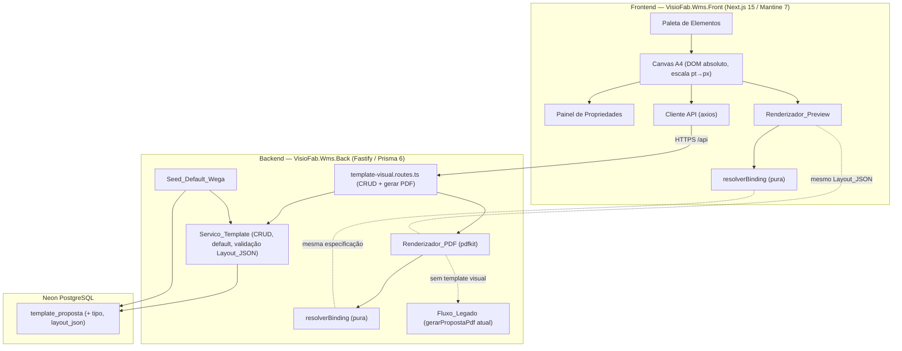
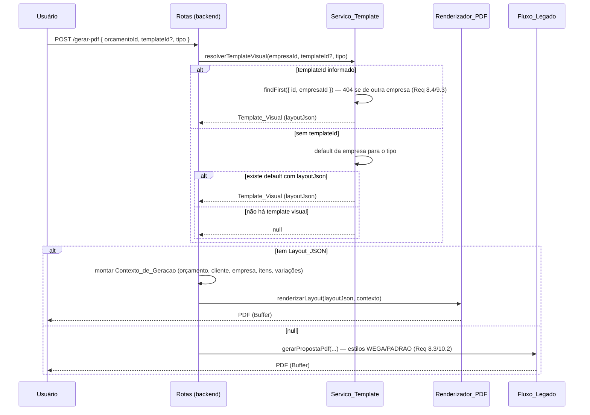

# Documento de Design

## Overview

Esta feature introduz um **Editor Visual de Documentos** (WYSIWYG) para os
templates de proposta/orçamento comercial, evoluindo o configurador atual de
liga/desliga de blocos para um canvas de posicionamento livre com preview fiel
ao PDF.

O coração do design é **uma única especificação de layout (Layout_JSON)
interpretada por dois renderizadores**: o `Renderizador_PDF` (backend, pdfkit) e
o `Renderizador_Preview` (frontend, DOM absoluto). Para garantir que o que o
usuário monta é exatamente o que o cliente recebe (Req 4), ambos usam a **mesma
unidade de coordenadas — pontos (pt), a unidade nativa do pdfkit** (A4 =
595 × 842 pt). O preview escala pt→px por um fator; o PDF usa pt diretamente.

O escopo é **aditivo e não-regressivo**:

- O model `TemplateProposta` é estendido com `tipo` (ORCAMENTO|PROPOSTA) e
  `layoutJson` (nullable). Quando `layoutJson` está presente, é um template
  **visual** novo; quando é `null`, é um template **legado** de blocos
  (comportamento atual preservado).
- As rotas atuais `proposta-pdf` e `enviar-email` **não mudam de contrato**.
- Quando não há template visual aplicável, a geração cai no **Fluxo_Legado**
  (`gerarPropostaPdf` atual, estilos WEGA/PADRAO).
- O motor de cálculo (`orcamento-grafico-calculo.service.ts`) **não é tocado** —
  esta feature é exclusivamente camada de apresentação.

Repos separados: backend `VisioFab.Wms.Back` (Fastify/Prisma6/Neon/pdfkit),
frontend `VisioFab.Wms.Front` (Next.js 15/Mantine 7). Isolamento multi-tenant
com `empresaId` explícito em toda query (Req 9).

### Decisões técnicas principais

| # | Decisão | Justificativa |
|---|---------|---------------|
| 1 | Coordenadas em **pt** (points) como fonte única de verdade | pt é a unidade nativa do pdfkit (`doc.image(x,y,{width,height})`, `doc.text(str,x,y)`). Usar a mesma unidade no preview (escalando por um fator pt→px) elimina conversões divergentes e garante fidelidade preview↔PDF (Req 4.2/4.3). |
| 2 | Canvas no front = **DOM absoluto** (divs posicionados), não `<canvas>` bitmap | Texto em DOM é nítido em qualquer zoom e renderiza fontes do mesmo jeito conceitual que o pdfkit desenha texto vetorial. `<canvas>` bitmap (Fabric.js) rasteriza o texto e diverge do PDF vetorial. |
| 3 | Biblioteca de canvas: **react-moveable** (arrastar/redimensionar/snapping) | DOM-first (opera sobre divs posicionados, não bitmap), tem alças de resize, drag e snapping a guias/margens prontos. react-rnd seria alternativa viável, mas react-moveable tem snapping a guias nativo (importante p/ Req 1.3). Fabric.js é descartada (canvas bitmap). |
| 4 | `layoutJson` nullable no `TemplateProposta` (não tabela nova) | Reaproveita CRUD, default e isolamento já existentes; `tipo` default PROPOSTA preserva não-regressão; template legado (layoutJson null) continua usando `config`. |
| 5 | Resolução de **binding como função pura compartilhável** conceitualmente | A mesma especificação de substituição (`{{cliente.nome}}` → valor, formatação R$/data, fallback vazio + aviso) é descrita uma vez e implementada igual nos dois renderizadores. É o ponto mais testável por PBT. |

### Pesquisa e referências

- **pdfkit** — API de posicionamento absoluto: `doc.text(texto, x, y, { width, align })`, `doc.image(buffer, x, y, { width, height })`, `doc.moveTo(x,y).lineTo(x2,y2).stroke()`. Página A4 padrão = 595,28 × 841,89 pt. Confirmado no renderizador atual (`orcamento-grafico-proposta-pdf.service.ts`), que já usa coordenadas em pt (`doc.page.width`, colunas fixas `col1=50`, etc.).
- **react-moveable** — biblioteca React para manipulação direta de elementos DOM (drag, resize, snap a guias/elementos). Opera sobre elementos posicionados absolutamente, combinando com a estratégia de canvas DOM. Alternativa considerada: react-rnd (mais simples, sem snapping a guias nativo).
- **Fabric.js (descartada)** — é um motor de canvas bitmap; o texto é rasterizado, o que impede fidelidade com o texto vetorial do pdfkit e degrada nitidez no zoom. Inadequada para o objetivo de fidelidade preview↔PDF.
- **Padrão de dois renderizadores da mesma spec** — é o mesmo princípio de "single source of truth" já aplicado no projeto (ex.: `base-contagem.service.ts`, motor puro consumido por várias superfícies). Aqui a "spec" é o Layout_JSON + a função de resolução de binding.

## Architecture

### Visão de componentes



### Decisão de fidelidade: uma spec, dois renderizadores

O requisito 4 ("o que monto é o que o cliente recebe") só é garantido se as duas
implementações **interpretarem o Layout_JSON exatamente igual**. Estratégia:

1. **Coordenadas em pt em ambos.** O Layout_JSON guarda `x`, `y`, `largura`,
   `altura` em pt. O `Renderizador_PDF` passa esses valores direto ao pdfkit. O
   `Renderizador_Preview` multiplica por `escala = larguraCanvasPx / 595` para
   obter px.
2. **Tamanho de fonte em pt.** pdfkit usa `doc.fontSize(n)` em pt; no preview,
   `fontSize = tamanhoPt * escala` px. Como 1pt CSS ≈ 1,333px, a escala já
   converte corretamente porque o canvas inteiro é escalado pelo mesmo fator.
3. **Mesmo mapa de fontes.** As fontes suportadas (Helvetica/Helvetica-Bold)
   mapeiam para as famílias equivalentes no preview, mantendo métricas próximas.
4. **Mesma resolução de binding.** Descrita em uma especificação única
   (pseudo-código abaixo), implementada identicamente nos dois lados e testada
   por property-based testing no backend.

### Fluxo de geração do PDF



### Isolamento multi-tenant (Req 9)

Seguindo o steering `ATENCAO-pontos-verificar.md` (§2.1): **não confiar apenas no
`prismaScoped`** (bypass SUPER_ADMIN). Toda query do `Servico_Template` filtra
`empresaId` EXPLÍCITO. Operação que referencia template de outra empresa responde
como "não encontrado" (404), nunca revela existência (Req 9.3).

## Components and Interfaces

### Backend

#### 1. `template-visual.routes.ts` (prefixo `/api/orcamento-grafico/templates-visuais`)

Novo arquivo de rotas (não altera `templates-proposta` legado). CRUD + geração.
Todas as rotas autenticadas, isolamento `empresaId` explícito.

| Método | Rota | Descrição |
|--------|------|-----------|
| GET | `/?tipo=ORCAMENTO\|PROPOSTA` | Lista templates visuais da empresa, filtrando por tipo (Req 5.2). |
| GET | `/:id` | Detalhe (inclui `layoutJson`). 404 se de outra empresa (Req 9.3). |
| POST | `/` | Cria `{ nome, tipo, layoutJson }`. Valida tipo e Layout_JSON (Req 5.3/5.4/7.1). |
| PUT | `/:id` | Atualiza `{ nome?, layoutJson? }` — valida e persiste (Req 7.6). |
| POST | `/:id/duplicar` | Duplica (mesmo tipo, cópia do Layout_JSON, não-default) (Req 7.2). |
| PATCH | `/:id/default` | Define default (único por empresa+tipo, em transação) (Req 7.3). |
| DELETE | `/:id` | Exclui se não-default; 400 se default (Req 7.4/7.5). |
| POST | `/:id/preview-pdf` | Gera PDF de amostra do template (dados de exemplo) p/ conferência. |
| POST | `/gerar-pdf` | `{ orcamentoId, templateId?, tipo }` → PDF real (Req 8). |

#### 2. `template-visual.service.ts` (Servico_Template)

```ts
// Isolamento empresaId EXPLÍCITO em TODA query (Req 9.1/9.2)
listarTemplatesVisuais(empresaId: string, tipo: TipoTemplate): Promise<TemplateVisualResumo[]>
obterTemplateVisual(empresaId: string, id: string): Promise<TemplateVisual>        // 404 cross-empresa
criarTemplateVisual(empresaId: string, dados: { nome; tipo; layoutJson }): Promise<TemplateVisual>
atualizarTemplateVisual(empresaId: string, id: string, dados: { nome?; layoutJson? }): Promise<TemplateVisual>
duplicarTemplateVisual(empresaId: string, id: string): Promise<TemplateVisual>
definirDefault(empresaId: string, id: string): Promise<void>                        // transação, único por (empresa,tipo)
excluirTemplateVisual(empresaId: string, id: string): Promise<void>                 // bloqueia default
resolverTemplateVisual(empresaId: string, tipo: TipoTemplate, templateId?: string): Promise<TemplateVisual | null>
```

#### 3. `layout-json.service.ts` — validação/normalização (função pura)

```ts
validarLayoutJson(raw: unknown): LayoutDocumento   // via Zod; lança erro de validação legível
clampElemento(el: Elemento, pagina: Pagina): Elemento  // restringe x,y,largura,altura à área útil (Req 1.3)
normalizarLayout(raw: unknown): LayoutDocumento        // tolerante a JSON parcial; nunca lança
```

#### 4. `binding-resolver.service.ts` — resolução de binding (função PURA, testada por PBT)

```ts
// Núcleo compartilhável conceitualmente com o front. Dado o caminho do binding
// e o Contexto_de_Geracao, retorna o valor formatado ou { vazio: true, aviso }.
resolverBinding(caminho: string, ctx: ContextoGeracao): ResultadoBinding
formatarMoeda(valor: number): string          // "R$ 1.234,56" (pt-BR)
formatarData(data: Date): string               // "dd/mm/aaaa"
resolverTabela(fonteDados: FonteDadosTabela, ctx: ContextoGeracao): LinhaTabela[]
```

Especificação (pseudo-código) da resolução de um binding escalar:

```
resolverBinding(caminho, ctx):
  valor := navegar(ctx, caminho)          # ex.: "cliente.nome" → ctx.cliente.nome
  se valor é indefinido/null:
    retorna { vazio: true, aviso: "Binding não encontrado: " + caminho }   # Req 3.4
  se caminho é monetário (orcamento.precoVenda, itens.*.precoTotal, ...):
    retorna { texto: formatarMoeda(Number(valor)) }                        # Req 3.5
  se valor é Date:
    retorna { texto: formatarData(valor) }                                 # Req 3.5
  retorna { texto: String(valor) }                                         # Req 3.3
```

#### 5. `renderizador-pdf.service.ts` (Renderizador_PDF)

```ts
renderizarLayout(layout: LayoutDocumento, ctx: ContextoGeracao): Promise<Buffer>
// Itera elementos NA ORDEM do array (Req 1.6), despacha por tipo:
//  LOGO           -> doc.image(logoBuffer, x, y, { width, height })
//  TEXTO          -> doc.text(texto, x, y, { width, align }) com fonte/tamanho/cor/negrito
//  CAMPO_DINAMICO -> resolverBinding(...).texto -> doc.text(...)
//  TABELA         -> resolverTabela(...) desenhado linha a linha nas colunas configuradas
//  LINHA          -> doc.moveTo(x, y).lineTo(x+largura, y).stroke()
//  BLOCO_CONDICOES-> doc.text(condicoes, x, y, { width })
//  ASSINATURA     -> doc.moveTo(...).lineTo(...).stroke() + rótulo
```

#### 6. `seed-default-wega.service.ts` (Seed_Default_Wega)

```ts
seedTemplatesVisuaisWega(empresaId: string): Promise<{ criados: number; ignorados: number }>
// Idempotente (Req 6.4): cria 1 PROPOSTA (traduz renderWega) + 1 ORCAMENTO se
// a empresa ainda não tiver template visual daquele tipo; marca default quando
// não há default do tipo (Req 6.3). empresaId explícito em cada registro (Req 6.5).
```

### Frontend (Next.js 15 / Mantine 7)

- **`editor-visual/page.tsx`** — página do editor: Paleta + Canvas + Painel.
- **`CanvasA4.tsx`** — container A4 escalado; renderiza cada elemento como div
  absoluto via react-moveable (drag/resize/snapping às margens — Req 1.1/1.2/1.3).
- **`PaletaElementos.tsx`** — botões p/ inserir os 7 tipos (Req 2.1/2.2).
- **`PainelPropriedades.tsx`** — edição de x/y/largura/altura/fonte/tamanho/
  alinhamento + binding (Req 1.4/1.5/3.2).
- **`RenderizadorPreview.tsx`** — interpreta o Layout_JSON em DOM (Req 4). Usa
  `resolverBinding` (TS puro, espelho do backend) e o fator de escala pt→px.
- **`lib/binding-resolver.ts`** — porta TS pura da mesma especificação de binding.
- **`lib/layout-escala.ts`** — `ptParaPx(valorPt, escala)` e helpers de clamp.

## Data Models

### Extensão do schema Prisma (`TemplateProposta`)

```prisma
model TemplateProposta {
  id           String   @id @default(uuid())
  empresaId    String   @map("empresa_id")
  nome         String   @db.VarChar(120)
  // NOVO: tipo do template. Default PROPOSTA preserva registros legados (Req 5.1).
  tipo         String   @default("PROPOSTA") @map("tipo") @db.VarChar(20) // ORCAMENTO | PROPOSTA
  isDefault    Boolean  @default(false) @map("is_default")
  // Config legada de blocos (Fluxo_Legado). Mantida p/ não-regressão.
  config       Json
  // NOVO: layout visual. NULL = template legado de blocos; presente = template visual novo.
  layoutJson   Json?    @map("layout_json")
  criadoEm     DateTime @default(now()) @map("criado_em")
  atualizadoEm DateTime @updatedAt @map("atualizado_em")

  // Default agora é por (empresa, tipo) — ver nota sobre unicidade abaixo.
  @@index([empresaId, tipo, isDefault])
  @@map("template_proposta")
}
```

> **Nota sobre unicidade do default**: a regra "um default por empresa por tipo"
> (Req 7.3) é garantida na camada de aplicação (transação que zera os demais
> antes de marcar, filtrando por `empresaId` + `tipo`), seguindo o padrão já
> usado em `definirTemplateDefault`. Não se usa constraint única parcial no banco
> para não conflitar com registros legados.

### Migração idempotente (`prisma/migrate-prod.ts`) — MESMO commit do schema

Conforme o steering `database-migrations.md`, `schema.prisma` + `migrate-prod.ts`
vão no **mesmo commit**. SQL idempotente:

```sql
ALTER TABLE template_proposta ADD COLUMN IF NOT EXISTS tipo VARCHAR(20) NOT NULL DEFAULT 'PROPOSTA';
ALTER TABLE template_proposta ADD COLUMN IF NOT EXISTS layout_json JSONB;
CREATE INDEX IF NOT EXISTS template_proposta_empresa_id_tipo_is_default_idx
  ON template_proposta (empresa_id, tipo, is_default);
```

Testar rodando `npx tsx prisma/migrate-prod.ts` 2× local (idempotência). Os
registros legados existentes recebem `tipo='PROPOSTA'` e `layout_json=NULL`
automaticamente — continuam no Fluxo_Legado (não-regressão, Req 10).

### Layout_JSON — schema do documento (TypeScript / Zod)

Unidade de todas as coordenadas e dimensões: **pt** (A4 = 595 × 842 pt).

```ts
type TipoTemplate = 'ORCAMENTO' | 'PROPOSTA'

interface Pagina {
  larguraPt: number      // 595 (A4)
  alturaPt: number       // 842 (A4)
  margemTopoPt: number
  margemBaixoPt: number
  margemEsquerdaPt: number
  margemDireitaPt: number
}

type TipoElemento =
  | 'LOGO' | 'TEXTO' | 'CAMPO_DINAMICO' | 'TABELA'
  | 'LINHA' | 'BLOCO_CONDICOES' | 'ASSINATURA'

interface EstiloTexto {
  fonte: 'Helvetica' | 'Helvetica-Bold'
  tamanhoPt: number
  alinhamento: 'left' | 'center' | 'right'
  negrito: boolean
  cor: string            // hex "#333333"
}

interface Elemento {
  id: string
  tipo: TipoElemento
  xPt: number
  yPt: number
  larguraPt: number
  alturaPt: number
  estilo?: EstiloTexto                  // TEXTO, CAMPO_DINAMICO, BLOCO_CONDICOES, TABELA, ASSINATURA
  // Propriedades por tipo (apenas a relevante é preenchida):
  textoEstatico?: string                // TEXTO
  binding?: string                      // CAMPO_DINAMICO ex.: "{{cliente.nome}}"
  tabela?: {
    fonteDados: 'itens' | 'variacoes'   // Req 2.6
    colunas: Array<{ titulo: string; binding: string; larguraPt: number; alinhamento: 'left'|'center'|'right' }>
  }
  rotuloAssinatura?: string             // ASSINATURA
}

interface LayoutDocumento {
  versao: 1
  pagina: Pagina
  elementos: Elemento[]                 // ORDEM = ordem de desenho no PDF (Req 1.6)
}
```

### Contexto_de_Geracao

Dados reais disponíveis na geração, montados pela rota a partir do orçamento
(reaproveita os tipos de `orcamento-grafico-proposta-pdf.service.ts`):

```ts
interface ContextoGeracao {
  cliente:  { nome: string; cnpj?: string; contato?: string; email?: string }
  empresa:  { razaoSocial: string; cnpj?: string; telefone?: string; email?: string; logoBuffer?: Buffer | null }
  orcamento:{ numero: number; versao: number; precoVenda?: number; validadeAte?: Date; criadoEm: Date; /* ... */ }
  itens:     Array<{ descricao: string; quantidade: number; precoUnitario: number; precoTotal: number }>
  variacoes: Array<{ quantidade: number; precoUnitario: number; precoTotal: number }>
}
```

Bindings suportados (expostos na UI — Req 3.1): `{{cliente.nome}}`,
`{{cliente.cnpj}}`, `{{empresa.razaoSocial}}`, `{{orcamento.numero}}`,
`{{orcamento.precoVenda}}` (R$), `{{orcamento.validadeAte}}` (dd/mm/aaaa),
`{{itens}}`, `{{variacoes}}` (fontes de tabela), entre outros.

## Correctness Properties

*Uma propriedade é uma característica ou comportamento que deve valer para todas
as execuções válidas do sistema — uma afirmação formal sobre o que o software
deve fazer. As propriedades servem de ponte entre a especificação legível por
humanos e garantias de correção verificáveis por máquina.*

As propriedades abaixo focam o **núcleo puro** da feature (resolução de binding,
clamp de coordenadas, escala pt→px, despacho do renderizador) e as **regras de
negócio do Servico_Template** (filtro por tipo, unicidade de default,
duplicação, isolamento, idempotência do seed). Elas serão implementadas com
**fast-check + vitest** no backend. Interações de UI, presença de catálogo e
não-regressão estrutural são cobertas por testes de exemplo/componente (ver
Testing Strategy), não por PBT.

### Property 1: Clamp mantém o elemento dentro da área útil

*Para qualquer* `Elemento` e qualquer `Pagina`, após `clampElemento(el, pagina)`
a caixa resultante está inteiramente contida na área útil da página (dentro das
margens): `x >= margemEsquerda`, `y >= margemTopo`,
`x + largura <= larguraPt - margemDireita`,
`y + altura <= alturaPt - margemBaixo`.

**Validates: Requirements 1.3**

### Property 2: Ordem de desenho preserva a ordem do Layout_JSON

*Para qualquer* `LayoutDocumento`, a sequência de operações de desenho emitidas
pelo `Renderizador_PDF` segue exatamente a ordem dos elementos no array
`elementos`.

**Validates: Requirements 1.6**

### Property 3: Despacho do renderizador por tipo nas coordenadas do elemento

*Para qualquer* `Elemento` de qualquer tipo, o `Renderizador_PDF` emite a
operação de desenho correspondente ao tipo (imagem para LOGO; texto para
TEXTO/CAMPO_DINAMICO/BLOCO_CONDICOES; linha para LINHA/ASSINATURA; tabela para
TABELA) posicionada nas coordenadas `x`, `y` do elemento.

**Validates: Requirements 2.3, 2.4, 2.5, 2.6, 2.7, 2.8, 2.9**

### Property 4: Binding presente é substituído pelo valor do contexto

*Para qualquer* `Contexto_de_Geracao` e qualquer binding que referencie um dado
presente no contexto, `resolverBinding` retorna o valor correspondente do
contexto (como texto, já formatado quando monetário ou data).

**Validates: Requirements 3.3**

### Property 5: Binding ausente nunca lança e produz vazio + aviso

*Para qualquer* string de binding que não corresponda a nenhum dado do
`Contexto_de_Geracao`, `resolverBinding` retorna um resultado vazio com aviso e
**nunca lança exceção**, independentemente do formato da string.

**Validates: Requirements 3.4**

### Property 6: Formatação de moeda/data é idempotente e segue o padrão brasileiro

*Para qualquer* valor monetário, `formatarMoeda` produz uma string no padrão R$
(pt-BR), e *para qualquer* data, `formatarData` produz `dd/mm/aaaa`; além disso,
resolver um binding cujo valor já é texto formatado não altera o resultado
(resolução idempotente sobre valores já resolvidos).

**Validates: Requirements 3.5**

### Property 7: Escala pt→px preserva a posição relativa (fidelidade preview↔PDF)

*Para qualquer* coordenada em pt e qualquer fator de escala positivo, a posição
relativa no preview é igual à posição relativa no PDF:
`ptParaPx(xPt, escala) / (larguraPt * escala) == xPt / larguraPt`. Ou seja, a
proporção de cada elemento em relação à página é idêntica nos dois
renderizadores.

**Validates: Requirements 4.3**

### Property 8: Listar por tipo retorna apenas templates daquele tipo e empresa

*Para qualquer* conjunto de `Template_Visual` de tipos variados e qualquer
`Tipo_Template` consultado, `listarTemplatesVisuais(empresaId, tipo)` retorna
somente templates cujo `tipo` é o consultado e cujo `empresaId` é o da consulta.

**Validates: Requirements 5.2**

### Property 9: Tipo inválido é sempre rejeitado na criação

*Para qualquer* string de tipo diferente de `ORCAMENTO` ou `PROPOSTA`, a criação
de `Template_Visual` é rejeitada com erro de validação.

**Validates: Requirements 5.4**

### Property 10: Seed é idempotente

*Para qualquer* estado inicial de uma empresa, executar `Seed_Default_Wega` duas
vezes resulta no mesmo conjunto de `Template_Visual` (mesma quantidade e
identidade) que executá-lo uma única vez.

**Validates: Requirements 6.4**

### Property 11: Duplicação copia layout e tipo sem marcar default

*Para qualquer* `Template_Visual`, duplicá-lo produz um novo template com o mesmo
`tipo`, um `layoutJson` estruturalmente igual ao original e `isDefault = false`,
com `id` distinto do original.

**Validates: Requirements 7.2**

### Property 12: No máximo um default por empresa por tipo

*Para qualquer* conjunto de `Template_Visual` e qualquer alvo escolhido para
`definirDefault`, após a operação existe exatamente um `Template_Default` no tipo
do alvo para aquela empresa, e os defaults de outros tipos permanecem
inalterados.

**Validates: Requirements 7.3**

### Property 13: Isolamento multi-tenant (acesso cross-empresa é inexistência)

*Para qualquer* par de empresas distintas A e B e qualquer `Template_Visual`
pertencente a B, qualquer operação (obter, atualizar, excluir, resolver para
geração) disparada por A referenciando esse template responde como se não
existisse (template não encontrado).

**Validates: Requirements 8.4, 9.2, 9.3**

## Error Handling

- **Validação do Layout_JSON**: `validarLayoutJson` usa Zod; em falha, a rota
  retorna **400** com mensagem legível "campo: motivo" (padrão já usado no
  projeto, ex.: handler Zod global do orçamento/CT-e), nunca o genérico "Dados
  inválidos".
- **Tipo inválido na criação** (Req 5.4): **400** de validação (`tipo` fora de
  `ORCAMENTO|PROPOSTA`).
- **Template de outra empresa** (Req 8.4/9.3): `findFirst({ id, empresaId })`
  → quando não encontra, **404** "Template não encontrado" — nunca distingue
  "não existe" de "é de outra empresa".
- **Excluir default** (Req 7.5): **400** com orientação para definir outro
  template como default antes (mesma semântica de `excluirTemplate` legado).
- **Binding ausente** (Req 3.4): tratado no núcleo puro — não é erro de API; o
  elemento renderiza vazio e um aviso é acumulado (retornável no corpo da
  resposta de preview, p/ a UI destacar). A geração **nunca é interrompida**.
- **Logo inválido/ausente**: segue o best-effort atual (`resolverLogoBuffer`
  retorna `null`, o elemento LOGO é omitido sem quebrar o PDF).
- **Orçamento inexistente na geração**: **404**.
- Toda query filtra `empresaId` explícito; falha de escopo (sem empresa na
  sessão) retorna erro de autorização, seguindo o middleware atual.

## Testing Strategy

Abordagem dupla: **testes de exemplo/unitários** para casos concretos, interações
de UI e condições de erro; **testes de propriedade (PBT)** para as invariantes
universais do núcleo puro e das regras do Servico_Template.

### Property-based testing (backend — fast-check + vitest)

PBT é apropriado aqui porque o núcleo é formado por **funções puras** (resolução
de binding, clamp, escala, despacho do renderizador) e por **regras de negócio
com invariantes universais** (unicidade de default, filtro por tipo, isolamento,
idempotência do seed) — todas com espaço de entrada grande e comportamento que
varia significativamente com a entrada.

Requisitos dos testes de propriedade:

- Biblioteca: **fast-check** (não implementar PBT do zero).
- **Mínimo de 100 iterações** por teste de propriedade.
- Cada teste referencia a propriedade do design com a tag:
  `// Feature: comercial-editor-visual-templates, Property {n}: {texto}`.
- Cada propriedade (1 a 13) é coberta por **um único** teste de propriedade.
- As regras do Servico_Template (Properties 8–13) usam Prisma com banco local;
  a resolução de binding/clamp/escala/despacho (Properties 1–7) são puras e não
  exigem banco. O `Renderizador_PDF` é testado com **pdfkit mockado** (captura
  das chamadas `image/text/moveTo/lineTo`) para manter as 100+ iterações baratas.
- Nota operacional (steering): rodar vitest com execução única (`vitest run`),
  nunca em watch; no front, usar `--pool=threads` se houver timeout.

### Testes de exemplo / unitários

- **Backend**: criar com tipo válido (5.3), excluir não-default (7.4), excluir
  default rejeita (7.5), resolver sem id retorna default (8.2), resolver sem
  default retorna null → Fluxo_Legado (8.3/10.2), seed cria 1 PROPOSTA + 1
  ORCAMENTO com `empresaId` e `layoutJson` (6.1/6.2/6.5), geração com templateId
  produz Buffer PDF não vazio (8.1), update com layout válido persiste (7.6/7.1).
- **Frontend (componente/interação)**: paleta expõe os 7 tipos (2.1), adicionar
  elemento insere com valores iniciais (2.2), selecionar exibe painel (1.4),
  editar valor no painel aplica + clamp (1.5), arrastar atualiza x/y (1.1),
  redimensionar atualiza largura/altura (1.2), alteração atualiza preview (4.1),
  canvas usa a `Pagina` do layout com margens A4 (4.4), catálogo de bindings
  listado (3.1), associar binding registra no layout (3.2).

### Não-regressão (smoke)

- Rotas legadas `proposta-pdf` e `enviar-email` mantêm contrato — suíte
  existente permanece verde (10.1).
- `orcamento-grafico-calculo.service.ts` **não é alterado** (10.3).
- `npx tsx prisma/migrate-prod.ts` roda **2× sem erro** (idempotência da
  migração — 10.4), confirmando `tipo` e `layout_json` aplicados.
