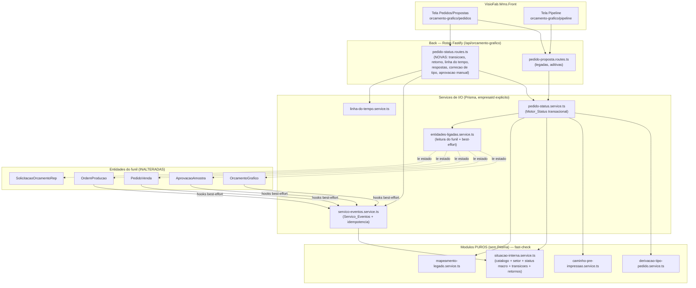
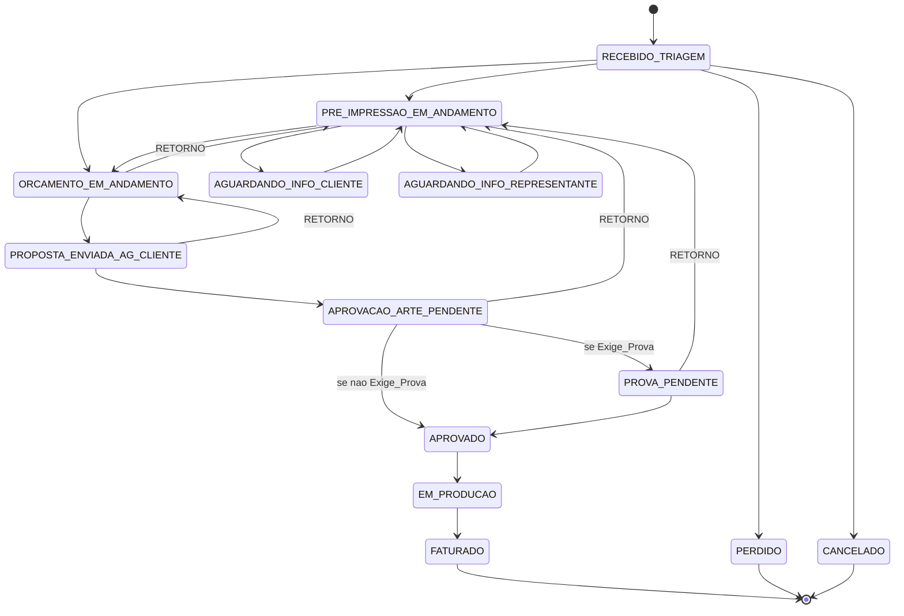

# Design Document — Comercial: Pedido com Status Fiel (Fundação)

## Overview

Esta spec é o **item 1 ("Fundação")** da §20.4 de `docs/PROJETO-MODULO-COMERCIAL.md`.
Substitui o modelo de estados linear do `PedidoProposta`
(`NOVO → EM_ANALISE → ENVIADO_ORCAMENTO → ORCADO → PROPOSTA_ENVIADA → ACEITO`,
mais `PERDIDO`/`CANCELADO`, em `pedido-proposta-estado.service.ts`) por um modelo
de **status fiel**: situação interna granular, status macro derivado, setor
responsável, retornos com rodada e uma linha do tempo única e auditável.

O design é **estritamente aditivo e não-regressivo**. O campo legado `estado`, a
tabela `log_pedido_proposta` e todas as rotas atuais continuam funcionando. A
máquina de estados nova vive em **módulos de funções puras** (sem Prisma,
testáveis com `fast-check`), separados dos services de I/O — mesmo espírito de
`pedido-proposta-estado.service.ts` e de `base-contagem.service.ts` do PCP.

Entrega da Fundação:

1. **Respostas_Pedido** (cliente, faca, arte, referência, prova) + **Tipo_Pedido
   derivado** (`PRODUTO_NOVO | ALTERACAO | REPETICAO`), corrigível manualmente.
2. **Status_Macro** derivado (`RECEBIDO → EM_PRE_IMPRESSAO/EM_ORCAMENTO →
   EM_APROVACAO → APROVADO → EM_PRODUCAO → FATURADO`, + `PERDIDO`/`CANCELADO`).
3. **Setor_Responsavel** ("com quem está a bola") + **Tempo_Parado**.
4. **Retornos** explícitos com motivo e **Rodada**.
5. **Linha_do_Tempo** única e auditável.
6. **Servico_Eventos** (pontos de extensão para Pré-Impressão e Aprovação externa).

### Decisões de design justificadas

**D1 — Onde guardar a Situacao_Interna e como manter `estado` legado sincronizado
(Req 13.2).** A `Situacao_Interna` é uma **nova coluna** `situacao_interna` em
`pedido_proposta` (não uma tabela à parte): é um atributo 1:1 do Pedido, como o
`estado` é hoje. O campo legado `estado` passa a ser **derivado** da
`Situacao_Interna` por uma função pura `situacaoParaEstadoLegado()` e gravado
**na mesma transação** de toda transição, servindo de "espelho" sempre coerente.
Assim nenhum consumidor atual de `estado` (Pipeline, portal, relatórios) quebra.
Justificativa: evita tabela de status separada (mais JOINs, risco de divergência)
e segue o padrão do projeto (status como coluna do agregado, ex.:
`OrdemProducao.status`).

**D2 — Linha_do_Tempo: estender `LogPedidoProposta` OU tabela nova.** Escolha de
**menor risco: tabela nova `evento_pedido_proposta`** (não estender
`log_pedido_proposta`). Justificativa:
- `log_pedido_proposta` tem shape rígido legado (`estadoAnterior`/`estadoNovo`
  NOT NULL VARCHAR(20)) que não acomoda eventos **sem** mudança de estado (vínculo
  de entidade, correção de tipo, aprovação manual) nem o **payload serializável
  de até 64 KB** e os tipos de evento livres exigidos pelo Servico_Eventos
  (Req 10.1/10.5). Forçar `estadoAnterior` a nullable e alargar enums de uma
  tabela viva em produção é mais arriscado que criar tabela nova idempotente.
- A migração (Req 4.10) **copia** cada linha de `log_pedido_proposta` para
  `evento_pedido_proposta` preservando usuário/data/motivo; o `transicionarEstado`
  legado passa a gravar **nos dois** (log antigo + evento novo) na mesma
  transação, mantendo a não-regressão (Req 8.5: cascata de exclusão em ambas via
  `onDelete: Cascade`). `log_pedido_proposta` **não** sofre `DROP` (Req 14.7).

**D3 — Chave de idempotência do Servico_Eventos com validade ≥ 24h (Req 10.9).**
Tabela dedicada `idempotencia_evento` com `@@unique([empresaId, operacao, chave])`,
guardando `paramsHash` (sha256 dos parâmetros) e `resultadoJson` (resultado da
1ª execução) + `criadoEm`. Regras: mesma chave + mesmo hash → retorna
`resultadoJson` sem novo efeito; mesma chave + hash diferente →
`IDEMPOTENCIA_CONFLITO` (Req 10.10); a chave só é gravada **no sucesso**
(Req 10.8), na mesma transação do Evento. A linha é **mantida permanentemente**
(sem expurgo nesta spec), logo a validade ≥ 24h é satisfeita trivialmente.

**D4 — Serialização de concorrência (Req 6.12, 7.13, 10.11).** **Update
condicional por versão (optimistic lock):** nova coluna `situacao_versao Int
@default(0)`. Toda transição lê `situacao_interna` + `situacao_versao`, valida
pela máquina pura e grava com `updateMany({ where: { id, empresaId,
situacaoVersao: versaoLida }, data: { ..., situacaoVersao: { increment: 1 } } })`.
Se `count === 0`, outra transação venceu: relê o estado atualizado e **revalida
uma vez**; se não for mais válida, retorna o erro correspondente
(`ESTADO_TRANSICAO_INVALIDA`/`PEDIDO_TERMINAL`/`RETORNO_INVALIDO`). Para o caso
idempotente concorrente (Req 10.11), a `@@unique` de `idempotencia_evento`
garante que apenas uma transação insere a chave; a perdedora captura o erro de
unicidade e relê o `resultadoJson`. Justificativa: o Neon (pooler) não favorece
locks longos (`SELECT ... FOR UPDATE`); update condicional por versão é mais
barato e já é o padrão de concorrência leve do ecossistema.

**D5 — Status_Macro nunca editável (Req 3.3).** Não há Status_Macro "digitável":
ele é derivado pela função pura `derivarStatusMacro(situacao, entidadesLigadas)`
e **materializado** numa coluna cache `status_macro`, recalculada na mesma
transação de cada transição (Req 3.4) e quando uma entidade ligada muda
(Req 3.5). Qualquer rota que receba `status_macro`/`statusMacro` no body é
rejeitada com `STATUS_MACRO_NAO_EDITAVEL` — a coluna só é escrita pelo Motor_Status.

**D6 — Não tocar o motor de cálculo do orçamento (Req 9.10).** A integração do
Req 9 é **best-effort** e só **lê** o estado das Entidades_Ligadas e **solicita
transições** do Pedido. As regras de `OrcamentoGrafico`, `AprovacaoAmostra`,
`PedidoVenda` e `OrdemProducao` ficam inalteradas. Nenhuma chamada ao
Servico_Eventos pode derrubar a operação original (try/catch + log — Req 9.9).

## Architecture



Fluxo de uma transição: a rota resolve `empresaId` + permissão (Req 12) → chama
`pedido-status.service.ts` (I/O) → que lê o Pedido (empresaId explícito), valida
pela máquina pura `situacao-interna.service.ts`, deriva `status_macro`/`setor`/
`estado` legado pelas funções puras e grava tudo + o Evento_Pedido em **uma
transação** com update condicional por versão.

### Diagrama de estados (Situacoes_Internas)



`APROVADO` só é permitido quando o Calculo_Pedido está concluído E a
Aprovacao_Arte_Cliente está registrada (+ prova aprovada quando `Exige_Prova`) —
regra de guarda, não transição separada (Req 2.5/2.6/2.12).

## Components and Interfaces

### Módulos PUROS (sem Prisma)

Ficam em `src/modules/orcamento-grafico/pedido-proposta/`:

| Arquivo | Responsabilidade | Exporta (puro) |
|---|---|---|
| `derivacao-tipo-pedido.service.ts` | Deriva Tipo_Pedido das Respostas_Pedido (Req 1.4/1.5/1.6/1.16) | `derivarTipoPedido(respostas): { tipo, aConfirmar }` |
| `caminho-pre-impressao.service.ts` | Caminho e exigências por Tipo_Pedido (Req 2.1/2.11) | `caminhoDoTipo(tipo)`, `exigenciasDoTipo(tipo, exigeProva)` |
| `situacao-interna.service.ts` | Catálogo de Situacoes_Internas, Setor_Responsavel, derivação do Status_Macro, tabela de transições (AVANCO/RETORNO), retornos permitidos, validação (Req 3/5/6/7) | `CATALOGO`, `derivarStatusMacro`, `setorDaSituacao`, `transicoesPermitidas`, `retornosPermitidos`, `validarTransicao`, `isTerminal` |
| `mapeamento-legado.service.ts` | Estado_Legado ↔ Situacao_Interna, `situacaoParaEstadoLegado`, heurística de `Situacao_Faca` a partir de texto de `matriz` (Req 4/13.2) | `legadoParaSituacao`, `situacaoParaEstadoLegado`, `heuristicaSituacaoFaca` |

Cada módulo expõe uma classe de erro `PedidoStatusError extends Error` com
`statusCode` + `code` (mesmo padrão de `PedidoPropostaError`), reaproveitada
pelos services.

### Services de I/O (Prisma)

| Arquivo | Responsabilidade |
|---|---|
| `pedido-status.service.ts` | Motor_Status transacional: `solicitarTransicao`, `devolverParaSetor` (Retorno), `salvarRespostasPedido`, `corrigirTipoPedido`, `registrarAprovacaoArteManual`, `consultarTransicoes`, `calcularTempoParado`. Update condicional por versão. |
| `servico-eventos.service.ts` | Servico_Eventos: `registrarEvento`, `solicitarTransicao` (com idempotência). Interface interna para Modulos_Dependentes. |
| `entidades-ligadas.service.ts` | Lê estado das Entidades_Ligadas (empresaId do Pedido) e expõe hooks best-effort chamados pelos fluxos do funil (Req 9). |
| `linha-do-tempo.service.ts` | Grava/lista Evento_Pedido (somente-inserção, paginado, empresaId explícito). |

### Servico_Eventos — assinaturas TypeScript

```ts
// servico-eventos.service.ts
export interface RegistrarEventoInput {
  empresaId: string
  pedidoId: string
  tipo: string              // 1..60, /^[A-Z0-9_]{1,60}$/  (Req 10.5)
  origem: string            // 1..60 (usuario ou modulo)   (Req 10.1)
  dados?: Record<string, unknown>  // serializavel, <= 64 KB (Req 10.1)
  motivo?: string           // 0..500
  idempotencyKey: string    // 1..100
}
export interface RegistrarEventoResult {
  eventoId: string
  reaproveitado: boolean    // true = idempotencia atingida
}
export function registrarEvento(input: RegistrarEventoInput): Promise<RegistrarEventoResult>

export interface SolicitarTransicaoInput {
  empresaId: string
  pedidoId: string
  destino: { situacaoInterna: string } | { setor: Setor }  // situacao OU setor (retorno)
  origem: string            // 1..60
  motivo?: string           // 0..500 (obrigatorio conforme destino)
  idempotencyKey: string    // 1..100
  intencao?: 'AVANCO' | 'RETORNO'
}
export interface SolicitarTransicaoResult {
  situacaoInterna: string
  rodada: number
  eventoId: string
  reaproveitado: boolean
}
export function solicitarTransicao(input: SolicitarTransicaoInput): Promise<SolicitarTransicaoResult>
```

**Contratos e erros** (lançados como `PedidoStatusError`):

| Código | HTTP | Quando |
|---|---|---|
| `NAO_ENCONTRADO` | 404 | Pedido inexistente ou de outra empresa (indistinguível — Req 10.7) |
| `EVENTO_INVALIDO` | 400 | Campo obrigatório ausente, tamanho acima do limite, tipo fora de `/^[A-Z0-9_]{1,60}$/`, `dados` > 64 KB (Req 10.8) |
| `ESTADO_TRANSICAO_INVALIDA` | 400 | Transição fora da tabela / destino = situação atual (Req 6.3) |
| `CAMINHO_TIPO_VIOLADO` | 400 | Exigência de caminho/tipo pendente (Req 2.8) |
| `MOTIVO_OBRIGATORIO` | 400 | Motivo ausente/≠[5..500] quando exigido (Req 6.8/7.3) |
| `PEDIDO_TERMINAL` | 409 | Pedido em `PERDIDO`/`CANCELADO` (precede 400 — Req 6.6) |
| `IDEMPOTENCIA_CONFLITO` | 409 | Chave reusada com params diferentes (Req 10.10) |

Idempotência: chave registrada só no sucesso (Req 10.8). Repetição com mesmo
hash → retorna o resultado gravado sem novo efeito (Req 10.9/10.11). Permissão:
chamadas de Modulo_Dependente com `origem` de sistema dispensam a verificação de
permissão de usuário (Req 12.8); o módulo chamador é interno ao Back (não exposto
via HTTP). As Situacoes_Internas sob `EM_PRE_IMPRESSAO` e `EM_APROVACAO` ficam
reservadas para acionamento pelos Modulos_Dependentes (Req 10.13).

### Integração Req 9 — onde plugar no código atual (best-effort)

Todas as chamadas em `try/catch` com log; **nunca** relançam (Req 9.9). Cada uma
usa `idempotencyKey` derivada do id da entidade + evento, para não duplicar em
reprocessos.

| Evento do funil | Arquivo/handler atual onde plugar | Chamada |
|---|---|---|
| Encaminhar RFQ → Orçamento | `encaminhar-orcamento.service.ts`, dentro da `$transaction` existente | `solicitarTransicao({ destino: ORCAMENTO_EM_ANDAMENTO, origem: 'SISTEMA:ENCAMINHAR' })` + vínculo (Req 9.2) |
| Orçamento calculado + enviado como proposta | `orcamento-grafico.routes.ts`, handler `POST /:id/enviar` | `solicitarTransicao({ destino: PROPOSTA_ENVIADA_AG_CLIENTE, origem: 'SISTEMA:PROPOSTA' })` (Req 9.3) |
| Orçamento aprovado → PedidoVenda | `orcamento-grafico.routes.ts`, handler `POST /:id/aprovar` | `solicitarTransicao({ destino: APROVADO })` + `registrarEvento('VINCULO_PEDIDO_VENDA')` (Req 9.4/9.6) |
| Amostra aberta/reprovada | service/rota de `AprovacaoAmostra` | `solicitarTransicao({ destino: APROVACAO_ARTE_PENDENTE/PROVA_PENDENTE })` + `registrarEvento('AMOSTRA_*')` (Req 9.5) |
| OP vinculada / em produção | `etapa-operacional.routes.ts` (conclusão/vínculo) e geração de OP | `registrarEvento('VINCULO_OP')` + recálculo do macro (Req 9.7) |
| Solicitação do portal vira RFQ | fluxo de criação a partir de `SolicitacaoOrcamentoRep` | `registrarEvento('VINCULO_SOLICITACAO')` + origem `REPRESENTANTE` (Req 9.8) |

Como `AprovacaoAmostra` liga por `orcamentoId`/`pedidoVendaId` (não por
`pedidoPropostaId`) e `OrdemProducao` liga por `pedidoVendaId`,
`entidades-ligadas.service.ts` resolve o Pedido navegando:
`OrdemProducao.pedidoVendaId → PedidoVenda → OrcamentoGrafico.pedidoPropostaId` e
`AprovacaoAmostra.orcamentoId → OrcamentoGrafico.pedidoPropostaId` (ou
`.pedidoVendaId → PedidoVenda → ...`), sempre filtrando `empresaId` do Pedido
(Req 11.5). Vínculo direto já existente: `OrcamentoGrafico.pedidoPropostaId` ↔
`PedidoProposta.orcamentoGraficoId`; `OrcamentoGrafico.pedidoVendaId`.

## Data Models

### Catálogo CONCRETO de Situacoes_Internas

Enxuto (uma situação por "parada real" do fluxo da Wega). Cada uma pertence a
exatamente um Status_Macro e tem um Setor_Responsavel (Req 5.1).

| Situacao_Interna | Status_Macro | Setor_Responsavel | Terminal? |
|---|---|---|---|
| `RECEBIDO_TRIAGEM` | `RECEBIDO` | `COMERCIAL` | não |
| `PRE_IMPRESSAO_EM_ANDAMENTO` | `EM_PRE_IMPRESSAO` | `PRE_IMPRESSAO` | não |
| `AGUARDANDO_INFO_CLIENTE` | `EM_PRE_IMPRESSAO` | `CLIENTE` | não |
| `AGUARDANDO_INFO_REPRESENTANTE` | `EM_PRE_IMPRESSAO` | `REPRESENTANTE` | não |
| `ORCAMENTO_EM_ANDAMENTO` | `EM_ORCAMENTO` | `ORCAMENTO` | não |
| `PROPOSTA_ENVIADA_AG_CLIENTE` | `EM_APROVACAO` | `CLIENTE` | não |
| `APROVACAO_ARTE_PENDENTE` | `EM_APROVACAO` | `CLIENTE` | não |
| `PROVA_PENDENTE` | `EM_APROVACAO` | `CLIENTE` | não |
| `APROVADO` | `APROVADO` | `COMERCIAL` | não |
| `EM_PRODUCAO` | `EM_PRODUCAO` | `COMERCIAL` | não |
| `FATURADO` | `FATURADO` | `null` (Req 5.6) | **sim** |
| `PERDIDO` | `PERDIDO` | `null` | **sim** |
| `CANCELADO` | `CANCELADO` | `null` | **sim** |

> `AGUARDANDO_INFO_CLIENTE`/`_REPRESENTANTE` cobrem a parada "aguardando
> informação/arquivo". As situações de `EM_PRE_IMPRESSAO` e `EM_APROVACAO` são
> reservadas para acionamento pelos Modulos_Dependentes (Req 10.13).

### Derivação do Tipo_Pedido (função pura — Req 1.4/1.5)

Ordem de avaliação (determinística; totalidade garantida — Req 1.16):

| # | Condição (sobre Respostas_Pedido) | Tipo_Pedido | A_Confirmar |
|---|---|---|---|
| a | `Situacao_Faca = NOVA` **ou** `Situacao_Arte = CRIAR` | `PRODUTO_NOVO` | não |
| b | senão, `Situacao_Arte ∈ {EXISTENTE_COM_ALTERACAO, CLIENTE_ENVIA}` | `ALTERACAO` | não |
| c | senão, `Situacao_Faca = EXISTENTE` **e** `Situacao_Arte = EXISTENTE_SEM_ALTERACAO` | `REPETICAO` | não |
| d | senão (algum `NAO_INFORMADA` sem decidir por a) | `PRODUTO_NOVO` | **sim** (Classificacao_A_Confirmar) |

Flag manual (Req 1.7/1.8): quando corrigido, grava `tipo_pedido_manual = true` +
`tipo_pedido_derivado`; a derivação continua rodando para **sinalizar
divergência** (`tipo_pedido_divergente`) sem sobrescrever o valor manual.

### Caminhos e exigências por Tipo_Pedido (Req 2.1/2.2/2.5/2.6)

| Tipo_Pedido | Caminho_Pre_Impressao | EM_PRE_IMPRESSAO | EM_ORCAMENTO | Calculo_Pedido | Aprovacao_Arte_Cliente | Prova |
|---|---|---|---|---|---|---|
| `REPETICAO` | `CONFERENCIA` | sim | sim | sim | sim | se `Exige_Prova` |
| `ALTERACAO` | `PARCIAL` | sim | sim | sim | sim | se `Exige_Prova` |
| `PRODUTO_NOVO` | `COMPLETA` | sim | sim | sim | sim | se `Exige_Prova` |

Nenhum tipo pula a pré-impressão; cálculo e aprovação de arte são obrigatórios em
todos. `EM_PRE_IMPRESSAO` e `EM_ORCAMENTO` ocorrem em qualquer ordem a partir de
`RECEBIDO`, com idas e voltas (Req 2.3).

### Tabela de transições (AVANCO/RETORNO) — Req 6.1

| Origem | Destino | Classe |
|---|---|---|
| `RECEBIDO_TRIAGEM` | `PRE_IMPRESSAO_EM_ANDAMENTO` | AVANCO |
| `RECEBIDO_TRIAGEM` | `ORCAMENTO_EM_ANDAMENTO` | AVANCO |
| `PRE_IMPRESSAO_EM_ANDAMENTO` | `ORCAMENTO_EM_ANDAMENTO` | AVANCO |
| `PRE_IMPRESSAO_EM_ANDAMENTO` | `AGUARDANDO_INFO_CLIENTE` | AVANCO |
| `PRE_IMPRESSAO_EM_ANDAMENTO` | `AGUARDANDO_INFO_REPRESENTANTE` | AVANCO |
| `ORCAMENTO_EM_ANDAMENTO` | `PRE_IMPRESSAO_EM_ANDAMENTO` | RETORNO |
| `ORCAMENTO_EM_ANDAMENTO` | `PROPOSTA_ENVIADA_AG_CLIENTE` | AVANCO |
| `AGUARDANDO_INFO_CLIENTE` | `PRE_IMPRESSAO_EM_ANDAMENTO` | AVANCO |
| `AGUARDANDO_INFO_REPRESENTANTE` | `PRE_IMPRESSAO_EM_ANDAMENTO` | AVANCO |
| `PROPOSTA_ENVIADA_AG_CLIENTE` | `APROVACAO_ARTE_PENDENTE` | AVANCO |
| `PROPOSTA_ENVIADA_AG_CLIENTE` | `ORCAMENTO_EM_ANDAMENTO` | RETORNO |
| `PROPOSTA_ENVIADA_AG_CLIENTE` | `PRE_IMPRESSAO_EM_ANDAMENTO` | RETORNO |
| `APROVACAO_ARTE_PENDENTE` | `PROVA_PENDENTE` | AVANCO |
| `APROVACAO_ARTE_PENDENTE` | `APROVADO` | AVANCO |
| `APROVACAO_ARTE_PENDENTE` | `PRE_IMPRESSAO_EM_ANDAMENTO` | RETORNO |
| `PROVA_PENDENTE` | `APROVADO` | AVANCO |
| `PROVA_PENDENTE` | `PRE_IMPRESSAO_EM_ANDAMENTO` | RETORNO |
| `APROVADO` | `EM_PRODUCAO` | AVANCO |
| `EM_PRODUCAO` | `FATURADO` | AVANCO |
| qualquer não-terminal | `PERDIDO` | — (encerramento) |
| qualquer não-terminal | `CANCELADO` | — (encerramento) |

`APROVACAO_ARTE_PENDENTE → APROVADO` é aceita só quando `Exige_Prova = false`;
com prova exigida, o avanço válido é para `PROVA_PENDENTE` (checado em
`validarTransicao`, erro `CAMINHO_TIPO_VIOLADO` — Req 2.8). `→ APROVADO` sempre
exige Calculo_Pedido concluído + Aprovacao_Arte_Cliente registrada (Req 2.5/2.12).

### Retornos permitidos por setor (Req 7.1/7.5)

A ação "devolver para \<setor\>" mapeia o setor de destino para a situação de
retorno:

| Setor de destino | Situacao_Interna resultante |
|---|---|
| `PRE_IMPRESSAO` | `PRE_IMPRESSAO_EM_ANDAMENTO` |
| `ORCAMENTO` | `ORCAMENTO_EM_ANDAMENTO` |
| `REPRESENTANTE` | `AGUARDANDO_INFO_REPRESENTANTE` |
| `CLIENTE` | `AGUARDANDO_INFO_CLIENTE` |
| `COMERCIAL` | `RECEBIDO_TRIAGEM` |

Retorno rejeitado (`RETORNO_INVALIDO`) quando o destino = setor atual, não é um
dos 5 setores, ou a situação resultante não consta dos retornos permitidos a
partir da situação atual.

### Derivação do Status_Macro (situação + entidades ligadas) — Req 3.2/3.6/3.7

```
derivarStatusMacro(situacao, entidades):
  se PedidoVenda efetivado/faturado         -> FATURADO            (Req 3.7)
  senao se OrdemProducao ligada EM_PRODUCAO -> EM_PRODUCAO         (Req 3.6)
  senao                                     -> statusMacroDaSituacao(situacao)
```

Função pura e idempotente (Req 3.9/3.10). As entidades entram como **snapshot**
já lido (`{ pedidoVenda: {faturado}, op: {emProducao} }`), mantendo a função sem
I/O.

### Mapeamento Estado_Legado ↔ Situacao_Interna (Req 4.1/4.2, 13.2)

Ida (migração):

| Estado_Legado | Situacao_Interna | Status_Macro |
|---|---|---|
| `NOVO` | `RECEBIDO_TRIAGEM` | `RECEBIDO` |
| `EM_ANALISE` | `PRE_IMPRESSAO_EM_ANDAMENTO` | `EM_PRE_IMPRESSAO` |
| `ENVIADO_ORCAMENTO` | `ORCAMENTO_EM_ANDAMENTO` | `EM_ORCAMENTO` |
| `ORCADO` | `ORCAMENTO_EM_ANDAMENTO` | `EM_ORCAMENTO` |
| `PROPOSTA_ENVIADA` | `PROPOSTA_ENVIADA_AG_CLIENTE` | `EM_APROVACAO` |
| `ACEITO` | `APROVADO` (ou `EM_PRODUCAO`/`FATURADO` por entidade ligada — Req 4.2) | `APROVADO`/`EM_PRODUCAO`/`FATURADO` |
| `PERDIDO` | `PERDIDO` | `PERDIDO` |
| `CANCELADO` | `CANCELADO` | `CANCELADO` |

Volta (sincronizar `estado` — Req 13.2): `situacaoParaEstadoLegado()` é o inverso
canônico (ambas origens de `ORCAMENTO_EM_ANDAMENTO` → `ENVIADO_ORCAMENTO`; as 3
situações de `EM_APROVACAO` → `PROPOSTA_ENVIADA`; `EM_PRODUCAO`/`FATURADO` →
`ACEITO`). Garante que o Pipeline legado agrupa cada Pedido na coluna do seu
Estado_Legado (Req 13.9).

### Schema — colunas e tabelas novas (`prisma/schema.prisma`)

Tudo **aditivo**, opcional/com default (Req 14.5). Nenhum `DROP` (Req 14.7).

Novas colunas em `PedidoProposta`:

```prisma
// ── Status fiel (spec comercial-pedido-status-fiel) — ADITIVO ──
situacaoInterna  String?   @map("situacao_interna") @db.VarChar(40) // null = ainda nao migrado
statusMacro      String?   @map("status_macro")     @db.VarChar(20) // cache derivado (nunca editavel)
setorResponsavel String?   @map("setor_responsavel") @db.VarChar(20) // null quando terminal
responsavelDesde DateTime? @map("responsavel_desde")
rodada           Int       @default(1)
situacaoVersao   Int       @default(0) @map("situacao_versao") // optimistic lock

// Respostas_Pedido
situacaoCliente  String?  @map("situacao_cliente") @db.VarChar(12) // NOVO | EXISTENTE
situacaoFaca     String?  @map("situacao_faca")    @db.VarChar(16) // NOVA | EXISTENTE | NAO_INFORMADA
numeroMatriz     String?  @map("numero_matriz")    @db.VarChar(80)
situacaoArte     String?  @map("situacao_arte")    @db.VarChar(24) // CRIAR|CLIENTE_ENVIA|EXISTENTE_SEM_ALTERACAO|EXISTENTE_COM_ALTERACAO|NAO_INFORMADA
exigeProva       Boolean  @default(false) @map("exige_prova")
// Referencia_Origem estruturada e pesquisavel
refOrigemTipo    String?  @map("ref_origem_tipo")  @db.VarChar(16) // CALCULO|PROPOSTA|OP|PEDIDO
refOrigemNumero  String?  @map("ref_origem_numero") @db.VarChar(60)
refOrigemCalculoId String? @map("ref_origem_calculo_id")  // vinculo quando encontrado
refOrigemNaoLocalizada Boolean @default(false) @map("ref_origem_nao_localizada")

// Tipo_Pedido novo (coexiste com o legado `tipoPedido`)
tipoPedidoDerivado   String?  @map("tipo_pedido_derivado") @db.VarChar(16) // PRODUTO_NOVO|ALTERACAO|REPETICAO
tipoPedidoManual     Boolean  @default(false) @map("tipo_pedido_manual")
tipoPedidoDivergente Boolean  @default(false) @map("tipo_pedido_divergente")
classificacaoAConfirmar Boolean @default(false) @map("classificacao_a_confirmar")

// Aprovacao de arte registrada manualmente
aprovacaoArteEm    DateTime? @map("aprovacao_arte_em")
aprovacaoArteForma String?   @map("aprovacao_arte_forma") @db.VarChar(16) // REPRESENTANTE|EMAIL|PRESENCIAL

// Relacao inversa
eventos EventoPedidoProposta[]
```

Novos índices em `PedidoProposta` (Req 5.8/5.9/11.7, pesquisa por referência Req 1.14):

```prisma
@@index([empresaId, statusMacro])
@@index([empresaId, setorResponsavel])
@@index([empresaId, refOrigemTipo, refOrigemNumero])
```

Nova tabela `EventoPedidoProposta` (Linha_do_Tempo — D2):

```prisma
model EventoPedidoProposta {
  id               String   @id @default(uuid())
  empresaId        String   @map("empresa_id")          // empresaId do Pedido real (Req 8.9/11.3)
  pedidoPropostaId String   @map("pedido_proposta_id")
  tipo             String   @db.VarChar(60)             // AVANCO|RETORNO|VINCULO_*|TIPO_CORRIGIDO|... (Req 10.5)
  origem           String   @db.VarChar(60)             // usuarioId ou "SISTEMA:<modulo>"
  setorOrigem      String?  @map("setor_origem") @db.VarChar(20)
  setorDestino     String?  @map("setor_destino") @db.VarChar(20)
  valorAnterior    String?  @map("valor_anterior") @db.VarChar(60)
  valorNovo        String?  @map("valor_novo") @db.VarChar(60)
  motivo           String?  @db.Text
  dados            Json?                                // payload serializavel <= 64 KB (Req 10.1)
  criadoEm         DateTime @default(now()) @map("criado_em")

  pedidoProposta PedidoProposta @relation(fields: [pedidoPropostaId], references: [id], onDelete: Cascade) // Req 8.5

  @@index([empresaId, pedidoPropostaId, criadoEm])
  @@map("evento_pedido_proposta")
}
```

Nova tabela `IdempotenciaEvento` (D3):

```prisma
model IdempotenciaEvento {
  id            String   @id @default(uuid())
  empresaId     String   @map("empresa_id")
  operacao      String   @db.VarChar(40) // REGISTRAR_EVENTO | SOLICITAR_TRANSICAO
  chave         String   @db.VarChar(100)
  paramsHash    String   @map("params_hash") @db.VarChar(64) // sha256 dos params
  resultadoJson Json     @map("resultado_json")
  criadoEm      DateTime @default(now()) @map("criado_em")

  @@unique([empresaId, operacao, chave]) // serializa concorrentes (Req 10.11)
  @@map("idempotencia_evento")
}
```

### SQL idempotente equivalente (`prisma/migrate-prod.ts`) — Req 14.2/14.3/14.4/14.8

Seguindo o padrão do arquivo (steering database-migrations). No **mesmo commit**
do `schema.prisma` (Req 14.1):

```ts
// comercial-pedido-status-fiel — colunas novas em pedido_proposta (idempotente)
const colsPedido: Array<[string, string]> = [
  ['situacao_interna', 'VARCHAR(40)'],
  ['status_macro', 'VARCHAR(20)'],
  ['setor_responsavel', 'VARCHAR(20)'],
  ['responsavel_desde', 'TIMESTAMP'],
  ['rodada', 'INTEGER NOT NULL DEFAULT 1'],
  ['situacao_versao', 'INTEGER NOT NULL DEFAULT 0'],
  ['situacao_cliente', 'VARCHAR(12)'],
  ['situacao_faca', 'VARCHAR(16)'],
  ['numero_matriz', 'VARCHAR(80)'],
  ['situacao_arte', 'VARCHAR(24)'],
  ['exige_prova', 'BOOLEAN NOT NULL DEFAULT false'],
  ['ref_origem_tipo', 'VARCHAR(16)'],
  ['ref_origem_numero', 'VARCHAR(60)'],
  ['ref_origem_calculo_id', 'TEXT'],
  ['ref_origem_nao_localizada', 'BOOLEAN NOT NULL DEFAULT false'],
  ['tipo_pedido_derivado', 'VARCHAR(16)'],
  ['tipo_pedido_manual', 'BOOLEAN NOT NULL DEFAULT false'],
  ['tipo_pedido_divergente', 'BOOLEAN NOT NULL DEFAULT false'],
  ['classificacao_a_confirmar', 'BOOLEAN NOT NULL DEFAULT false'],
  ['aprovacao_arte_em', 'TIMESTAMP'],
  ['aprovacao_arte_forma', 'VARCHAR(16)'],
]
for (const [col, tipo] of colsPedido) {
  await prisma.$executeRawUnsafe(
    `ALTER TABLE pedido_proposta ADD COLUMN IF NOT EXISTS ${col} ${tipo};`,
  )
}

await prisma.$executeRawUnsafe(`
  CREATE TABLE IF NOT EXISTS evento_pedido_proposta (
    id TEXT PRIMARY KEY, empresa_id TEXT NOT NULL, pedido_proposta_id TEXT NOT NULL,
    tipo VARCHAR(60) NOT NULL, origem VARCHAR(60) NOT NULL,
    setor_origem VARCHAR(20), setor_destino VARCHAR(20),
    valor_anterior VARCHAR(60), valor_novo VARCHAR(60),
    motivo TEXT, dados JSONB, criado_em TIMESTAMP NOT NULL DEFAULT now()
  );`)
await prisma.$executeRawUnsafe(`
  CREATE TABLE IF NOT EXISTS idempotencia_evento (
    id TEXT PRIMARY KEY, empresa_id TEXT NOT NULL, operacao VARCHAR(40) NOT NULL,
    chave VARCHAR(100) NOT NULL, params_hash VARCHAR(64) NOT NULL,
    resultado_json JSONB NOT NULL, criado_em TIMESTAMP NOT NULL DEFAULT now()
  );`)

await prisma.$executeRawUnsafe(
  `CREATE INDEX IF NOT EXISTS pedido_proposta_empresa_status_macro_idx ON pedido_proposta(empresa_id, status_macro);`)
await prisma.$executeRawUnsafe(
  `CREATE INDEX IF NOT EXISTS pedido_proposta_empresa_setor_idx ON pedido_proposta(empresa_id, setor_responsavel);`)
await prisma.$executeRawUnsafe(
  `CREATE INDEX IF NOT EXISTS pedido_proposta_empresa_refori_idx ON pedido_proposta(empresa_id, ref_origem_tipo, ref_origem_numero);`)
await prisma.$executeRawUnsafe(
  `CREATE INDEX IF NOT EXISTS evento_pedido_empresa_pedido_idx ON evento_pedido_proposta(empresa_id, pedido_proposta_id, criado_em);`)
await prisma.$executeRawUnsafe(
  `CREATE UNIQUE INDEX IF NOT EXISTS idempotencia_evento_uk ON idempotencia_evento(empresa_id, operacao, chave);`)

// FK em try/catch individual (Postgres nao tem ADD CONSTRAINT IF NOT EXISTS)
try {
  await prisma.$executeRawUnsafe(`
    ALTER TABLE evento_pedido_proposta
    ADD CONSTRAINT evento_pedido_proposta_fk
    FOREIGN KEY (pedido_proposta_id) REFERENCES pedido_proposta(id) ON DELETE CASCADE;`)
} catch { /* ja existe */ }
```

### Migração de dados do Req 4 (no `migrate-prod.ts`, após criar colunas)

Executada por empresa (Req 11.6), idempotente (Req 4.11/4.12 — pula Pedidos que
já têm `situacao_interna`):

1. Para cada `pedido_proposta` com `situacao_interna IS NULL`:
   - `situacao_interna`/`status_macro` ← `legadoParaSituacao(estado)` (Req 4.1);
     para `ACEITO` com OP/PedidoVenda ligados, deriva `EM_PRODUCAO`/`FATURADO`
     (Req 4.2).
   - `setor_responsavel`/`responsavel_desde` ← setor da situação; data da última
     linha de `log_pedido_proposta` do Pedido, ou `criado_em` (Req 4.9).
   - `rodada = 1` (Req 4.9).
   - `tipo_pedido_derivado` ← conversão do `tipoPedido` legado (Req 4.3):
     `REPETICAO→REPETICAO`; `NOVO→PRODUTO_NOVO`; `MOSTRUARIO→PRODUTO_NOVO` +
     `exige_prova=true`; nulo → `PRODUTO_NOVO` + `classificacao_a_confirmar=true`.
     Marcado como origem legada (não re-derivado das Respostas — Req 4.4).
   - Respostas_Pedido a partir dos dados disponíveis (Req 4.5):
     `situacao_cliente` ← `ja_cliente` (`true→EXISTENTE`, `false→NOVO`);
     `situacao_arte = NAO_INFORMADA`;
     `situacao_faca` ← **heurística sobre o texto de `matriz`**:
     - `NOVA` quando o texto casa `/\bnova\b/i`;
     - `EXISTENTE` (guardando o texto em `numero_matriz`) quando casa
       `/casa|tem na casa|gr[áa]fica|matriz\s*\d|repeti[çc][ãa]o|\d{3,}/i`
       (ex.: "tem na casa", "arte e faca na gráfica", "matriz 2301b",
       "repetição", qualquer número de matriz);
     - `NAO_INFORMADA` nos demais casos.
   - **Não** aplicar retroativamente as exigências do Req 2 a Pedidos já em
     `EM_APROVACAO`/`APROVADO`/`EM_PRODUCAO`/`FATURADO` (Req 4.6).
2. Copiar cada linha de `log_pedido_proposta` do Pedido para
   `evento_pedido_proposta` (`tipo='MIGRACAO_LOG'`, preserva usuário/data/motivo,
   `valor_anterior=estado_anterior`, `valor_novo=estado_novo`), **só se ainda não
   copiada** (idempotência por Pedido — Req 4.10/4.11).
3. Estado_Legado desconhecido → mantém `RECEBIDO` + aviso no log, sem interromper
   (Req 4.13).
4. Preserva `estado`, `tipoPedido` e demais campos originais (Req 4.8). Nenhum
   `DROP` (Req 14.7). Contagem por empresa idêntica antes/depois (Req 4.14).

O teste de idempotência da migração é **smoke test** (rodar 2× — Req 16.6), não
property test.

## Correctness Properties

*Uma propriedade é uma característica ou comportamento que deve valer para todas
as execuções válidas do sistema — uma afirmação formal do que o sistema deve
fazer. As propriedades são a ponte entre a especificação legível por humanos e
garantias de correção verificáveis por máquina.*

As propriedades abaixo validam o **Motor_Status** (funções puras, sem Prisma),
testável com **Vitest + fast-check** (mínimo 100 iterações por propriedade —
Req 16.2/16.3). Cada teste é tagueado:
`Feature: comercial-pedido-status-fiel, Property {n}: {texto}`.

### Property 1: Derivação total e determinística do Tipo_Pedido

*For any* combinação de Respostas_Pedido (`Situacao_Faca` ∈ {NOVA, EXISTENTE,
NAO_INFORMADA} × `Situacao_Arte` ∈ {CRIAR, CLIENTE_ENVIA, EXISTENTE_SEM_ALTERACAO,
EXISTENTE_COM_ALTERACAO, NAO_INFORMADA}), `derivarTipoPedido` produz **exatamente
um** valor em `{PRODUTO_NOVO, ALTERACAO, REPETICAO}`, segue a ordem a→b→c→d, marca
`aConfirmar=true` exatamente quando a regra (d) decide (algum `NAO_INFORMADA` sem
cair em a), e é determinística (duas aplicações dão o mesmo resultado).

**Validates: Requirements 1.4, 1.5, 1.6, 1.16**

### Property 2: Caminho e invariante de caminho por Tipo_Pedido

*For any* Tipo_Pedido, `caminhoDoTipo` retorna exatamente o caminho esperado
(`REPETICAO→CONFERENCIA`, `ALTERACAO→PARCIAL`, `PRODUTO_NOVO→COMPLETA`); e *for
any* transição de AVANCO aceita pelo Motor_Status, a Situacao_Interna de destino
pertence ao caminho do Tipo_Pedido do Pedido.

**Validates: Requirements 2.1, 6.14**

### Property 3: Alcançabilidade e ausência de becos sem saída

*For any* Situacao_Interna não-terminal e *for any* Tipo_Pedido / Caminho_Pre_Impressao
aplicável, existe ao menos uma transição de saída permitida e é possível alcançar
um Status_Macro terminal por uma sequência de transições permitidas; e todo
caminho de `RECEBIDO` até `APROVADO` passa por `EM_PRE_IMPRESSAO` e por
`EM_ORCAMENTO`.

**Validates: Requirements 2.2, 2.3, 6.13**

### Property 4: Invariante de APROVADO

*For any* sequência de transições aceitas que leva o Pedido a `APROVADO`, existem
o Calculo_Pedido concluído e a Aprovacao_Arte_Cliente registrada,
independentemente do Tipo_Pedido, e — quando `Exige_Prova` — a prova aprovada
(`AprovacaoAmostra APROVADA`).

**Validates: Requirements 2.5, 2.6, 2.12**

### Property 5: Idempotência e totalidade da derivação do Status_Macro

*For any* Situacao_Interna e snapshot de Entidades_Ligadas, `derivarStatusMacro`
retorna exatamente um valor dentre os 9 Status_Macro, e aplicá-la duas vezes
consecutivas sobre os mesmos dados produz o mesmo valor
(`derivar(derivar(x)) == derivar(x)`).

**Validates: Requirements 3.2, 3.9, 3.10**

### Property 6: Consistência entre consulta e validação de transições

*For any* Pedido e Situacao_Interna atual, o conjunto de destinos retornado por
`consultarTransicoes` (avanço ∪ retorno) é igual ao conjunto de destinos que
`validarTransicao` aceita para esse Pedido, desconsiderando o motivo; e ambas as
listas são vazias quando o Pedido está em Status_Macro terminal.

**Validates: Requirements 6.9, 6.15**

### Property 7: Invariante da Rodada

*For any* sequência de transições aceitas aplicada a um Pedido, o valor final da
Rodada menos 1 é igual ao número de eventos do tipo `RETORNO` na Linha_do_Tempo;
a Rodada é sempre inteiro ≥ 1 e nunca decresce.

**Validates: Requirements 7.7, 7.12, 7.14**

### Property 8: Último evento de situação reflete o estado atual

*For any* sequência de transições aceitas, o `valor_novo` do último
Evento_Pedido de mudança de Situacao_Interna é igual à Situacao_Interna atual do
Pedido.

**Validates: Requirements 8.10**

### Property 9: Motivo obrigatório (5..500 após trim)

*For any* string de motivo, a transição para `PERDIDO`/`CANCELADO` e todo Retorno
são aceitos quanto ao motivo **se e somente se** o comprimento após remover
espaços das extremidades estiver em [5, 500]; caso contrário a operação é
rejeitada com `MOTIVO_OBRIGATORIO` sem alterar o Pedido.

**Validates: Requirements 6.7, 6.8, 7.2, 7.3, 7.4**

### Property 10: Mapeamento legado total e não-regressão

*For any* Estado_Legado dentre os 8 válidos, `legadoParaSituacao` retorna uma
Situacao_Interna e um Status_Macro definidos; `situacaoParaEstadoLegado` é um
inverso coerente (toda situação mapeia de volta a um Estado_Legado válido); e
toda transição válida do modelo linear legado continua válida no Motor_Status
quando o Caminho_Pre_Impressao a permite.

**Validates: Requirements 4.1, 4.3, 13.8, 13.9**

### Property 11: Heurística de Situacao_Faca a partir do texto de `matriz`

*For any* texto de `matriz`, `heuristicaSituacaoFaca` retorna exatamente um valor
em `{NOVA, EXISTENTE, NAO_INFORMADA}`: `NOVA` quando o texto indica faca nova
(`/\bnova\b/i`); `EXISTENTE` quando indica matriz da casa, número de matriz ou
repetição (`/casa|tem na casa|gr[áa]fica|matriz\s*\d|repeti[çc][ãa]o|\d{3,}/i`);
e `NAO_INFORMADA` nos demais casos (incluindo texto vazio/só espaços).

**Validates: Requirements 4.5**

## Error Handling

- Toda função pura lança `PedidoStatusError(statusCode, message, code)` — mesmo
  padrão de `PedidoPropostaError`. As rotas traduzem via um `tratarErro` idêntico
  ao atual (HTTP + `{ message, code }`), compondo mensagem legível para ZodError
  (campo: motivo), como já feito em `cte.routes.ts`.
- **Precedência:** `PEDIDO_TERMINAL` (409) é checado **antes** de
  `ESTADO_TRANSICAO_INVALIDA` (400) (Req 6.6). Permissão (`403 PERMISSAO_NEGADA`)
  é checada na rota antes de qualquer gravação (Req 12.7).
- **Transações atômicas:** situação + status_macro + setor + responsavel_desde +
  rodada + Evento_Pedido (+ log legado + sincronização de `estado`) gravados em
  uma `$transaction`; falha em qualquer passo → rollback total, Pedido e
  Linha_do_Tempo inalterados (Req 6.5, 7.10).
- **Concorrência:** update condicional por `situacao_versao`; `count===0` →
  relê e revalida uma vez; se inválido, erro correspondente (Req 6.12, 7.13).
- **Idempotência:** chave gravada só no sucesso (Req 10.8); conflito de params →
  `IDEMPOTENCIA_CONFLITO` (Req 10.10); corrida resolvida pela `@@unique` (Req 10.11).
- **Best-effort do funil (Req 9.9):** toda chamada ao Servico_Eventos a partir de
  um fluxo de entidade ligada em `try/catch` que loga e não relança — a operação
  original (orçamento/amostra/pedido/OP) sempre conclui.
- **404 indistinguível (Req 10.7/11.4):** Pedido inexistente e Pedido de outra
  empresa retornam o mesmo `404 NAO_ENCONTRADO`, sem revelar existência.

## Testing Strategy

**Abordagem dupla** (unitários + propriedades), como no restante do projeto.

- **Property-based (Vitest + fast-check), ≥100 iterações, módulos puros:**
  `derivacao-tipo-pedido.service.test.ts`, `caminho-pre-impressao.service.test.ts`,
  `situacao-interna.service.test.ts`, `mapeamento-legado.service.test.ts`.
  Implementam as 11 propriedades acima, uma propriedade por teste, tagueadas com
  `Feature: comercial-pedido-status-fiel, Property N: ...`. Geradores: Respostas
  aleatórias, sequências aleatórias de transições (random walk no grafo), strings
  de motivo e de `matriz`.
- **Unitários de exemplo/edge:** validação de enum (`RESPOSTA_PEDIDO_INVALIDA`),
  `Tempo_Parado` (minutos inteiros), `STATUS_MACRO_NAO_EDITAVEL`, precedência
  `PEDIDO_TERMINAL`, mapeamento explícito dos 8 Estado_Legado (Req 16.4).
- **Integração com mocks de Prisma:** isolamento por `empresaId` (acesso
  cross-empresa → 404) nas rotas de transição/retorno/linha-do-tempo e no
  Servico_Eventos (Req 16.5); idempotência do Servico_Eventos (reaproveitado /
  conflito / corrida); permissões por destino (ADMIN bypass; `Parametro` ausente
  = liberado — Req 12).
- **Smoke test (não property):** rodar `npx tsx prisma/migrate-prod.ts` duas
  vezes contra o banco local — segunda execução sem erro, sem duplicar eventos,
  sem alterar valores migrados (Req 16.6).
- **Regressão legada:** cada transição válida do modelo linear atual continua
  válida (Req 13.8); `GET /pedidos-proposta`/`:id` respondem com os campos de
  hoje + os novos.

PBT **não** se aplica a: UI do Front (snapshot/exemplo), idempotência da migração
(smoke), isolamento multi-tenant e idempotência do Servico_Eventos (integração
com mocks — dependem de Prisma).

## Rotas novas/alteradas (Fastify + Zod)

Prefixo `/api/orcamento-grafico`, `empresaId` **explícito** em toda query (nunca
só `prismaScoped` — bypass SUPER_ADMIN, Req 11.2). Novo arquivo
`pedido-status.routes.ts` (registrado junto de `pedido-proposta.routes.ts`).

| Método | Rota | Permissão (Req 12) | Erros |
|---|---|---|---|
| `GET` | `/pedidos-proposta/:id/transicoes` | `podeVerComercial` | 404 |
| `POST` | `/pedidos-proposta/:id/transicionar` | por destino (abaixo) | 400/409/403/404 |
| `POST` | `/pedidos-proposta/:id/devolver` | `podeVerComercial` | `RETORNO_INVALIDO`/`MOTIVO_OBRIGATORIO`/`PEDIDO_TERMINAL`/404/403 |
| `GET` | `/pedidos-proposta/:id/linha-do-tempo?cursor=&limite=` | `podeVerComercial` | 404 |
| `PUT` | `/pedidos-proposta/:id/respostas` | `podeCriarOrcamento` | `RESPOSTA_PEDIDO_INVALIDA`/`TIPO_PEDIDO_BLOQUEADO`/404 |
| `POST` | `/pedidos-proposta/:id/corrigir-tipo` | `podeCriarOrcamento` | `MOTIVO_OBRIGATORIO`/`TIPO_PEDIDO_BLOQUEADO`/404 |
| `POST` | `/pedidos-proposta/:id/aprovacao-arte` | `podeAprovarOrcamento` | 404/400 |
| `GET` | `/pedidos-proposta/buscar?refTipo=&refNumero=` | `podeVerComercial` | — (Req 1.14) |

Mapa de permissões por destino de transição (Req 12.1–12.4): `EM_APROVACAO`
(envio de proposta) → `podeEnviarProposta`; `APROVADO` → `podeAprovarOrcamento`;
`EM_PRODUCAO`/vínculo `PedidoVenda` → `podeConverterPedido`;
`PERDIDO`/`CANCELADO`/Retorno → `podeVerComercial`. ADMIN/SUPER_ADMIN bypass
(Req 12.6); `Parametro` ausente → tudo liberado (Req 12.9); falta de permissão →
`403 PERMISSAO_NEGADA` sem gravar (Req 12.7). Verificação via
`verificarPermissaoComercial` (reuso do arquivo existente).

**Não-regressão (Req 13):** as rotas atuais (`criar`, `atualizar`, `obter`,
`listar`, `transicionar` por Estado_Legado, `encaminhar`, anexos) permanecem. O
`PATCH /pedidos-proposta/:id/estado` passa a **traduzir** o Estado_Legado para a
transição equivalente do Motor_Status (`legadoParaSituacao`), aplicando as mesmas
validações; destino sem equivalente permitido → `400 ESTADO_TRANSICAO_INVALIDA`
(Req 13.3/13.4). `GET /pedidos-proposta` e `:id` respondem com os campos de hoje
+ os novos (aditivo — Req 13.1/13.6). A criação que recebe só `tipoPedido` legado
(portal do representante) converte + marca `classificacao_a_confirmar`
(Req 13.10). `STATUS_MACRO_NAO_EDITAVEL` (400) para qualquer rota que receba
`status_macro`/`statusMacro` no body (Req 3.3).

## Front (Req 15) — mudanças compatíveis com payload legado

Repositório separado `VisioFab.Wms.Front`. Telas reais:
- **Pedidos/Propostas:** `src/app/(interna)/orcamento-grafico/pedidos/`
- **Pipeline:** `src/app/(interna)/orcamento-grafico/pipeline/page.tsx`

Mudanças (todas tolerantes a payload sem os campos novos — Req 15.10):

- **Listagem de Pedidos:** colunas Status_Macro (selo de cor **com legenda
  textual** — Req 15.2, não só cor), Setor_Responsavel, Tempo_Parado (formatado
  min/h/dias — Req 15.3), Rodada, Tipo_Pedido. Filtros por Status_Macro,
  Setor_Responsavel e Tipo_Pedido + ordenação por Tempo_Parado (Req 15.4),
  passados à API como query params.
- **Detalhe do Pedido:** aba **Linha do Tempo** (consome `/linha-do-tempo`) com
  tipo/usuário/data/setor origem→destino/motivo (Req 15.5); painel de
  **Respostas_Pedido** + sinais `Classificacao_A_Confirmar`, "matriz a confirmar",
  "referência não localizada"; ação **corrigir Tipo_Pedido** (motivo) e
  **registrar Aprovacao_Arte_Cliente** manual (Req 15.12).
- **Ação "Devolver para…":** Select do setor de destino + motivo obrigatório;
  exibe a mensagem de erro do Back quando rejeitada (Req 15.6).
- **Botões de transição:** só os destinos informados por `GET /transicoes`
  (Req 15.7); botão oculto/desabilitado quando o usuário não tem a permissão,
  usando `GET /permissoes/minha` (Req 15.8).
- **Acessibilidade:** controles operáveis por teclado e com rótulos acessíveis
  (`aria-label`) — Req 15.11.
- **Pipeline:** continua agrupando por coluna; o critério passa a ser
  **Status_Macro** (derivado), sem perder nenhum Pedido; como o `estado` legado
  segue sincronizado, o agrupamento atual por `estado` também permanece válido
  durante a transição (Req 15.9/13.9).

## Rastreabilidade (requisito → componente)

| Requisito | Componente principal |
|---|---|
| 1 (Respostas + derivação) | `derivacao-tipo-pedido.service.ts` (puro); `pedido-status.service.ts` (`salvarRespostasPedido`, `corrigirTipoPedido`); `PUT /respostas`, `POST /corrigir-tipo`, `GET /buscar` |
| 2 (Caminho por classificação) | `caminho-pre-impressao.service.ts`; validação em `situacao-interna.service.ts` |
| 3 (Status_Macro derivado) | `situacao-interna.service.ts` (`derivarStatusMacro`); coluna cache `status_macro`; `STATUS_MACRO_NAO_EDITAVEL` nas rotas |
| 4 (Migração dos dados) | `mapeamento-legado.service.ts`; bloco de migração em `prisma/migrate-prod.ts` |
| 5 (Setor responsável) | `situacao-interna.service.ts` (`setorDaSituacao`); colunas `setor_responsavel`/`responsavel_desde`; `calcularTempoParado`; filtros/ordenação na listagem |
| 6 (Transições ida/volta) | `situacao-interna.service.ts` (tabela + `validarTransicao`); `pedido-status.service.ts` (`solicitarTransicao`); `POST /transicionar`, `GET /transicoes` |
| 7 (Retornos e rodadas) | `pedido-status.service.ts` (`devolverParaSetor`); coluna `rodada`; `POST /devolver` |
| 8 (Linha do tempo) | `EventoPedidoProposta` + `linha-do-tempo.service.ts`; `GET /linha-do-tempo` |
| 9 (Vínculo com o funil) | `entidades-ligadas.service.ts` + hooks best-effort em encaminhar/enviar/aprovar/amostra/OP |
| 10 (Pontos de extensão) | `servico-eventos.service.ts` + `IdempotenciaEvento` |
| 11 (Multi-tenant) | `empresaId` explícito em todos os services; 404 indistinguível |
| 12 (Permissões) | `verificarPermissaoComercial` (reuso) nas rotas novas |
| 13 (Não-regressão) | `mapeamento-legado.service.ts`; rotas legadas aditivas; sincronização de `estado` |
| 14 (Schema + migração) | `schema.prisma` + `prisma/migrate-prod.ts` no mesmo commit, idempotente |
| 15 (Front) | `orcamento-grafico/pedidos/` e `orcamento-grafico/pipeline/page.tsx` |
| 16 (Qualidade) | testes puros (fast-check) + integração (mocks) + smoke da migração |
