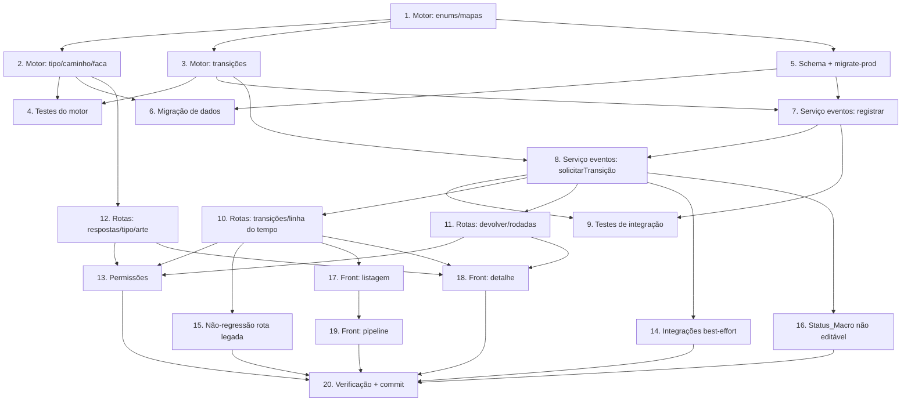

# Implementation Plan

## Overview

Plano incremental da Fundação (status fiel do Pedido/Proposta). A ordem respeita
dependências: primeiro o motor puro e seus testes (sem IO), depois schema +
migração de dados, depois os serviços de IO (eventos/integrações), as rotas, a
não-regressão da rota legada, e por fim o Front (repo separado). Cada tarefa é
só de código e aponta os requisitos que satisfaz.

## Tasks

- [x] 1. Motor puro de status (`status-fiel.motor.ts`) — enums, tabelas e derivações
  - Criar `src/modules/orcamento-grafico/pedido-proposta/status-fiel.motor.ts` com os tipos `Situacao` (12 valores), `StatusMacro` (9), `Setor` (5), `TipoPedido` (REPETICAO|ALTERACAO|PRODUTO_NOVO), `RespostasPedido`, `SituacaoFaca`, `SituacaoArte`, `EstadoLegado`.
  - Implementar `StatusFielError` e os mapas puros `statusMacroDe`, `setorDe`, `isTerminal`, `estadoLegadoDe`, `situacaoDeEstadoLegado` cobrindo o catálogo de 12 Situacoes_Internas.
  - _Requirements: 3.9, 5.1, 16.1_

- [x] 2. Motor puro — derivação de Tipo_Pedido, caminho e heurística da faca
  - Implementar `derivarTipoPedido(respostas)` (regra ordenada a/b/c + `aConfirmar`), `caminhoPreImpressao(tipo)` e `situacaoFacaDoTexto(matriz)` como funções puras determinísticas.
  - Implementar a tabela de exigências por Tipo_Pedido (pré-impressão/cálculo/aprovação de arte/prova).
  - _Requirements: 1.4, 1.5, 1.6, 1.16, 2.1, 2.11, 4.5_

- [x] 3. Motor puro — transições (ida/volta) e consultas
  - Declarar `TRANSICOES` (avanços + retornos + PERDIDO/CANCELADO gerados em código a partir de não-terminais).
  - Implementar `validarTransicao(atual, destino, tipo, motivo?)` com todos os códigos (ESTADO_TRANSICAO_INVALIDA, PEDIDO_TERMINAL, MOTIVO_OBRIGATORIO, CAMINHO_TIPO_VIOLADO) e `transicoesPermitidas(atual, tipo)` retornando `{ avanco, retorno }`.
  - Garantir precedência de PEDIDO_TERMINAL sobre transição inválida; motivo 5..500 trim para PERDIDO/CANCELADO.
  - _Requirements: 6.1, 6.2, 6.3, 6.6, 6.7, 6.8, 6.9, 6.10, 2.8_

- [x] 4. Testes do motor (unit + property-based)
  - Criar `status-fiel.motor.test.ts` (Vitest + fast-check) cobrindo P1–P9 do design: idempotência de `statusMacroDe`, ausência de becos, invariante caminho×tipo, totalidade de `derivarTipoPedido`, guarda de APROVADO, consistência consulta×validação, mapa dos 8 Estado_Legado.
  - Incluir casos unitários da heurística `situacaoFacaDoTexto` (nova/casa/código/vazio).
  - _Requirements: 16.2, 16.3, 16.4_

- [x] 5. Schema Prisma + migrate-prod (colunas, tabelas novas, índices) no mesmo commit
  - Adicionar ao `schema.prisma` as colunas novas de `PedidoProposta` (situacaoInterna, statusMacro, setorResponsavel, responsavelDesde, rodada, situacaoVersao, Respostas_Pedido, refOrigem*, tipoPedidoDerivado/Manual/Divergente, classificacaoAConfirmar, aprovacaoArteEm/Forma, relação inversa `eventos`) + os 3 índices (`[empresaId,statusMacro]`, `[empresaId,setorResponsavel]`, `[empresaId,refOrigemTipo,refOrigemNumero]`).
  - Adicionar os models NOVOS `EventoPedidoProposta` (tabela `evento_pedido_proposta`, FK `onDelete: Cascade`, índice `[empresaId,pedidoPropostaId,criadoEm]`) e `IdempotenciaEvento` (tabela `idempotencia_evento`, `@@unique([empresaId,operacao,chave])`) conforme o design (D2/D3). NÃO estender `LogPedidoProposta` (mantida intacta — Req 14.7).
  - Replicar no `migrate-prod.ts` com `ADD COLUMN IF NOT EXISTS` (lista `colsPedido`), `CREATE TABLE IF NOT EXISTS` das 2 tabelas e `CREATE INDEX/UNIQUE INDEX IF NOT EXISTS`; rodar `prisma generate`.
  - Testar `npx tsx prisma/migrate-prod.ts` 2× local sem erro (idempotência).
  - _Requirements: 14.1, 14.2, 14.3, 14.4, 14.5, 14.7, 14.8, 14.9_

- [x] 6. Migração de dados do Req 4 (`migrarPedidosParaStatusFiel`)
  - Implementar a função (chamada ao fim do migrate-prod), processando por empresa e lotes, só `WHERE situacao_interna IS NULL`.
  - Mapear Estado_Legado→Situacao/Status (com ACEITO+OP/PedidoVenda → EM_PRODUCAO/FATURADO), converter tipoPedido legado→derivado (MOSTRUARIO→exigeProva; nulo→aConfirmar), preencher Respostas_Pedido do disponível, rodada=1, responsavelDesde do último log ou criadoEm.
  - Não aplicar exigências retroativas a quem já está em EM_APROVACAO+; registrar aviso para estado desconhecido; preservar valores legados.
  - _Requirements: 4.1, 4.2, 4.3, 4.4, 4.5, 4.6, 4.7, 4.8, 4.9, 4.11, 4.12, 4.13, 4.14, 11.6, 16.6_

- [x] 7. Serviço de eventos (`servico-eventos.service.ts`) — registrarEvento
  - Implementar `registrarEvento(input)` com validação de formato (tipo 1..60 `/^[A-Z0-9_]{1,60}$/`, origem 1..60, dados <=64KB, motivo 0..500, chave 1..100), inserindo uma linha em `EventoPedidoProposta` sem alterar Situacao_Interna/Rodada, com `empresaId` do pedido real.
  - Implementar idempotência via tabela `IdempotenciaEvento` (`operacao='REGISTRAR_EVENTO'`): reaproveita por `(empresaId, operacao, chave)` com `paramsHash` igual retornando `resultadoJson`; `IDEMPOTENCIA_CONFLITO` (409) se hash diferente; só grava a chave quando aceito; concorrência resolvida por P2002→releitura.
  - Comentário de cabeçalho documentando contratos/erros/situações reservadas aos pilares.
  - _Requirements: 10.1, 10.4, 10.5, 10.7, 10.8, 10.9, 10.10, 10.11, 10.12, 11.1, 11.3_

- [x] 8. Serviço de eventos — solicitarTransicao (transação + update otimista)
  - Implementar `solicitarTransicao(input)` validando pelo motor puro, gravando Situacao/Status/Setor/Responsavel_Desde + a linha de `EventoPedidoProposta` na mesma transação, com `updateMany` condicional por `situacaoVersao` (`{ increment: 1 }`; relê e revalida uma vez em colisão).
  - Suportar `intencao: 'DEVOLVER'` (incrementa rodada em 1) e destino por Situacao ou por Setor; origem `modulo:` dispensa permissão de usuário.
  - _Requirements: 10.2, 10.3, 10.6, 10.14, 6.4, 6.5, 6.12, 12.8_

- [x] 9. Testes de integração do serviço de eventos (mock de Prisma)
  - Criar `servico-eventos.service.test.ts` cobrindo isolamento por empresaId (404 cross-empresa indistinguível), idempotência (reaproveita/conflito via `IdempotenciaEvento`), update otimista por `situacaoVersao` e rollback de transição de retorno.
  - _Requirements: 16.5, 11.2, 11.4, 10.7, 7.10_

- [x] 10. Rotas de status fiel (`pedido-status.routes.ts`)
  - Criar o arquivo com `authenticate` + empresaId explícito + Zod, e registrar em `server.ts` sob `/api/comercial/pedidos`: `GET /:id/transicoes`, `POST /:id/transicao`, `GET /:id/linha-do-tempo` (paginado asc).
  - Resolver `:id` por `findFirst({ id, empresaId })` → 404; mapear `StatusFielError`/`ZodError` para HTTP+code via `formatarErroZod`.
  - _Requirements: 6.9, 6.11, 8.6, 8.7, 11.4, 3.3_

- [x] 11. Rotas — devolver (retorno) e rodadas
  - Implementar `POST /:id/devolver` (setorDestino + motivo 5..500 trim), validando tabela de retornos, destino ≠ setor atual, terminal (409 PEDIDO_TERMINAL), incrementando rodada em transação atômica e gravando Evento RETORNO.
  - _Requirements: 7.1, 7.2, 7.3, 7.4, 7.5, 7.6, 7.7, 7.8, 7.9, 7.11, 7.12, 7.13_

- [x] 12. Rotas — Respostas_Pedido, correção de Tipo_Pedido e aprovação de arte manual
  - `PATCH /:id/respostas` (só em RECEBIDO/EM_PRE_IMPRESSAO/EM_ORCAMENTO; 409 TIPO_PEDIDO_BLOQUEADO fora disso; rederiva tipo; grava evento; resolve/vincula Referencia_Origem ou guarda texto não localizado).
  - `PATCH /:id/tipo-pedido` (motivo 5..500; marca manual; limpa aConfirmar; evento) e `POST /:id/aprovacao-arte` (forma/data/observacao → evento).
  - Permitir busca de Pedidos por Referencia_Origem (tipo+número).
  - _Requirements: 1.1, 1.2, 1.3, 1.7, 1.8, 1.9, 1.10, 1.11, 1.12, 1.13, 1.14, 2.7_

- [x] 13. Permissões nas transições sensíveis
  - Aplicar `verificarPermissaoComercial` nas rotas: `podeEnviarProposta` (→EM_APROVACAO por proposta), `podeAprovarOrcamento` (→APROVADO), `podeConverterPedido` (→EM_PRODUCAO/vínculo PedidoVenda), `podeVerComercial` (retorno/PERDIDO/CANCELADO); bypass ADMIN/SUPER_ADMIN; default liberado quando o Parametro não existe (403 PERMISSAO_NEGADA).
  - _Requirements: 12.1, 12.2, 12.3, 12.4, 12.5, 12.6, 12.7, 12.9_

- [x] 14. Integrações best-effort com as Entidades_Ligadas (`pedido-integracoes.service.ts`)
  - Criar o serviço com os ganchos `aoCriarOrcamento`, `aoEnviarProposta`, `aoAprovarOrcamento`, `aoMudarAmostra`, `aoGerarPedidoVenda`, `aoVincularOP`, cada um em `try/catch` que loga e não propaga, resolvendo a cadeia RFQ→Orcamento→PedidoVenda→OP por query filtrada por empresaId.
  - Plugar os ganchos nos pontos existentes (encaminhar-orcamento, envio/aprovação do OrcamentoGrafico, AprovacaoAmostra, geração de PedidoVenda, conclusão de OP) sem alterar as regras dessas entidades.
  - _Requirements: 9.1, 9.2, 9.3, 9.4, 9.5, 9.6, 9.7, 9.8, 9.9, 9.10, 3.5, 3.6, 3.7_

- [x] 15. Não-regressão da rota legada de estado e sincronização de `estado`
  - Ajustar a rota legada de transição em `pedido-proposta.routes.ts` para traduzir `estado` destino → Situacao via motor, aplicar as mesmas validações e manter `estado` preenchido/coerente após cada transição.
  - Aceitar criação com `tipoPedido` legado sem Respostas_Pedido (portal do rep), convertendo conforme Req 4 e marcando classificacaoAConfirmar.
  - Teste de regressão percorrendo NOVO→…→ACEITO traduzido.
  - _Requirements: 13.1, 13.2, 13.3, 13.4, 13.6, 13.7, 13.8, 13.10_

- [x] 16. Status_Macro não editável e derivação a partir das entidades ligadas
  - Rejeitar gravação direta de `statusMacro` (400 STATUS_MACRO_NAO_EDITAVEL) nas rotas de update; recalcular `statusMacro` na mesma transação da mudança de Situacao_Interna e ao mudar entidade ligada (EM_PRODUCAO/FATURADO).
  - _Requirements: 3.1, 3.2, 3.3, 3.4, 3.5, 3.6, 3.7, 3.8_

- [x] 17. Front — Tela de Pedidos (listagem + filtros + selos)
  - No repo `VisioFab.Wms.Front`, estender `orcamento-grafico/pedidos/page.tsx`: colunas Status_Macro (selo cor+texto), Setor, Tempo_Parado formatado, Rodada, Tipo_Pedido; filtros Status_Macro/Setor/Tipo + ordenação por Tempo_Parado; degradação sem campos novos.
  - _Requirements: 15.1, 15.2, 15.3, 15.4, 15.10_

- [x] 18. Front — Detalhe do Pedido (linha do tempo, devolver, respostas, aprovação de arte)
  - Criar/estender `orcamento-grafico/pedidos/[id]/page.tsx`: Linha_do_Tempo, ação "Devolver para…" (setor + motivo obrigatório com mensagem de erro do Back), listar só transições permitidas, ocultar/desabilitar por permissão, exibir Respostas_Pedido + sinais (aConfirmar/matriz a confirmar/referência não localizada), correção de Tipo_Pedido e registro manual de aprovação de arte; acessível por teclado.
  - _Requirements: 15.5, 15.6, 15.7, 15.8, 15.11, 15.12_

- [x] 19. Front — Pipeline por Status_Macro
  - Ajustar `orcamento-grafico/pipeline/page.tsx` para agrupar colunas por Status_Macro sem perder pedido; manter funcionamento após migração.
  - _Requirements: 15.9, 13.5, 13.9_

- [x] 20. Verificação final e checklist de commit
  - Rodar o teste do motor e o de integração; `get_diagnostics` limpo nos arquivos tocados (back e front); confirmar migrate-prod 2× idempotente.
  - Preparar commits separados (back: schema.prisma + migrate-prod.ts juntos; front à parte), deixando fora `configurador/produtos/page.tsx` e `src/data/hooks/useProduto.ts`.
  - _Requirements: 14.1, 16.2, 16.5, 16.6_

## Task Dependency Graph

```json
{
  "waves": [
    { "wave": 1, "tasks": ["1"] },
    { "wave": 2, "tasks": ["2", "3", "5"] },
    { "wave": 3, "tasks": ["4", "6", "7"] },
    { "wave": 4, "tasks": ["8"] },
    { "wave": 5, "tasks": ["9", "10", "11", "12", "14", "16"] },
    { "wave": 6, "tasks": ["13", "15", "17"] },
    { "wave": 7, "tasks": ["18", "19"] },
    { "wave": 8, "tasks": ["20"] }
  ]
}
```



## Notes

- Back e Front são repositórios separados. Tarefas 1–16 são no Back; 17–19 no
  Front; a 20 fecha os dois.
- `schema.prisma` e `migrate-prod.ts` SEMPRE no mesmo commit (steering
  database-migrations); testar `migrate-prod.ts` 2× local (idempotência).
- Multi-tenant: `empresaId` explícito em toda query; `prismaScoped` não isola
  SUPER_ADMIN.
- Verificação preferida nesta máquina: `get_diagnostics` nos arquivos tocados;
  testes com `npx vitest run <arq> --reporter=dot` (reporter `basic` removido).
- Não commitar `configurador/produtos/page.tsx` nem `src/data/hooks/useProduto.ts`
  (instrução do usuário). Scripts temporários com prefixo `_tmp-`, removidos após
  uso.
- As tarefas marcadas de teste cobrem as Correctness Properties P1–P9 do design.
