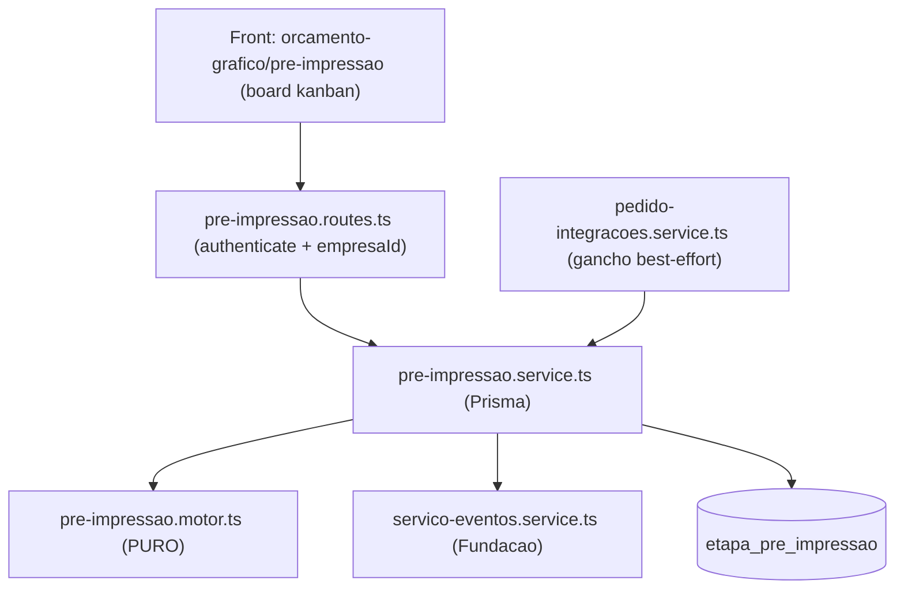

# Design Document — Board da Pré-Impressão

## Overview

Pilar 3 (Frente 2) do fluxo comercial. Board kanban por Pedido com as 4 etapas
**Mockup → Arte → Padrão → Ficha Técnica**, status de ida e volta, acionando o
`Servico_Eventos` da Fundação (sem alterar a máquina de estados). Aditivo e
não-regressivo.

## Architecture



Fluxo: pedido entra em EM_PRE_IMPRESSAO → gancho best-effort chama
`garantirBoard` → pré-impressão mexe nas etapas pela tela → cada mudança grava
status + evento; board concluído → evento `PRE_IMPRESSAO_CONCLUIDA` (sem forçar
transição).

### Decisões

**D1 — Etapas fixas, uma linha por etapa.** Tabela `etapa_pre_impressao`, 4
linhas por pedido (uma por `etapa`), `@@unique([pedidoPropostaId, etapa])`.
Ordem fixa pela enum.

**D2 — Criação idempotente e best-effort no gancho.** Quando o pedido entra em
`EM_PRE_IMPRESSAO` (via `solicitarTransicao`), um gancho best-effort chama
`garantirBoard(pedidoId)`. Também há endpoint explícito para pedidos antigos.
`garantirBoard` cria só o que falta (idempotente por `@@unique`).

**D3 — Conclusão sinaliza, não força transição (Req 3.2).** Quando as etapas
relevantes do caminho estão `CONCLUIDA`, registra `PRE_IMPRESSAO_CONCLUIDA` na
Linha_do_Tempo. Não transiciona o pedido — o comercial decide. Mantém a
não-regressão.

**D4 — Etapas relevantes por caminho.** Função pura `etapasRelevantes(caminho)`:
- `COMPLETA` (produto novo): as 4 etapas.
- `PARCIAL` (alteração): `ARTE`, `PADRAO`, `FICHA_TECNICA` (sem mockup).
- `CONFERENCIA` (repetição): `ARTE`, `FICHA_TECNICA` (conferir arte e ficha).
As 4 etapas sempre existem no board; "relevantes" define quando o board é
considerado concluído.

## Components and Interfaces

### Módulo PURO — `pre-impressao.motor.ts`

```ts
export type EtapaPre = 'MOCKUP' | 'ARTE' | 'PADRAO' | 'FICHA_TECNICA'
export type StatusEtapa = 'PENDENTE' | 'EM_ANDAMENTO' | 'CONCLUIDA'
export type Caminho = 'CONFERENCIA' | 'PARCIAL' | 'COMPLETA'

export const ETAPAS: EtapaPre[]                       // ordem fixa
export class PreImpressaoError extends Error { statusCode; code }

export function etapasRelevantes(caminho: Caminho): EtapaPre[]
export function boardConcluido(
  caminho: Caminho,
  statusPorEtapa: Record<EtapaPre, StatusEtapa>,
): boolean                                            // todas relevantes CONCLUIDA
export function validarStatus(s: string): StatusEtapa // lança se inválido
```

### Service I/O — `pre-impressao.service.ts` (Prisma, empresaId explícito)

```ts
garantirBoard(empresaId, pedidoId): { criadas: number }        // idempotente
obterBoard(empresaId, pedidoId): { etapas[], caminho, concluido }
listarPedidosEmPreImpressao(empresaId): ResumoPedidoBoard[]
mudarStatusEtapa(empresaId, pedidoId, etapa, status, usuarioId, observacao?)
```

- `garantirBoard`: valida pedido por `{ id, empresaId }` (404); cria as 4 etapas
  que faltarem; registra `BOARD_CRIADO` (best-effort).
- `mudarStatusEtapa`: valida etapa/status; grava status + datas (início/conclusão);
  registra evento `ETAPA_BOARD_<ETAPA>_<STATUS>`; se o board ficou concluído,
  registra `PRE_IMPRESSAO_CONCLUIDA` (best-effort). Tudo isolado por empresaId.

### Gancho na Fundação (best-effort)

Em `pedido-integracoes.service.ts`, nova função `aoEntrarPreImpressao(empresaId,
pedidoId)` chamando `garantirBoard` em try/catch. Acionada quando uma transição
leva à situação `PRE_IMPRESSAO_EM_ANDAMENTO` (no `solicitarTransicao`, de forma
best-effort para não acoplar o motor).

### Rotas — `pre-impressao.routes.ts` (prefixo `/api/orcamento-grafico`, authenticate)

| Método | Rota | Descrição |
|---|---|---|
| GET | `/pre-impressao/pedidos` | lista pedidos em EM_PRE_IMPRESSAO + resumo do board |
| GET | `/pedidos-proposta/:id/board` | board do pedido (4 etapas) |
| POST | `/pedidos-proposta/:id/board/garantir` | cria/garante o board |
| PATCH | `/pedidos-proposta/:id/board/:etapa` | muda status da etapa `{ status, observacao? }` |

Permissão: `podeVerComercial` (bypass ADMIN). empresaId explícito.

## Data Models

### `EtapaPreImpressao` (schema.prisma)

```prisma
model EtapaPreImpressao {
  id               String    @id @default(uuid())
  empresaId        String    @map("empresa_id")
  pedidoPropostaId String    @map("pedido_proposta_id")
  etapa            String    @db.VarChar(20) // MOCKUP|ARTE|PADRAO|FICHA_TECNICA
  status           String    @default("PENDENTE") @db.VarChar(16)
  ordem            Int
  observacao       String?   @db.Text
  dataInicio       DateTime? @map("data_inicio")
  dataConclusao    DateTime? @map("data_conclusao")
  criadoEm         DateTime  @default(now()) @map("criado_em")
  atualizadoEm     DateTime  @updatedAt @map("atualizado_em")

  pedidoProposta PedidoProposta @relation(fields: [pedidoPropostaId], references: [id], onDelete: Cascade)

  @@unique([pedidoPropostaId, etapa])
  @@index([empresaId, pedidoPropostaId])
  @@map("etapa_pre_impressao")
}
```

Relação inversa em `PedidoProposta`: `etapasPreImpressao EtapaPreImpressao[]`.

### migrate-prod.ts (idempotente)

`CREATE TABLE IF NOT EXISTS etapa_pre_impressao (...)` + `CREATE UNIQUE INDEX IF
NOT EXISTS` em `(pedido_proposta_id, etapa)` + índice `(empresa_id,
pedido_proposta_id)` + FK em try/catch. Mesmo commit do schema.

## Front

- `src/app/(interna)/orcamento-grafico/pre-impressao/page.tsx`: lista de pedidos
  em pré-impressão (cliente, produto, progresso "X/Y", tempo parado); clicar abre
  o board.
- Board do pedido: 4 cartões de etapa com status (selo) e botões Iniciar /
  Concluir / Voltar + observação. Consome as rotas novas. Degrada sem campos.
- Item "Pré-Impressão" no menu Comercial do `ModuleSidebar` (ou equivalente).

## Correctness Properties

### Property 1: etapasRelevantes é subconjunto de ETAPAS
`etapasRelevantes(caminho)` é determinística e sempre retorna um subconjunto de ETAPAS, para qualquer caminho.
**Validates: Requirements 7.1, 7.2**

### Property 2: boardConcluido reflete as etapas relevantes
`boardConcluido(caminho, status)` retorna true se e somente se todas as etapas relevantes do caminho estão CONCLUIDA.
**Validates: Requirements 3.1, 7.2**

### Property 3: validarStatus aceita só os 3 status
`validarStatus` aceita somente PENDENTE, EM_ANDAMENTO e CONCLUIDA; qualquer outro valor lança erro.
**Validates: Requirements 2.1, 7.1**

## Error handling

- Motor lança `PreImpressaoError(status, msg, code)`; rotas mapeiam p/ HTTP+code.
- Ganchos best-effort em try/catch (não derrubam a operação de origem).

## Testing Strategy

- Unit (`pre-impressao.motor.test.ts`): P1–P3 (vitest).
- Integração mock Prisma (`pre-impressao.service.test.ts`): idempotência de
  `garantirBoard`, isolamento por empresaId, mudança de status + evento.
- Fumaça da migração (2x).

## Rastreabilidade

| Req | Onde |
|---|---|
| 1 | `garantirBoard` + gancho + endpoint garantir |
| 2 | `mudarStatusEtapa` + datas + eventos |
| 3 | `boardConcluido` → `PRE_IMPRESSAO_CONCLUIDA` (sem forçar transição) |
| 4 | `obterBoard`, `listarPedidosEmPreImpressao` |
| 5 | schema + migrate-prod |
| 6 | tela pré-impressão + menu |
| 7 | motor puro + testes |
