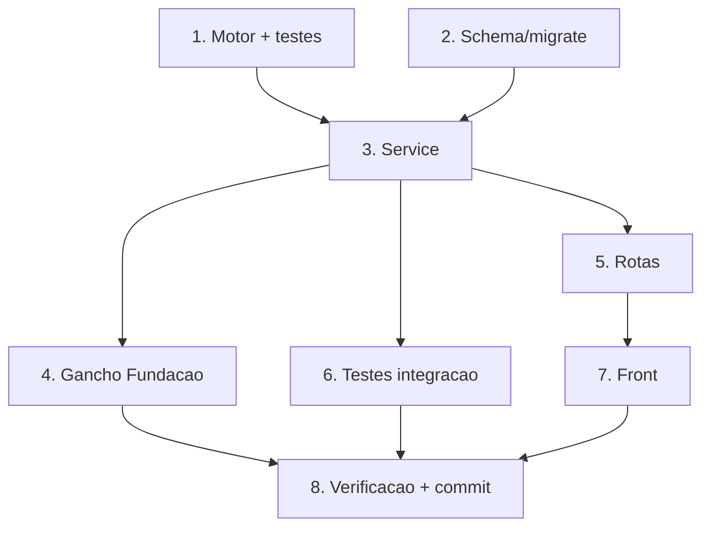

# Implementation Plan

## Overview

Board da Pré-Impressão (Frente 2). Motor puro + testes → schema/migração →
service → gancho na Fundação → rotas → testes de integração → front → verificação
e commit. Reusa o Servico_Eventos da Fundação.

## Tasks

- [x] 1. Motor puro `pre-impressao.motor.ts` + testes
  - Criar o motor (ETAPAS, StatusEtapa, Caminho, `etapasRelevantes`, `boardConcluido`, `validarStatus`, `PreImpressaoError`) e `pre-impressao.motor.test.ts` (P1–P3).
  - _Requirements: 7.1, 7.2_

- [x] 2. Schema + migrate-prod (etapa_pre_impressao)
  - Model `EtapaPreImpressao` + relação inversa em `PedidoProposta`; `migrate-prod.ts` idempotente (CREATE TABLE/INDEX/UNIQUE IF NOT EXISTS + FK try/catch); `prisma generate`.
  - _Requirements: 5.1, 5.2, 5.3, 5.4_

- [x] 3. Service `pre-impressao.service.ts`
  - `garantirBoard` (idempotente, evento BOARD_CRIADO), `obterBoard`, `listarPedidosEmPreImpressao`, `mudarStatusEtapa` (datas + evento + PRE_IMPRESSAO_CONCLUIDA quando board concluído). empresaId explícito; best-effort no Servico_Eventos.
  - _Requirements: 1.1, 1.2, 1.3, 1.5, 2.1, 2.2, 2.3, 2.5, 2.6, 3.1, 3.2, 3.3, 4.1, 4.2, 4.3, 4.4_

- [x] 4. Gancho na Fundação (aoEntrarPreImpressao)
  - Em `pedido-integracoes.service.ts`, `aoEntrarPreImpressao` chamando `garantirBoard` em try/catch; acionar best-effort quando a transição leva a PRE_IMPRESSAO_EM_ANDAMENTO.
  - _Requirements: 1.1, 3.4_

- [x] 5. Rotas `pre-impressao.routes.ts`
  - GET `/pre-impressao/pedidos`, GET `/pedidos-proposta/:id/board`, POST `/pedidos-proposta/:id/board/garantir`, PATCH `/pedidos-proposta/:id/board/:etapa`; authenticate + permissão; 404 cross-empresa; registrar no server.ts.
  - _Requirements: 1.4, 2.4, 4.1, 4.2, 6.5_

- [x] 6. Testes de integração (mock de Prisma)
  - `pre-impressao.service.test.ts`: idempotência de garantirBoard, isolamento por empresaId, mudança de status + evento, board concluído.
  - _Requirements: 7.3_

- [x] 7. Front — tela de Pré-Impressão (board)
  - `orcamento-grafico/pre-impressao/page.tsx`: lista de pedidos em pré-impressão + progresso; board com 4 etapas (iniciar/concluir/voltar + observação); item no menu Comercial.
  - _Requirements: 6.1, 6.2, 6.3, 6.4, 6.5_

- [x] 8. Verificação e commit
  - Testes (motor + integração); get_diagnostics limpo (back e front); next build; migrate-prod idempotente. Commits separados (back: schema+migrate juntos; front à parte). Não commitar configurador/produtos nem useProduto.
  - _Requirements: 5.1, 7.2, 7.3_

## Task Dependency Graph

```json
{
  "waves": [
    { "wave": 1, "tasks": ["1", "2"] },
    { "wave": 2, "tasks": ["3"] },
    { "wave": 3, "tasks": ["4", "5", "6"] },
    { "wave": 4, "tasks": ["7"] },
    { "wave": 5, "tasks": ["8"] }
  ]
}
```



## Notes

- Back e Front repos separados. 1–6 no Back; 7 no Front; 8 fecha.
- schema.prisma + migrate-prod.ts no mesmo commit; idempotente.
- Reusa Servico_Eventos; não altera a máquina de estados da Fundação.
- empresaId explícito; ganchos best-effort.
- Scripts temporários `_tmp-`, removidos após uso.
