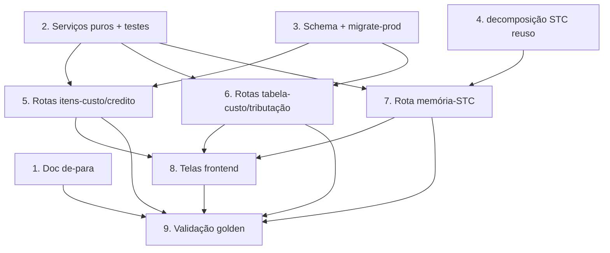

# Implementation Plan — Configurador Gráfico (paridade Calcgraf) + Memória CalculoSTC

## Overview

Ordem: primeiro os serviços PUROS (testáveis sem Prisma, com property-based) e o
documento de de-para; depois schema + migração (no mesmo commit); depois as rotas
backend; depois as telas; por fim validação golden (12992) e não-regressão.

Reuso máximo dos cadastros existentes (PrecoMateriaPrima, SuporteGrafico,
CentroProducao, AcabamentoGrafico, TabelaMargem) e do service de decomposição STC
(`decomposicao-stc.service.ts`). Estrutura nova só nas 3 lacunas: crédito fiscal do
papel, tabela de custo por vigência/coluna, tributação por operação.

> Regras do projeto (obrigatórias): `empresaId` EXPLÍCITO em toda query;
> `schema.prisma` + `prisma/migrate-prod.ts` SEMPRE no mesmo commit (idempotente,
> testado 2× local); NÃO alterar o motor nem a ancoragem (não-regressão);
> `get_diagnostics` nos arquivos tocados; testes via `vitest --reporter=dot`.

## Task Dependency Graph



```json
{
  "waves": [
    { "wave": 1, "tasks": ["1", "2", "3", "4"] },
    { "wave": 2, "tasks": ["5", "6", "7"] },
    { "wave": 3, "tasks": ["8"] },
    { "wave": 4, "tasks": ["9"] }
  ]
}
```

## Tasks

- [x] 1. Documento de de-para Calcgraf → Vizor
  - Criar `docs/calcgraf-config-de-para.md` com a tabela de-para (seção 3 do
    design): cada configuração do Calcgraf → model/cadastro do Vizor → status
    (existe / parcial / lacuna).
  - Detalhar as 3 lacunas com descrição e impacto no cálculo: crédito fiscal do
    papel (PIS/COFINS 9,25%), tabelas de custo por vigência/coluna, tributação por
    operação; listar quais componentes do CEV são parametrizáveis por caso.
  - _Requirements: 1.1, 1.2, 1.3, 1.4, 1.5_

- [x] 2. Serviços puros + testes (sem Prisma)
  - [x] 2.1 `configurador-grafico/credito-fiscal.service.ts` — `precoLiquidoCredito(bruto, creditoPercent)` com `round2`; crédito 0 → bruto.
    - _Requirements: 3.2, 3.3_
  - [x] 2.2 `configurador-grafico/vigencia-tabela.service.ts` — `sobrepoe(a,b)` (fim null = +∞) e `versaoVigenteNaData(versoes, data)` (retorna no máximo 1).
    - _Requirements: 4.3, 4.6_
  - [x] 2.3 `configurador-grafico/itens-custo-view.service.ts` — `grupoDaOrigem(origem)` (MD/CT/SE) e `montarItensCusto(cadastros)` (visão unificada com origem derivada do tipo de cadastro).
    - _Requirements: 2.1, 2.3_
  - [x] 2.4* Testes property-based (fast-check) dos 3 serviços — crédito (P1–P3), vigência (P4–P5), itens-custo (P8). 16/16 passando.
    - _Requirements: 2.3, 3.3, 4.3, 4.6_

- [x] 3. Schema Prisma + migrate-prod (mesmo commit)
  - [x] 3.1 `PrecoMateriaPrima.creditoPisCofinsPercent` (Decimal 5,2, nullable) + `ALTER TABLE ... ADD COLUMN IF NOT EXISTS`.
    - _Requirements: 3.2, 3.3_
  - [x] 3.2 Models `TabelaCustoGrafico` + `TabelaCustoGraficoItem` (valores por coluna: total/direto/depreciacao/administracao/outros/freteKg) + `CREATE TABLE/INDEX IF NOT EXISTS`.
    - _Requirements: 4.1, 4.2_
  - [x] 3.3 Model `TributacaoGrafica` (alíquotas + flags de crédito + papel imune) + `CREATE TABLE/INDEX IF NOT EXISTS`.
    - _Requirements: 3.6_
  - [x] 3.4 `prisma validate` OK (schema válido). Migração roda no deploy do Render (Postgres local off; idempotente). migrate-prod.ts no mesmo commit do schema.
    - _Requirements: 4.1, 4.2, 3.6_

- [ ] 4. Reuso do service de decomposição STC (memória)
  - Garantir que `normalizarCustosStc`/`aplicarDecomposicaoStc` cobrem o agrupamento
    MD/CT/SE e a Origem para a memória (já existe); adicionar helper
    `montarMemoriaStc(custosCalcgraf)` se necessário (puro) retornando
    `{ materialDireto, custoTransformacao, servicoExterno, custoProducao, componentes, temMemoria }`.
  - _Requirements: 5.1, 5.2, 5.3, 5.5_

- [x] 5. Backend — rotas de itens de custo + crédito fiscal do papel
  - [x] 5.1 `GET /api/configurador-grafico/itens-custo` (visão unificada, filtros origem/busca), `empresaId` explícito. (em `configurador-grafico.routes.ts`)
    - _Requirements: 2.1, 2.5, 6.1_
  - [x] 5.2 Validação de Origem inválida → 400 com valores válidos.
    - _Requirements: 2.4_
  - [x] 5.3 `PUT /api/configurador-grafico/papel/:id/credito-fiscal` — grava `creditoPisCofinsPercent` e retorna preço líquido; isolamento por empresa.
    - _Requirements: 3.1, 3.2, 3.3, 6.2, 6.3_

- [x] 6. Backend — tabelas de custo (vigência) + tributação por operação
  - [x] 6.1 CRUD de versões; POST/PUT rejeita vigência sobreposta (409) via `conflitoDeVigencia`; `empresaId` explícito.
    - _Requirements: 4.1, 4.2, 4.3, 4.5, 6.1, 6.3_
  - [x] 6.2 `GET /tabelas-custo/vigente?data=` — versão vigente (máx. 1) ou 404 via `versaoVigenteNaData`.
    - _Requirements: 4.4, 4.6_
  - [x] 6.3 CRUD de tributação por operação (alíquotas/flags/papel imune); `empresaId` explícito.
    - _Requirements: 3.6, 6.1, 6.3_
  - [x] 6.4 Registrado no `server.ts` com `authenticate` (prefixo `/api/configurador-grafico`); isolamento cross-tenant (404).
    - _Requirements: 6.1, 6.2_

- [x] 7. Backend — rota de Memória do CalculoSTC (read-only)
  - `GET /api/calculo-grafico/:id/memoria-stc`: lê `custosCalcgraf`, monta MD/CT/SE
    + componentes + Origem via `montarMemoriaStc`; `temMemoria:false` quando nulo;
    sem edição; `empresaId` do cálculo explícito. Golden 12992 testado (19/19).
  - _Requirements: 5.1, 5.2, 5.3, 5.5, 5.6, 5.7, 5.8, 6.1, 6.2, 7.4_

- [ ] 8. Frontend — telas (módulo Orçamento Gráfico ▸ Cadastros)
  - [ ] 8.1 "Itens de Custo" — grid Mantine com coluna Origem + badge MD/CT/SE + filtro; clique navega ao cadastro de origem. (depende do deploy backend)
    - _Requirements: 2.1, 2.3_
  - [ ] 8.2 Campo "Crédito PIS/COFINS %" no cadastro de preço de papel + exibição do preço líquido ao lado do bruto. (depende do deploy backend)
    - _Requirements: 3.1, 3.2, 3.3_
  - [ ] 8.3 "Tabelas de Custo" (versões por vigência) — lista + criar/editar; erro claro de conflito de vigência (409). (depende do deploy backend)
    - _Requirements: 4.1, 4.3_
  - [ ] 8.4 "Tributação & Margens" — CRUD das operações (alíquotas/flags/papel imune). (depende do deploy backend)
    - _Requirements: 3.6_
  - [x] 8.5 Painel "Memória STC" (read-only) na Biblioteca de Cálculos — botão "Memória STC" por linha + modal com subtotais MD/CT/SE, C.Prod, Origem por componente, e mensagem quando sem memória. get_diagnostics limpo.
    - _Requirements: 5.1, 5.2, 5.3, 5.6, 5.7_

- [ ] 9. Validação golden (12992) + não-regressão
  - [ ] 9.1 Validar na API (Wega): `GET /memoria-stc` do 12992 → MD 4.113,94 / CT 1.078,11 / total 5.192,05; crédito fiscal 7,45→6,83.
    - _Requirements: 5.4, 3.3, 7.3_
  - [ ] 9.2 Rodar a suíte `src/modules/orcamento-grafico` (vitest) — 0 regressões; confirmar que o puxar do 12992 segue em 5.192,05 e `custosCalcgraf`/foto inalterados.
    - _Requirements: 7.1, 7.2, 7.3, 7.4_

## Notes

- Tarefas marcadas com `*` (ex.: 2.4) são testes property-based (fast-check) —
  opcionais para o fluxo funcional, mas recomendadas para as funções puras.
- `CalculoSTC` é SAÍDA/memória: a Memória STC é SOMENTE LEITURA; nunca editar o
  `custosCalcgraf` nem a foto do cálculo (Req 7.4).
- Acesso ao banco Calcgraf (de-para/validação): `sqlcmd -S localhost -E -C -d
  CalcgrafCartonWega` (SOMENTE LEITURA). `cartoon/` é gitignored.
- Produção (Wega): empresa `75848e24-742e-461d-b913-1642c5b83ae9`; `custos_calcgraf`
  já gravado para 7.926 cálculos. Golden de validação: cálculo 12992.
- Commit: schema.prisma + migrate-prod.ts juntos; push na `main` (deploy Render/Vercel).
- Sequência prática: Wave 1 (de-para + puros + schema + reuso STC) → Wave 2 (rotas)
  → Wave 3 (telas) → Wave 4 (validação golden + não-regressão).
