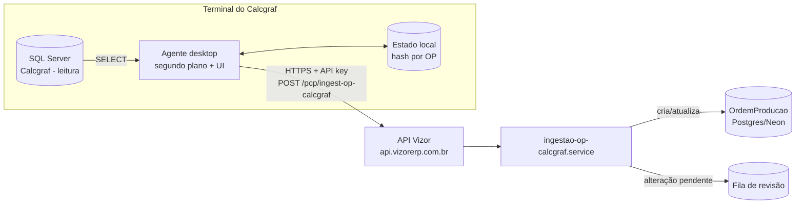
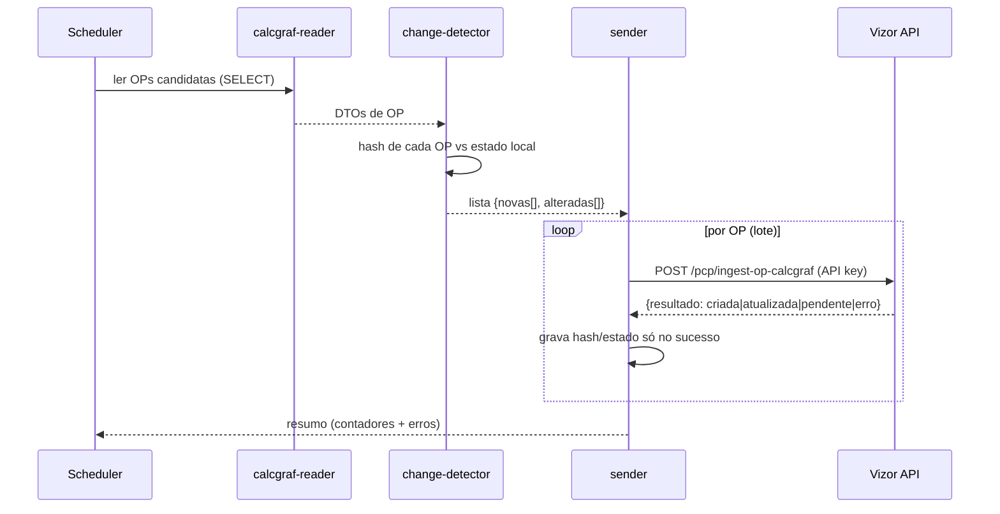

# Design — Importador de OP do Calcgraf (agente desktop → Vizor)

## Overview

Dois componentes novos trabalham juntos, sem substituir o importador de PDF
existente (que continua como fallback):

> As seções canônicas abaixo (Architecture, Components and Interfaces, Data
> Models, Correctness Properties) organizam o design; o conteúdo está em
> português conforme o padrão do projeto.


1. **Agente desktop (TS)** — app Windows que roda no servidor do Calcgraf.
   Conecta ao SQL Server local **somente leitura**, detecta OPs novas e
   alteradas, e as envia por HTTPS para a API do Vizor. Roda em segundo plano
   (serviço) e também sob demanda (UI).
2. **Endpoint de ingestão no Vizor (backend)** — recebe o payload do agente,
   autentica por API key vinculada a uma empresa, e cria/atualiza
   `OrdemProducao` reutilizando o mesmo caminho de persistência da importação de
   PDF (casamento por `referenciaExterna`, tags em `observacoes`, bloqueio
   quando há produção).



### Decisões de arquitetura
- **O agente lê o banco LOCAL do TS**, não o backup restaurado no PC de
  desenvolvimento. O backup (`CalcgrafCartonWega`) é só bancada de dev/teste. O
  schema de dev precisa bater com a produção — confirmar versão do Calcgraf com
  o DevOps e usar um backup recente (risco documentado em "Riscos").
- **Detecção de alteração por HASH de conteúdo**, não por timestamp:
  `OpHeader` só tem `DataHoraEmissao` (emissão), **não** há coluna de "última
  alteração". O agente calcula um hash determinístico do conteúdo relevante da
  OP (header + itens + estrutura + lotes) e compara com o último hash enviado.
- **O Vizor é a autoridade de identidade**: casa a OP por
  `referenciaExterna == OpHeader.Numero` + `origemImportacao`. Reusa a regra já
  provada do importador de PDF.
- **Somente leitura garantida em duas camadas**: (1) usuário SQL com role
  `db_datareader` (preferência) e (2) o agente só emite `SELECT`.
- **MVP = só a OP** (header/itens/estrutura/lotes/etapas-roteiro). Cálculos
  gráficos ficam para fase futura — o payload é versionado para permitir
  evoluir sem quebrar.

---

## Architecture

A arquitetura está descrita no diagrama acima e detalhada nos dois componentes
a seguir (agente desktop no TS e endpoint de ingestão no Vizor). O agente lê o
SQL Server local em modo somente-leitura, detecta diferenças por hash e envia
por HTTPS autenticado para a API; o Vizor cria/atualiza `OrdemProducao`
reusando o caminho da importação de PDF, com isolamento multi-tenant explícito.

## Components and Interfaces

### Componente 1 — Agente desktop (TS)

### Stack
- **Electron + TypeScript** (reuso do ecossistema Node/TS do time; empacota como
  instalável Windows `.exe`; UI simples para config + sync sob demanda; roda em
  segundo plano via janela oculta/tray + auto-start).
  - Alternativa considerada: .NET WinForms/Worker Service (nativo Windows, mais
    leve). Rejeitada para manter uma só stack (TS) no time. Registrada como
    opção caso o consumo de memória do Electron incomode no TS.
- **Acesso ao SQL Server**: o levantamento mostrou que a instância **não expõe
  TCP/1433** (só named pipes/shared memory). Portanto:
  - **Driver primário**: `msnodesqlv8` (usa ODBC + named pipes, suporta
    autenticação Windows `Trusted_Connection=yes` e trust do certificado) —
    conecta localmente sem precisar habilitar TCP.
  - **Fallback / modo dev**: ponte via `sqlcmd` + `FOR JSON PATH` (já validada
    no levantamento), caso o driver nativo não instale no TS.
  - **Decisão de credencial fica com o DevOps** (Req 9): autenticação Windows
    do serviço OU usuário SQL `db_datareader` dedicado. A connection string é
    **configurável**.

### Módulos do agente
| Módulo | Responsabilidade |
|---|---|
| `config` | Lê/grava config protegida (connection string, URL API, API key, intervalo). Segredos cifrados com DPAPI (Windows `safeStorage` do Electron). |
| `calcgraf-reader` | Abre conexão só-leitura; queries de OP (header+itens+estrutura+lotes); monta o DTO da OP. |
| `change-detector` | Calcula hash por OP; compara com estado local; classifica em NOVA / ALTERADA / INALTERADA. |
| `state-store` | Persiste estado local (SQLite ou JSON em `%APPDATA%`): `{ numeroOp, hash, ultimoEnvioEm, status }`. |
| `sender` | POST autenticado para a API; retry com backoff; marca enviado só no sucesso. |
| `scheduler` | Loop de segundo plano (intervalo configurável) + gatilho manual pela UI. |
| `ui` | Tela de config + botão "Sincronizar agora" + painel de resultado (novas/alteradas/pendentes/erros) + log. |

### Query de leitura (conceitual)
Seleciona as OPs candidatas e suas filhas por `OpHeader.Codigo`:
```sql
-- Candidatas: OPs recentes/ativas (filtra por faixa de Numero ou DataHoraEmissao
-- para não varrer as 3193 toda vez; o hash decide o que mudou).
SELECT Codigo, Numero, Serie, DataHoraEmissao, Descricao, FlagExportado, CodExterno
FROM OpHeader WHERE Ativo <> 'N' /* ... */;
-- Para cada OpHeader.Codigo: OpItem, OpItemEstrutura, OpLote (tiragem, datas,
-- fila, status), e o produto via OpItem.CodItemEstoque.
```
> As colunas exatas de cada tabela estão em `docs/calcgraf-mapeamento-importacao.md`
> (seção "Tabelas de OP"). A query definitiva é tarefa da implementação,
> validada contra o backup real.

### Detecção de alteração (hash)
```
hashOp = sha256(normalizar({
  numero, descricao, dataEmissao,
  itens: [{ item, codItemEstoque, status }...],
  estrutura: [...],
  lotes: [{ tiragem, dataPrometida, ordemFila, status }...],
}))
```
Normalização determinística (ordenar arrays por chave estável, trim de strings,
números com precisão fixa) para o mesmo conteúdo gerar sempre o mesmo hash.

### Fluxo de um ciclo de sincronização


---

### Componente 2 — Ingestão no Vizor (backend)

### Autenticação por API key (Req 6)
Novo mecanismo de credencial de máquina, **separado do JWT de usuário**:
- Model **`AgenteApiKey`** (`agente_api_key`): `id`, `empresaId` (FK),
  `nome` (ex.: "Agente Calcgraf — Carton Wega"), `tokenHash` (hash do token, o
  token em claro só é exibido na criação), `status` (ATIVO/REVOGADO),
  `ultimoUsoEm`, `criadoEm`. `@@index([empresaId])`.
- Hook `agenteAuth`: lê header `x-agente-key`, resolve a key por hash, injeta
  `request.agente = { empresaId, keyId }`. Rejeita 401 se ausente/inválida/
  revogada. **Todo gravação usa `request.agente.empresaId`** (isolamento
  multi-tenant explícito — nunca `prismaScoped` só, por causa do bypass
  SUPER_ADMIN documentado no steering `ATENCAO-pontos-verificar.md`).

### Rota de ingestão
`POST /api/pcp/ingest-op-calcgraf` (prefixo `/api/pcp`, hook `agenteAuth`):
- Body (payload versionado):
```ts
{
  schemaVersion: 1,
  ops: Array<{
    numero: number            // OpHeader.Numero → referenciaExterna
    descricao: string
    dataEmissao?: string
    produtoNome?: string      // via CodItemEstoque (nome)
    produtoCodigo?: string
    clienteNome?: string
    quantidade?: number       // tiragem do lote principal
    dataEntrega?: string      // OpLote.DataPrometida
    tiragem?: number
    hashOrigem: string        // o hash calculado pelo agente (idempotência)
    itens?: [...]             // itens/estrutura (fase MVP: mínimo p/ liberar)
    etapas?: [...]            // roteiro, quando disponível
  }>
}
```
- Resposta: por OP, `{ numero, resultado: 'criada'|'atualizada'|'pendente'|'ignorada'|'erro', mensagem? }`.
- Validação Zod; payload malformado → 400 com mensagem clara, **sem** tocar OPs
  existentes (Req 8.4).

### Serviço `ingestao-op-calcgraf.service.ts` (regras de negócio)
Para cada OP do payload, dentro de uma transação por OP:

1. **Idempotência (Req 8.1)**: busca `OrdemProducao` por
   `{ empresaId, origemImportacao: 'AGENTE_CALCGRAF', referenciaExterna: String(numero) }`.
   - Se existe e o `hashOrigem` recebido == `hashImportacaoOrigem` salvo →
     resultado `ignorada` (nada muda).
2. **Criar (Req 4)**: se não existe nenhuma OP com essa `referenciaExterna` na
   empresa → cria `OrdemProducao`:
   - `numero` = próximo sequencial interno (igual ao PDF — nunca usar o número
     do Calcgraf como `numero` interno; ele vai só em `referenciaExterna`).
   - `origemImportacao: 'AGENTE_CALCGRAF'`, `status` inicial que a torne
     liberável no menu Ordens de Produção (mesmo status inicial do fluxo PDF).
   - cliente/produto: vínculo formal via de-para quando houver; senão tags
     `[Cliente]`/`[Produto]` em `observacoes` (padrão existente, seção 1.6 do
     steering pcp-modulo). Salva `hashImportacaoOrigem`.
3. **Atualizar vs Pendente (Req 5)**: se existe e o hash mudou →
   - verifica produção: `temApontamento = apontamentos>0`
     OU `etapas` com status `EM_ANDAMENTO`/`CONCLUIDA`.
   - **sem produção** → atualiza (header/itens/etapas/quantidade), preservando
     vínculos manuais por descrição (espírito da reextração de PDF). resultado
     `atualizada`.
   - **com produção** → **não** sobrescreve; grava uma **alteração pendente**
     (ver model abaixo) + resultado `pendente`. Preserva o estado de produção.
4. **Reconciliação (Req 3)**: a própria passagem acima cobre as OPs em
   programação (PROGRAMADA/LIBERADA/EM_PRODUCAO) — elas entram como "existe +
   hash mudou". Nunca força regressão de status.
5. **Auditoria (Req 4.4/5.4)**: grava `LogOrdemProducao` em toda criação/
   atualização com origem Calcgraf.

### Model `AlteracaoOpPendente` (`alteracao_op_pendente`)
Fila de revisão para OPs que mudaram no Calcgraf mas já têm produção no Vizor:
`id`, `empresaId`, `ordemProducaoId` (FK), `numeroOrigem`, `hashOrigem`,
`payloadJson` (o snapshot recebido, p/ aplicar na revisão), `status`
(PENDENTE/APLICADA/DESCARTADA), `criadoEm`, `resolvidoPorId?`, `resolvidoEm?`.
`@@index([empresaId, status])`.
- Tela no Vizor (PCP) lista as pendentes; o usuário revisa e decide aplicar
  (reusa o serviço de atualização, agora forçado) ou descartar. (Tela =
  tarefa da implementação; MVP pode começar listando via rota + ação aplicar.)

## Data Models

### Schema Prisma — resumo das mudanças
- Novo enum/valor `origemImportacao`: adicionar `AGENTE_CALCGRAF` (hoje
  `PDF_GPRINT | MANUAL | AVULSA | null`). É string livre no schema atual → só
  usar o novo valor; sem mudança de enum se for `String`.
- Novo campo em `OrdemProducao`: `hashImportacaoOrigem` (`String?`,
  `@map("hash_importacao_origem")`) — para idempotência.
- Novos models: `AgenteApiKey`, `AlteracaoOpPendente`.
- **Migração**: seguir steering `database-migrations.md` — alterar
  `schema.prisma` E `prisma/migrate-prod.ts` no MESMO commit, idempotente
  (`CREATE TABLE IF NOT EXISTS`, `ADD COLUMN IF NOT EXISTS`), testar 2× local.

---

## Correctness Properties

Propriedades que a implementação deve preservar (base para os testes
property-based com fast-check):

### Property 1: Hash determinístico
`calcularHashOp(dto)` produz o mesmo hash para o mesmo conteúdo normalizado,
independentemente da ordem dos arrays filhos (itens/estrutura/lotes).
**Validates: Requirements 2.2**

### Property 2: Idempotência de ingestão
Ingerir o mesmo payload (mesmo `numero` e mesmo `hashOrigem`) mais de uma vez
resulta em no máximo uma `OrdemProducao` e, a partir da 2ª vez, resultado
`ignorada`. **Validates: Requirements 8.1**

### Property 3: Identidade por número
Duas OPs de origem com o mesmo `numero` na mesma empresa referem-se à mesma
`OrdemProducao` (casada por `referenciaExterna`); números diferentes nunca
colidem. **Validates: Requirements 2.3, 4.1**

### Property 4: Não-regressão de produção
Se a OP de destino tem apontamento ou etapa iniciada/concluída, nenhuma
ingestão automática altera seus dados de produção; a mudança vira
`AlteracaoOpPendente`. **Validates: Requirements 5.2**

### Property 5: Isolamento multi-tenant
Toda OP criada/atualizada é gravada sob a `empresaId` da API key usada; nunca
sob outra empresa. **Validates: Requirements 6.2, 6.4**

### Property 6: Somente leitura na origem
O agente nunca emite comando de escrita no SQL Server do Calcgraf.
**Validates: Requirements 1.1**

### Property 7: Erro isolado por OP
Uma OP malformada no lote não impede o processamento das demais OPs válidas do
mesmo payload. **Validates: Requirements 8.4**

## Error Handling
- **Agente sem conexão SQL** (Req 1.3): loga, pula o ciclo, tenta no próximo.
- **Agente sem internet / API fora** (Req 8.2): mantém OPs como pendentes no
  estado local; reenvia no próximo ciclo; nunca marca enviado sem 2xx.
- **API key inválida/revogada** (Req 6.3): 401; o agente alerta na UI e para de
  enviar até reconfigurar.
- **Payload malformado** (Req 8.4): 400 por OP com erro de validação; OPs
  válidas do mesmo lote seguem processadas (erro isolado por OP).
- **OP finalizada no Vizor** (CONCLUIDA/CANCELADA): resultado `ignorada` com
  aviso (mesma proteção do PDF).

## Testing Strategy
- **Backend (Vitest + fast-check)** — funções puras testáveis:
  - `calcularHashOp(dto)` determinístico (property: mesma entrada normalizada ⇒
    mesmo hash; reordenar arrays filhos não muda o hash).
  - `classificarIngestao(opExistente, hashRecebido, temProducao)` ⇒
    `criada|atualizada|pendente|ignorada` (tabela-verdade coberta por testes).
  - Isolamento multi-tenant: gravação sempre sob `agente.empresaId`.
  - Idempotência: enviar 2× o mesmo payload ⇒ 1 OP, 2ª vira `ignorada`.
- **Agente** — testes do `change-detector` (hash) e do `state-store`; o
  `calcgraf-reader` validado contra o backup `CalcgrafCartonWega` local
  (golden: ler OP 3138/3137 e conferir campos).
- Não-regressão: o importador de PDF existente permanece intocado.

## Riscos / pendências (confirmar antes de implementar)
1. **Schema dev == produção?** Confirmar versão do Calcgraf no TS e usar backup
   recente. Divergência de colunas quebra o reader. (Pergunta ao DevOps.)
2. **Internet liberada no TS** para `api.vizorerp.com.br:443` (firewall/proxy).
3. **Credencial de leitura** no TS: Windows auth do serviço vs usuário SQL
   `db_datareader`. (Pergunta ao DevOps.)
4. **Driver `msnodesqlv8` instala no TS?** Se não, usar ponte `sqlcmd`.
5. **Vínculo produto/cliente**: `OpItem.CodItemEstoque` → qual tabela de
   item/produto e qual campo de nome; cliente da OP vem de `OpItemxPedidoItem` →
   pedido → cliente? Validar no backup antes de fechar o DTO.
