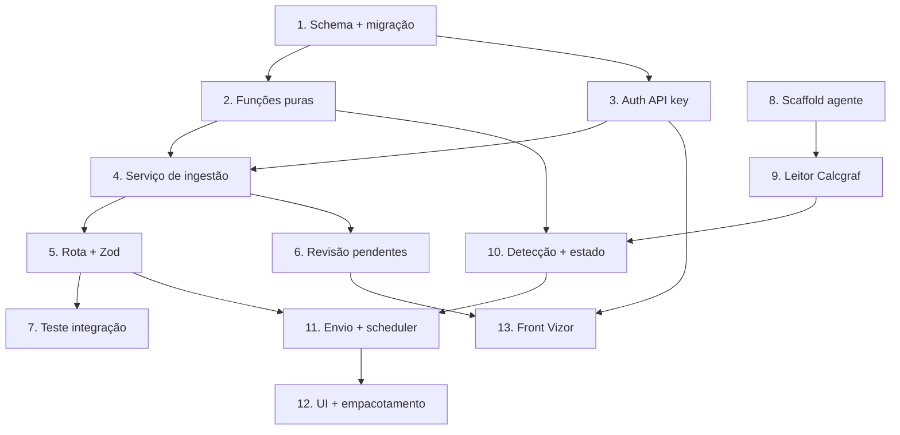

# Implementation Plan — Importador de OP do Calcgraf

## Overview

Ordem: primeiro o backend de ingestão no Vizor (schema → funções puras →
auth → rota → serviço → revisão de pendentes), depois o agente desktop
(reader → detecção → envio → UI/empacotamento). As funções puras com
propriedades de correção têm testes property-based (fast-check).

> Pré-requisitos externos (DevOps/Pedro) NÃO bloqueiam as tarefas de backend
> nem o desenvolvimento do agente contra o backup local; só bloqueiam a
> instalação em produção. Ver "Riscos" no design.

## Task Dependency Graph



```json
{
  "waves": [
    { "wave": 1, "tasks": ["1", "8"] },
    { "wave": 2, "tasks": ["2", "3", "9"] },
    { "wave": 3, "tasks": ["4", "10"] },
    { "wave": 4, "tasks": ["5", "6", "11"] },
    { "wave": 5, "tasks": ["7", "12", "13"] }
  ]
}
```

## Tasks

### Backend — Vizor (VisioFab.Wms.Back)

- [x] 1. Schema + migração (AgenteApiKey, AlteracaoOpPendente, hash na OP)
  - Adicionar em `prisma/schema.prisma`: model `AgenteApiKey`
    (`agente_api_key`: id, empresaId, nome, tokenHash, status, ultimoUsoEm,
    criadoEm; `@@index([empresaId])`), model `AlteracaoOpPendente`
    (`alteracao_op_pendente`: id, empresaId, ordemProducaoId, numeroOrigem,
    hashOrigem, payloadJson, status, criadoEm, resolvidoPorId?, resolvidoEm?;
    `@@index([empresaId, status])`), e campo `OrdemProducao.hashImportacaoOrigem`
    (`String?`, `@map("hash_importacao_origem")`).
  - Atualizar `prisma/migrate-prod.ts` com o SQL idempotente equivalente
    (`CREATE TABLE IF NOT EXISTS`, `ADD COLUMN IF NOT EXISTS`), seguindo
    steering `database-migrations.md`.
  - Rodar `npx prisma migrate dev` + `npx tsx prisma/migrate-prod.ts` 2× local
    (idempotente). `npx prisma generate`.
  - _Requirements: 4.1, 5.1, 6.2, 8.1_

- [x] 2. Funções puras de ingestão (motor testável, sem Prisma)
- [x] 2.1 `calcularHashOp(dto)` + normalização determinística
  - Criar `src/modules/pcp/importador-calcgraf/ingestao-op-calcgraf.pure.ts`.
  - `normalizarOpParaHash(dto)` (ordena arrays filhos por chave estável, trim,
    números com precisão fixa) e `calcularHashOp(dto)` (sha256 do normalizado).
  - _Requirements: 2.2_
- [x] 2.2 `classificarIngestao(opExistente, hashRecebido, temProducao)`
  - Retorna `'criada' | 'atualizada' | 'pendente' | 'ignorada'` conforme a
    tabela-verdade do design (não existe→criada; existe+hash igual→ignorada;
    existe+hash difere+sem produção→atualizada; existe+hash difere+com
    produção→pendente; existe finalizada→ignorada).
  - _Requirements: 4.1, 5.1, 5.2, 8.1_
- [x] 2.3 Testes property-based das funções puras (Vitest + fast-check)
  - `ingestao-op-calcgraf.pure.test.ts` cobrindo Property 1 (hash
    determinístico/ordem-insensível), Property 2 (idempotência via
    classificar), Property 3 (identidade por número), Property 4 (não-regressão
    com produção), Property 7 (erro isolado — validação por OP).
  - Rodar `npx vitest run <arq> --reporter=dot`.
  - _Requirements: 2.2, 2.3, 4.1, 5.2, 8.1, 8.4_

- [x] 3. Autenticação por API key do agente
  - Criar `src/modules/pcp/importador-calcgraf/agente-auth.ts`: hook
    `agenteAuth` lê header `x-agente-key`, resolve `AgenteApiKey` por hash,
    valida status ATIVO, injeta `request.agente = { empresaId, keyId }`,
    atualiza `ultimoUsoEm`; 401 se ausente/inválida/revogada.
  - CRUD mínimo de chaves (criar/listar/revogar) protegido por ADMIN —
    `agente-api-key.routes.ts` (token em claro exibido só na criação).
  - _Requirements: 6.1, 6.2, 6.3, 6.4_

- [x] 4. Serviço de ingestão (regras de negócio, Prisma)
  - `ingestao-op-calcgraf.service.ts`: para cada OP do payload, em transação —
    busca por `{ empresaId, origemImportacao:'AGENTE_CALCGRAF', referenciaExterna }`,
    aplica `classificarIngestao`, cria/atualiza `OrdemProducao` (reusando o
    padrão do importador de PDF: `numero` interno sequencial, tags
    `[Cliente]`/`[Produto]` em `observacoes`, status inicial liberável),
    grava `hashImportacaoOrigem`, cria `AlteracaoOpPendente` quando pendente,
    grava `LogOrdemProducao`. `empresaId` SEMPRE de `request.agente` (nunca
    prismaScoped sozinho).
  - _Requirements: 3.1, 3.2, 3.3, 4.1, 4.2, 4.3, 4.4, 5.1, 5.2, 5.3, 5.4, 6.2, 6.4, 8.1_

- [x] 5. Rota de ingestão + validação Zod
  - `POST /api/pcp/ingest-op-calcgraf` (hook `agenteAuth`) em
    `importador-calcgraf.routes.ts`, registrada em `server.ts` com prefixo
    `/api/pcp`. Schema Zod do payload versionado (`schemaVersion`, `ops[]`);
    400 por OP com erro, sem tocar OPs válidas; resposta com resultado por OP.
  - _Requirements: 6.1, 8.1, 8.4_

- [x] 6. Revisão de alterações pendentes (backend)
  - Rotas `GET /pcp/alteracoes-op-pendentes` (lista por empresa, filtro status)
    + `POST /pcp/alteracoes-op-pendentes/:id/aplicar` (força a atualização
    reusando o serviço) + `.../descartar`. Isolamento por `user.empresaId`.
  - _Requirements: 3.2, 5.2_

- [x] 7. Teste de integração da ingestão (idempotência + isolamento)
  - Teste que envia o mesmo payload 2× → 1 OP + 2ª `ignorada`; OP com produção
    → `pendente`; grava sob a empresa da key.
  - _Requirements: 5.2, 6.2, 8.1_

### Agente desktop (novo projeto)

- [x] 8. Scaffold do agente (Electron + TS) e config protegida
  - Criar projeto `VisioFab.AgenteCalcgraf/` (Electron + TS). Módulo `config`:
    ler/gravar connection string, URL API, API key, intervalo; segredos via
    `safeStorage` (DPAPI). Tela de configuração mínima.
  - _Requirements: 7.4, 9.1, 9.2, 9.4_

- [x] 9. Leitor do Calcgraf (somente leitura)
  - Módulo `calcgraf-reader`: conexão `msnodesqlv8` (named pipes, Trusted ou
    user SQL) com fallback `sqlcmd`+`FOR JSON PATH`; queries de
    OpHeader/OpItem/OpItemEstrutura/OpLote; monta o DTO da OP. Apenas `SELECT`.
  - Validar contra o backup local `CalcgrafCartonWega` (golden: OP 3138/3137).
  - _Requirements: 1.1, 1.2, 1.4_

- [x] 10. Detecção de alteração + estado local
  - Módulo `change-detector` (reusa `calcularHashOp`, compartilhado/portado) e
    `state-store` (SQLite/JSON em `%APPDATA%`): classifica NOVA/ALTERADA/
    INALTERADA comparando hash; persiste `{numeroOp, hash, ultimoEnvioEm}`.
  - _Requirements: 2.1, 2.2, 2.5_

- [x] 11. Envio + resiliência + scheduler
  - Módulo `sender`: POST autenticado (`x-agente-key`), retry com backoff,
    marca enviado só no 2xx; `scheduler`: loop em segundo plano (intervalo
    configurável) + gatilho manual. Falha de rede mantém OP pendente.
  - _Requirements: 2.4, 7.1, 7.2, 8.1, 8.2, 8.3_

- [x] 12. UI de resultado + log + empacotamento
  - Tela com botão "Sincronizar agora" + painel de resultado (novas/alteradas/
    pendentes/erros) + log local; auto-start em segundo plano; empacotar
    instalável Windows (`electron-builder`).
  - _Requirements: 7.1, 7.2, 7.3, 9.1, 9.3_

### Frontend Vizor (opcional nesta fase)

- [x] 13. Tela de alterações pendentes + cadastro de API key (PCP)
  - `VisioFab.Wms.Front`: tela lista `AlteracaoOpPendente` com ações
    aplicar/descartar; tela admin para gerar/revogar `AgenteApiKey`.
  - _Requirements: 3.2, 5.2, 6.1_

## Notes

- As tarefas 1–7 (backend no Vizor) e 2.3/7 (testes) podem ser feitas sem
  depender do DevOps — usam o backup local `CalcgrafCartonWega` para validar o
  reader e o próprio Postgres/Neon para a ingestão.
- As tarefas 8–12 (agente desktop) ficam num projeto novo
  `VisioFab.AgenteCalcgraf/`; a instalação em produção depende das confirmações
  do DevOps (internet no TS, credencial de leitura, versão do Calcgraf).
- Migrações seguem o steering `database-migrations.md` (schema.prisma +
  migrate-prod.ts no mesmo commit, idempotente, testado 2× local).
- Isolamento multi-tenant: gravação sempre sob a `empresaId` da API key /
  do usuário — nunca confiar só em `prismaScoped` (steering
  `ATENCAO-pontos-verificar.md`).
- A tarefa 13 (frontend) é opcional nesta fase; o essencial é o backend
  aceitar e processar as OPs do agente.
