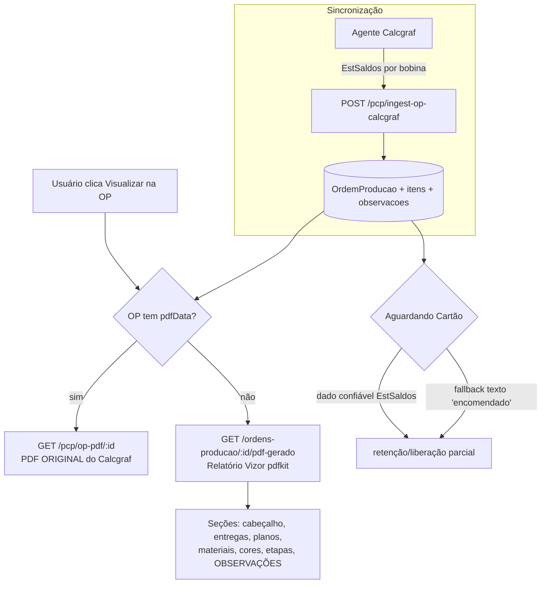

# Design Document

Visualização e Observações da OP (paridade Calcgraf)

## Overview

Esta feature garante que QUALQUER OP tenha uma visualização completa para
consulta e que a regra "Aguardando Cartão" use um dado confiável de estoque.

Descoberta importante (reduz muito o esforço): **grande parte da infraestrutura
já existe no Vizor**:
- `GET /pcp/op-pdf/:opId` serve o **PDF original** salvo (`OrdemProducao.pdfData`)
  — usado pelas OPs importadas por PDF e pelas que tiveram PDF enviado.
- `src/modules/ordem-producao/op-pdf-gerado.service.ts` (`gerarOpPdf`) já **gera
  um PDF da OP nativa** (pdfkit) com cabeçalho, cliente/produto, formato, cores,
  matriz, tipoOp, itens, etapas, variações e programação de entrega.
- `GET /ordens-producao/:id/pdf-gerado` já serve esse PDF gerado.

Portanto o trabalho se concentra em: (1) a **lógica de decisão** do botão
"Visualizar" (PDF salvo → senão PDF gerado); (2) **enriquecer** o `gerarOpPdf`
com TODAS as observações e seções que faltam para igualar o PDF do Calcgraf; (3)
trazer do agente o **status de estoque das bobinas** (`EstSaldos`) para a regra
do cartão; (4) ajustar o front para o "Visualizar" cair no gerado quando não há
PDF salvo. Repos: `VisioFab.Wms.Back`, `VisioFab.Wms.Front`, `VisioFab.AgenteCalcgraf`.

## Architecture

### Decisão de visualização (Requisito 1 e 2)

O front decide uma vez, no clique do "Visualizar":
- Já existe `POST /ordens-producao/pdf-status` que informa, em lote, quais OPs
  têm `pdfData`. A tela de OPs usa isso para decidir o ícone/ação.
- Regra: **tem pdfData → abre `op-pdf/:id` (original)**; **não tem → abre
  `pdf-gerado` (relatório Vizor)**. O PDF original sempre tem prioridade (Req 2.4).
- "Enviar/substituir PDF" (`PUT /ordens-producao/:id/pdf`) passa a OP a ter
  `pdfData` → o "Visualizar" volta a abrir o original (Req 1.2). Sem mudança.

## Components and Interfaces

### 1. Backend — relatório Vizor enriquecido (`op-pdf-gerado.service.ts`)

Estender `gerarOpPdf(opId, empresaId)` para produzir um layout com as MESMAS
seções do PDF do Calcgraf (ordem e rótulos equivalentes):

| Seção | Fonte dos dados (Vizor) |
|---|---|
| Cabeçalho (nº OP, ref., cliente, produto, descrição, formato, qtd, emissão, entrega) | `OrdemProducao` + tags `[Cliente]`/`[Produto]`/`[Formato]` + `clienteId`/`produtoId` |
| Programação de Entrega | `ProgramacaoEntrega` (todas as parcelas) |
| Planos / Frente-Verso | `PlanoOrdemProducao` (nome, tipo FACE/COMPONENTE, cores, formato, tiragem) |
| Materiais (papel, tinta, acabamento) | `ItemOrdemProducao` + tag `[Cores]` para tintas/pantones |
| Impressão / Roteiro | `EtapaOrdemProducao` (centro + setup/operação) |
| **Observações** | ver tabela da seção 3 |
| Área de apontamento | já existe |

O serviço já usa `select` explícito (sem `pdfData`) e resolve
cliente/produto por tag com prioridade — padrão do módulo. Mantém isso.

### 2. Observações — fonte confiável vs. derivada (Requisito 3)

Investigação no backup `CalcgrafCartonWega` (sqlcmd) concluiu que **NÃO existe
uma coluna única "Observacoes"** na OP/Cálculo. Cada "Obs.:" do PDF é montada
pelo GPrint de dados dispersos. Mapa de origem (ordem de preferência: campo de
tabela → derivado documentado → omitir):

| Observação (PDF) | Fonte confiável no Calcgraf | Estratégia |
|---|---|---|
| Bobinas em estoque/encomendado (kg) | `EstSaldos.SaldoFisico` por `CodItem` do suporte vs. necessidade | **Campo confiável** (agente envia status+kg; Req 4) |
| Acondicionamento (ex.: "pallet 4.000 un") | `CalculoProdutosConjuntos.ConteudoAcond` | **Campo** (agente envia como `[Acond]`) |
| Tipo de serviço (Novo/Repetição/Alteração) | Não há coluna direta; derivável (produto/cliente já teve OP = repetição) | **Derivado documentado** → tag `[TipoOp]` |
| Materiais/pantones/cores | já trazidos (`[Cores]`, itens) | já existe |
| Faturamento, Ficha técnica, Nº pedido interno | Sem campo claro; montados pelo GPrint | **Omitir** (baixo valor; registrar no doc) — NÃO bloqueia |

As observações trazidas ficam em `OrdemProducao.observacoes` como tags
(`[Acond]`, `[TipoOp]`, `[Bobina] ... em estoque/encomendado (N kg)`), lidas
pelo relatório (seção 1) e pela regra (seção 4). "Todas as observações
primordiais": as de valor real (bobina/estoque, acondicionamento, tipo de
serviço, cores, matriz, formato) ficam cobertas; os textos puramente
administrativos sem fonte confiável são omitidos conscientemente.

### 3. Regra "Aguardando Cartão" por `EstSaldos` (Requisito 4)

Hoje a regra lê a palavra "encomendado" + "em estoque (N kg)" das observações
(texto). Passa a ter uma **fonte estruturada confiável**:

- **Agente**: para cada bobina/suporte da OP (via plano/material), consulta
  `EstSaldos` (SaldoFisico por `CodItem` do suporte) e classifica
  `ESTOQUE`/`A_COMPRAR` + os kg. Envia no DTO: `bobinas: [{ descricao, kg,
  status, codItem }]` (aditivo).
- **Backend ingestão**: grava essas bobinas em `observacoes` no MESMO formato
  que a regra já entende (`[Bobina] <desc> em estoque (N kg)` /
  `... encomendado (N kg)`), de forma que `etapa-operacional.routes.ts`
  (`temMaterialEncomendado`/`analisarMaterial`) funcione SEM alteração.
  - Vantagem: zero mudança na regra; a diferença é que a origem do texto agora
    é um dado confiável (saldo real), não um texto do PDF.
- **Fallback (Req 4.3)**: OPs antigas de PDF seguem com o texto que já têm. A
  regra é a mesma função — nenhuma regressão.
- A liberação parcial (`fração = kgEstoque / kgTotal`) é preservada (Req 4.4).

### 4. Frontend (`VisioFab.Wms.Front`)

- Tela de detalhe da OP (`pcp/ordens-producao/[id]/page.tsx`) e lista
  (`pcp/ordens-producao/page.tsx`): o botão "Visualizar" (olho) decide por
  `pdfStatus`: com PDF → abre `op-pdf/:id?token=`; sem PDF → abre
  `/ordens-producao/:id/pdf-gerado?token=` (nova aba). Hoje a tela de detalhe
  abre só `op-pdf`; passa a ter o fallback para o gerado.
- Exibir as observações estruturadas também inline na tela de detalhe (já
  mostra `op.observacoes`; melhora a formatação por tag).

### 5. Agente (`VisioFab.AgenteCalcgraf`)

- Reader passa a trazer (SELECT, sequencial): bobinas da OP com status via
  `EstSaldos`, e `ConteudoAcond` de `CalculoProdutosConjuntos`. Campos aditivos
  no DTO espelhado. Funções puras testadas (`node:test`). Reempacotar v0.4.0.

## Data Models

Sem mudança de schema no Vizor (reuso de `OrdemProducao.observacoes`,
`ItemOrdemProducao`, `PlanoOrdemProducao`, `ProgramacaoEntrega`). Caso o design
de implementação conclua que vale persistir bobina/estoque de forma estruturada
(em vez de só no texto de `observacoes`), isso exigirá nova tabela + migração
idempotente em `migrate-prod.ts` (Req 5.4) — decisão adiada para a fase de
tarefas; a abordagem padrão (gravar no texto já entendido pela regra) evita
schema e é a preferida por não-regressão.

## Error Handling

- `GET /:id/pdf-gerado`: OP inexistente/outra empresa → 404; isolamento por
  `empresaId` (Req 6). Token via query param validado junto com a sessão do
  usuário (Req 6.3/6.4) — mesmo mecanismo do `op-pdf/:opId`.
- Agente: falha ao ler `EstSaldos` de uma bobina NÃO derruba a OP; a bobina
  entra sem status (a regra cai no comportamento conservador atual).
- Ingestão: cintos S1/S2 preservados (payload sem etapas não zera; produção →
  pendente); campos novos aditivos.

## Testing Strategy

- **Backend (vitest)**: unit do montador do relatório (seções presentes dado um
  OP fake); teste da ingestão gravando bobinas de `EstSaldos` no formato que a
  regra entende; não-regressão da regra `analisarMaterial` (texto antigo
  continua válido).
- **Agente (node:test)**: funções puras de classificação de bobina
  (ESTOQUE/A_COMPRAR a partir de SaldoFisico) e de montagem do acondicionamento.
- **Validação contra backup**: rodar o reader contra `CalcgrafCartonWega` para
  OPs golden (3.166 com 2 bobinas em estoque; uma com encomenda) e conferir o
  status/kg + o relatório gerado com as observações.
- **Multi-tenant**: relatório e ingestão isolados por `empresaId` (dois tokens).

## Correctness Properties

### Property 1: Prioridade do PDF original
Se `pdfData != null`, o "Visualizar" sempre abre o PDF original; nunca o gerado.
**Validates: Requirements 1.1, 2.4**

### Property 2: Completude do relatório
O relatório Vizor contém todas as seções do Requisito 2.2 quando os dados
existem (nenhuma seção com dado presente fica fora).
**Validates: Requirements 2.1, 2.2, 3.1**

### Property 3: Não-regressão da regra do cartão
Para qualquer OP cujas observações já tinham o texto de bobina,
`analisarMaterial` produz o mesmo resultado antes e depois da mudança.
**Validates: Requirements 4.3, 5.1**

### Property 4: Confiabilidade do estoque
O status de bobina gravado pelo agente corresponde a `SaldoFisico >=
necessidade` igual a ESTOQUE, e `SaldoFisico < necessidade` igual a A_COMPRAR,
de forma determinística.
**Validates: Requirements 4.1, 4.2**

### Property 5: Isolamento multi-tenant
Relatório e ingestão de uma empresa não acessam dados de outra; token de outra
empresa não serve o relatório.
**Validates: Requirements 6.1, 6.3, 6.4, 5.5**

### Property 6: Idempotência da ingestão
Reenviar a mesma OP não duplica nem altera a OP, pela chave de hash.
**Validates: Requirements 5.2**
