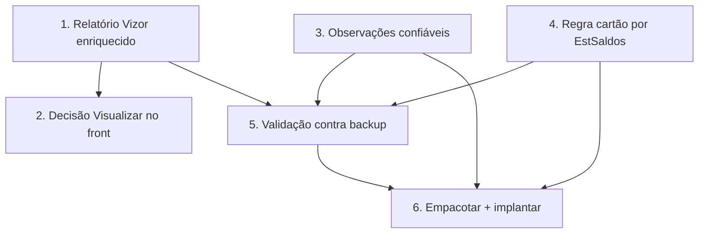

# Implementation Plan

Ordem pensada para entregar valor cedo e com segurança: primeiro o relatório
Vizor (resolve a visualização sem tocar o agente), depois a decisão do
"Visualizar" no front, e por fim a regra do cartão por estoque confiável (que
exige reinstalar o agente). Invariantes: não-regressão das OPs de PDF, cintos
S1/S2 da ingestão, multi-tenant por `empresaId`.

## Overview

- Blocos 1–2: relatório Vizor enriquecido + fallback no front (sem agente).
- Blocos 3–5: observações confiáveis (acondicionamento, tipo de serviço) +
  regra do cartão por `EstSaldos` (exige agente) + validação.
- Bloco 6: empacotar/implantar agente e fechar a spec.

## Tasks

- [x] 1. Enriquecer o relatório Vizor da OP (`op-pdf-gerado.service.ts`)
  - [x] 1.1 Seção PLANOS/COMPONENTES (`PlanoOrdemProducao` — nome/tipo/formato/
    cores/tiragem; "VERSO" nunca "COSTA"); Acondicionamento (`[Acond]`) no
    cabeçalho; seção OBSERVAÇÕES (bobinas `[Bobina]` + texto livre + tags
    aditivas, sem duplicar o que já aparece no cabeçalho). Materiais/roteiro/
    entregas já existiam.
  - [x] 1.2 `select` explícito (sem `pdfData`), isolamento por `empresaId`
    mantidos; layout em seções legíveis. get_diagnostics limpo.
  - [x] 1.3 Testes (vitest **6/6**): `extrairTag` + `extrairObservacoesParaExibicao`
    (bobinas viram linha, texto livre preservado, tags do cabeçalho não
    duplicam, tag aditiva vira "Chave: valor", vazio→[]).
  - _Requisitos: 2.1, 2.2, 2.3, 3.1, 6.1_

- [x] 2. Decisão do "Visualizar" no front (`VisioFab.Wms.Front`)
  - [x] 2.1 Tela de detalhe (`[id]/page.tsx`): consulta `pdf-status` no load →
    `temPdf`. "Ver PDF Original" aparece quando `temPdf` (qualquer origem, não só
    PDF_GPRINT); "Imprimir OP" (relatório Vizor) continua sempre disponível.
  - [x] 2.2 Lista (`ordens-producao/page.tsx`): o ícone PDF abre o PDF original
    quando existe; quando NÃO existe, abre o **relatório gerado pelo Vizor**
    (`/pdf-gerado`) em vez de só o upload. Upload fica no ícone próprio.
  - [x] 2.3 get_diagnostics limpo nos dois arquivos. (Exibição inline por tag
    fica melhor coberta pelo relatório gerado — Bloco 1.)
  - _Requisitos: 1.1, 1.2, 1.3, 2.1, 2.4_

- [ ] 3. Observações confiáveis — backend ingestão + reader
  - [ ] 3.1 Reader do agente: trazer `ConteudoAcond`
    (`CalculoProdutosConjuntos`) → DTO aditivo `acondicionamento`; e derivar
    tipo de serviço (regra documentada) → `tipoOp`. Funções puras testadas
    (`node:test`).
  - [ ] 3.2 Backend ingestão (`ingestao-op-calcgraf.service.ts`): gravar
    `[Acond]`/`[TipoOp]` em `observacoes` (aditivo; hash cobre). Preserva cintos.
  - [ ] 3.3 Testes do service (vitest) das novas tags; não-regressão.
  - _Requisitos: 3.1, 3.2, 3.3, 3.4, 5.2, 5.3_

- [ ] 4. Regra "Aguardando Cartão" por `EstSaldos` (dado confiável)
  - [ ] 4.1 Reader do agente: por bobina/suporte da OP, consultar `EstSaldos`
    (SaldoFisico por `CodItem`), classificar `ESTOQUE`/`A_COMPRAR` + kg. Função
    pura `classificarBobina(saldoFisico, necessidadeKg)` testada (Property 4).
  - [ ] 4.2 DTO aditivo `bobinas: [{ descricao, kg, status, codItem }]`.
  - [ ] 4.3 Backend ingestão: gravar as bobinas em `observacoes` NO MESMO
    formato que a regra já entende (`[Bobina] <desc> em estoque|encomendado
    (N kg)`), de modo que `analisarMaterial`/`temMaterialEncomendado` em
    `etapa-operacional.routes.ts` funcionem SEM alteração.
  - [ ] 4.4 Teste de não-regressão (vitest): OP com texto antigo → mesmo
    resultado de `analisarMaterial`; OP nova via EstSaldos → retenção/parcial
    correta (Property 3).
  - _Requisitos: 4.1, 4.2, 4.3, 4.4, 5.3_

- [ ] 5. Validação ponta a ponta contra o backup local
  - [ ] 5.1 Script `_tmp-` (removido após uso): rodar o reader contra
    `CalcgrafCartonWega` para a OP 3.166 (2 bobinas em estoque) + uma OP com
    encomenda; conferir status/kg, acondicionamento, tipoOp e o relatório gerado
    com as observações.
  - [ ] 5.2 Conferir isolamento multi-tenant (relatório/ingestão por empresa) —
    Property 5. Remover o script.
  - _Requisitos: 4.1, 5.5, 6.1_

- [ ] 6. Empacotar agente e implantar
  - [ ] 6.1 Bump do agente para v0.4.0; selo de versão; `npm run build` +
    `npm run dist`; doc de deploy (backend primeiro → validar → trocar agente).
  - [ ] 6.2 Commit/push (back e front separados); se tocar schema (não previsto),
    `migrate-prod.ts` idempotente no mesmo commit, testado 2× (Req 5.4).
  - [ ] 6.3 Deploy monitorado + atualizar HANDOFF/steering.
  - _Requisitos: 5.1, 5.4_

## Task Dependency Graph



```json
{
  "waves": [
    { "wave": 1, "tasks": ["1", "3", "4"] },
    { "wave": 2, "tasks": ["2", "5"] },
    { "wave": 3, "tasks": ["6"] }
  ]
}
```

## Notes

- Blocos 1 e 2 entregam a visualização completa SEM reinstalar o agente (usam os
  dados já sincronizados) — valor imediato.
- Blocos 3, 4 e 6 mexem no agente (reinstalação no servidor PHTech, via RDP).
- A regra do cartão é mantida intacta: o agente só muda a ORIGEM do texto de
  bobina (de PDF para saldo real) — fallback preserva as OPs antigas.
- Sem mudança de schema por padrão; se necessário, migração idempotente.
