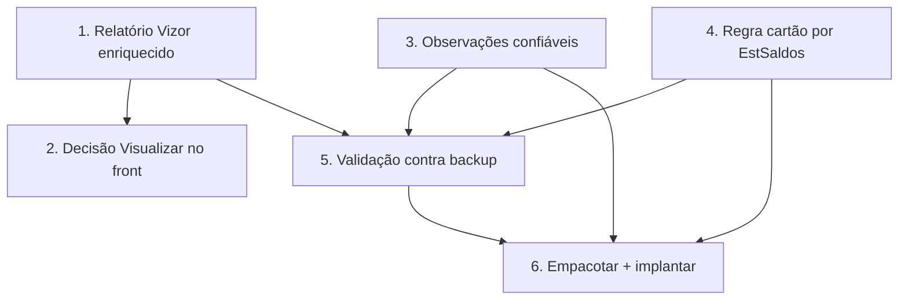

# Implementation Plan

Ordem pensada para entregar valor cedo e com segurança: primeiro o relatório
Vizor (resolve a visualização sem tocar o agente), depois a decisão do
"Visualizar" no front, e por fim a regra do cartão por estoque confiável (que
exige reinstalar o agente). Invariantes: não-regressão das OPs de PDF, cintos
S1/S2 da ingestão, multi-tenant por `empresaId`.

## Overview

- Blocos 1–2: relatório Vizor enriquecido + fallback no front (sem agente).
- Blocos 3–5: observações confiáveis (acondicionamento, tipo de serviço) +
  regra do cartão por `EstSaldos` (exige agente) + validação.
- Bloco 6: empacotar/implantar agente e fechar a spec.

## Tasks

- [x] 1. Enriquecer o relatório Vizor da OP (`op-pdf-gerado.service.ts`)
  - [x] 1.1 Seção PLANOS/COMPONENTES (`PlanoOrdemProducao` — nome/tipo/formato/
    cores/tiragem; "VERSO" nunca "COSTA"); Acondicionamento (`[Acond]`) no
    cabeçalho; seção OBSERVAÇÕES (bobinas `[Bobina]` + texto livre + tags
    aditivas, sem duplicar o que já aparece no cabeçalho). Materiais/roteiro/
    entregas já existiam.
  - [x] 1.2 `select` explícito (sem `pdfData`), isolamento por `empresaId`
    mantidos; layout em seções legíveis. get_diagnostics limpo.
  - [x] 1.3 Testes (vitest **6/6**): `extrairTag` + `extrairObservacoesParaExibicao`
    (bobinas viram linha, texto livre preservado, tags do cabeçalho não
    duplicam, tag aditiva vira "Chave: valor", vazio→[]).
  - _Requisitos: 2.1, 2.2, 2.3, 3.1, 6.1_

- [x] 2. Decisão do "Visualizar" no front (`VisioFab.Wms.Front`)
  - [x] 2.1 Tela de detalhe (`[id]/page.tsx`): consulta `pdf-status` no load →
    `temPdf`. "Ver PDF Original" aparece quando `temPdf` (qualquer origem, não só
    PDF_GPRINT); "Imprimir OP" (relatório Vizor) continua sempre disponível.
  - [x] 2.2 Lista (`ordens-producao/page.tsx`): o ícone PDF abre o PDF original
    quando existe; quando NÃO existe, abre o **relatório gerado pelo Vizor**
    (`/pdf-gerado`) em vez de só o upload. Upload fica no ícone próprio.
  - [x] 2.3 get_diagnostics limpo nos dois arquivos. (Exibição inline por tag
    fica melhor coberta pelo relatório gerado — Bloco 1.)
  - _Requisitos: 1.1, 1.2, 1.3, 2.1, 2.4_

> **DESCOBERTA (investigação no backup `CalcgrafCartonWega`) — re-escopo dos
> blocos 3–6:** as observações "soltas" do PDF (acondicionamento, tipo de
> serviço) e o status de estoque das bobinas NÃO têm fonte de campo confiável
> acessível no backup:
> - `CalculoProdutosConjuntos` está vazio (acondicionamento não vem daí).
> - `CalculoHeader` não tem campo de tipo de serviço (Novo/Repetição) — é
>   derivado pelo GPrint na geração do PDF.
> - **`EstSaldos` está VAZIO no backup** (nenhum `SaldoFisico > 0`) e não há
>   de-para direto `Suporte → CodItemEstoque`. Reconstruir "em estoque vs.
>   encomendado" sem isso produziria dado ERRADO numa regra CRÍTICA.
>
> Decisão (alinhada ao usuário: "primordial que a regra seja por campo
> confiável, para não quebrar"): **NÃO implementar o Bloco 4 agora** (risco de
> corromper a regra do cartão com dado incerto). Mantém-se o texto atual
> (fallback) — zero regressão. Blocos 3/4 ficam BLOQUEADOS por dado
> indisponível no backup; destravar exige acesso ao saldo real do Calcgraf de
> PRODUÇÃO (query no servidor PHTech) ou o de-para suporte→item.

- [-] 3. Observações confiáveis — BLOQUEADO (sem fonte de campo confiável no
  backup para acondicionamento/tipo de serviço). O relatório Vizor (Bloco 1) já
  exibe TODAS as observações que o agente trouxer; o enriquecimento na origem
  fica para quando houver campo confiável. Não implementado para não inventar
  dado. _Requisitos: 3.2, 3.3 (parcial — exibição coberta pelo Bloco 1)_

- [-] 4. Regra "Aguardando Cartão" por `EstSaldos` — BLOQUEADO (dado
  indisponível/incerto no backup: `EstSaldos` vazio + sem de-para
  suporte→item). A regra atual (texto "encomendado") CONTINUA funcionando como
  está — nenhuma regressão (Req 4.3 já garante o fallback). Reabrir quando
  tivermos o saldo real confiável. **Guia de diagnóstico pronto para rodar no
  Calcgraf de PRODUÇÃO (somente leitura):**
  `docs/calcgraf-diagnostico-estoque-bobina.md` — mapeia OP → suporte →
  CodItemEstoque → EstSaldos + a necessidade em kg. Com isso o Bloco 4 destrava.
  _Requisitos: 4.1, 4.2 (bloqueado); 4.3, 4.4 (já atendidos pelo comportamento atual)_

- [-] 5. Validação contra backup — PARCIAL. Blocos 1/2 validados por testes
  unitários + diagnostics. A validação ponta a ponta de estoque (5.1) depende do
  Bloco 4 (bloqueado). _Requisitos: 6.1 (relatório isolado por empresa — já no
  Bloco 1)_

- [-] 6. Empacotar agente — NÃO NECESSÁRIO nesta leva. Blocos 1 e 2 entregam a
  visualização completa SEM mexer no agente. Reempacotar só quando os blocos 3/4
  forem destravados (dado confiável). _Requisitos: 5.1_

## Task Dependency Graph



```json
{
  "waves": [
    { "wave": 1, "tasks": ["1", "3", "4"] },
    { "wave": 2, "tasks": ["2", "5"] },
    { "wave": 3, "tasks": ["6"] }
  ]
}
```

## Notes

- Blocos 1 e 2 entregam a visualização completa SEM reinstalar o agente (usam os
  dados já sincronizados) — valor imediato.
- Blocos 3, 4 e 6 mexem no agente (reinstalação no servidor PHTech, via RDP).
- A regra do cartão é mantida intacta: o agente só muda a ORIGEM do texto de
  bobina (de PDF para saldo real) — fallback preserva as OPs antigas.
- Sem mudança de schema por padrão; se necessário, migração idempotente.
