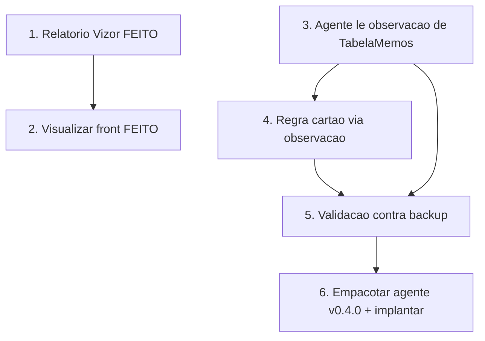

# Implementation Plan

Ordem pensada para entregar valor cedo e com segurança: primeiro o relatório
Vizor (resolve a visualização sem tocar o agente), depois a decisão do
"Visualizar" no front, e por fim a regra do cartão por estoque confiável (que
exige reinstalar o agente). Invariantes: não-regressão das OPs de PDF, cintos
S1/S2 da ingestão, multi-tenant por `empresaId`.

## Overview

- Blocos 1–2: relatório Vizor enriquecido + fallback no front (sem agente).
- Blocos 3–5: observações confiáveis (acondicionamento, tipo de serviço) +
  regra do cartão por `EstSaldos` (exige agente) + validação.
- Bloco 6: empacotar/implantar agente e fechar a spec.

## Tasks

- [x] 1. Enriquecer o relatório Vizor da OP (`op-pdf-gerado.service.ts`)
  - [x] 1.1 Seção PLANOS/COMPONENTES (`PlanoOrdemProducao` — nome/tipo/formato/
    cores/tiragem; "VERSO" nunca "COSTA"); Acondicionamento (`[Acond]`) no
    cabeçalho; seção OBSERVAÇÕES (bobinas `[Bobina]` + texto livre + tags
    aditivas, sem duplicar o que já aparece no cabeçalho). Materiais/roteiro/
    entregas já existiam.
  - [x] 1.2 `select` explícito (sem `pdfData`), isolamento por `empresaId`
    mantidos; layout em seções legíveis. get_diagnostics limpo.
  - [x] 1.3 Testes (vitest **6/6**): `extrairTag` + `extrairObservacoesParaExibicao`
    (bobinas viram linha, texto livre preservado, tags do cabeçalho não
    duplicam, tag aditiva vira "Chave: valor", vazio→[]).
  - _Requisitos: 2.1, 2.2, 2.3, 3.1, 6.1_

- [x] 2. Decisão do "Visualizar" no front (`VisioFab.Wms.Front`)
  - [x] 2.1 Tela de detalhe (`[id]/page.tsx`): consulta `pdf-status` no load →
    `temPdf`. "Ver PDF Original" aparece quando `temPdf` (qualquer origem, não só
    PDF_GPRINT); "Imprimir OP" (relatório Vizor) continua sempre disponível.
  - [x] 2.2 Lista (`ordens-producao/page.tsx`): o ícone PDF abre o PDF original
    quando existe; quando NÃO existe, abre o **relatório gerado pelo Vizor**
    (`/pdf-gerado`) em vez de só o upload. Upload fica no ícone próprio.
  - [x] 2.3 get_diagnostics limpo nos dois arquivos. (Exibição inline por tag
    fica melhor coberta pelo relatório gerado — Bloco 1.)
  - _Requisitos: 1.1, 1.2, 1.3, 2.1, 2.4_

> **DESCOBERTA (investigação no backup `CalcgrafCartonWega`) — re-escopo dos
> blocos 3–6. Dois motivos DIFERENTES de bloqueio:**
>
> **(A) Tipo de serviço (Novo/Repetição) e Acondicionamento — NÃO existem como
> campo** nem no backup nem no servidor. O GPrint monta esses textos ao gerar o
> PDF, por regra interna. `CalculoProdutosConjuntos` (ConteudoAcond) está vazio
> e `CalculoHeader` não tem coluna de tipo de serviço. → O servidor NÃO
> resolveria; são derivações do GPrint. Fica fora (baixo valor; sem fonte).
>
> **(B) Observação da OP (incl. bobina "em estoque/encomendado") — FONTE
> ENCONTRADA (18/10/2026):** o texto está SIM no banco, num campo memo
> (`ntext`), na tabela genérica **`TabelaMemos`** com
> `NomeTabela = 'CalculoOp'` e `Codigo = <CalcCodigo>` (o mesmo CalcCodigo que o
> reader já resolve para o roteiro — maior `CalculoHeader.Codigo` da OP). O
> campo `Memo` contém o texto consolidado da observação por área (Serviço
> Novo/Repetição + "Bobina ... em estoque/encomendado (N kg)" + LXL + Montagem
> + instruções), exatamente como no PDF e como a tela "Observações por Áreas"
> do Calcgraf mostra. Confirmado em cálculos reais (15196, 15193, 15189...).
> `EstSaldos`/`SuporteXEstoque` estão vazios porque o saldo é controle apartado
> — mas o TEXTO da observação (que a regra do cartão usa) está no memo.
> → Bloco 4 REABERTO como VIÁVEL (ver Task 4 abaixo): o agente lê esse memo e
> traz como `observacaoTexto`; o backend grava em `observacoes` (a regra do
> cartão passa a funcionar nas OPs sincronizadas, igual às de PDF).

- [x] 3. Agente lê a observação da OP de `TabelaMemos` e envia ao Vizor
  - [x] 3.1 Reader (`calcgraf-reader.ts`): query `montarQueryObservacaoOp` em
    `TabelaMemos` por `NomeTabela='CalculoOp'` + `Codigo IN (<CalcCodigos>)` →
    `CAST(Memo AS nvarchar(max))`. Reusa o CalcCodigo já resolvido para o
    roteiro (6ª query SEQUENCIAL do `lerRoteiroEmLote`, tedious). DTO aditivo
    `observacaoTexto?: string`; propagado em `lerOpsCandidatas`. Testes
    (`node:test`, `calcgraf-observacao.test.ts`): 3/3; suíte do reader 19/19.
  - [x] 3.2 Backend ingestão (`ingestao-op-calcgraf.service.ts`):
    `montarObservacoes` anexa `observacaoTexto` ao campo `observacoes`
    (preservando `[Cliente]`/`[Produto]`/etc.). DTO `.pure.ts` ganhou
    `observacaoTexto` e o hash passou a cobri-lo. Cintos preservados.
    Multi-tenant por `empresaId` da OP.
  - [x] 3.3 Testes do service (vitest): observação anexada + regra detecta +
    não-regressão (sem observacaoTexto = observacoes inalterado). Suíte
    service+pure **64/64**.
  - _Requisitos: 3.1, 3.2, 3.3, 3.4_

- [x] 4. Regra "Aguardando Cartão" nas OPs sincronizadas (via observação)
  - [x] 4.1 Com a `observacaoTexto` gravada em `observacoes` (Task 3), a regra
    existente de `etapa-operacional.routes.ts` (`temMaterialEncomendado` /
    `analisarMaterial`) passa a funcionar nas OPs do agente SEM alteração na
    regra.
  - [x] 4.2 Formato validado: o memo usa "em estoque ( N kg )" com espaços
    variáveis. `normalizarObservacaoCartao` (backend, exportada e testada)
    compacta `( N kg )` → `(N kg)` — o único formato que o regex da regra casa.
    A regra NÃO foi alterada. Testes de casamento + idempotência inclusos.
  - _Requisitos: 4.1, 4.3, 4.4_

- [x] 5. Validação ponta a ponta contra o backup local
  - [x] 5.1 Script `_tmp-valida-obs.mjs` (removido após uso) rodou contra
    `CalcgrafCartonWega` nos cálculos 15196/15193/15189. Confirmado: 15193
    "( 23,40 kg )" NÃO casava bruto (0) e casa após normalizar (1); 15189 e
    15196 (já compactos) casam antes e depois. Comprova a necessidade e a
    corretude da normalização.
  - [x] 5.2 Script removido. _Requisitos: 4.1_

- [x] 6. Empacotar agente v0.4.0 e implantar
  - [x] 6.1 Bump `package.json` → **0.4.0**; selo da UI (`main.ts` INFO_VERSAO)
    = "Fase 2+ — Paridade PDF + Observações da OP"; `npm run build` + `npm run
    dist` OK → `release/VisioFab Agente Calcgraf Setup 0.4.0.exe` (~165,72 MB).
  - [x] 6.2 Commit/push na `main` do backend (`e1f9ca3f8`) — Render redeploya o
    backend automaticamente (ingestão passa a aceitar/anexar `observacaoTexto`).
    PENDENTE operacional (fora do código): reinstalar o `.exe` v0.4.0 no servidor
    PHTech via RDP APÓS o deploy do backend concluir — manter o agente antigo
    parado até lá (ordem backend-primeiro é retrocompatível: `observacaoTexto` é
    aditivo e o backend v0.4.0 só anexa quando o campo chega).
  - _Requisitos: 5.1_

## Task Dependency Graph



```json
{
  "waves": [
    { "wave": 1, "tasks": ["3"] },
    { "wave": 2, "tasks": ["4", "5"] },
    { "wave": 3, "tasks": ["6"] }
  ]
}
```

## Notes

- Blocos 1 e 2 (FEITOS) entregam a visualização completa SEM reinstalar o agente
  — valor imediato, já em produção.
- Blocos 3, 4 e 6 mexem no agente (reinstalação no servidor PHTech, via RDP).
- FONTE da observação: `TabelaMemos` (`NomeTabela='CalculoOp'`, `Codigo=CalcCodigo`,
  campo `Memo` ntext) — o texto completo da OP (incl. bobina "em estoque/
  encomendado"). A regra do cartão NÃO muda: passa a ter a observação também nas
  OPs sincronizadas (hoje só OPs de PDF a tinham). Sem regressão.
- Sem mudança de schema (reusa `OrdemProducao.observacoes`).
