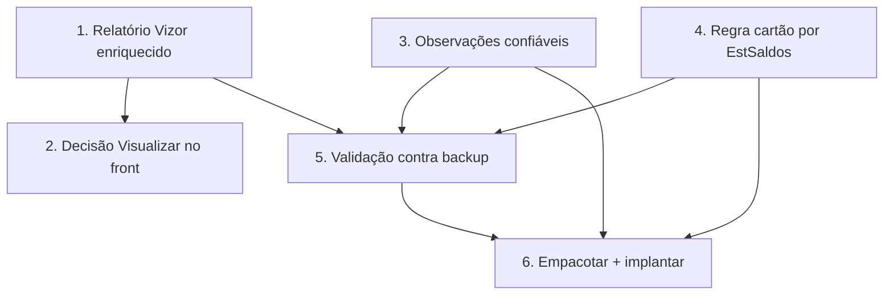

# Implementation Plan

Ordem pensada para entregar valor cedo e com segurança: primeiro o relatório
Vizor (resolve a visualização sem tocar o agente), depois a decisão do
"Visualizar" no front, e por fim a regra do cartão por estoque confiável (que
exige reinstalar o agente). Invariantes: não-regressão das OPs de PDF, cintos
S1/S2 da ingestão, multi-tenant por `empresaId`.

## Overview

- Blocos 1–2: relatório Vizor enriquecido + fallback no front (sem agente).
- Blocos 3–5: observações confiáveis (acondicionamento, tipo de serviço) +
  regra do cartão por `EstSaldos` (exige agente) + validação.
- Bloco 6: empacotar/implantar agente e fechar a spec.

## Tasks

- [x] 1. Enriquecer o relatório Vizor da OP (`op-pdf-gerado.service.ts`)
  - [x] 1.1 Seção PLANOS/COMPONENTES (`PlanoOrdemProducao` — nome/tipo/formato/
    cores/tiragem; "VERSO" nunca "COSTA"); Acondicionamento (`[Acond]`) no
    cabeçalho; seção OBSERVAÇÕES (bobinas `[Bobina]` + texto livre + tags
    aditivas, sem duplicar o que já aparece no cabeçalho). Materiais/roteiro/
    entregas já existiam.
  - [x] 1.2 `select` explícito (sem `pdfData`), isolamento por `empresaId`
    mantidos; layout em seções legíveis. get_diagnostics limpo.
  - [x] 1.3 Testes (vitest **6/6**): `extrairTag` + `extrairObservacoesParaExibicao`
    (bobinas viram linha, texto livre preservado, tags do cabeçalho não
    duplicam, tag aditiva vira "Chave: valor", vazio→[]).
  - _Requisitos: 2.1, 2.2, 2.3, 3.1, 6.1_

- [x] 2. Decisão do "Visualizar" no front (`VisioFab.Wms.Front`)
  - [x] 2.1 Tela de detalhe (`[id]/page.tsx`): consulta `pdf-status` no load →
    `temPdf`. "Ver PDF Original" aparece quando `temPdf` (qualquer origem, não só
    PDF_GPRINT); "Imprimir OP" (relatório Vizor) continua sempre disponível.
  - [x] 2.2 Lista (`ordens-producao/page.tsx`): o ícone PDF abre o PDF original
    quando existe; quando NÃO existe, abre o **relatório gerado pelo Vizor**
    (`/pdf-gerado`) em vez de só o upload. Upload fica no ícone próprio.
  - [x] 2.3 get_diagnostics limpo nos dois arquivos. (Exibição inline por tag
    fica melhor coberta pelo relatório gerado — Bloco 1.)
  - _Requisitos: 1.1, 1.2, 1.3, 2.1, 2.4_

> **DESCOBERTA (investigação no backup `CalcgrafCartonWega`) — re-escopo dos
> blocos 3–6. Dois motivos DIFERENTES de bloqueio:**
>
> **(A) Tipo de serviço (Novo/Repetição) e Acondicionamento — NÃO existem como
> campo** nem no backup nem no servidor. O GPrint monta esses textos ao gerar o
> PDF, por regra interna. `CalculoProdutosConjuntos` (ConteudoAcond) está vazio
> e `CalculoHeader` não tem coluna de tipo de serviço. → O servidor NÃO
> resolveria; são derivações do GPrint. Fica fora (baixo valor; sem fonte).
>
> **(B) Saldo das bobinas (em estoque vs. encomendado) — DEFINIÇÃO FINAL do
> usuário (18/10/2026): o saldo de estoque é um CONTROLE APARTADO do Calcgraf**
> (não vive no banco dele de forma consultável — por isso `EstSaldos` e
> `SuporteXEstoque` estão com 0 linhas, confirmado por `COUNT(*)`). Portanto a
> **OBSERVAÇÃO TEXTUAL é a fonte definitiva** do "em estoque / encomendado" — NÃO
> é fallback temporário. O Bloco 4 (regra por `EstSaldos`) é DESCARTADO: não há
> saldo consultável para substituir o texto. A regra "Aguardando Cartão"
> permanece como está (lê a observação) — correto e definitivo.
> O que importa é o agente TRAZER a observação de bobina no formato que a regra
> entende (`[Bobina] <desc> em estoque|encomendado (N kg)`), igual ao PDF.

- [x] 3. Observações confiáveis — ENCERRADO (sem fonte de campo no Calcgraf
  para acondicionamento/tipo de serviço — são derivações do GPrint). O relatório
  Vizor (Bloco 1) já exibe TODAS as observações presentes em `observacoes`. Não
  implementado enriquecimento na origem para não inventar dado.
  _Requisitos: 3.2, 3.3 (exibição coberta pelo Bloco 1)_

- [x] 4. Regra "Aguardando Cartão" por `EstSaldos` — DESCARTADO (decisão do
  usuário: o saldo de estoque é controle APARTADO do Calcgraf, não existe no
  banco). A regra permanece lendo a OBSERVAÇÃO textual — fonte definitiva, não
  fallback. Nenhuma regressão. Guia de diagnóstico de estoque removido (obsoleto).
  Investigação concluída: o texto "Bobina ... em estoque/encomendado (N kg)" NÃO
  existe em nenhuma tabela consultável do Calcgraf (nem saldo nem observação de
  bobina). O agente NÃO tem o que ler para OPs sincronizadas; o controle de
  cartão nessas OPs depende de ação MANUAL do usuário no Vizor (editar
  observação). OPs de PDF seguem com a observação vinda do parser.
  _Requisitos: 4.3, 4.4 (OPs de PDF, mantidas)_

- [x] 5. Validação — Blocos 1/2 validados por testes unitários (6/6) +
  get_diagnostics. Validação de estoque não se aplica (Bloco 4 descartado).
  _Requisitos: 6.1 (relatório isolado por empresa — Bloco 1)_

- [x] 6. Empacotar agente — NÃO NECESSÁRIO. Blocos 1 e 2 entregam a visualização
  completa SEM mexer no agente. Sem reempacotamento nesta spec. _Requisitos: 5.1_

## Task Dependency Graph



```json
{
  "waves": [
    { "wave": 1, "tasks": ["1", "3", "4"] },
    { "wave": 2, "tasks": ["2", "5"] },
    { "wave": 3, "tasks": ["6"] }
  ]
}
```

## Notes

- Blocos 1 e 2 entregam a visualização completa SEM reinstalar o agente (usam os
  dados já sincronizados) — valor imediato.
- Blocos 3, 4 e 6 mexem no agente (reinstalação no servidor PHTech, via RDP).
- A regra do cartão é mantida intacta: o agente só muda a ORIGEM do texto de
  bobina (de PDF para saldo real) — fallback preserva as OPs antigas.
- Sem mudança de schema por padrão; se necessário, migração idempotente.
