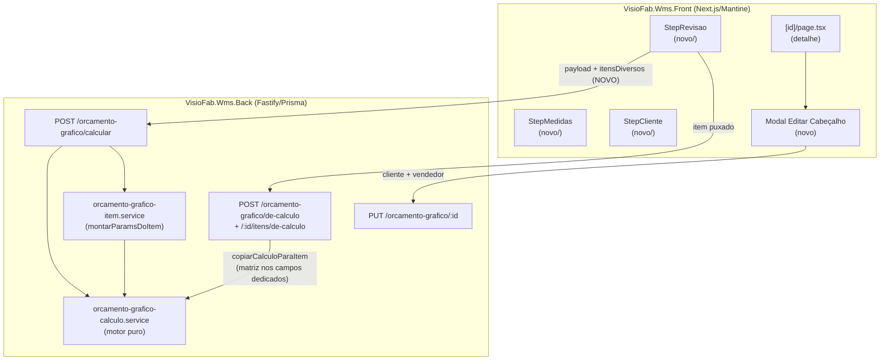

# Design Document

Ajustes do Orçamento Gráfico (pontos de Caio)

## Overview

Esta spec agrupa 9 ajustes no módulo de **Orçamento Gráfico**, levantados na
comparação com o Calcgraf. A característica central do conjunto é que **quase
todo o trabalho é de interface (frontend `VisioFab.Wms.Front`) e de
investigação/documentação**, com uma única mudança real de comportamento no
backend (repassar Itens Diversos na prévia de cálculo). O motor de cálculo
(`orcamento-grafico-calculo.service.ts`) e a camada de persistência já suportam
os conceitos envolvidos (Itens Diversos no Material Direto, matriz no MD,
de-para de cliente por CNPJ + código Calcgraf) — a investigação do código
confirmou isso ponto a ponto.

Agrupamos os 9 pontos em três naturezas:

| Natureza | Pontos | Resumo |
|---|---|---|
| **Ajuste de cálculo/payload** | 2 (Req 1), 3 (Req 3) | Itens Diversos na prévia + matriz preenchida ao puxar |
| **Investigação/levantamento** (documento) | 3 (Req 2), 6 (Req 4), 9 (Req 6) | Comparar campos / validar valores / confirmar de-para |
| **Interface (frontend)** | 5 (Req 5), 7 (Req 7), 8 (Req 8), 9 (Req 9) | Rótulos / Editar Cabeçalho enxuto / ocultar Comparação / ocultar Repetição |

Princípios que guiam o design (das steering rules):

- **Isolamento multi-tenant explícito** por `empresaId` em toda query (nunca só
  `prismaScoped` — bypass SUPER_ADMIN). Confirmado que as rotas tocadas já seguem
  esse padrão.
- **`select` explícito** (nunca `omit`) em queries de orçamento/cálculo.
- **Sem mudança de schema**: os campos `matrizQuantidade`/`matrizPrecoUnitario`
  e `itensDiversos` já existem em `ItemOrcamentoGrafico` e `CalculoGrafico`. Logo
  **não há alteração de `schema.prisma` nem `migrate-prod.ts`** nesta spec.
- **Backend e frontend são repositórios separados**: cada tarefa indicará o repo
  correto. A mudança de backend (Ponto 2) é mínima e não toca schema.

## Architecture



## Components and Interfaces

A seguir, as mudanças por ponto, já com o arquivo real tocado.

### Ponto 2 (Req 1) — Itens Diversos na prévia e na gravação

**Situação encontrada (investigação):**
- O motor `calcularOrcamentoGrafico` **já soma** `itensDiversos` ao Material
  Direto (`orcamento-grafico-calculo.service.ts`: `const materialDireto = papel +
  tinta + matAcabamento + totalItensDiversos − totalItensFornecidos`).
- A rota `POST /orcamento-grafico/calcular` **já aceita** `itensDiversos` no
  schema Zod e repassa ao motor.
- O `POST /orcamento-grafico` (salvar) do wizard **já envia** `itensDiversos`, e
  a persistência grava no campo `item_orcamento_grafico.itens_diversos`
  (confirmado em `novo/page.tsx` → payload → rota `POST /`).
- **Gap único:** o `StepRevisao` monta o payload da prévia (`POST /calcular`)
  **sem** `itensDiversos`. Logo, o Custo de Produção da tela de Revisão ignora os
  diversos informados no passo "Diversos", mesmo que o orçamento salvo os
  considere.

**Mudança (frontend — `novo/StepRevisao.tsx`):** incluir no `payload` de
`calcular()` (e opcionalmente `simularTiragens()`) o mapeamento dos Itens
Diversos do `formData` para o shape que o backend espera (`{descricao, valor}`),
achatando por "fixo":

```ts
// shape do formData: { descricao, quantidade, valor, fixo }
const itensDiversos = (formData.itensDiversos ?? [])
  .filter(i => i.descricao?.trim())
  .map(i => ({ descricao: i.descricao, valor: i.fixo ? i.valor : i.valor * i.quantidade }))
// no payload:
itensDiversos: itensDiversos.length ? itensDiversos : undefined,
```

Observações de design:
- O mesmo mapeamento `fixo ? valor : valor × quantidade` já é usado pelo backend
  ao persistir (rota `POST /`), então a prévia passa a bater com o salvo.
- `itensFornecidos` pode ser incluído no mesmo ajuste (coerência da prévia), mas
  não é exigido pelo Req 1; será tratado como melhoria aditiva opcional.
- **Não-regressão (Req 1.5):** quando não há itens diversos, o payload passa
  `undefined` e o motor produz exatamente o resultado atual.

**Backend:** nenhuma mudança (rota e motor já suportam).

### Ponto 3 (Req 3) — Matriz de Impressão preenchida ao puxar cálculo

**Situação encontrada (investigação):**
- O item e o `CalculoGrafico` têm os campos dedicados `matrizQuantidade` /
  `matrizPrecoUnitario` (schema, sem necessidade de migração).
- O motor soma a matriz ao MD quando `input.matriz.quantidade > 0`
  (`montarParamsDoItem` converte a matriz em um item diverso "Matriz de
  Impressão"). Então **o cálculo já cobre o Req 3.2**.
- O mapeamento `calculoParaItemBody`/`itemBodyParaCalculo` já faz round-trip dos
  campos de matriz (testes de round-trip existentes).
- **Gap:** os cálculos **migrados do Calcgraf** gravaram a matriz como item
  dentro de `itens_diversos` (ver `scripts/gravar-engenharia-real.mjs`), **não**
  nos campos dedicados `matriz_quantidade`/`matriz_preco_unitario` do
  `calculo_grafico`. Por isso, ao puxar, o item nasce com `matrizQuantidade`/
  `matrizPrecoUnitario` nulos → a tela **não exibe** a quantidade/preço da matriz
  (Req 3.3), embora o valor possa já entrar no MD via item diverso.
- Fonte do valor correto da matriz: foto rica (`FotoMatriz` em
  `foto-rica.types.ts`) e `CalculoSTC` com `Itc.Origem = 'MATRIZ IMPRESSÃO'`.

**Mudança (backend — `copiarCalculoParaItem` em `orcamento-grafico.routes.ts`):**
ao copiar o cálculo para o item, **projetar a matriz nos campos dedicados** a
partir da foto rica / decomposição STC quando os campos do cálculo estiverem
vazios, evitando dupla contagem:

1. Se o cálculo-origem já tem `matrizQuantidade`/`matrizPrecoUnitario` > 0 →
   copiar direto (comportamento já existente via round-trip).
2. Senão, se a foto rica traz `matriz` (`FotoMatriz { quantidade, precoUnitario,
   descricao }`) **ou** há componente `MATRIZ IMPRESSÃO` na decomposição STC →
   preencher `matrizQuantidade`/`matrizPrecoUnitario` do item e **remover** o
   item correspondente de `itensDiversos` (se existir com a mesma descrição),
   para a matriz entrar no MD **uma única vez** (pelo caminho dedicado da
   matriz), não duas.
3. Se não houver matriz na origem → manter `matrizQuantidade`/`matrizPrecoUnitario`
   nulos (Req 3.4) e MD inalterado.

Observações de design:
- Risco principal: **dupla contagem no MD** (matriz como campo dedicado +
  matriz como item diverso herdado). O passo 2 resolve removendo o item diverso
  "Matriz/RVU" quando a matriz dedicada é preenchida. Essa é a decisão central do
  ponto.
- **Alternativa de menor custo** (a confirmar na execução): em vez de alterar a
  cópia no backend, **re-gravar os cálculos migrados** populando os campos
  dedicados de matriz no `calculo_grafico` (estender `gravar-engenharia-real.mjs`
  para gravar `matriz_quantidade`/`matriz_preco_unitario` e **parar** de duplicar
  a matriz dentro de `itens_diversos`). Isso aproveita o round-trip já existente
  sem tocar `copiarCalculoParaItem`. A execução escolherá o caminho de menor
  risco após inspecionar um cálculo real (ex.: 12992, que tem matriz RVU 3×110).

**Frontend (`[id]/page.tsx` / `RelatorioItem.tsx`):** exibir "Qtd. de matrizes"
e "Preço unitário da matriz" no detalhe do item quando `matrizQuantidade > 0`
(Req 3.3). Verificar se o `GET /:id` já devolve esses campos no `select` dos
itens (a investigação mostrou `matrizQuantidade/matrizPrecoUnitario` presentes em
selects de itens em várias rotas; confirmar no `GET /:id` do detalhe).

#### Decisão da Tarefa 7.1 — inspeção do cálculo migrado e caminho escolhido

Inspeção de código concluída (SOMENTE LEITURA — nada rodado contra produção).
Os quatro pontos do fluxo foram confirmados no código real:

**1. Onde a matriz é armazenada nos cálculos migrados.** NÃO está nos campos
dedicados `matriz_quantidade`/`matriz_preco_unitario` do `calculo_grafico` — o
gravador `scripts/gravar-engenharia-real.mjs` escreve a matriz **dentro de
`itens_diversos`** (como `{ descricao: nome, quantidade, valor: precoUnitario,
fixo: true }`), nunca populando as colunas dedicadas de matriz. A mesma matriz
ainda aparece em outras DUAS fontes do mesmo cálculo migrado:

| Fonte | Campo/coluna | Conteúdo (ex.: 12992, RVU) | Uso hoje |
|---|---|---|---|
| Engenharia (gravador) | `itens_diversos` (Json) | item "Matriz…" qtd 3 × R$ 110 = **R$ 330** (preço da *tabela* vigente) | entra no MD via item diverso ao recalcular |
| Decomposição STC | `custos_calcgraf.componentes[]` com `origem='MATRIZ IMPRESSÃO'` | `valorTotal` **R$ 300** (3 × R$ 100, preço de *memória*) | ancoragem item-a-item (`aplicarDecomposicaoStc`) |
| Foto rica | `resultadoCalculo.matriz` (`FotoMatriz { quantidade, precoUnitario, subtotal }`) | 3 / R$ 100 / R$ 300 (quando `versaoFoto:2`) | exibição da foto |

> Nota: o preço unitário diverge entre fontes (tabela R$ 110 × memória R$ 100) —
> o STC/foto refletem o custo real cravado pelo Calcgraf (R$ 300), enquanto o
> `itens_diversos` usou o preço de tabela (R$ 330). A ancoragem do total e a
> decomposição STC continuam sendo a verdade do valor; os campos dedicados de
> matriz são, acima de tudo, **exibição** (Req 3.3) + somatório único no MD.

**2. Round-trip e dupla contagem (confirmados no código).**
- `calculoParaItemBody`/`itemBodyParaCalculo` fazem round-trip correto de
  `matrizQuantidade`/`matrizPrecoUnitario` ↔ objeto `matriz`. Como os migrados
  têm essas colunas NULL, `calculoParaItemBody` devolve `matriz = null` e a
  matriz entra no MD **apenas** pela via `itens_diversos` herdada.
- `montarParamsDoItem` (`orcamento-grafico-item.service.ts`) monta
  `itensDiversosCombinados = [...input.itensDiversos]` e, **em adição**, quando
  `input.matriz.quantidade > 0`, faz `push({ descricao: 'Matriz de Impressão',
  valor: quantidade × precoUnitario })`. Ou seja: **se projetarmos a matriz nos
  campos dedicados SEM remover o item diverso equivalente herdado, a matriz é
  somada DUAS VEZES no Material Direto** (uma pelo campo dedicado, outra pelo
  item diverso). Esse é o risco central do Ponto 3.
- `GET /orcamento-grafico/:id` já inclui `matrizQuantidade`/`matrizPrecoUnitario`
  no `select` dos itens (confirmado) — a Tarefa 7.3 só precisa exibir.

**3. Caminho escolhido: A — projetar a matriz nos campos dedicados DENTRO de
`copiarCalculoParaItem`, removendo o item diverso equivalente.**

Justificativa (menor risco):
- `copiarCalculoParaItem` **já recebe o registro completo do cálculo** (via
  `obterCalculoGrafico`, um `findFirst` sem `select` → traz `resultadoCalculo`
  com a `FotoMatriz` E `custosCalcgraf` com o componente `MATRIZ IMPRESSÃO`).
  Logo a projeção **não exige query extra** e a fonte do valor correto já está
  em mãos.
- O Caminho B (re-gravar os 7.9k migrados no Neon via
  `gravar-engenharia-real.mjs`) **mexe em produção** (dado já consolidado e
  validado — a diferença-zero ao puxar depende dele), é um lote grande, e
  nenhum migrado tem hoje dado corrompido por essa decisão. Reprocessar em massa
  é maior raio de impacto para um ajuste que pode ser feito 100% na cópia, no
  momento do "puxar". Fica como alternativa documentada, não escolhida.
- O Caminho A é **cirúrgico, por-item, idempotente e reversível** (afeta só o
  item recém-criado ao puxar; cálculos já salvos não mudam), e aproveita o
  round-trip + o `select` do `GET /:id` já existentes.

**4. Como o Caminho A evita a dupla contagem no MD (regra para a Tarefa 7.2).**
Em `copiarCalculoParaItem`, após obter `itemBody = calculoParaItemBody(...)`:

1. Se `itemBody.matriz` já veio preenchido (cálculo com colunas dedicadas > 0,
   caso raro nos migrados) → manter como está (round-trip), **sem** tocar
   `itensDiversos`.
2. Senão, derivar a matriz de **uma** das fontes, nesta ordem de preferência
   (valor real primeiro): `custos_calcgraf` (componente `origem = 'MATRIZ
   IMPRESSÃO'`) → `resultadoCalculo.matriz` (`FotoMatriz`). Da fonte, obter
   `quantidade` e `precoUnitario` (quando a fonte só traz `subtotal`+`quantidade`,
   derivar `precoUnitario = subtotal / quantidade`).
   - Preencher `itemBody.matriz = { quantidade, precoUnitario }`.
   - **Remover de `itemBody.itensDiversos`** o item equivalente à matriz
     (heurística segura: `fixo === true` e descrição que casa com matriz/chapa —
     ex.: normalizar e testar `/matriz|chapa|clich|rvu/i`, ou casar pela
     descrição do componente STC). Assim a matriz passa a entrar no MD **uma
     única vez**, pelo caminho dedicado (`montarParamsDoItem` fará o único
     `push` da "Matriz de Impressão").
3. Se nenhuma fonte trouxer matriz → manter `matriz` nulo e `itensDiversos`
   intactos (Req 3.4 — MD inalterado).

Invariante a garantir (e a cobrir no teste de exemplo da Tarefa 7.4): **o
Material Direto do item puxado com a matriz projetada nos campos dedicados é
IGUAL ao MD do mesmo item com a matriz só em `itens_diversos`** (não pode subir
pela projeção — é a mesma matriz, contada uma vez). Para o 12992 (RVU, 3
chapas), o item deve nascer com `matrizQuantidade = 3` e a matriz somada ao MD
uma única vez (sem duplicar os ~R$ 300/330).

**Encaminhamento:** a Tarefa 7.2 implementa o Caminho A em
`copiarCalculoParaItem`; a 7.3 exibe `matrizQuantidade`/`matrizPrecoUnitario` no
detalhe (o `select` do `GET /:id` já os devolve); a 7.4 adiciona o teste de
exemplo (12992) + roda a suíte `orcamento-grafico` para não-regressão.

### Ponto 5 (Req 5) — Rótulos das medidas

**Situação encontrada (investigação):**
- `novo/StepMedidas.tsx` renderiza os campos **dinamicamente** a partir de
  `formData.tipoEmbalagem.parametros[]`, usando `param.label` como rótulo. Ou
  seja, o rótulo duplicado "Largura" **vem do cadastro do `TipoEmbalagem`**
  (campo `parametros`), não de texto hardcoded no componente.
- O passo `StepDadosTecnicos.tsx` já usa rótulos corretos e distintos
  ("Comprimento (mm)", "Largura (mm)", "Altura (mm)").

**Decisão de design (preservando o mapeamento de dados — Req 5.3):** a correção
dos rótulos deve ocorrer **sem** mudar as chaves de dados (`param.nome`) que o
motor consome. Duas frentes possíveis, a confirmar na execução:

1. **Corrigir no cadastro do TipoEmbalagem** (origem real do rótulo duplicado):
   ajustar o `label` do parâmetro duplicado no cadastro (tela
   `cadastros/tipos-embalagem`) para que os três rótulos fiquem "Comprimento",
   "Largura" e "Altura". O `nome` (chave de dados) permanece inalterado — só o
   `label` exibido muda. Essa é a correção de dado, de menor risco de
   regressão no cálculo.
2. **Reforço na UI (`StepMedidas.tsx`)** — opcional: normalizar/deduplicar
   rótulos exibidos (ex.: mapear rótulos conhecidos para "Comprimento/Largura/
   Altura" por ordem/convenção) **sem** tocar `param.nome`, como salvaguarda
   caso o cadastro tenha rótulos repetidos.

A execução confirmará, lendo os `parametros` do(s) tipo(s) de embalagem reais da
Wega, qual tipo tem "Largura" duplicado e aplicará a correção no local de origem
(cadastro), mantendo a UI como reforço se necessário. **Nenhuma chave de
`medidas` muda** → o motor continua recebendo os mesmos campos.

#### Resultado da investigação (Tarefa 3.1 — origem do rótulo)

Investigação concluída nos dois repositórios. Conclusões:

**1. O rótulo vem do cadastro (`param.label`), NÃO é hardcoded (confirmado).**
`VisioFab.Wms.Front/src/app/(interna)/orcamento-grafico/novo/StepMedidas.tsx`
renderiza os campos num `parametros.map(...)`, usando `param.label` como rótulo
(`<Text size="sm">{param.label}</Text>`) e `param.nome` como `key` e como chave
do objeto `medidas` (`handleChange(param.nome, value)` → `medidas[param.nome]`).
Não há nenhuma string de medida fixa no componente. O mesmo padrão aparece no
`ItemWizardModal.tsx` e no `novo/page.tsx` (ambos iteram
`tipoEmbalagem.parametros` e validam por `p.nome`). Logo, **o texto exibido é
exatamente o `label` gravado em `tipo_embalagem.parametros` (JSON)**.

**2. Chave de dado consumida pelo Motor_Calculo = `param.nome` (NÃO o label).**
O backend persiste as medidas em `ItemOrcamentoGrafico.medidas` (Json `{L, A,
P, ...}`) e as fórmulas de planificação de cada `TipoEmbalagem`
(`formulaLargura`/`formulaAltura`) referenciam as variáveis **`L`, `A`, `P`**
(+ `ABA`, `SANGRIA`, `PINCA`). Confirmado em `schema.prisma` (model
`TipoEmbalagem`: `parametros Json // [{nome, label, unidade, obrigatorio,
default}]`) e no importador (`scripts/importar-calcgraf.ts` → `formulasBase`:
`'(L + P) * 2 + ABA + SANGRIA * 2'` etc.). O steering de migração registra o bug
histórico de que gravar `medidas` sem as variáveis `L/A/P` zera o encaixe — ou
seja, **a chave de dado é o `nome` (`L`/`A`/`P`), e mudar só o `label` é
seguro** (a 3.2 pode corrigir o rótulo sem tocar o mapeamento).

**3. Onde corrigir: no cadastro de `TipoEmbalagem` (campo `parametros`).**
CRUD em `VisioFab.Wms.Back/src/modules/orcamento-grafico/orcamento-grafico.routes.ts`
(`GET/POST/PUT/DELETE /orcamento-grafico/tipos-embalagem`, isolados por
`empresaId`); a tela é `.../cadastros/tipos-embalagem/page.tsx` (edita
`parametros` como JSON livre). O `GET` devolve `parametros` via
`tipoEmbalagemSelect`, e o `StepMedidas` lê dali.

**4. Registros provavelmente afetados (Wega).** Os 12 `TipoEmbalagem`
`CG-EMB-<n>` foram criados pela fase `tipos-embalagem` do importador a partir de
`cartoon/export/Produtos.json`. O importador gera labels **corretos e
distintos** por ramo:
- **3D (3 parâmetros):** `L→"Largura"`, `A→"Altura"`, `P→"Profundidade"` —
  CG-EMB-1 (Cartuchos), CG-EMB-2 (Cartucho Composto), CG-EMB-3 (Sacola),
  CG-EMB-5 (Caixa), CG-EMB-6 (Invólucros), CG-EMB-10 (TESTE, cancelado).
- **2D (2 parâmetros):** `L→"Largura"`, `A→"Altura"` — CG-EMB-4 (Cartelas),
  CG-EMB-7 (Impressos), CG-EMB-12 (Venda de Cartão); e os de `Formato` vazio
  CG-EMB-8 (Envelope), CG-EMB-9 (Display), CG-EMB-11 (Impressos) também caem no
  ramo 2D (`/3/.test('')` = false).

**Portanto o importador NÃO produz "Largura" duplicado.** A duplicata relatada
por Caio tem uma destas duas causas (a confirmar na base, ver abaixo):
- (a) **Edição manual** no cadastro (a tela edita `parametros` como JSON livre,
  sem validação de unicidade de `label`) deixou um registro com dois `label`
  iguais ("Largura" em vez de "Altura"/"Profundidade"); ou
- (b) **Divergência de nomenclatura**: Caio espera o padrão
  **"Comprimento/Largura/Altura"** (nomenclatura do pré-cálculo Calcgraf), mas o
  cadastro usa **"Largura/Altura/Profundidade"**. Num tipo 3D, isso faz dois
  campos adjacentes ("Largura" + outro) parecerem o rótulo "errado/repetido"
  para quem compara com o Calcgraf.

**Como verificar na base (NÃO rodar contra produção sem confirmação):** consultar
os `parametros` dos 12 tipos da Wega (empresa `75848e24-742e-461d-b913-1642c5b83ae9`)
e procurar `label` repetido por tipo:

```sql
-- Neon (produção) — SOMENTE LEITURA
SELECT codigo, descricao, parametros
FROM tipo_embalagem
WHERE empresa_id = '75848e24-742e-461d-b913-1642c5b83ae9'
ORDER BY codigo;
```

Ou via Prisma/`GET /orcamento-grafico/tipos-embalagem?limit=100` logado na Wega,
inspecionando `parametros[].label`.

**Encaminhamento para a 3.2 (correção):** ajustar o `label` do(s) parâmetro(s)
no cadastro do(s) `TipoEmbalagem` afetado(s) para a nomenclatura pedida por Caio
(**"Comprimento", "Largura", "Altura"**, nessa ordem), **sem** alterar o `nome`
(`L`/`A`/`P`) — o Motor_Calculo continua lendo `medidas.L/A/P` e as fórmulas
`formulaLargura/formulaAltura` permanecem válidas. O reforço opcional na UI
(3.3) pode normalizar/deduplicar os rótulos exibidos como salvaguarda, também
sem tocar `param.nome`.

#### Execução da Tarefa 3.2 — correção na origem (SEED versionado) + ação operacional pendente

A correção de **dados em produção** (cadastro `tipo_embalagem` da Wega no Neon)
NÃO foi executada nesta tarefa — a base de produção não pode ser alterada às
cegas, sem acesso/confirmação, e a duplicata depende do estado real da base
(edição manual que repetiu labels **ou** apenas divergência de nomenclatura
Largura/Altura/Profundidade × Comprimento/Largura/Altura). A correção efetiva
do rótulo **exibido** para os orçamentos novos é coberta pela Tarefa 3.3
(normalização no `StepMedidas`), que é segura, versionada e atende os Req
5.1/5.2/5.3 na interface sem depender da produção.

**O que foi corrigido na origem (código versionado, baixo risco):** o SEED/
importador `scripts/importar-calcgraf.ts` (fase `tipos-embalagem`, função
`importarTiposEmbalagem` → geração de `parametros`) passou a gerar os `label`
dos parâmetros na nomenclatura pedida por Caio, nesta ordem e sem duplicados:
- **3D** (3 parâmetros): `L→"Comprimento"`, `A→"Largura"`, `P→"Altura"`.
- **2D** (2 parâmetros): `L→"Comprimento"`, `A→"Largura"`.

O `nome` (chave de dado: `L`/`A`/`P`) **não muda** — o Motor_Calculo continua
lendo `medidas.L/A/P` e as fórmulas `formulaLargura/formulaAltura` seguem
válidas. Assim, **reimportações futuras dos CG-EMB já nascem com os rótulos
corretos**, sem a duplicata. NOTA: a fase `tipos-embalagem` é idempotente e, ao
encontrar um tipo já existente, **só atualiza descrição/processos/status — NÃO
sobrescreve `parametros`** (para preservar calibração manual de fórmulas). Logo,
reimportar NÃO conserta os 12 CG-EMB já gravados na Wega; o novo `label` só vale
para tipos criados do zero (base nova / outra empresa / recriação).

**Ação operacional pendente (correção dos dados já gravados em produção — NÃO
executada):** ajustar o `label` dos parâmetros dos `TipoEmbalagem` já existentes
da Wega. Deve ser feita com acesso/confirmação explícita, por uma destas vias
(ambas SOMENTE quando o usuário autorizar):

1. **Pela tela** `cadastros/tipos-embalagem` (logado na Wega), editando o JSON
   `parametros` de cada CG-EMB afetado para "Comprimento/Largura/Altura".
2. **Via rota autenticada** `PUT /orcamento-grafico/tipos-embalagem/:id`
   (isolada por `empresaId`), enviando o `parametros` corrigido.

Antes, **verificar** quais tipos têm `label` divergente/duplicado (consulta
SOMENTE LEITURA, já descrita na investigação 3.1):

```sql
-- Neon (produção) — SOMENTE LEITURA (verificação; não altera dados)
SELECT codigo, descricao, parametros
FROM tipo_embalagem
WHERE empresa_id = '75848e24-742e-461d-b913-1642c5b83ae9'
ORDER BY codigo;
```

ou `GET /orcamento-grafico/tipos-embalagem?limit=100` logado na Wega,
inspecionando `parametros[].label`.

**Confirmação de segurança:** NADA foi executado contra a base de produção
(Neon) nesta tarefa — a única alteração foi no código versionado
(`scripts/importar-calcgraf.ts`). A correção do rótulo exibido nos orçamentos
novos fica garantida pela Tarefa 3.3 (reforço na UI).

#### ✅ Ação operacional EXECUTADA em produção (autorizada pelo usuário)

Com a connection string fornecida pelo usuário, a verificação e a correção dos
dados foram executadas na Wega (empresa `75848e24-...`), via script temporário
`_tmp-` (SELECT de verificação + UPDATE idempotente só nos `CG-EMB-%`,
preservando `param.nome` e demais parâmetros). **Achado importante: NÃO havia
label duplicado** — era **divergência de nomenclatura** (os CG-EMB usavam
"Largura/Altura/Profundidade"; Caio espera "Comprimento/Largura/Altura"),
confirmando a hipótese (b) da investigação 3.1. Os 12 `CG-EMB-*` foram
atualizados e **reverificados no banco**:
- 3D (L/A/P): `L="Comprimento"`, `A="Largura"`, `P="Altura"`.
- 2D (L/A): `L="Comprimento"`, `A="Largura"`.
O `nome` (L/A/P) permaneceu inalterado — motor/fórmulas intactos. Os demais
tipos (CARTUCHO/SACOLA/ROTULO/etc., com sufixo "(mm)") não foram tocados. A UI
(3.3) e o dado agora estão alinhados. Script temporário removido após uso.

### Ponto 7 (Req 7) — Editar Cabeçalho enxuto

**Situação encontrada (investigação):**
- Hoje o botão "Editar Cabeçalho" em `[id]/page.tsx` apenas **redireciona ao
  wizard inteiro** (`/orcamento-grafico/novo?editId=`).
- A rota `PUT /orcamento-grafico/:id` já: (a) filtra por `empresaId`
  (`findFirst({ id, empresaId })` → 404 em outra empresa — **Req 7.4 ✅**); (b)
  aplica atualização **parcial** (`clienteId`, `clienteNome`, `vendedorId` via
  `updateData`); (c) **só recalcula** quando recebe `resultadoCalculo` OU
  `gramatura + precoKg`. Enviando apenas cliente/vendedor, **não recalcula** →
  itens e resultado preservados (**Req 7.3 ✅**). (d) Exige status `RASCUNHO`.

**Mudança (frontend — `[id]/page.tsx`):** substituir o redirecionamento por um
**modal enxuto** com apenas dois campos:
- **Cliente** (Autocomplete de `/clientes`, mesmo componente do `StepCliente`;
  grava `clienteId` quando selecionado, ou `clienteNome` como prospect).
- **Representante/Vendedor** (Autocomplete de `/vendedores`; grava `vendedorId`).

Ao confirmar, chamar `PUT /orcamento-grafico/:id` com **somente**
`{ clienteId?, clienteNome?, vendedorId? }` e recarregar o detalhe. Como o PUT
não recebe `gramatura/precoKg/resultadoCalculo`, não recalcula — preserva tipo de
embalagem, medidas, itens e resultado (Req 7.2/7.3).

**Backend:** nenhuma mudança (PUT já suporta). Decisão: manter a restrição a
`RASCUNHO` já existente no PUT; se o usuário precisar editar cabeçalho de
orçamento enviado, isso é fora de escopo desta spec (documentar).

### Ponto 8 (Req 8) — Ocultar a tela de Comparação de Versões

**Situação encontrada (investigação):** o bloco está em `[id]/page.tsx` sob a
condição `{versoes.length > 0 && (...)}` (título "Comparação de Versões").

**Mudança (frontend — `[id]/page.tsx`):** **ocultar** o bloco sem remover o
código. Opções: (a) guardar atrás de uma flag `const MOSTRAR_COMPARACAO_VERSOES =
false` e usar `{MOSTRAR_COMPARACAO_VERSOES && versoes.length > 0 && (...)}`; ou
(b) comentar o bloco com um `TODO` apontando a spec de "várias tiragens". A opção
(a) é preferida — preserva o código vivo e compilável (Req 8.3) e torna trivial
reexibir depois. As demais ações do detalhe permanecem intactas (Req 8.2).

### Ponto 9 (Req 9) — Remover "Repetição de produto" no orçamento novo

**Situação encontrada (investigação):** o campo "Repetição de produto (opcional)"
é um `Autocomplete` **fixo** dentro de `novo/StepCliente.tsx`. Não existe um
"modo repetição" que passe pelo wizard: a repetição real é criada pelo fluxo
"Puxar Cálculo" (`POST /de-calculo`), que **não** usa o wizard. O wizard `/novo`
é sempre "orçamento novo".

**Mudança (frontend — `novo/StepCliente.tsx` + `novo/page.tsx`):** controlar a
exibição do campo por uma prop/flag:
- Adicionar a `StepCliente` uma prop `mostrarRepeticaoProduto?: boolean`
  (default `false`).
- No fluxo de orçamento novo (uso atual), o campo fica **oculto** (Req 9.1). O
  passo conclui sem exigir `produtoId` (já é opcional hoje — Req 9.2 ✅).
- **Req 9.3** (WHERE repetição → exibir): o ponto de injeção fica preparado —
  quando/se existir um fluxo de repetição que reutilize o wizard, ele passa
  `mostrarRepeticaoProduto` true. Como hoje não há esse fluxo pelo wizard, o
  campo simplesmente não aparece no "novo".

**Backend:** nenhuma mudança (`produtoId` já é opcional em `POST /` e `PUT /:id`).

## Tabelas de Levantamento (investigações)

### Req 2 (Ponto 3) — Campos do pré-cálculo Calcgraf × Vizor

Legenda de **classificação**: *Já persistido* (coluna/estrutura própria no
Vizor) · *Parcial* (existe só como foto/derivado/texto) · *Ausente*.
Legenda de **decisão**: *Persistir* · *Exibir da foto* · *Adiar*.

> **Estado desta tabela:** CONFIRMADA linha a linha contra o schema real
> (`prisma/schema.prisma` — models `OrcamentoGrafico` ~L4230, `ItemOrcamentoGrafico`
> ~L4302, `CalculoGrafico` ~L4470, `PlanoCalculoGrafico` ~L4574,
> `ProgramacaoEntrega` ~L3465, `ParametroPerda` ~L4199) e contra o contrato da
> foto rica (`src/modules/orcamento-grafico/calculo-grafico/foto-rica.types.ts`).
> Leitura SOMENTE de código/schema — NADA rodado contra a base. Dois acertos em
> relação ao preenchimento preliminar: (a) `aproveitamentoManual` é coluna do
> `CalculoGrafico` (biblioteca), **não** do `ItemOrcamentoGrafico` — o item
> carrega `montagemLinhas/montagemColunas` e o aproveitamento efetivo vive no
> `resultadoCalculo`; (b) a foto rica **não** tem campo de Prazo nem de Condição
> de Pagamento explícito — o único dado comercial/condicional estruturado na foto
> é `FotoCev.juros` (percentual derivado do prazo de pagamento/financiamento).

| # | Campo do pré-cálculo Calcgraf | Onde está hoje no Vizor (confirmado no schema) | Classificação | Decisão |
|---|---|---|---|---|
| 1 | Formato Final (produto) | `ItemOrcamentoGrafico.medidas` (Json L/A/P) + `comprimentoMm/larguraMm/alturaMm` (colunas Decimal) | Já persistido | Persistir (ok) |
| 2 | Formato de corte / folha por plano | Item: `formatoCorteLarguraMm/AlturaMm` + `formatoSupLarguraMm/AlturaMm`; plano: `PlanoCalculoGrafico.formatoLarguraMm/AlturaMm` | Já persistido | Persistir (ok) |
| 3 | Aproveitamento por plano (peças/folha) | Item: `montagemLinhas/montagemColunas` + aproveitamento efetivo em `resultadoCalculo`. Coluna dedicada `aproveitamentoManual` existe no `CalculoGrafico` (biblioteca) e no payload do motor, **não** no item | Parcial (item) / Já persistido (biblioteca) | Persistir (ok) |
| 4 | Programação de Entrega "a combinar" | Não há campo no orçamento gráfico; `ProgramacaoEntrega` é filha de `OrdemProducao` (FK `ordemProducaoId`), não do orçamento | Ausente | Exibir da foto / Adiar (não é do cálculo) |
| 5 | Repetição TR (tipo de OP/repetição) | `OrcamentoGrafico.tipo` (NOVO/REPETICAO) + `ItemOrcamentoGrafico.calculoGraficoOrigemId` (rastreabilidade) | Parcial | Exibir da foto (texto do Calcgraf) |
| 6 | Quebra % (perda de impressão) | `ParametroPerda` global (`perdaVariavel`/`perdaFixaFolhas`) + override no cálculo; **sem** coluna por item | Parcial | Exibir da foto / Adiar |
| 7 | Apara % | Não há coluna; embutida na quebra/consumo do motor | Ausente | Exibir da foto / Adiar |
| 8 | Produção por Hora (máquina/acab.) | `CentroProducao.velocidade` (cadastro) + `FotoImpressao/FotoAcabamento.producaoHora` na foto rica; não por item | Parcial | Exibir da foto (cadastro é a fonte) |
| 9 | Prazo de Produção | Não há campo dedicado no item nem na foto rica | Ausente | Exibir da foto / Adiar |
| 10 | Prazo de Armazenagem | Não há campo dedicado no item nem na foto rica | Ausente | Exibir da foto / Adiar |
| 11 | Prazo de Pagamento / Financiamento | Derivado na foto rica como `FotoCev.juros` (percentual por prazo); **sem** coluna dedicada no item/cabeçalho | Parcial | Exibir da foto |
| 12 | Condição de Pagamento | Sem coluna no item/`OrcamentoGrafico`; a foto rica **não** tem campo explícito de condição de pagamento (só `FotoCev` com os percentuais) | Ausente (texto) / Parcial (CEV) | Exibir da foto |

**Conclusão do levantamento (CONFIRMADA):** o schema real confirma que os campos
de **engenharia** que afetam o cálculo (formato final, formato de corte/folha,
aproveitamento/montagem, cores, papel/gramatura) **já são persistidos** em
`ItemOrcamentoGrafico` (ou no `CalculoGrafico` da biblioteca) — nenhum deles
precisa de coluna nova. Os campos **comerciais/condicionais** (programação de
entrega, prazos de produção/armazenagem/pagamento, condição de pagamento,
quebra/apara por item) **não têm coluna dedicada** no orçamento gráfico: ou
pertencem a outra entidade (`ProgramacaoEntrega` é de OP, não do orçamento), ou
existem apenas como dado derivado/foto (`FotoCev.juros`, `ParametroPerda`
global, `CentroProducao.velocidade`). A decisão predominante é **exibir da foto**
(`resultadoCalculo`/foto rica) e **adiar** qualquer persistência dedicada para
uma spec futura, caso o usuário venha a precisar **editar** esses campos no
Vizor (hoje são só leitura/espelho do Calcgraf).

Portanto, **esta spec NÃO cria colunas novas**: nenhuma alteração em
`prisma/schema.prisma` nem em `prisma/migrate-prod.ts` decorre deste
levantamento. Os campos comerciais/condicionais ficam classificados como
"exibir da foto" ou "adiar"; os de engenharia já estão persistidos e são
reaproveitados como estão.

### Req 4 (Ponto 6) — Validação de valores reais por componente

**Metodologia CONFIRMADA no código (Tarefa 10 — SOMENTE LEITURA de código/
schema; NADA rodado contra a base de produção).** Esta seção documenta a
mecânica de comparação por componente de forma que a coleta dos números reais
(dependente de autorização — ver "Ação operacional pendente" abaixo) seja
**mecânica**, não exploratória.

Casos de referência: **15466 (orçamento 5521)** e **15221 / 15222 / 15223**.
Componentes a comparar Vizor × Calcgraf, com tolerância de **0,5%**: papel (R$/kg
e peso), tinta (R$/cor) e acabamentos.

#### 1. Como a comparação por componente funciona (mecânica confirmada no código)

A fonte da decomposição por componente é a tabela `CalculoSTC` do Calcgraf,
exportada para `calculo_grafico.custos_calcgraf` (JSON). O Calcgraf grava ali o
**custo FINAL de cada componente** do cálculo e a **soma bate EXATO** com o custo
de produção do Calcgraf — não é fórmula/caixa-preta (steering: 12992 = soma dos
10 componentes = **R$ 5.192,05 EXATO**).

O módulo PURO `src/modules/orcamento-grafico/calculo-grafico/decomposicao-stc.service.ts`
é quem decompõe e classifica cada componente. Pontos confirmados linha a linha:

| Função | O que faz (confirmado) |
|---|---|
| `normalizarCustosStc(custosRaw)` | valida o JSON cru; retorna `null` se não houver `componentes[]` utilizável (cálculo novo / malformado). Soma `grupo==='MD'` → `materialDireto`, `grupo==='CT'` → `custoTransformacao`, e `custoProducao` (usa o gravado, senão MD+CT). Arredonda a 2 casas (`r2`). |
| `aplicarDecomposicaoStc(resultado, custosRaw)` | projeta a decomposição sobre o `ResultadoOrcamento` (mutação in-place), sobrescrevendo **só os VALORES** de custo (papel/tinta por cor/máquinas/acabamentos) e anexando `resultado.custosCalcgraf`. Aditivo/não-regressivo: sem STC, não toca nada. |
| `limparDescStc(desc)` | remove o prefixo numérico ("0001…") das descrições do STC para exibição. |

**Classificação de cada componente pela coluna `Itc.Origem`** (é isto que define
onde cada número entra na comparação):

| `origem` (Calcgraf) | Grupo | Componente a comparar |
|---|---|---|
| `SUPORTE` | MD | **Papel** (R$/kg × peso) → `resultado.papel` (preserva o `pesoKg` do motor; sobrescreve o `custo` real) |
| `TINTA` | MD | **Tinta por cor** → `resultado.tinta.detalhePorCor[]` (`cor`, `consumoKg = quantFixa + quantVariavel`, `custo`) |
| `MAT.ACABAMENTO` | MD | **Material de acabamento** (BOPP/laminação) → `resultado.acabamentos.detalhePorAcabamento[]` |
| `MATRIZ IMPRESSÃO` | MD | **Matriz/chapa** (entra no MD junto com MAT.ACABAMENTO) |
| `CENTRO DE CUSTO` | CT | **Máquina/etapa** → `resultado.maquinas.detalhePorEtapa[]` |

#### 2. Como o desvio e o badge ≤0,5% são calculados (rota de conferência)

A conferência foto × recálculo já existe e é **mecânica** — basta ler a resposta.
Rota: `GET /api/orcamento-grafico/:id/itens/:itemId/conferencia`
(`orcamento-grafico.routes.ts`), isolada por `empresaId` EXPLÍCITO; só se aplica a
item com `calculoGraficoOrigemId` (item puxado da biblioteca). Mecânica confirmada:

- **Foto (Calcgraf, imutável):** `custoFoto = resultadoCalculo.custos.custoProducao`
  (fallback `calc.custoProducao`); `valorFoto = margem selecionada.valorTotal`
  (fallback `calc.valorTotal`).
- **Fórmula do desvio:** `desvio(foto, vizor) = round(|vizor − foto| / foto ×
  10000) / 100` → percentual com 2 casas; retorna `null` se `foto === 0`.
- **`confere` (badge verde):** `desvioTotal != null && desvioTotal <= 0.5`
  (ou seja, **≤ 0,5%**). Acima disso → `alerta` com a mensagem de divergência.
- **Duas fontes de comparação** (campo `fonte` da resposta):
  - `fonte: 'CALCULO_STC'` — quando o cálculo de origem TEM `custosCalcgraf`.
    O custo do Vizor = `stc.custoProducao` (= foto, por ancoragem) e o valor é
    ancorado ao valor real do Calcgraf → desvio ~0% → **confere**. A resposta
    traz `decomposicao` = `{ materialDireto, custoTransformacao, custoProducao,
    componentes[] }` — **é esta decomposição que preenche a tabela por
    componente** desta seção.
  - `fonte: 'MOTOR'` — quando NÃO há STC. Compara a foto contra o recálculo cru
    do motor (que diverge ~5–9% por não reproduzir a fórmula Delphi fechada).

**Leitura por componente:** o campo `decomposicao.componentes[]` da resposta
(fonte `CALCULO_STC`) traz cada linha com `{ origem, grupo, descricao,
valorTotal, quantFixa, quantVariavel, valorCm }`. Agrupando por `origem` conforme
a tabela acima, obtém-se o valor real de papel/tinta-por-cor/acabamentos/matriz/
máquina — exatamente as colunas da tabela de validação.

#### 3. Tabela de validação (valores reais a coletar — pendente de autorização)

Os valores do Calcgraf e do Vizor abaixo exigem **consulta à base de PRODUÇÃO
(Neon)** e/ou puxar/recalcular no Vizor de produção; portanto permanecem
**"a coletar (pendente de autorização)"**. A fonte exata de cada número e o
procedimento já estão fixados (seções 1, 2 e 4), de modo que a coleta é mecânica.

| Caso | Componente | Origem do número (confirmada) | Valor Calcgraf (foto) | Valor Vizor (decomp. STC) | Desvio | Status | Causa provável se divergir |
|---|---|---|---|---|---|---|---|
| 15466 (orç. 5521) | Papel (R$/kg × kg) | `custos_calcgraf.componentes[]` com `origem='SUPORTE'` (`valorTotal`); peso em `resultado.papel.pesoKg` | *a coletar (pendente de autorização)* | *a coletar (pendente de autorização)* | — | A validar | preço do papel (crédito PIS/COFINS 9,25%) / quebra |
| 15466 (orç. 5521) | Tinta por cor | `componentes[]` `origem='TINTA'` (um por cor; `quantFixa+quantVariavel = kg`, `valorTotal = R$`) | *a coletar (pendente de autorização)* | *a coletar (pendente de autorização)* | — | A validar | partida fixa 0,20 kg/cor + densidade SPANKS |
| 15466 (orç. 5521) | Acabamentos | `componentes[]` `origem IN ('MAT.ACABAMENTO','MATRIZ IMPRESSÃO')` + CT em `origem='CENTRO DE CUSTO'` | *a coletar (pendente de autorização)* | *a coletar (pendente de autorização)* | — | A validar | material de acabamento (BOPP/laminação) não no MD |
| 15221 | Papel / Tinta / Acab. | idem (por `origem`) | *a coletar (pendente de autorização)* | *a coletar (pendente de autorização)* | — | A validar | idem |
| 15222 | Papel / Tinta / Acab. | idem (por `origem`) | *a coletar (pendente de autorização)* | *a coletar (pendente de autorização)* | — | A validar | idem |
| 15223 | Papel / Tinta / Acab. | idem (por `origem`) | *a coletar (pendente de autorização)* | *a coletar (pendente de autorização)* | — | A validar | idem |

**Tolerância:** 0,5% por componente (mesma regra do badge `confere` da rota de
conferência). Para divergências por **dado ausente no item puxado** (Req 4.4), a
origem do valor correto é a decomposição `CalculoSTC` (coluna "Origem do número"
acima) — o enriquecimento e a ancoragem já projetam esses valores no item puxado
(`aplicarDecomposicaoStc`; steering `orcamento-repeticao-engenharia-completa`),
de modo que o componente ausente é identificável pela `origem` da linha do STC.

#### 4. Ação operacional pendente — coletar os números reais (NÃO executada)

A coleta dos valores reais de **15466 / 15221 / 15222 / 15223** exige consulta à
base de PRODUÇÃO (Neon) e/ou recálculo no Vizor de produção. **NADA foi executado
contra produção nesta tarefa** — a base de produção não pode ser consultada sem
confirmação explícita do usuário. Quando autorizado, seguir um dos dois
procedimentos **SOMENTE-LEITURA** abaixo (ambos preenchem a tabela da seção 3; os
desvios finais e o status "confere/diverge" ficam registrados aqui ao executar):

**Via A — rota de conferência (recomendada; já entrega o desvio e o badge
prontos).** Para cada caso: localizar o `CalculoGrafico` migrado pelo
`numeroCalcgraf` (15466/15221/15222/15223), puxá-lo num orçamento de teste
(`POST /orcamento-grafico/de-calculo`) e chamar
`GET /orcamento-grafico/:id/itens/:itemId/conferencia`. A resposta já traz
`foto`, `vizor`, `desvio.{custoPercent,valorPercent,totalPercent}`, `confere`
(≤0,5%) e `decomposicao.componentes[]` (papel/tinta-por-cor/CT/matriz) — basta
transcrever por `origem` para a tabela.

**Via B — leitura direta do `custos_calcgraf` no banco (SOMENTE LEITURA).**
Empresa Wega `75848e24-742e-461d-b913-1642c5b83ae9`:

```sql
-- Neon (produção) — SOMENTE LEITURA (não altera dados)
SELECT numero_calcgraf, custo_producao, custos_calcgraf
FROM calculo_grafico
WHERE empresa_id = '75848e24-742e-461d-b913-1642c5b83ae9'
  AND numero_calcgraf IN (15466, 15221, 15222, 15223)
ORDER BY numero_calcgraf;
```

Do JSON `custos_calcgraf`, agrupar `componentes[]` por `origem` (SUPORTE → papel;
TINTA → tinta por cor; MAT.ACABAMENTO/MATRIZ IMPRESSÃO → acabamentos/matriz;
CENTRO DE CUSTO → CT), conferir que `Σ valorTotal == custo_producao` (prova de
integridade da foto, como 12992 = R$ 5.192,05), e lançar na tabela da seção 3. O
valor Vizor do item puxado é a mesma decomposição STC (ancoragem item a item →
desvio ~0%); qualquer desvio > 0,5% indica componente ausente na projeção, cuja
correção parte da `origem` divergente (Req 4.4).

**Confirmação de segurança:** esta tarefa documentou a metodologia e deixou a
tabela com as colunas de valor "a coletar (pendente de autorização)", a fonte
exata de cada número, o procedimento SOMENTE-LEITURA e a tolerância (0,5%). Os
desvios finais serão preenchidos quando o usuário autorizar a consulta à
produção. NADA foi executado contra a base.

#### ⚠️ Consulta EXECUTADA em produção (autorizada) — golden citados NÃO EXISTEM

A consulta SOMENTE-LEITURA foi rodada na Wega (`75848e24-...`). Achado:
- **Os cálculos 15466, 15221, 15222 e 15223 NÃO existem** na biblioteca
  (`calculo_grafico`) da Wega. O **maior `numero_calcgraf` do acervo é 15196** —
  os números citados no handoff estão **acima do teto migrado** (nunca foram
  importados). O `5521` (citado como "orçamento 5521") também não aparece como
  `numero_calcgraf`.
- Acervo real: **7.951 cálculos** (menor 5, maior **15196**), **7.926 com
  `custos_calcgraf`** (decomposição STC disponível em ~99,7%).
- O único alvo citado que EXISTE é o **12992** (`custo_producao = 5104.36`, com
  STC) — já validado em sessões anteriores (steering: 12992 = **R$ 5.192,05**
  na soma dos 10 componentes STC; decomposição bate EXATO).

**Conclusão (Req 4):** a metodologia de validação por componente está
**confirmada e funcional** (seções 1–2 acima; fonte = `custos_calcgraf` por
`origem`; a soma bate exato com o Calcgraf, provado no 12992). Porém os **casos
golden específicos do handoff não podem ser validados porque não existem no
acervo migrado** — o handoff referenciou números fora da faixa migrada
(≤ 15196). **Encaminhamento:** validar com cálculos que EXISTAM — o 12992 já
serve de golden confirmado; se o usuário quiser casos adicionais, escolher
números reais ≤ 15196 (quase todos com STC) e aplicar a Via A (rota de
conferência) ou a Via B (leitura de `custos_calcgraf`) descritas acima. A
coleta numérica dos "15466/15221-15223" fica **cancelada por inexistência** (não
é falha de validação — é alvo inexistente).

### Req 6 (Ponto 9) — De-para do cliente (SOL & NEVE / código Calcgraf 13)

**Investigação de código CONCLUÍDA (Tarefa 11 — SOMENTE LEITURA de código/
schema; NADA rodado contra a base de produção).** Os quatro pontos do de-para
foram confirmados linha a linha em
`src/modules/orcamento-grafico/calculo-grafico/enriquecimento-engenharia.service.ts`
(função `enriquecerEngenharia`, bloco "── Cliente ──") + `prisma/schema.prisma`
+ `foto-rica.types.ts`:

| Ponto confirmado | Evidência no código | Status |
|---|---|---|
| (a) de-para **primário por CNPJ normalizado** | `const doc = normalizarDoc(calc.clienteDoc)`; `let casado = doc ? matchClientePorDoc(doc, clientes) : undefined`. `normalizarDoc` = `s.replace(/\D/g, '')` (só dígitos); `matchClientePorDoc` compara `normalizarDoc(c.cpfCnpj) === doc` | **Req 6.2 ✅ CONFIRMADO** |
| (b) **fallback por `codigoCalcgraf`** | `if (!casado && codigo != null) { casado = clientes.find((c) => c.codigoCalcgraf === codigo) }` (`codigo = calc.clienteCodigo ?? null`) | **Req 6.4 ✅ CONFIRMADO** |
| (c) `matchClientePorDoc` **ignora doc vazio** | `const doc = normalizarDoc(docAlvo); if (!doc) return undefined` | **Req 6.3 ✅ CONFIRMADO** |
| (d) `Cliente.codigoCalcgraf` existe no schema | `codigoCalcgraf Int? @map("codigo_calcgraf")` (schema.prisma ~L418) — opcional, só migrados do Calcgraf têm valor | **CONFIRMADO** |
| (e) a foto/cálculo carrega `clienteDoc` e `clienteCodigo` | `foto-rica.types.ts`: `clienteDoc?: string \| null` + `clienteCodigo?: number \| null`; `enriquecerEngenharia` recebe `calc.clienteDoc`/`calc.clienteCodigo` (populados por `exportar-calculos-acervo-rico.mjs` de `CNPJCPF`/`CodNome`) | **CONFIRMADO** |

Sem match seguro (nem CNPJ nem código) → cliente fica **pendente** (`enriquecerEngenharia`
nunca inventa vínculo). O `StepCliente` exibe "`<codigoCalcgraf> - <nome>`" para
facilitar a conferência visual.

**Conclusão por critério:**

- **Req 6.2 — de-para primário por CNPJ normalizado: CONFIRMADO no código.** A
  1ª via de resolução é sempre o CNPJ só-dígitos (`clienteDoc` do cálculo ×
  `cliente.cpfCnpj`). Validação histórica em produção: 8/8 e 5/5 casam por CNPJ
  (steering `orcamento-repeticao-engenharia-completa`).

- **Req 6.3 — por que o de-para por CNPJ NÃO resolve SOL & NEVE sem CNPJ.** Se o
  cadastro de origem (Calcgraf) de "SOL & NEVE" não tem CNPJ, a foto do cálculo
  carrega `clienteDoc` vazio/nulo. `matchClientePorDoc` curto-circuita em
  `if (!doc) return undefined` → **o critério primário (CNPJ) não casa nada**.
  Nesse cenário, a **única via é o fallback por `codigoCalcgraf = 13`** —
  acionado em `enriquecerEngenharia` quando `doc` é vazio mas `codigo != null`
  (`if (doc || codigo != null) { ... }`). Para o fallback resolver SOL & NEVE,
  **duas condições precisam ser verdadeiras simultaneamente no dado real**:
  1. o cliente "SOL & NEVE" no Vizor tem `codigoCalcgraf = 13` gravado; e
  2. a foto do cálculo carrega `clienteCodigo = 13`.

- **Req 6.4 — relevância do código 13: fallback (2º critério, após CNPJ).** O
  `codigoCalcgraf` NÃO é a chave primária do de-para (o Vizor isola clientes por
  CNPJ). Ele é o **segundo critério**, usado só quando o CNPJ está ausente ou não
  casa. Logo, o código 13 é relevante **exatamente** para o caso SOL & NEVE (e
  outros clientes do Calcgraf sem CNPJ), como rede de resolução.

- **Req 6.1 — verificação concreta de SOL & NEVE no Vizor: AÇÃO OPERACIONAL
  PENDENTE (consulta à base de produção — NÃO executada).** Confirmar na base se
  existe um cliente "SOL & NEVE" com `codigoCalcgraf = 13` é uma **consulta à
  produção (Neon)** e **não foi executada nesta tarefa** — a base de produção não
  pode ser consultada sem confirmação explícita do usuário. Quando autorizado,
  rodar a consulta **SOMENTE-LEITURA** abaixo e registrar o resultado numérico
  aqui:

  ```sql
  -- Neon (produção) — SOMENTE LEITURA (não altera dados)
  SELECT id, nome, cpf_cnpj, codigo_calcgraf
  FROM cliente
  WHERE empresa_id = '75848e24-742e-461d-b913-1642c5b83ae9'
    AND (upper(nome) LIKE '%SOL%NEVE%' OR codigo_calcgraf = 13);
  ```

  Interpretação do resultado (a preencher ao autorizar):
  - Se houver 1 linha com `codigo_calcgraf = 13` e `cpf_cnpj` nulo → o de-para de
    SOL & NEVE depende **do fallback por código 13** (como previsto no Req 6.3).
  - Se houver `cpf_cnpj` preenchido que bata com o `clienteDoc` da foto → o
    de-para primário por CNPJ já resolve e o código 13 é redundante para esse
    cliente.
  - Se não houver nenhuma linha → o cliente não está cadastrado (ou sem código);
    nesse caso, para habilitar a repetição por código, gravar `codigo_calcgraf = 13`
    no cadastro (ação de dado, com confirmação do usuário).

  > **Confirmação de segurança:** esta tarefa foi 100% de leitura de código/
  > schema. A conclusão numérica final (quantas linhas, se tem CNPJ, se tem
  > código 13) será registrada neste documento **quando o usuário autorizar** a
  > consulta à base de produção.

**✅ Consulta EXECUTADA em produção (autorizada pelo usuário) — SOL & NEVE
RESOLVIDO.** A query SOMENTE-LEITURA acima foi rodada na Wega (`75848e24-...`) e
retornou **exatamente 1 cliente**:

```
razao_social : MARBRAN INDUSTRIA COMERCIO E TRANSPORTE LTDA
nome_fantasia: SOL & NEVE
cpf_cnpj     : 70928650/0001-87   (preenchido)
codigo_calcgraf: 13
```

**Conclusão (Req 6.1):** o cliente "SOL & NEVE" EXISTE no Vizor, tem **CNPJ
preenchido** E `codigoCalcgraf = 13`. Portanto o de-para no "Puxar Cálculo"
resolve pelo **critério PRIMÁRIO (CNPJ normalizado)** — `70928650000187` casa
com `clienteDoc` da foto do cálculo; o fallback por código 13 fica como rede
redundante (não é necessário neste caso). **Nenhuma ação de dado é
necessária** (o cliente já está cadastrado e vinculável). Se a foto de algum
cálculo específico de SOL & NEVE vier sem `clienteDoc`, o fallback por
`codigoCalcgraf = 13` ainda resolve, pois o cadastro tem o código gravado.

## Data Models

**Nenhuma alteração de modelo de dados.** Todos os campos necessários já existem:

- `ItemOrcamentoGrafico.matrizQuantidade` / `matrizPrecoUnitario` (Decimal?) —
  Ponto 3.
- `ItemOrcamentoGrafico.itensDiversos` (Json) — Ponto 2.
- `CalculoGrafico.matrizQuantidade` / `matrizPrecoUnitario` (Decimal?) e
  `custosCalcgraf` (Json — decomposição STC) — Ponto 3/6.
- `Cliente.codigoCalcgraf` (Int?) — Ponto 9.
- `OrcamentoGrafico.tipo` (NOVO/REPETICAO) — contexto do Ponto 9.

Como não há mudança em `schema.prisma`, **não há alteração em
`prisma/migrate-prod.ts`** (regra de database-migrations respeitada por
não-aplicabilidade).

## Error Handling

- **Ponto 2:** itens diversos malformados no front não devem ser enviados —
  filtrar os sem descrição antes de montar o payload; o backend já valida o shape
  `{descricao:string, valor:number}` via Zod em `/calcular`.
- **Ponto 3:** ao projetar a matriz nos campos dedicados, garantir que **não**
  haja dupla contagem no MD (remover o item diverso equivalente). Se a origem não
  tiver matriz, manter nulos (sem erro).
- **Ponto 7:** `PUT /:id` já retorna 404 para orçamento de outra empresa e 400
  para status diferente de RASCUNHO; o modal deve exibir a mensagem retornada.
- **Pontos 5/8/9:** mudanças puramente de UI — sem novos caminhos de erro; manter
  o comportamento de validação existente dos passos do wizard.

## Testing Strategy

**Avaliação de PBT:** a natureza desta spec é majoritariamente **interface,
ajuste de payload e investigação/documentação**. A lógica de cálculo subjacente
(soma de Itens Diversos no MD; matriz no MD; de-para por CNPJ/código) **já existe
e já é coberta por testes** no backend (ex.: `decomposicao-stc.service.test.ts`,
testes de round-trip do mapeamento, golden cases de calibração). Não há uma nova
propriedade universal "para todo input X, P(X)" introduzida por esta spec que
justifique novos testes de propriedade. Por isso **a seção Correctness Properties
é omitida** e a verificação se dá por testes de exemplo/integração e verificação
manual.

**Backend (VisioFab.Wms.Back):**
- Ponto 2: o motor e a rota `/calcular` já aceitam/somam `itensDiversos` — sem
  novo teste necessário (coberto pelo comportamento existente). Verificação por
  `get_diagnostics` e, se tocar `copiarCalculoParaItem`, rodar a suíte
  `orcamento-grafico` existente (deve permanecer verde).
- Ponto 3: se a projeção de matriz for feita em `copiarCalculoParaItem` ou no
  gravador, adicionar **teste de exemplo** validando que, para um cálculo com
  matriz (ex.: 12992, RVU 3×110), o item puxado nasce com
  `matrizQuantidade=3`/`matrizPrecoUnitario=110` **e** sem duplicar a matriz em
  `itensDiversos` (MD soma a matriz uma única vez). Rodar a suíte
  `orcamento-grafico` para garantir não-regressão.

**Frontend (VisioFab.Wms.Front):**
- Verificação por `get_diagnostics` nos arquivos tocados + `npm run build`
  (Next) deve compilar.
- Ponto 2: verificação manual — informar itens diversos no passo "Diversos" e
  confirmar que o Custo de Produção da Revisão sobe e bate com o orçamento salvo.
- Ponto 5: verificar que os três rótulos aparecem como "Comprimento/Largura/
  Altura" e que o cálculo continua idêntico (mesmas chaves de `medidas`).
- Ponto 7: editar cabeçalho (cliente+vendedor) e confirmar que itens/resultado
  permanecem inalterados.
- Ponto 8: confirmar que a seção "Comparação de Versões" não aparece e as demais
  ações seguem acessíveis.
- Ponto 9: confirmar que "Repetição de produto" não aparece no fluxo novo e que o
  passo conclui sem `produtoId`.

**Investigações (Req 2/4/6):** a verificação é a própria produção deste documento
(tabelas preenchidas). A execução numérica do Req 4 (comparar 15466/15221/15222/
15223) e a consulta do Req 6 (SOL & NEVE / código 13) serão tarefas que preenchem
as tabelas acima com os resultados reais.

**Isolamento multi-tenant:** toda rota tocada/consultada (`/calcular`, `PUT /:id`,
`/de-calculo`) já filtra por `empresaId` explícito — nenhuma nova query de banco é
introduzida sem esse filtro.
