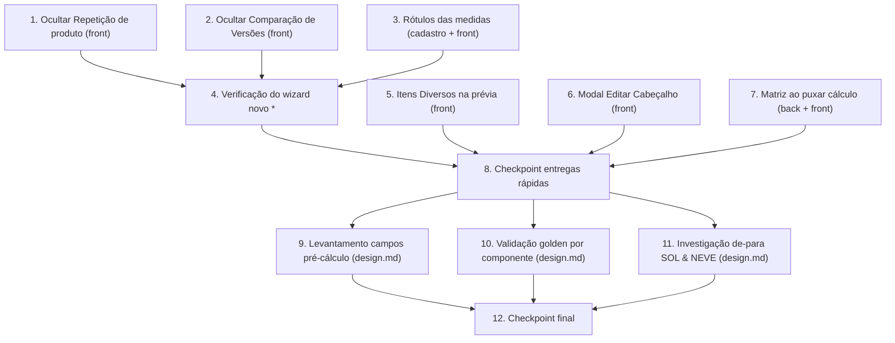

# Implementation Plan: Ajustes do Orçamento Gráfico (pontos de Caio)

## Overview

Plano de implementação dos 9 pontos cobertos pela spec. A maior parte do
trabalho é de **interface (frontend `VisioFab.Wms.Front`)**, com uma única
mudança de comportamento no **backend (`VisioFab.Wms.Back`)** (projeção da
matriz ao puxar cálculo) e três tarefas de **levantamento/investigação** que
gravam o resultado no próprio `design.md`.

**Convenções deste plano:**

- Cada tarefa indica explicitamente o **repositório** e o **arquivo** onde atua.
  - Backend = `c:\Source\VisioFab.Wms.Back` (Fastify/Prisma).
  - Frontend = `c:\Source\VisioFab.Wms.Front` (Next.js/Mantine) — **repo
    separado**.
- **Sem mudança de schema** (confirmado no design): `matrizQuantidade`,
  `matrizPrecoUnitario`, `itensDiversos`, `codigoCalcgraf` e `tipo` já existem.
  Portanto **nenhuma** tarefa toca `schema.prisma`/`migrate-prod.ts` — a menos
  que a investigação do Ponto 5 (Req 3) comprove necessidade de recolar a matriz
  (ver Tarefa 3, caminho condicional).
- O design **omite** a seção Correctness Properties de propósito (UI / payload /
  investigação). Logo **não há novos property tests** — os testes se limitam a
  não-regressão (suíte `orcamento-grafico` já existente) e verificação
  manual/golden.
- Tarefas marcadas com `*` são opcionais (testes/verificação) e podem ser
  puladas num MVP.
- Entregas rápidas primeiro; investigações (Reqs 2, 4, 6) ao final como
  tarefas de levantamento que gravam a conclusão no `design.md`.

## Task Dependency Graph



As tarefas 1, 2, 3, 5, 6 e 7 são independentes entre si (podem ser feitas em
qualquer ordem); o checkpoint 8 consolida as entregas rápidas antes das
investigações (9, 10, 11), que gravam suas conclusões no `design.md`. O
checkpoint 12 encerra a spec.

```json
{
  "waves": [
    {
      "wave": 1,
      "tasks": ["1", "2", "3", "5", "6", "7"],
      "description": "Entregas rápidas de UI, payload e matriz — independentes entre si (podem rodar em paralelo)."
    },
    {
      "wave": 2,
      "tasks": ["4", "8"],
      "description": "Verificação do wizard novo e checkpoint de build/diagnostics das entregas rápidas."
    },
    {
      "wave": 3,
      "tasks": ["9", "10", "11"],
      "description": "Investigações/levantamentos que gravam o resultado no design.md."
    },
    {
      "wave": 4,
      "tasks": ["12"],
      "description": "Checkpoint final — investigações registradas e tudo compilando."
    }
  ]
}
```

## Tasks

- [x] 1. Ponto 9 (Req 9) — Ocultar "Repetição de produto" no orçamento novo
  - **Repo: FRONTEND** (`VisioFab.Wms.Front`)
  - Arquivo: `src/app/(interna)/orcamento-grafico/novo/StepCliente.tsx` — adicionar
    prop `mostrarRepeticaoProduto?: boolean` (default `false`) e envolver o
    `Autocomplete` "Repetição de produto (opcional)" em `{mostrarRepeticaoProduto && (...)}`.
  - Arquivo: `src/app/(interna)/orcamento-grafico/novo/page.tsx` — ao renderizar
    `StepCliente` no fluxo de orçamento novo, passar `mostrarRepeticaoProduto={false}`.
  - Garantir que o passo conclui sem exigir `produtoId` (já é opcional hoje).
  - _Requirements: 9.1, 9.2, 9.3_

- [x] 2. Ponto 8 (Req 8) — Ocultar a tela de Comparação de Versões
  - **Repo: FRONTEND** (`VisioFab.Wms.Front`)
  - Arquivo: `src/app/(interna)/orcamento-grafico/[id]/page.tsx` — introduzir a flag
    `const MOSTRAR_COMPARACAO_VERSOES = false` e trocar a condição do bloco
    "Comparação de Versões" para `{MOSTRAR_COMPARACAO_VERSOES && versoes.length > 0 && (...)}`.
  - NÃO remover o código do bloco (preservar para reexibição futura).
  - Confirmar que as demais ações do detalhe seguem acessíveis.
  - _Requirements: 8.1, 8.2, 8.3_

- [x] 3. Ponto 5 (Req 5) — Corrigir rótulos das medidas (Comprimento/Largura/Altura)
  - [x] 3.1 Investigar a origem do rótulo duplicado "Largura"
    - **Repo: FRONTEND** (`VisioFab.Wms.Front`)
    - Ler `src/app/(interna)/orcamento-grafico/novo/StepMedidas.tsx` (renderiza os
      campos a partir de `formData.tipoEmbalagem.parametros[].label`).
    - **Repo: BACKEND** (`VisioFab.Wms.Back`) — identificar qual(is) `TipoEmbalagem`
      da Wega tem o `label` do parâmetro duplicado (consulta ao cadastro/base).
    - _Requirements: 5.1, 5.2_
  - [x] 3.2 Corrigir o rótulo na origem (cadastro do TipoEmbalagem)
    - **Repo: BACKEND / cadastro** — ajustar o `label` do parâmetro duplicado no
      cadastro `TipoEmbalagem` (tela `cadastros/tipos-embalagem`) para
      "Comprimento", "Largura" e "Altura", **sem** alterar o `nome` (chave de
      dados que o Motor_Calculo consome).
    - Garantir que o mapeamento de valores para os campos de `medidas` permanece
      inalterado.
    - _Requirements: 5.1, 5.2, 5.3_
  - [x] 3.3 Reforço opcional na UI do StepMedidas
    - **Repo: FRONTEND** (`VisioFab.Wms.Front`)
    - Arquivo: `src/app/(interna)/orcamento-grafico/novo/StepMedidas.tsx` —
      normalizar/deduplicar os rótulos exibidos (Comprimento/Largura/Altura por
      ordem) como salvaguarda, **sem** tocar `param.nome`.
    - _Requirements: 5.2, 5.3_

- [ ] 4. Ponto 12 — (coberto pela Tarefa 1; manter como checkpoint de verificação do fluxo novo)
  - [ ]* 4.1 Verificação do wizard de orçamento novo (não-regressão de UI)
    - **Repo: FRONTEND** (`VisioFab.Wms.Front`)
    - `get_diagnostics` nos arquivos tocados (StepCliente, StepMedidas, page do
      detalhe) + `npm run build` (Next) deve compilar.
    - Verificação manual: "Repetição de produto" não aparece no fluxo novo; os três
      rótulos de medida aparecem corretos; "Comparação de Versões" não aparece.
    - _Requirements: 5.1, 8.1, 9.1_

- [x] 5. Ponto 2 (Req 1) — Itens Diversos na prévia da Revisão
  - [x] 5.1 Incluir Itens Diversos no payload da prévia
    - **Repo: FRONTEND** (`VisioFab.Wms.Front`)
    - Arquivo: `src/app/(interna)/orcamento-grafico/novo/StepRevisao.tsx` — no
      payload de `POST /orcamento-grafico/calcular` (e, opcionalmente,
      `simularTiragens`), mapear `formData.itensDiversos` para `{descricao, valor}`
      usando `valor = fixo ? valor : valor * quantidade`; filtrar itens sem
      descrição; enviar `undefined` quando a lista estiver vazia.
    - Backend: **nenhuma mudança** — `/calcular` e o motor já aceitam/somam
      `itensDiversos` ao Material Direto; salvar via `POST /` já persiste em
      `item_orcamento_grafico.itens_diversos`.
    - _Requirements: 1.1, 1.2, 1.3, 1.4, 1.5_
  - [ ]* 5.2 Verificação de não-regressão (Ponto 2)
    - **Repo: FRONTEND** — `get_diagnostics` + `npm run build`.
    - Verificação manual: informar Itens Diversos no passo "Diversos"; confirmar que
      o Custo de Produção da Revisão sobe e **bate** com o valor do orçamento salvo;
      e que, sem Itens Diversos, o resultado é idêntico ao atual (Req 1.5).
    - _Requirements: 1.1, 1.2, 1.5_

- [x] 6. Ponto 10 (Req 7) — Modal enxuto "Editar Cabeçalho"
  - [x] 6.1 Substituir o redirecionamento por um modal de cliente + vendedor
    - **Repo: FRONTEND** (`VisioFab.Wms.Front`)
    - Arquivo: `src/app/(interna)/orcamento-grafico/[id]/page.tsx` — trocar o botão
      que redireciona ao wizard (`/novo?editId=`) por um modal Mantine com dois
      campos: **Cliente** (Autocomplete de `/clientes`, grava `clienteId` ou
      `clienteNome`) e **Representante/Vendedor** (Autocomplete de `/vendedores`,
      grava `vendedorId`).
    - Ao confirmar, chamar `PUT /orcamento-grafico/:id` com **somente**
      `{ clienteId?, clienteNome?, vendedorId? }` e recarregar o detalhe.
    - Backend: **nenhuma mudança** — o `PUT /:id` já filtra por `empresaId` (404 em
      outra empresa — Req 7.4), aplica atualização parcial e só recalcula quando
      recebe `resultadoCalculo`/`gramatura+precoKg` (não enviados aqui → itens e
      resultado preservados — Req 7.3).
    - Exibir a mensagem de erro retornada pelo PUT (404/400) no modal.
    - _Requirements: 7.1, 7.2, 7.3, 7.4_
  - [ ]* 6.2 Verificação do Editar Cabeçalho
    - **Repo: FRONTEND** — `get_diagnostics` + `npm run build`.
    - Verificação manual: editar cliente+vendedor e confirmar que tipo de embalagem,
      medidas, itens e resultado permanecem inalterados.
    - _Requirements: 7.2, 7.3_

- [x] 7. Ponto 5 da spec (Req 3) — Matriz de Impressão preenchida ao puxar cálculo
  - [x] 7.1 Inspecionar um cálculo migrado com matriz e escolher o caminho de menor risco
    - **Repo: BACKEND** (`VisioFab.Wms.Back`)
    - Inspecionar um cálculo real com matriz (ex.: 12992, RVU 3×110): verificar se a
      matriz está nos campos dedicados `matriz_quantidade`/`matriz_preco_unitario`
      do `calculo_grafico` ou embutida em `itens_diversos`; e se a foto rica
      (`FotoMatriz`) / `CalculoSTC` (`Itc.Origem='MATRIZ IMPRESSÃO'`) trazem o valor.
    - Decidir entre: (A) projetar a matriz nos campos dedicados em
      `copiarCalculoParaItem`; ou (B) re-gravar os migrados populando os campos
      dedicados via `scripts/gravar-engenharia-real.mjs` e parar de duplicar a
      matriz em `itens_diversos`. Registrar a decisão.
    - _Requirements: 3.1, 3.4_
  - [x] 7.2 Projetar a matriz nos campos dedicados (sem dupla contagem no MD)
    - **Repo: BACKEND** (`VisioFab.Wms.Back`)
    - Caminho A — arquivo `src/modules/orcamento-grafico/orcamento-grafico.routes.ts`
      (`copiarCalculoParaItem`): se o cálculo já tem matriz dedicada > 0, copiar
      direto; senão, se há `FotoMatriz`/componente `MATRIZ IMPRESSÃO` na decomposição
      STC, preencher `matrizQuantidade`/`matrizPrecoUnitario` e **remover** o item
      diverso equivalente de `itensDiversos` (matriz entra no MD **uma única vez**).
      Se não houver matriz, manter nulos (Req 3.4).
    - Caminho B (alternativo) — estender `scripts/gravar-engenharia-real.mjs` para
      gravar `matriz_quantidade`/`matriz_preco_unitario` no `calculo_grafico` e não
      duplicar a matriz em `itens_diversos` (aproveita o round-trip já existente).
    - _Requirements: 3.1, 3.2, 3.4_
  - [x] 7.3 Exibir quantidade e preço da matriz no detalhe do item
    - **Repo: FRONTEND** (`VisioFab.Wms.Front`)
    - Arquivo: `src/app/(interna)/orcamento-grafico/[id]/page.tsx` (e/ou
      `RelatorioItem.tsx`) — exibir "Qtd. de matrizes" e "Preço unitário da matriz"
      quando `matrizQuantidade > 0`.
    - Backend: confirmar que o `GET /orcamento-grafico/:id` devolve
      `matrizQuantidade`/`matrizPrecoUnitario` no `select` dos itens; adicionar ao
      `select` se faltar.
    - _Requirements: 3.3_
  - [ ]* 7.4 Teste de exemplo + não-regressão da suíte orcamento-grafico
    - **Repo: BACKEND** (`VisioFab.Wms.Back`)
    - Teste de exemplo: para um cálculo com matriz (ex.: 12992, RVU 3×110), o item
      puxado nasce com `matrizQuantidade=3`/`matrizPrecoUnitario=110` e **sem**
      duplicar a matriz em `itensDiversos` (MD soma a matriz uma única vez).
    - Rodar a suíte existente do módulo `orcamento-grafico` e garantir que permanece
      verde (usar execução única, ex.: `vitest --run`).
    - _Requirements: 3.1, 3.2, 3.4_

- [x] 8. Checkpoint — garantir build/diagnostics limpos das entregas rápidas
  - Ensure all tests pass, ask the user if questions arise.
  - **Repo: FRONTEND** — `npm run build` (Next) compila; `get_diagnostics` limpo nos
    arquivos tocados (StepCliente, StepMedidas, StepRevisao, [id]/page.tsx).
  - **Repo: BACKEND** — `get_diagnostics` limpo; suíte `orcamento-grafico` verde.

- [x] 9. Ponto 3 (Req 2) — Levantamento dos campos do pré-cálculo (gravar no design.md)
  - **Repo: BACKEND / documentação** — spec
    `.kiro/specs/orcamento-grafico-ajustes-caio/design.md`.
  - Completar a tabela "Req 2 (Ponto 3) — Campos do pré-cálculo Calcgraf × Vizor"
    com a classificação de cada campo ("já persistido" / "parcial" / "ausente") e a
    decisão ("persistir" / "exibir da foto" / "adiar"), confirmando contra o schema
    real (`ItemOrcamentoGrafico`, `resultadoCalculo`).
  - Confirmar a conclusão de que esta spec **não cria colunas novas**.
  - _Requirements: 2.1, 2.2, 2.3, 2.4_

- [x] 10. Ponto 6 (Req 4) — Validação dos valores reais por componente (gravar no design.md)
  - **Repo: BACKEND / documentação + consulta** — spec
    `.kiro/specs/orcamento-grafico-ajustes-caio/design.md`.
  - Para os casos **15466 (orçamento 5521)** e **15221 / 15222 / 15223**: coletar os
    valores do pré-cálculo Calcgraf (foto / `custos_calcgraf` / foto rica), puxar/
    recalcular no Vizor e comparar papel (R$/kg e peso), tinta (R$/cor) e acabamentos.
  - Preencher a tabela "Req 4 (Ponto 6)" do design com os valores e o desvio;
    registrar, para desvios > 0,5%, o componente divergente e a causa provável
    (origem do valor correto em `CalculoSTC`/foto rica para dado ausente — Req 4.4).
  - _Requirements: 4.1, 4.2, 4.3, 4.4_

- [x] 11. Ponto 9 da spec (Req 6) — Investigação do de-para SOL & NEVE / código Calcgraf 13 (gravar no design.md)
  - **Repo: BACKEND / consulta + documentação** — spec
    `.kiro/specs/orcamento-grafico-ajustes-caio/design.md`.
  - Consultar o cadastro real: verificar se existe um cliente "SOL & NEVE" no Vizor,
    se possui CNPJ e/ou `codigoCalcgraf = 13`; e se a foto do cálculo carrega
    `clienteCodigo = 13`.
  - Confirmar que o de-para primário é por CNPJ normalizado
    (`enriquecimento-engenharia.service.ts`) e que o `codigoCalcgraf` é o fallback.
  - Registrar no design: se SOL & NEVE não tem CNPJ, por que o de-para por CNPJ não o
    resolve, e a conclusão sobre a relevância do código 13 como fallback.
  - _Requirements: 6.1, 6.2, 6.3, 6.4_

- [x] 12. Checkpoint final — investigações registradas e tudo compilando
  - Ensure all tests pass, ask the user if questions arise.
  - Confirmar que as tabelas dos Reqs 2, 4 e 6 estão preenchidas no `design.md`.
  - Confirmar build/diagnostics limpos em ambos os repositórios e suíte
    `orcamento-grafico` verde no backend.

## Notes

- Tarefas marcadas com `*` são opcionais (verificação/testes) e podem ser puladas
  para um MVP mais rápido.
- Esta spec **não introduz migração de banco**. Caso a investigação da Tarefa 7.1
  conclua pelo Caminho B com necessidade de nova coluna (não previsto), seguir a
  regra de `database-migrations`: alterar `schema.prisma` e `migrate-prod.ts` no
  **mesmo commit**, de forma idempotente, e testar `npx tsx prisma/migrate-prod.ts`
  2× local antes do push.
- Backend (`VisioFab.Wms.Back`) e frontend (`VisioFab.Wms.Front`) são repositórios
  separados — cada tarefa indica o repo/arquivo onde atua.
- Os testes focam em não-regressão (suíte `orcamento-grafico` existente) e
  verificação manual/golden — não há property tests novos (a seção Correctness
  Properties foi omitida de propósito no design).
