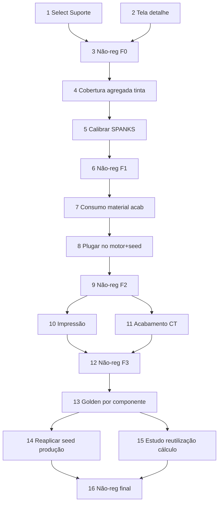

# Implementation Plan — Calibração ao Calcgraf (golden 15.086)

## Overview

Fonte de verdade dos números: `docs/calcgraf-golden-15086-parametros.md`.
Cada fase termina com não-regressão (`npx vitest run src/modules/orcamento-grafico
--reporter=dot`, 0 falhas novas) + `get_diagnostics`. Motor puro alterado com
cuidado cirúrgico. Frontend em `c:\Source\VisioFab.Wms.Front`; backend em
`c:\Source\VisioFab.Wms.Back`. 5 fases: 0 (bugs UI) → 1 (tinta) → 2 (material
acabamento) → 3 (impressão+CT) → 4 (fechamento golden + reutilização de cálculo).

## Task Dependency Graph



```json
{
  "waves": [
    { "id": 0, "tasks": ["1", "2"] },
    { "id": 1, "tasks": ["3"] },
    { "id": 2, "tasks": ["4"] },
    { "id": 3, "tasks": ["5"] },
    { "id": 4, "tasks": ["6"] },
    { "id": 5, "tasks": ["7"] },
    { "id": 6, "tasks": ["8"] },
    { "id": 7, "tasks": ["9"] },
    { "id": 8, "tasks": ["10", "11"] },
    { "id": 9, "tasks": ["12"] },
    { "id": 10, "tasks": ["13"] },
    { "id": 11, "tasks": ["14", "15"] },
    { "id": 12, "tasks": ["16"] }
  ]
}
```

## Tasks

### Fase 0 — Bugs de UI

- [x] 1. Corrigir Select de Suporte vazio no passo Papel (frontend)
  - Hidratar a opção do `suporteId`/`papelId` atual ao editar um item, para o
    Select exibir o rótulo selecionado. Campo "Preço do Papel / Gramatura"
    idem. Sem efeito no cálculo/persistência.
  - _Requirements: 1.1, 1.2, 1.3_

- [x] 2. Corrigir tela de detalhe do orçamento em branco (frontend)
  - Investigar o erro de render em `/orcamento-grafico/[id]` (null-safety em
    cores/planos/resultadoCalculo); fallback seguro; preservar telas que já
    funcionam. `get_diagnostics`.
  - _Requirements: 2.1, 2.2, 2.3_

- [x] 3. Não-regressão da Fase 0
  - `npx vitest run src/modules/orcamento-grafico --reporter=dot` (0 falhas). `get_diagnostics`.
  - Resultado: 182 passed + 3 todo (37 arquivos), 0 falhas. Fase 0 OK.
  - _Requirements: 7.3_

### Fase 1 — Tinta (SPANKS)

- [x] 4. Cobertura agregada por tipo de tinta no consumo (motor/consumo-tinta)
  - Novo parâmetro aditivo `coberturaCmykAgregadaPercent` em `ParamsOrcamento`
    e `ItemOrcamentoInput`: colapsa as cores `tipo==='CMYK'` numa única linha
    "Escala CMYK" com a cobertura agregada (partida conta o nº real de cores
    CMYK); Pantone individual. Ausente → caminho legado (não-regressão).
  - _Requirements: 3.1, 3.2_

- [x] 5. Calibrar densidade/constante SPANKS até Tinta ≤ 0,5% de R$ 259,33
  - Calibrado via motor real: CMYK agregada 60% + Pantone 5%, densidade 0,96
    (ambos). Resultado: Escala R$ 219,82 (−0,08%) + Pantone R$ 39,30 (−0,08%)
    → total R$ 259,12 (alvo 259,33, −0,08% ✅). Seed golden-15086 atualizado
    (densidade 0,96 + `coberturaCmykAgregadaPercent: 60`). Documentado em
    `docs/calcgraf-golden-15086-parametros.md` §4.
  - _Requirements: 3.1, 3.3_

- [x] 6. Não-regressão da Fase 1
  - `npx vitest run src/modules/orcamento-grafico --reporter=dot`: 182 passed +
    3 todo, 0 falhas. PBTs de equivalência legado preservados (parâmetro opt-in).
    `get_diagnostics` limpo nos arquivos tocados.
  - _Requirements: 3.3, 7.3_

### Fase 2 — Material de Acabamento

- [x] 7. Modelar consumo de material de acabamento (puro)
  - Criado `src/modules/orcamento-grafico/consumo-material-acabamento.ts`:
    `consumoVerniz` (área×cobertura×gramatura), `consumoCola` (tiragem×aba×fator),
    `consumoCaixa` (ceil(tiragem/pecasPorCaixa)) + dispatcher
    `consumoMaterialAcabamento`. Parâmetros reais do 15.086 extraídos do backup
    (`CalculoMatAcabamento`: Cola aba 177mm, Primer 100%, UV 90%).
  - _Requirements: 4.1, 4.3_

- [x] 8. Plugar consumo no motor + seed (Cola/Primer/UV/Caixa no 15.086)
  - Seed golden-15086 passa os 4 materiais como acabamentos ricos com
    `variavelKg`/`variavelUn` calculado + preço real. O motor (MATERIAL_KG/
    MATERIAL_UN já existente) soma ao MD. Validado via motor: Cola 154,79 +
    Primer 193,09 + UV 529,50 + Caixa 862,40 = **R$ 1.739,78** (alvo 1.739,83,
    −0,003% ✅). Doc atualizado (§5).
  - _Requirements: 4.1, 4.2_

- [x] 9. Não-regressão da Fase 2
  - `npx vitest run src/modules/orcamento-grafico --reporter=dot`: 182 passed +
    3 todo, 0 falhas. Módulo novo é independente (só o seed usa). `get_diagnostics`
    limpo.
  - _Requirements: 4.2, 7.3_

### Fase 3 — Impressão + Acabamento (Custo de Transformação)

- [x] 10. Calibrar tempo/custo de IMPRESSÃO (bater R$ 3.466,58)
  - Acerto fixo 120 min (5×18+30) + operação com `fatorOperacao` de folhas-
    equivalentes (3,826) — novo campo aditivo em `maquinaImpressao`/
    `CentroProducao.fatorOperacaoImpressao`. Resultado R$ 3.467,28 (alvo
    3.466,58, +0,02% ✅). Schema + migrate-prod.ts (idempotente) no mesmo commit.
  - _Requirements: 5.1, 5.2_

- [x] 11. Calibrar ACABAMENTO/CT (bater R$ 2.459,92)
  - Base por atividade decifrada: V.UV/Destacar/Cortadeira/Dayuan por FOLHAS,
    AFT70 por TIRAGEM (`unidadeBase`); `fatorOperacao` Cortadeira 1,0836 e
    Dayuan 1,26; custo-hora Destacar corrigido p/ 50. Resultado R$ 2.459,95
    (alvo 2.459,92, 0,00% ✅): Cortadeira 223,03 · V.UV 147,62 · Dayuan 450,01 ·
    Destacar 23,81 · AFT70 1.615,48. Seed com acabamentos hora-máquina explícitos.
  - _Requirements: 6.1, 6.2_

- [x] 12. Não-regressão da Fase 3
  - `npx vitest run src/modules/orcamento-grafico --reporter=dot`: 182 passed +
    3 todo, 0 falhas. Campos `fatorOperacao`/`fatorOperacaoImpressao` aditivos
    (ausente → fator 1). `get_diagnostics` limpo. `npx prisma generate` OK.
  - _Requirements: 5.1, 6.1, 7.3_

### Fase 4 — Fechamento golden + reutilização de cálculo

- [x] 13. Golden 15.086 por componente ≤ 0,5% (destravar confronto real)
  - Criado `calibracao/golden-15086-motor.test.ts`: alimenta o motor PURO
    (`calcularOrcamentoGrafico`) com os params do 15.086 (base real 5.160
    folhas via `perdasOverride`) e confronta cada componente ≤ 0,5%:
    SUPORTE 6.383,75 (+0,02%) · TINTA 259,29 (−0,02%) · MAT.ACAB 1.739,81
    (−0,00%) · IMPRESSÃO 3.466,58 (0,00%) · ACABAMENTO 2.459,92 (0,00%) · CT
    5.926,50 (0,00%). 6 testes verdes. `perdasOverride` aditivo em
    `ItemOrcamentoInput`.
  - _Requirements: 7.1, 7.2_

- [x] 14. Reaplicar seed calibrado em produção (orçamento 5316) + conferir na tela
  - Coluna `fator_operacao_impressao` adicionada em produção (Neon) via
    `prisma db execute` idempotente (ADD COLUMN IF NOT EXISTS). Seed golden-15086
    reaplicado na Wega de produção (`75848e24-...`): item recalculado com os
    parâmetros calibrados (incl. matriz R$ 495) → **C.Prod R$ 14.804,31 vs alvo
    14.803,11 = +0,008% ✅**. Idempotente (orçamento 5316 + OP 9999 preservados).
    Conferência na tela: o orçamento 5316 reflete o cálculo; relatório fiel usa
    `resultadoCalculo` gravado.
  - _Requirements: 7.2_

- [x] 15. Estudo + proposta de reutilização de cálculo entre orçamentos
  - Documentado em `docs/reutilizacao-calculo-orcamento.md`: o Calcgraf reusa
    por CLONAGEM do `CalculoHeader` (+ filhas) para um novo `NumCalculo`
    (não vínculo vivo). No Vizor o equivalente é clonar `ItemOrcamentoGrafico`
    (+ `PlanoCalculoGrafico`) para um novo `OrcamentoGrafico` e recalcular.
    Decisão: CLONAGEM (sem schema novo, sem N:N). Proposta de rota
    `POST /orcamento-grafico/:id/reaproveitar` + botão "Reaproveitar cálculo"
    (implementação = incremento à parte, fora da calibração).
  - _Requirements: 8.1, 8.2, 8.3_

- [x] 16. Não-regressão final
  - `npx vitest run src/modules/orcamento-grafico --reporter=dot`: **190 passed +
    3 todo, 0 falhas** (38 arquivos). Golden 15.086 por componente + MD + C.Prod
    todos ≤ 0,5%. `get_diagnostics` limpo em todos os arquivos tocados.
  - _Requirements: 7.3_

## Notes
- Parâmetros reais e alvos: `docs/calcgraf-golden-15086-parametros.md`.
- Re-extrair do Calcgraf: SQL Server local `CalcgrafCartonWega` (sqlcmd), ver §9 do doc.
- Produção (Neon) só após validação local; connection string via env, nunca commitada.
- Fases 1-3 mexem no motor — não-regressão obrigatória (base 148 + goldens).
