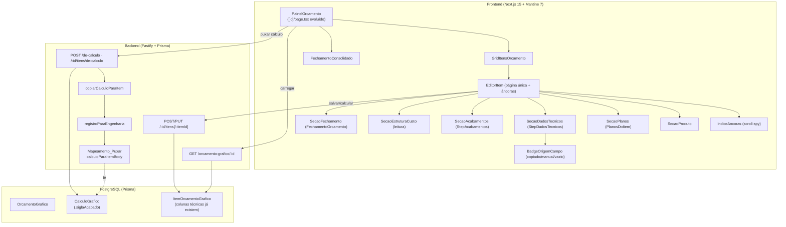
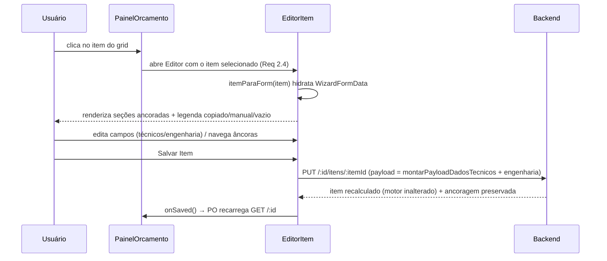

# Design Document

## Overview

Esta feature é majoritariamente de **experiência (UX)**: reorganizar como o
usuário cria/edita um Orçamento Gráfico e seu item para atingir **paridade de
entendimento** com o Calcgraf. O motor de cálculo, a ancoragem no valor real e a
decomposição de custo **já existem e não mudam** (não-regressão obrigatória).

O trabalho se divide em três frentes, nesta proporção de risco:

1. **Frontend (maior parte) — reorganização/apresentação.** Trocar o wizard
   linear de steps (`ItemWizardModal`) por um **Editor de Item em página única
   com índice de âncoras** (seções Produto, Planos, Dados Técnicos, Acabamentos,
   Estrutura de Custo, Fechamento), com scroll-spy, reempilhamento responsivo e
   uma legenda "copiado / manual / vazio" nos campos técnicos. Evoluir a tela de
   detalhe (`[id]/page.tsx`) para o **Painel do Orçamento** (cabeçalho + grid de
   itens + fechamento consolidado), abrindo o Editor ao clicar no item.
2. **Backend (ajuste mínimo, aditivo) — mapeamento de puxar.** Estender o
   `Mapeamento_Puxar` para copiar a **Sigla Acabado** do cálculo de origem
   (`CalculoGrafico.siglaAcabado`), que é o ÚNICO Campo_Técnico com fonte
   garantida na origem migrada. Os demais campos técnicos permanecem **manuais**
   (nunca inventar valor). Nenhuma mudança no motor; **sem migração de schema**
   (todas as colunas já existem).
3. **Validação visual — piloto.** Conferir a nova experiência no orçamento 3223
   (Cartucho Composto, Cervejaria Imperial, cálculo 10263).

### Princípios de não-regressão

- **Não tocar o motor de cálculo** (`orcamento-grafico-calculo.service.ts`,
  `calcularItem`, `calcularOrcamentoGrafico`), a **ancoragem** do valor real do
  Calcgraf, nem a **decomposição STC** (`decomposicao-stc.service.ts`).
- **Reaproveitar os componentes e sub-forms existentes** (os `Step*` do wizard
  `/novo`, `PlanosDoItem`, `FechamentoOrcamento`, `StepDadosTecnicos`) — o Editor
  de Item reorganiza a APRESENTAÇÃO, não reescreve a lógica de coleta/salvar.
- **Preservar os contratos de salvar/calcular** (`POST /:id/itens`,
  `PUT /:id/itens/:itemId`, `POST /:id/itens/:itemId/calcular`): o payload já
  carrega TODOS os campos técnicos (via `montarPayloadDadosTecnicos`).
- **Multi-tenant:** `empresaId` EXPLÍCITO em toda query de backend tocada
  (padrão do projeto — steering ATENCAO §2.1; `prismaScoped` não isola
  SUPER_ADMIN).
- **Não avançar para OP** (fluxo PCP/OP fora de escopo).

### Decisão-chave de arquitetura de frontend (menor risco)

O módulo está **em produção**. Em vez de reescrever o `ItemWizardModal` do zero,
o design cria um **novo componente de apresentação `EditorItem`** que **monta os
mesmos sub-forms já usados pelo wizard** (`StepTipo`, `StepMedidas`, `StepPapel`,
`StepCores`, `StepDadosTecnicos`, `StepAcabamentos`, `StepItensDiversos`) dentro
de **seções ancoradas** de uma página única, reutilizando `PlanosDoItem`,
`FechamentoOrcamento` e a visão de Estrutura de Custo já existente no detalhe.

O `EditorItem` compartilha com o wizard atual:
- o mesmo estado `WizardFormData` e `updateForm`;
- a mesma função `itemParaForm` (hidrata o form a partir do item carregado);
- o mesmo `salvar()` (monta o payload com `montarPayloadDadosTecnicos` e chama
  `POST`/`PUT`).

Assim, a lógica de coleta/validação/salvar **não é reescrita** — só a disposição
visual muda (steps → seções com âncoras). O `ItemWizardModal` pode ser mantido
temporariamente como fallback atrás de uma flag, reduzindo o risco de regressão
numa tela de produção; a meta é que o Painel do Orçamento passe a abrir o
`EditorItem`.

## Architecture

### Visão em camadas



### Fluxo "abrir item → editar → salvar" (sem recálculo implícito indesejado)



### Fluxo "Puxar Cálculo" com Sigla Acabado copiada (ajuste de backend)

```mermaid
sequenceDiagram
  participant U as Usuário
  participant PO as PainelOrcamento
  participant API as POST /de-calculo
  participant COPY as copiarCalculoParaItem
  participant MAP as calculoParaItemBody
  U->>PO: Puxar Cálculo (calculoId)
  PO->>API: cria orçamento/item a partir do cálculo
  API->>COPY: copiarCalculoParaItem(calc)
  COPY->>MAP: registroParaEngenharia(calc) → body
  Note over MAP: body.siglaAcabado = calc.siglaAcabado (NOVO, aditivo)
  MAP-->>COPY: body com engenharia + siglaAcabado
  COPY-->>API: dadosItem (persistência)
  API-->>PO: 201 item criado (Sigla Acabado preenchida; demais técnicos vazios)
  PO-->>U: Editor sinaliza campos técnicos vazios (Req 4.4)
```

### Pesquisa / fundamentação

- **Scroll-spy e navegação por âncoras** é padrão consolidado em editores longos
  (ex.: docs com sumário lateral). A implementação no Mantine/React usa a
  **`IntersectionObserver`** nativa do browser para marcar a seção visível — sem
  biblioteca extra, sem dependência nova. Fallback por cálculo de `scrollTop`
  quando o observer não estiver disponível.
- **Reempilhamento responsivo**: Mantine 7 expõe `SimpleGrid`/`Grid` com
  breakpoints e os componentes já usados no módulo (`Paper`, `Stack`, `Group`).
  O índice de âncoras passa de coluna lateral (desktop) para bloco acima/abaixo
  do conteúdo (mobile), mantendo a lista completa (Req 9.4).
- **Reuso dos sub-forms**: confirmado por leitura do código — `ItemWizardModal`
  já importa e compõe `StepTipo/StepMedidas/StepPapel/StepCores/
  StepDadosTecnicos/StepAcabamentos/StepItensDiversos/StepRevisao` e salva com
  `montarPayloadDadosTecnicos(formData)`. O Editor reaproveita exatamente essas
  peças, só mudando o contêiner de steps → seções.
- **Campos técnicos já persistidos**: confirmado no schema
  (`ItemOrcamentoGrafico` tem `siglaAcabado, tributacao, processoImpressao,
  coberturaTintaTexto, fabricante, microondulado, fornecido, qtdModelos, arte,
  observacao, observacaoAreasOp, conteudoVolume, acondicionamento`) e nas rotas
  (`dadosPersistenciaItem` grava; `GET /:id` seleciona todos). Logo, a
  descoberta/preenchimento (Req 3) é **puramente de frontend**.
- **Sigla Acabado na origem**: confirmado `CalculoGrafico.siglaAcabado` no
  schema — é a única fonte confiável de Campo_Técnico na origem migrada, logo o
  único "Passa a copiar" (Req 4.2).

## Components and Interfaces

### Frontend — novos componentes

Todos em `VisioFab.Wms.Front/src/app/(interna)/orcamento-grafico/`.

| Componente | Local sugerido | Responsabilidade |
|---|---|---|
| `EditorItem` | `[id]/EditorItem.tsx` | Página única do item: layout `nav de âncoras + seções`. Reaproveita `WizardFormData`, `itemParaForm`, `salvar()` do `ItemWizardModal`. Monta as `Secao*` na ordem Produto → Planos → Dados Técnicos → Acabamentos → Estrutura → Fechamento. |
| `IndiceAncoras` | `[id]/editor/IndiceAncoras.tsx` | Lista as âncoras presentes; destaca a ativa via `IntersectionObserver` (Req 1.2, 1.4); clique rola até a seção (Req 1.3). Oculta a âncora "Planos" em plano único (Req 5.2). Reempilha abaixo do conteúdo em telas menores (Req 9.4). |
| `SecaoProduto` | `[id]/editor/SecaoProduto.tsx` | Agrupa `StepTipo + StepMedidas + StepPapel` numa seção (como o step 0 do wizard atual). |
| `SecaoDadosTecnicos` | reaproveita `StepDadosTecnicos` | Todos os Campo_Técnico com rótulos do Calcgraf (Req 3.1, 3.2, 8.1). |
| `SecaoAcabamentos` | reaproveita `StepAcabamentos`/`StepItensDiversos` | Lista de atividades com custo. |
| `SecaoEstruturaCusto` | `[id]/editor/SecaoEstruturaCusto.tsx` | **Leitura** do `resultadoCalculo`/`custosCalcgraf`: MD/CT/SE por componente (Req 6). Extrai o componente de estrutura já renderizado hoje no detalhe. |
| `SecaoPlanos` | reaproveita `PlanosDoItem` | Planos do item (Req 5). Oculta seção+âncora em plano único (Req 5.2). |
| `SecaoFechamento` | reaproveita `FechamentoOrcamento` | Tiragem/margem/CM/CEV/valores (Req 7). Pré-visualização de faixas de margem sem persistir (Req 7.4, 7.5). |
| `BadgeOrigemCampo` | `[id]/editor/BadgeOrigemCampo.tsx` | Indicador por campo: `copiado` (●), `manual` (○), `vazio` (⚠). Materializa a Tabela_De_Para_Puxar (Req 4.4, 4.5). |
| `GridItensOrcamento` | extraído de `[id]/page.tsx` | Grid de itens do Painel (Req 2.2); clique abre o `EditorItem` (Req 2.4). Badge "Repetição" + nº do cálculo (Req 2.5). |

### Frontend — derivação da legenda "copiado / manual / vazio"

O frontend NÃO recebe do backend um flag "foi copiado". Ele **deriva** o estado
de cada Campo_Técnico a partir de duas fontes já disponíveis:

1. **Classificação estática** (da Tabela_De_Para_Puxar) — constante no frontend:
   - `siglaAcabado` → `COPIAVEL` (passa a vir do cálculo);
   - demais Campo_Técnico → `MANUAL` (sem fonte na origem).
2. **Valor atual do campo** no `WizardFormData` (após `itemParaForm`): vazio
   (`''`, `null`, `0` quando aplicável) vs preenchido.

Regra de exibição por campo técnico (função pura `origemCampo(classe, valor)`):

| Classe | Valor preenchido | Valor vazio |
|---|---|---|
| `COPIAVEL` (siglaAcabado) | `copiado` (●) | `vazio` (⚠) |
| `MANUAL` | `manual-preenchido` (○) | `manual-vazio` (⚠) |

A seção "Dados Técnicos" exibe um resumo "Campos vazios após puxar: …" listando
os técnicos ainda vazios (Req 4.4, 10.3). A função `origemCampo` é **pura** e
testável (ver Correctness Properties).

### Frontend — scroll-spy (contrato)

`useScrollSpy(ancoras: AncoraId[]): { ativa: AncoraId; irPara(id): void }`
- Observa os elementos de seção via `IntersectionObserver` (threshold por
  visibilidade); a âncora ativa é a seção mais visível no viewport (Req 1.4).
- `irPara(id)` faz `scrollIntoView({ behavior: 'smooth' })` (Req 1.3).
- Recebe **apenas** as âncoras presentes (Planos é omitida em plano único).

### Frontend — contrato de visibilidade das seções (plano único)

`montarAncoras(item): AncoraId[]` — função **pura** que decide a lista de
âncoras exibidas:
- Sempre inclui: `produto`, `dados-tecnicos`, `acabamentos`, `estrutura`,
  `fechamento`.
- Inclui `planos` **se e somente se** o item tem ≥ 1 plano
  (`item.planos?.length > 0`). Em plano único, a âncora E a seção são omitidas
  (Req 5.2). Esta função é a fonte única consumida pelo `IndiceAncoras` e pela
  renderização das seções (garante consistência entre âncora e seção).

### Backend — ajuste do Mapeamento_Puxar (aditivo)

Alterações mínimas, todas **aditivas** e cobertas por round-trip:

1. **`calculo-grafico.types.ts`** — adicionar ao `CamposEngenhariaCalculo` o
   campo de paridade:
   ```ts
   // ── Paridade (não afeta o custo) — copiado ao puxar quando existe na origem ──
   /** Sigla do acabado (paridade Calcgraf). Único Campo_Técnico com fonte na origem. */
   siglaAcabado?: string | null
   ```
2. **`calculo-grafico-mapeamento.ts`** — `ItemBodyMapeado` ganha `siglaAcabado?:
   string | null`; `calculoParaItemBody` copia `siglaAcabado: nuloOuValor(calculo.siglaAcabado)`;
   `itemBodyParaCalculo` devolve `siglaAcabado: nuloOuValor(body.siglaAcabado)`.
   Isso preserva o **round-trip** (Property existente da biblioteca + a desta
   spec).
3. **`calculo-grafico.service.ts`** — `registroParaEngenharia` passa a ler
   `siglaAcabado: calc.siglaAcabado` do registro persistido.
4. **`orcamento-grafico.routes.ts`** — `copiarCalculoParaItem` / o ponto que
   monta `dadosItem` a partir do `itemBody` deve propagar `siglaAcabado` para a
   persistência do item (a coluna já existe e `GET /:id` já a devolve). Os demais
   Campo_Técnico permanecem `null` (manuais).

> Importante: **`siglaAcabado` NÃO é usado pelo motor** — ele apenas trafega
> pelo shape de engenharia por conveniência de reuso do mapeamento, mas
> `bodyParaItemOrcamentoInput` **não** o repassa ao input do cálculo (o motor
> continua idêntico). Isso mantém a não-regressão do cálculo.

### Backend — garantia de retorno dos campos técnicos (já atendida)

O `GET /orcamento-grafico/:id` **já seleciona** `siglaAcabado, tributacao,
processoImpressao, coberturaTintaTexto, fabricante, microondulado, fornecido,
qtdModelos, arte, observacao, observacaoAreasOp, conteudoVolume,
acondicionamento` no `select` dos itens (confirmado no código). Portanto a
legenda do frontend tem os dados necessários **sem mudança de rota**. Não há
ação de backend aqui além de garantir que a extensão do puxar não quebre esse
select.

### Mapeamento Requisito → Componente

| Requisito | Componente / Ponto de implementação |
|---|---|
| 1.1 seções em página única | `EditorItem` (contêiner de seções) |
| 1.2 índice de âncoras | `IndiceAncoras` + `montarAncoras` |
| 1.3 clicar rola até a seção | `useScrollSpy.irPara` |
| 1.4 destaque da âncora visível | `useScrollSpy` (IntersectionObserver) |
| 1.5 preservar todos os campos do wizard | reuso dos `Step*` em `EditorItem` |
| 1.6 seção vazia com estado explicativo | `SecaoDadosTecnicos` (resumo de vazios) |
| 2.1 cabeçalho | `PainelOrcamento` (cabeçalho) |
| 2.2 grid de itens | `GridItensOrcamento` |
| 2.3 fechamento consolidado | `FechamentoConsolidado` (reusa `FechamentoOrcamento` c/ consolidado) |
| 2.4 clicar no item abre o Editor | `GridItensOrcamento` → `EditorItem` |
| 2.5 badge "Repetição" + cálculo | `GridItensOrcamento` (usa `orcamento.tipo`/`calculoOrigem`) |
| 3.1–3.4 Dados Técnicos (campos/tipos/rótulos) | `StepDadosTecnicos` em `SecaoDadosTecnicos` |
| 3.5 validação de tipo | validação já existente no payload/Zod + feedback no form |
| 3.6 não altera custo | técnicos não vão ao input do motor |
| 4.1 copiar engenharia (preservar) | `calculoParaItemBody` (inalterado) |
| 4.2 copiar siglaAcabado | extensão do `Mapeamento_Puxar` (backend) |
| 4.3 demais técnicos vazios | sem fonte → `null` (não inventar) |
| 4.4 sinalizar vazios | `BadgeOrigemCampo` + resumo de vazios |
| 4.5 documentar De-Para | Tabela_De_Para_Puxar (requirements) + constante `origemCampo` |
| 4.6 preservar ancoragem | fluxo `de-calculo` inalterado (ancoragem intacta) |
| 5.1–5.4 Planos | `PlanosDoItem` em `SecaoPlanos` + `montarAncoras` |
| 6.1–6.5 Estrutura de Custo (leitura) | `SecaoEstruturaCusto` |
| 7.1–7.5 Fechamento | `FechamentoOrcamento` em `SecaoFechamento` |
| 8.1–8.3 terminologia Calcgraf | rótulos nas seções/colunas (escopo Editor + Painel) |
| 9.1–9.4 responsividade/acessibilidade | `EditorItem` layout + `IndiceAncoras` reempilhável + labels associados |
| 10.1–10.3 piloto 3223 | validação visual (sem código próprio) |

## Data Models

### Sem mudança de schema

Todas as colunas usadas por esta feature **já existem** no `schema.prisma`
(confirmado). **Não há migração** (`migrate-prod.ts` não é tocado).

**`ItemOrcamentoGrafico`** (colunas técnicas de paridade já persistidas):

```
siglaAcabado         VarChar(60)?
tributacao           VarChar(60)?
processoImpressao    VarChar(60)?
coberturaTintaTexto  VarChar(60)?
fabricante           VarChar(120)?
microondulado        Boolean  @default(false)
fornecido            Boolean  @default(false)
qtdModelos           Int      @default(0)
arte                 VarChar(60)?
observacao           VarChar(1000)?
observacaoAreasOp    VarChar(1000)?
conteudoVolume       Int?
acondicionamento     Json?
```

**`CalculoGrafico`** (origem do puxar): possui `siglaAcabado VarChar(60)?` — a
única fonte de Campo_Técnico na origem migrada.

### Shape de engenharia estendido (TS, não-schema)

```ts
// calculo-grafico.types.ts — CamposEngenhariaCalculo (adição aditiva)
siglaAcabado?: string | null  // paridade; copiado ao puxar; NÃO vai ao motor
```

```ts
// calculo-grafico-mapeamento.ts — ItemBodyMapeado (adição aditiva)
siglaAcabado?: string | null
```

### Classificação de origem dos campos técnicos (frontend, constante)

```ts
type ClasseCampoTecnico = 'COPIAVEL' | 'MANUAL'
type OrigemCampo = 'copiado' | 'manual-preenchido' | 'manual-vazio' | 'vazio'

// Fonte única da legenda; espelha a Tabela_De_Para_Puxar dos requisitos.
const CLASSE_CAMPO_TECNICO: Record<string, ClasseCampoTecnico> = {
  siglaAcabado: 'COPIAVEL',
  tributacao: 'MANUAL',
  processoImpressao: 'MANUAL',
  coberturaTintaTexto: 'MANUAL',
  fabricante: 'MANUAL',
  qtdModelos: 'MANUAL',
  arte: 'MANUAL',
  microondulado: 'MANUAL',
  fornecido: 'MANUAL',
  observacao: 'MANUAL',
  observacaoAreasOp: 'MANUAL',
  acondicionamento: 'MANUAL',
  conteudoVolume: 'MANUAL',
}
```

### Modelo de visão do Painel/Editor (derivado do GET /:id existente)

Nenhuma estrutura nova é persistida. O frontend consome o `OrcamentoDetalhe` já
retornado pelo `GET /:id` (cabeçalho, `itens[]` com engenharia + técnicos +
`resultadoCalculo` + `planos`, `calculoOrigem`, `tipo`, consolidados).

## Correctness Properties

*Uma propriedade é uma característica ou comportamento que deve valer para todas
as execuções válidas do sistema — uma afirmação formal sobre o que o software
deve fazer. Propriedades são a ponte entre a especificação legível por humanos e
garantias de correção verificáveis por máquina.*

Esta feature é majoritariamente de UI (reorganização/apresentação), onde testes
de componente/exemplo são o instrumento adequado. Há, porém, um **núcleo de
funções puras** com propriedades universais de alto valor — e que protegem a
**não-regressão** do que já está em produção. As propriedades abaixo cobrem esse
núcleo. A reflexão de propriedades consolidou: o round-trip de engenharia (4.1) e
a cópia de `siglaAcabado` (4.2) numa única propriedade de round-trip estendido; a
visibilidade de âncoras (1.2) e a ocultação de Planos em plano único (5.2) numa
só; e a cobertura/round-trip front→payload (1.5, 3.1, 3.3) numa só.

### Property 1: Round-trip do Mapeamento_Puxar estendido preserva engenharia e Sigla Acabado

*Para todo* `CalculoGrafico` válido (campos de engenharia + `siglaAcabado`
opcional), aplicar `itemBodyParaCalculo(calculoParaItemBody(calc))` produz um
valor equivalente a `calc` em todos os campos de engenharia **e** em
`siglaAcabado` (incluindo o caso `null`/ausente).

**Validates: Requirements 4.1, 4.2**

### Property 2: Campos técnicos manuais nunca são inventados pelo Puxar

*Para todo* `CalculoGrafico`, o body produzido por `calculoParaItemBody(calc)`
**não** atribui valor a nenhum Campo_Técnico classificado como `MANUAL`
(tributação, processo de impressão, cobertura de tinta texto, fabricante, qtd. de
modelos, arte, microondulado, fornecido, observação, observação de áreas de OP,
acondicionamento, conteúdo por volume) — esses campos permanecem ausentes/`null`.

**Validates: Requirements 4.3**

### Property 3: Campos técnicos não afetam o input nem o resultado do cálculo

*Para toda* engenharia fixa e *todo* conjunto de Campo_Técnico variado, o input
derivado para o motor (`bodyParaItemOrcamentoInput`) é idêntico
independentemente dos valores dos campos técnicos — nenhum Campo_Técnico aparece
no input do motor. Consequentemente, a cópia de `siglaAcabado` ao puxar não altera
os campos de custo/consolidado produzidos por `copiarCalculoParaItem` (ancoragem
preservada).

**Validates: Requirements 3.6, 4.6**

### Property 4: Classificação de origem do campo (legenda copiado/manual/vazio)

*Para toda* classe ∈ {`COPIAVEL`, `MANUAL`} e *todo* valor (vazio ou
preenchido), a função pura `origemCampo(classe, valor)` retorna:
`copiado` apenas quando a classe é `COPIAVEL` e o valor está preenchido;
`vazio` quando `COPIAVEL` e vazio; `manual-preenchido` quando `MANUAL` e
preenchido; `manual-vazio` quando `MANUAL` e vazio. Em particular, **nunca**
marca como `copiado` um campo de classe `MANUAL`.

**Validates: Requirements 4.4**

### Property 5: Âncoras presentes refletem exatamente as seções (Planos em plano único)

*Para todo* item, `montarAncoras(item)` contém sempre as âncoras fixas
(`produto`, `dados-tecnicos`, `acabamentos`, `estrutura`, `fechamento`) e contém
`planos` **se e somente se** o item tem ≥ 1 plano. O conjunto de âncoras
retornado é exatamente o conjunto de seções que o `EditorItem` renderiza (nunca
âncora sem seção, nunca seção sem âncora).

**Validates: Requirements 1.2, 5.2**

### Property 6: Payload do Editor preserva todos os campos (engenharia + técnicos)

*Para todo* `WizardFormData`, o payload montado pelo `EditorItem` (engenharia +
`montarPayloadDadosTecnicos(form)`) preserva cada Campo_Técnico informado e
contém o mesmo conjunto de chaves que o payload do wizard atual — ou seja, a
reorganização em seções não remove nem perde nenhum campo editável.

**Validates: Requirements 1.5, 3.1, 3.3**

### Property 7: Pré-visualização de faixa de margem é pura e não persiste

*Para toda* faixa de margem válida (0 < margem% < 1 − CEV%), a pré-visualização
do Fechamento aplica o gross-up `valorTotal = base / (1 − margem% − CEV%)` de
forma consistente para valor unitário, valor total e contribuição marginal; a
operação é reversível (selecionar de volta a faixa original restaura os valores
exibidos) e **não** dispara persistência nem altera o valor consolidado já
gravado do item.

**Validates: Requirements 7.4, 7.5**

## Error Handling

- **Cálculo inexistente/cross-tenant ao puxar**: `copiarCalculoParaItem` e as
  rotas `/de-calculo` já tratam 404 (inexistente) e 403 (outra empresa) com
  `empresaId` EXPLÍCITO — comportamento preservado; a extensão de `siglaAcabado`
  não altera essas guardas.
- **Validação de tipo dos campos técnicos** (Req 3.5): o `itemOrcamentoBodySchema`
  (Zod) já valida os tipos/limites de cada campo técnico (`siglaAcabado` max 60,
  `conteudoVolume` inteiro ≥ 1, `microondulado`/`fornecido` boolean, etc.). Em
  erro, o handler Zod global compõe "campo: motivo" e o Editor sinaliza o campo
  inválido impedindo o salvamento (reuso do padrão existente — não reescrever).
- **Sigla Acabado ausente na origem**: o puxar deixa o campo vazio (Req 4.3) —
  nunca inventa; o Editor sinaliza como "vazio" via `origemCampo`.
- **Planos/estrutura/fechamento sem dado**: a Estrutura exibe apenas os totais
  consolidados com aviso quando `custosCalcgraf` não está disponível (Req 6.4); o
  Fechamento lê o `resultadoCalculo`/consolidado existente, exibindo "—" para
  campos ausentes (padrão atual de `FechamentoOrcamento`).
- **IntersectionObserver indisponível** (ambiente sem suporte): o scroll-spy cai
  para um cálculo simples de posição; a navegação por âncoras continua
  funcionando (degradação graciosa).
- **Falha ao salvar o item**: notificação de erro (padrão atual), sem perder o
  estado do form; o consolidado não é alterado.

## Testing Strategy

### Abordagem dupla

- **Testes de propriedade (PBT)** — para o núcleo PURO (mapeamento estendido,
  `origemCampo`, `montarAncoras`, cobertura de payload, pré-visualização de
  margem). Biblioteca: **fast-check** (já usada no projeto, tanto no back quanto
  no front). Mínimo **100 iterações** por propriedade. Cada teste referencia a
  propriedade do design.
- **Testes de componente/exemplo** — para a UI (seções, grid, scroll-spy com
  IntersectionObserver mockado, rótulos de terminologia, responsividade,
  acessibilidade). Vitest + Testing Library (padrão do frontend).
- **Smoke/validação visual** — piloto orçamento 3223 (Req 10): abrir Painel e
  Editor no ambiente real e conferir seções + legenda de técnicos vazios.

### Localização dos testes PBT

- Backend (mapeamento estendido): junto aos testes já existentes do submódulo,
  ex. `src/modules/orcamento-grafico/calculo-grafico/calculo-grafico-mapeamento.test.ts`
  (estender o round-trip existente para incluir `siglaAcabado`), e o não-regressão
  de custo junto aos testes de `copiarCalculoParaItem`/decomposição.
- Frontend (funções puras de UI): `origemCampo`, `montarAncoras`, cobertura de
  payload e pré-visualização de margem em arquivos `*.test.ts` colocados ao lado
  dos helpers do Editor (ex.: `[id]/editor/origem-campo.test.ts`). Rodar vitest
  com `--pool=threads` (padrão do front nesta máquina, conforme steering).

### Configuração e tags

- Cada teste de propriedade roda **≥ 100 iterações** (default do fast-check
  ajustado quando necessário).
- Tag por teste referenciando a propriedade do design, no formato:
  **Feature: orcamento-grafico-experiencia-calcgraf, Property {n}: {texto}**.
- Cada propriedade de correção é implementada por **um único** teste de
  propriedade; exemplos/edge cases complementam (não substituem).

### Mapeamento Propriedade → Teste

| Propriedade | Alvo (função pura) | Tipo |
|---|---|---|
| 1 Round-trip estendido | `calculoParaItemBody`/`itemBodyParaCalculo` (+ `siglaAcabado`) | PBT (back) |
| 2 Técnicos manuais não inventados | `calculoParaItemBody` | PBT (back) |
| 3 Técnicos não afetam cálculo | `bodyParaItemOrcamentoInput` / `copiarCalculoParaItem` | PBT (back) |
| 4 Legenda origem do campo | `origemCampo` | PBT (front) |
| 5 Âncoras × seções | `montarAncoras` | PBT (front) |
| 6 Payload preserva campos | `montarPayloadDadosTecnicos` + montagem do Editor | PBT (front) |
| 7 Pré-visualização de margem | função pura de gross-up da faixa | PBT (front) |

### Não-regressão obrigatória (gates antes de concluir)

- Suíte existente do módulo `orcamento-grafico` deve permanecer verde (o
  round-trip da biblioteca, os goldens de ancoragem e a decomposição STC não
  podem quebrar com a adição de `siglaAcabado`).
- `get_diagnostics` limpo nos arquivos tocados (back e front).
- `npm run build` (Next) do frontend compila.
- O salvar/calcular do item continua funcionando pela tela (payload inalterado
  em chaves; `montarPayloadDadosTecnicos` já cobre os técnicos).
- Multi-tenant: nenhuma query de backend tocada remove o filtro `empresaId`
  explícito.

### Validação no piloto 3223 (Req 10)

1. Abrir o orçamento 3223 no Painel → cabeçalho + grid + fechamento consolidado
   sem erro (10.1).
2. Abrir o item (cálculo 10263) no Editor → seções Produto, Planos, Dados
   Técnicos, Acabamentos, Estrutura de Custo e Fechamento com os dados (10.2).
3. Conferir que a legenda sinaliza os Campo_Técnico vazios após o puxar (10.3) —
   com `siglaAcabado` copiada quando presente na origem.
