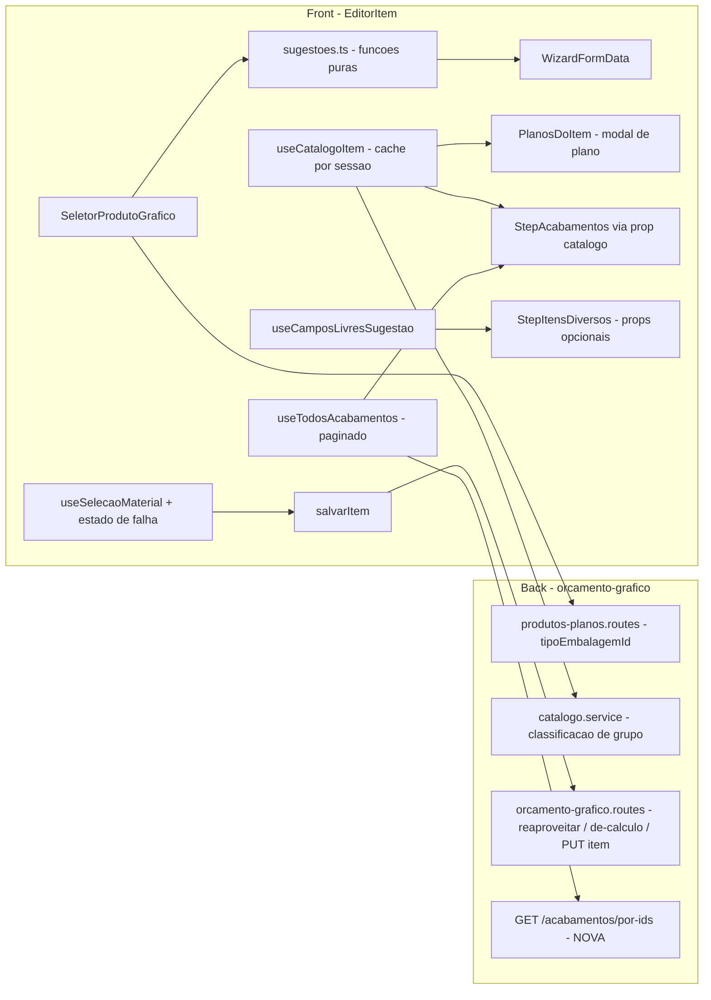

# Design Document

# Design — Orçamento Gráfico: Produto × Embalagem e Acabamentos da Fase 3

Status: **rascunho para aprovação do usuário.** Fluxo requirements → design → tasks. Nenhuma mudança de schema,
de código ou de dados de produção foi feita. As decisões que dependem do usuário estão marcadas **"a aprovar pelo
usuário"** e reunidas na seção final.
Base: `requirements.md` desta spec, spec da Fase 2 `orcamento-grafico-catalogo-no-editor` (no ar) e leitura do
código atual (back em `src/modules/orcamento-grafico/`, front em `src/app/(interna)/orcamento-grafico/`).

## Overview

A Fase 3 fecha o backlog da Fase 2 em cinco frentes:

1. **Produto × Tipo de Embalagem** (Req 1 a 4): o Produto Gráfico passa a sugerir o Tipo de Embalagem, o suporte, a
   gramatura e o preço por kg. As sugestões só preenchem campo vazio.
2. **Campos livres** (Req 5): sugestão de rótulos e opções (ARTE, PADRÃO) no bloco `camposLivres` do item.
3. **Acondicionamento** (Req 6): "Caixa Padrão" e "Embalar" no grupo certo do Cartucho Composto.
4. **Cópia de produto e tipo de plano** (Req 7) em `reaproveitar` e `de-calculo`.
5. **Pendências da Fase 2** (Req 8 a 11): seletor de material no modal de plano, campos técnicos que se perdem ao
   reabrir o item, falha de seleção de material que fecha o editor, limite de 100 acabamentos.

Princípios:

- **Aditivo.** Orçamento sem Produto Gráfico e item puxado do acervo (custo ancorado) não mudam.
- **Back antes do front.** Toda rota ou campo novo vai ao ar (Render) antes do front que o usa (Vercel).
- **Sem tocar no motor.** `ancorarCustoCalcgraf` e os arquivos do motor ficam sem nenhuma linha alterada.
- **Funções puras.** As decisões de sugestão ficam em funções sem React, rede ou banco, testáveis com fast-check.
- **Wizard intacto.** `/novo` e `ItemWizardModal` não recebem as props novas (todas opcionais e omitidas ali).

Fora desta fase: motor/PCP usando Ajustes, Quebras e Limites; tabela de valores de campos livres; Portal do
Representante; execução em produção da fase `materiais-tipo-param`.

## Architecture



Fluxo de sugestão ao escolher o produto (Req 3 e 4): o front busca o produto (já traz `tipoEmbalagemId`) e o catálogo
(`planos`, `defaults`), chama as funções puras e aplica o resultado só nos campos vazios. Itens salvos reabertos e
itens puxados nunca recebem sugestão (as funções recebem essas flags).

## Decisão A × B: onde guardar o Vinculo_Embalagem (Req 1.8)

Fatos verificados no código e no export:

- `relacoes-permitidas.ts` hoje **não tem** `TIPO_EMBALAGEM` em `TIPOS_RELACAO`; o par `PRODUTO → TIPO_EMBALAGEM`
  não existe e `PUT /relacoes` valida o par e a empresa.
- O export do legado (`CadastrosOrcamento.json`, 12 produtos, 1 `CANCELADO` "TESTE") **não traz tipo de embalagem
  do produto** (campos: Formato, Fibra, TipoCartucho, CodUnidade, CodFechamento…). Logo a importação não consegue
  preencher o vínculo a partir de dado do legado (Req 2.3 não se aplica hoje; vale o 2.4: vazio e relatório).
- Alternativa **por convenção**: o tipo de embalagem `CG-EMB-<n>` nasceu de `CalculoAcabados.CodProduto = n`, e o
  `ProdutoGrafico.codigoOrigem` guarda o código do produto do legado. Se `codigoOrigem = n`, o par
  `ProdutoGrafico(codigoOrigem=n) ↔ TipoEmbalagem(CG-EMB-n)` existe por construção. **A verificar por SELECT**
  (consulta 2 da seção "Consultas de investigação").

| Critério | Opção A: coluna `tipoEmbalagemId` em `ProdutoGrafico` | Opção B: linha em `relacao_cadastro_grafico` (`PRODUTO → TIPO_EMBALAGEM`) |
|---|---|---|
| Mudança de schema | Sim: 1 coluna `String?` (+ índice opcional) | Não |
| Migração de produção | `ALTER TABLE produto_grafico ADD COLUMN IF NOT EXISTS tipo_embalagem_id` em `migrate-prod.ts`, no mesmo commit; roda no deploy | Nenhuma; só código (incluir o par em `relacoes-permitidas.ts`) |
| Reversibilidade | Coluna nula é inofensiva; remover coluna exige nova migração | Total: apagar as linhas da relação desfaz |
| Cardinalidade "no máximo 1" (Req 1.2) | Natural (coluna escalar) | Precisa regra extra: `PUT /relacoes` aceita N destinos; o back teria de rejeitar mais de 1 |
| Leitura (Req 1.3, "toda leitura devolve `tipoEmbalagemId`") | Já vem na linha do produto (`GET /produtos` devolve a linha inteira) | Exige consulta adicional e montagem do campo em listagem e detalhe |
| Consistência com `relacao_cadastro_grafico` | Foge do padrão genérico; é atributo do produto, como `linhaId` | Segue o padrão (produto → atividade, → acondicionamento); mas relação é "N para N" e aqui é 1 para 1 |
| Isolamento por empresa | `empresaId` do produto + validação do tipo | `empresaId` da relação + validação do par (já existe) |
| Importação (Req 2) | Preencher só se vazio: `UPDATE ... WHERE tipo_embalagem_id IS NULL` | Criar linha só se não existir (padrão atual do importador de relações) |
| Risco | Baixo; aditivo e nulo por padrão | Baixo; mas semântica forçada (relação virou escalar) |

**RECOMENDAÇÃO (a aprovar pelo usuário): Opção A.** O vínculo é de cardinalidade 1 para 1, é lido em toda
listagem de produto e precisa de validação de empresa; a coluna escalar resolve os três com menos código e sem
consulta extra. A migração é uma coluna nula com `IF NOT EXISTS`, idempotente. Se o usuário preferir **não tocar
no schema agora**, a Opção B funciona com duas ressalvas: regra "no máximo 1" no `PUT /relacoes` e montagem do
`tipoEmbalagemId` na leitura.
Em ambas as opções, o preenchimento inicial dos 11 produtos ativos pode ser feito **só se** a consulta 2 mostrar o
casamento `codigoOrigem = n ↔ CG-EMB-n` (exatamente 1 candidato por produto); caso contrário os produtos ficam sem
vínculo e o usuário escolhe na tela (Req 1). **Nenhum schema é aplicado até a aprovação.**

Detalhe da Opção A (se aprovada): `ProdutoGrafico.tipoEmbalagemId String? @map("tipo_embalagem_id")` sem `@relation`
(padrão dos campos `produtoGraficoId`/`tipoPlanoId`, evita FK que bloqueie exclusão); `produtoInputSchema` aceita
`tipoEmbalagemId` (string uuid, nullable, opcional); `POST`/`PUT /produtos` validam
`tipoEmbalagem.findFirst({ id, empresaId: user.empresaId })` e respondem 422 "Tipo de Embalagem inválido" sem gravar
nada; `undefined` não altera, `null` limpa (Req 1.5).

## Components and Interfaces

### Back 1: Produto com `tipoEmbalagemId` (Req 1, 2)

Arquivo `produtos-planos.routes.ts`. `GET /produtos` e `GET /produtos/:id` já devolvem a linha inteira; com a Opção A
o campo sai sem código extra. Mudanças: `tipoEmbalagemId` no schema Zod de entrada (`.uuid().nullable().optional()`),
validação por `{ id, empresaId }` (422 com mensagem legível, sem gravar), e o campo na serialização de
`produtoBase` (hoje não o inclui). Resposta de `POST`/`PUT` devolve `tipoEmbalagemId` (nulo quando vazio).
O seletor da tela lista `GET /orcamento-grafico/tipos-embalagem` (já usado pelo `StepTipo`); o inativo vinculado é
resolvido no front a partir do vínculo (Req 1.6) e marcado "inativo".

Importador (`scripts/importar-cadastros-orcamento.ts`): a fase `produtos` **não escreve** `tipoEmbalagemId` quando o
legado não informa (caso atual); se vier a informar, preenche só se estiver nulo e lista não casados com motivo
(sem informação, nenhum candidato, mais de um). `--dry-run` imprime criados, atualizados, vínculos preenchidos e não
casados; falha em um produto desfaz só aquele produto (transação por produto), continua e termina com exit code ≠ 0.

### Back 2: Acondicionamento (Req 6)

Hoje `obterCatalogoProduto` classifica uma atividade como acondicionamento quando a flag
`AcabamentoGrafico.acondicionamento` é verdadeira **ou** existe relação `PRODUTO → ACONDICIONAMENTO`. Já
`obterCatalogoPlano` **não separa** o grupo (devolve só atividades com flag). Achados do export (passos 10 a 12):

- A tabela 6 do legado (`PRODUTO → ACONDICIONAMENTO`) só liga os produtos 7 e 11 a 39 e 53, e o 12 a 53.
- O produto 2 (Cartucho Composto) liga 39 (Caixa Padrão) e 53 (Embalar) **apenas** por `ATIVIDADE → PRODUTO`
  (tabela 4 → 10), que vira relação de atividade, sem a tabela 6.
- A flag `acondicionamento` vem de `codigosAcondicionamento` (destinos da tabela 6 ⇒ 39 e 53 `true`).

Hipóteses (a confirmar pelas consultas somente leitura da seção "Consultas de investigação"):

| Hipótese | Descrição | Caso do Req 6.1 | Correção segura |
|---|---|---|---|
| H1 | A flag está `false` em produção para 39/53 (o import idempotente não atualiza booleano já gravado) | (c) | Classificar pela flag do cadastro da atividade; dry-run que lista as flags a ajustar |
| H2 | A relação `PRODUTO → ACONDICIONAMENTO` não existe para o produto 2 | (a) | Importador cria a relação (só criar, nunca remover) |
| H3 | A relação existe, mas `obterCatalogoPlano` não separa o grupo | (c) | Função pura de classificação compartilhada pelas duas rotas |

**Correção proposta (recomendada, a aprovar pelo usuário):** extrair `classificarGrupoAtividade({ flagAcondicionamento,
temRelacaoAcondicionamento })` (função pura, no back, em `catalogo.service.ts`) e usá-la **nas duas** rotas do
catálogo. A regra é: acondicionamento = flag do cadastro da atividade **ou** relação do produto. Para o produto 2,
como a atividade 39/53 tem a flag `true` no legado, a correção de dados é ajustar a **flag do cadastro da atividade**
(`UPDATE acabamento_grafico SET acondicionamento = true WHERE codigo_origem IN (39, 53)`), apenas com **dry-run** e
autorização. Isso não toca nenhuma relação gravada (Req 6.4) e não muda `acabamentoId` marcado nos itens, custo,
`resultadoCalculo` nem consolidado (Req 6.9), porque só o grupo de exibição muda.
Req 6.8 (teste): comparar o agrupamento de todos os produtos da Carton Wega antes e depois, com diferença só no
produto 2 e nos produtos afetados aprovados. Req 6.10: a lista dos produtos afetados vem da consulta 4 e do
passo 12 do levantamento (produtos 7, 11 e 12 já têm a relação da tabela 6; o produto 2 e demais ligados só por
`ATIVIDADE → PRODUTO` são os candidatos ao mesmo defeito). **A inclusão dos demais produtos depende de aprovação.**

### Back 3: Copiar `produtoGraficoId` e `tipoPlanoId` (Req 7)

Achados (passos 15 a 19):

- `reconstruirBodyDoItem` (`~L918`) **não inclui** `produtoGraficoId` (nem `materiaisAcabamento`); `reconstruirBodyDoPlano`
  e a cópia-espelho **não levam** `tipoPlanoId`. `dadosPersistenciaItem`/`dadosPersistenciaPlano` já gravam os dois
  campos condicionalmente (`!== undefined`). `validarProdutoGraficoDaEmpresa` e `validarTipoPlanoDaEmpresa` existem
  (hoje respondem 422).
- `POST /:id/reaproveitar` **não usa `$transaction`**: cabeçalho, itens e planos são criados por `prisma.create`
  sequenciais e os `reconsolidar*` usam o `prisma` global. Os Req 7.1 e 7.10 exigem atomicidade.
- `POST /de-calculo` já usa `$transaction` (orçamento + item + planos-espelho via `materializarPlanosDoCalculo`).
- `CalculoGrafico` **não tem** `produtoGraficoId` nem `tipoPlanoId`; os planos do acervo são JSON em
  `resultadoCalculo.planos` (sem tabela e sem `tipoPlanoId`). **Resposta ao Req 7.5.**

**Atomicidade em `reaproveitar` (a aprovar pelo usuário):**

| | T1: transação interativa | T2: compensação |
|---|---|---|
| Como | `prisma.$transaction(async tx => …)`; helpers (`reconsolidar*`, `dadosPersistencia*`, validações) passam a receber `tx` | Manter chamadas atuais; se algo falhar, `deleteMany` do orçamento novo (cascata) |
| Garantia | Real: nenhum órfão (Req 7.10) | Parcial: queda do processo entre passos deixa órfão |
| Custo | Refatorar assinaturas dos helpers (aditivo: parâmetro opcional `db = prisma`) | Pouco código, menos seguro |
| Recomendação | **T1** (a aprovar). Timeout da transação elevado (ex.: 20 s) por causa do número de itens | |

Validação dos ids copiados (Req 7.6 e 7.7): helper `resolverIdDaEmpresa(db, modelo, id, empresaId)` devolve o id ou
`null` (consulta `{ id, empresaId }`). Id inexistente ou de outra empresa vira `null` sem erro. O 201 e o custo não
mudam (o `resultadoCalculo` e o consolidado copiados continuam iguais; `ancorarCustoCalcgraf` intocado). Não aplica
defaults do produto e não cria `SelecaoMaterialAcabamento` (Req 7.9).

**`de-calculo` (Req 7.3 e 7.5): alternativas, a aprovar pelo usuário:**

| Alternativa | O que faz | Schema | Risco |
|---|---|---|---|
| 1. Convenção, sem schema | Deriva `produtoGraficoId` de `CalculoAcabados.CodProduto → TipoEmbalagem CG-EMB-<n> ↔ ProdutoGrafico.codigoOrigem = n`; `tipoPlanoId` fica nulo | Não | Depende da consulta 2 confirmar o casamento 1 para 1; um erro de convenção gravaria produto errado |
| 2. Coluna aditiva | `CalculoGrafico.produtoGraficoId String?` e `tipoPlanoId String?` + `migrate-prod.ts` idempotente; preenchimento por script com dry-run | Sim | Mais um passo de dados em produção |
| 3. Nenhuma cópia | `de-calculo` segue como hoje (item sem produto); o usuário escolhe o produto no editor | Não | Não atende o Req 7.3 para cálculos migrados (o requisito só exige cópia "para cada campo que o cálculo possuir", ou seja, nenhum hoje) |

**Recomendação (a aprovar pelo usuário): Alternativa 3 agora, mais a 1 apenas se a consulta 2 provar o casamento.**
O Req 7.3 fica satisfeito de forma vazia (o cálculo não possui os campos), o código passa a copiar quando existirem
(proteção futura), e nenhum schema é tocado. A Alternativa 2 só se o usuário quiser produto automático para os
7.951 cálculos.

### Back 4: Busca de acabamentos por id (Req 11)

`GET /orcamento-grafico/acabamentos` (`orcamento-grafico.routes.ts ~L1945`) pagina com `page`/`limit` (máximo 100, o
Zod rejeita mais), devolve `total`/`totalPages` e filtra `status` (padrão ativo). **Não existe busca por id nem
`GET /acabamentos/:id`.** Proposta aditiva (back antes do front):

- `GET /orcamento-grafico/acabamentos/por-ids?ids=<uuid>,<uuid>…` (máximo 50 ids; `empresaId` da sessão no `where`;
  devolve a mesma forma de item da listagem; ids de outra empresa ou inexistentes simplesmente não voltam).
- Registrar a rota **antes** de qualquer rota paramétrica do mesmo prefixo para não colidir com `:id`.
- Não inclui filtro de `status`: atividade inativa que o catálogo ainda cita deve poder ser exibida.

### Back 5: Campos técnicos no `GET /:id` e no `PUT` (Req 9)

Achados dos passos 20 a 23. O `GET /:id` (`L3360-3520`) já devolve todos os Campos_Tecnicos. O `PUT /:id/itens/:itemId`
usa `dadosPersistenciaItem`, que **regrava `?? null/false/0`** em todos eles; `preservarEngenhariaDoItem` protege
apenas `formatoCorte*` e `aproveitamentoManual`. `abrirEditorPagina` (`[id]/page.tsx L886-917`) repassa um
subconjunto; o resto chega `undefined` ao formulário e o `montarPayloadDadosTecnicos` o omite, então o PUT grava
`null/false/0`. **Conclusão: o defeito é do front (não repassa ao reabrir); o back já devolve.** Correção:
(1) repassar todos os campos em `abrirEditorPagina`; (2) teste de ida e volta item → formulário → payload;
(3) nenhuma mudança de `select` do back é necessária (Req 9.3 satisfeito de forma vazia). Salvaguarda opcional no
back, **sem mudar o contrato**: se o campo vier **ausente** (`undefined`) no body, não regravar (hoje regrava);
isso muda o comportamento do PUT e **depende de aprovação** (ver seção final, decisão 7).

Tabela do Req 9.1 (evidências: passos 20 a 23):

| Campo_Tecnico | Repassado por `abrirEditorPagina` | Devolvido pelo `GET /:id` | Regravado vazio pelo `PUT` se não enviado |
|---|---|---|---|
| `modeloFacaId` | não | sim | sim (`?? null`) |
| `tintaModo` | não | sim | sim |
| `tintaConsumoKg` | não | sim | sim |
| `siglaAcabado` | não | sim | sim |
| `tributacao` | não | sim | sim |
| `processoImpressao` | não | sim | sim |
| `coberturaTintaTexto` | não | sim | sim |
| `fabricante` | não | sim | sim |
| `microondulado` (e `materialMicroonduladoId`) | não | sim | sim (`?? false/null`) |
| `fornecido` | não | sim | sim (`?? false`) |
| `arte` | não | sim | sim |
| `observacao` (e `observacaoAreasOp`) | não | sim | sim |
| medidas técnicas (`comprimento`, `largura`, `altura`, `abas`, `fibra`, `conteudoVolume`, `qtdModelos`) | não | sim | sim (`?? null/0`) |
| `montagemLinhas`, `montagemColunas` | não | sim | sim |
| `formatoSup*` e `formatoCorte*` | não (corte é protegido no back) | sim | corte: não (protegido); superior: sim |
| `ajusteCorteMicroMm` | não | sim | sim |
| `suporteProducaoId` | não | sim | não (o PUT não o toca) |
| `aproveitamentoManual` | não | sim (SQL raw `L3502-3519`) | não (protegido por `preservarEngenhariaDoItem`) |
| `acondicionamento` | não | sim | sim |

Efeito sobre item puxado: `formatoCorte*` e `aproveitamentoManual` já eram preservados, por isso o custo ancorado
(12992 = 5.192,05) não regride; os demais campos se perdem silenciosamente, sem afetar o valor. `ancorarCustoCalcgraf`
não é alterado.

### Front 1: Funções puras de sugestão (`editor/sugestoes.ts`, novo) (Req 3, 4, 14.1)

Sem React, rede ou banco. Todas recebem somente valores simples.

```ts
type FlagsItem = { itemNovo: boolean; itemPuxado: boolean; itemSalvo: boolean }

sugerirTipoEmbalagem(i: {
  produtoEscolhidoId: string | null
  vinculo: { id: string; ativo: boolean } | null
  valorAtual: string | null
} & FlagsItem): { acao: 'APLICAR'; tipoEmbalagemId: string }
              | { acao: 'AVISO_INATIVO' } | { acao: 'NENHUM' }

sugerirSuporteGramatura(i: {
  planoFixo: { suportePadraoId: string | null; gramaturaPadrao: number | null } | null
  suporteAtual: string | null; gramaturaAtual: number | null
} & FlagsItem): { suporteId?: string; gramatura?: number }

sugerirPrecoKg(i: {
  suporteId: string | null; gramatura: number | null; precoKgAtual: number | null
  candidatos: { id: string; precoUnitario: number }[]   // precos-mp tipo PAPEL, suporteId, comPreco
} & FlagsItem): { acao: 'APLICAR'; precoKg: number } | { acao: 'AVISO'; motivo: 'SEM_PAPEL' | 'MAIS_DE_UM' } | { acao: 'NENHUM' }

mesclarCamposLivres(cadastro: CampoLivreApi[], atuais: Par[]): {
  rotulos: string[]; opcoesPorRotulo: Record<string, { valor: string; padrao: boolean }[]>; obrigatorios: Set<string>
}
```

Regras: `NENHUM` sempre que `itemPuxado || itemSalvo || !itemNovo`, ou quando o campo já é Campo_Preenchido (vazio =
`null`, `undefined`, `''`; gramatura vazia também é `0`). `sugerirPrecoKg` aplica só com **exatamente 1** candidato de
preço maior que 0 (0 → aviso "preço não encontrado", 2 ou mais → "mais de um papel encontrado"; consequência das
duplicatas de papel já registradas). A aplicação das sugestões é idempotente: `aplicar(aplicar(f)) = aplicar(f)`.
`mesclarCamposLivres` ordena rótulos alfabeticamente sem repetir, mantém as opções na ordem do cadastro e **nunca**
adiciona par nem seleciona padrão (Req 5.8).

Quando o tipo é sugerido, o editor chama o **mesmo** manipulador da escolha manual
(`updateForm({ tipoEmbalagemId, tipoEmbalagem: obj, medidas: {} })`, como no `StepTipo`), para o valor calculado ser
igual ao da escolha manual (Req 3.9). Marca `origemTipoEmbalagem = 'PRODUTO'` em estado local (não vai ao payload)
para exibir "sugerido pelo produto"; qualquer troca ou limpeza do campo zera a marca.

### Front 2: Validação prévia ao salvar (Req 4.8, 4.9)

`validarObrigatoriosParaSalvar(form): string[]` (pura) devolve os nomes dos campos faltantes (Tipo de Embalagem,
Gramatura > 0, Preço por kg > 0). O botão Salvar chama a função antes de `salvarItem`; se a lista não for vazia, não
envia e exibe "Faltam: …" mantendo o formulário. Respostas 400 do back por esses campos mostram a `message` devolvida
e deixam o editor aberto.

### Front 3: ProdutoModal e campos livres (Req 1, 5)

- `cadastros/produtos/ProdutoModal.tsx`: `FormState` ganha `tipoEmbalagemId`; novo `Select` "Tipo de Embalagem"
  (`clearable`, `searchable`, `label` visível) alimentado por `GET /orcamento-grafico/tipos-embalagem`, ordenado por
  nome. Tipo inativo já vinculado aparece com "(inativo)" e é preservado ao salvar sem alteração; não é oferecido a
  outros produtos. 422 mostra a `message` e mantém o formulário.
- Campos livres: hook `useCamposLivresSugestao` faz **duas** chamadas a `GET /cadastros/campos-livres`
  (`proprietario=SOLICITACAO` e `proprietario=PEDIDO`, status ativo, com `opcoes`), uma vez por sessão do Editor
  (a rota aceita 1 proprietário por chamada; RECUSA e INSUMO ficam fora, Req 5.9). O bloco atual de `camposLivres`
  do `StepItensDiversos` ganha **props opcionais** `sugestoesRotulos`, `opcoesPorRotulo`, `obrigatorios`; sem elas
  (wizard) o componente se comporta como hoje. Rótulo vira `Autocomplete` (digitação livre); conteúdo vira
  `Autocomplete` com as opções quando o rótulo é do tipo LISTA, com "padrão" apenas como indicador textual. Limite
  de 20 pares, 50 e 500 caracteres impedido no front com mensagem. Falha de carga: aviso legível e digitação livre.
- **Confirmação da lista de proprietários (Req 5.9):** SOLICITACAO e PEDIDO, a confirmar pelo usuário (decisão 9).

### Front 4: Carga completa de acabamentos (Req 11)

`StepAcabamentos` (compartilhado com o wizard) carrega hoje `api.get('/acabamentos', { page: 1, limit: 100 })` em
`useEffect` próprio. Para não alterar o wizard, cria-se o hook `useTodosAcabamentos` usado **só** pelo `EditorItem`,
que passa a lista pronta por prop opcional `acabamentosExternos` ao `StepAcabamentos` (quando presente, o `useEffect`
de carga é ignorado).

1. Pagina em sequência `page=1,2,…` com `limit=100` até receber menos de 100 ou atingir `total`.
   Empresa com até 100 acabamentos: exatamente 1 requisição e nenhuma busca por id (Req 11.5).
2. Com produto escolhido, os ids das atividades do Catálogo ausentes na lista são buscados em lote por
   `GET /acabamentos/por-ids` (1 requisição por até 50 ids; o requisito de "uma por atividade" é cumprido de forma
   mais barata e continua correto).
3. Deduplicação por `id` (Req 11.6). Falha de página ou de busca: aviso "a lista de acabamentos pode estar
   incompleta" com a `message` da API e botão "Tentar novamente"; mantém o que já carregou.
4. Outras telas com `limit` 200/500 (`AbaRelacoesProduto`, `AbaDefaultsPlano`, itens diversos,
   `PedidoPropostaForm`) são rejeitadas pelo Zod (máximo 100). **Achado colateral, fora do escopo, não alterado.**

### Front 5: Falha de seleção de material no primeiro salvamento (Req 10)

Hoje (`EditorItem.salvar`, `~L430-475`): `isEditing = !!item` (prop). Depois do `POST` do item novo, se o passe de
seleções lança, o editor fica aberto com `isEditing = false` e o próximo Salvar faz `POST` de novo (item duplicado).
`useSelecaoMaterial.aplicarPendentes` devolve `{ aplicadas, falhas, linhas }` sem dizer qual atividade falhou; a API
não tem timeout explícito; falha parcial hoje fecha o editor com aviso amarelo.

Desenho:

```ts
const [itemIdCriado, setItemIdCriado] = useState<string | null>(null)
const itemIdEfetivo = item?.id ?? itemIdCriado
const isEditing = !!itemIdEfetivo            // após o POST, os Salvar seguintes fazem PUT

type ResultadoPasse = {
  gravadas: { chave: string }[]
  falhas: { chave: string; atividadeNome: string; mensagem: string }[]   // chave = acabamentoId|planoId
}
aplicarPendentes(itemId, { timeoutMs: 30_000 }): Promise<ResultadoPasse>
```

- Após `POST` com sucesso: `setItemIdCriado(id)` **antes** de iniciar o passe. Qualquer "Salvar" ou "Tentar novamente"
  usa `itemIdEfetivo` (nenhum segundo item, Req 10.3).
- Cada seleção ganha estado `'PENDENTE' | 'GRAVADA' | 'NAO_GRAVADA'`. Falha (erro da API ou 30 s sem resposta, via
  `AbortController`) ⇒ `NAO_GRAVADA` com `mensagem` da API ou "tempo esgotado".
- Com ao menos uma `NAO_GRAVADA`: editor permanece aberto, formulário intacto, **sem** passe de recálculo, lista por
  atividade com a mensagem e botão "Tentar novamente", que regrava somente as `NAO_GRAVADA` (Req 10.5). O usuário pode
  trocar ou remover a escolha antes.
- Todas gravadas: executa o passe de recálculo e fecha como hoje (Req 10.6).
- Fechar com `NAO_GRAVADA`: confirmação "o item foi salvo e N escolhas não foram gravadas" (Cancelar mantém aberto;
  Confirmar fecha sem excluir o item).
- Item sem seleções: fluxo, payload e fechamento idênticos aos atuais (Req 10.8). A função que resume o passe é
  pura (`resumirPasse(resultados)`) e testada com fast-check.

### Front 6: Seletor de material no modal de plano (Req 8)

Achados (passos 28 a 30): o modal de `PlanosDoItem` só mostra badges de atividades **pré-marcadas** em plano
**novo** (`atividadesPreMarcadas`); na edição zera a lista e o `PUT` não envia `acabamentosRicos`; não há seletor de
atividade nem de material; e `PlanosDoItem` usa um `useCatalogoItem(produtoGraficoId)` **próprio**, sem compartilhar
cache com o `EditorItem`. `selecao-material.routes` já aceita `planoId` validado por `{ id, itemId, empresaId }`
(404), devolve 422 com permitidos, e `aplicaNoPreco = false` em item puxado.

Desenho:

- **Cache compartilhado:** `useCatalogoItem` passa a ser instanciado uma vez no `EditorItem` e entregue ao
  `PlanosDoItem` por **prop opcional** `catalogoCompartilhado` (quando ausente, o componente cria o seu como hoje;
  a página `[id]/page.tsx` e o wizard seguem iguais). A chave do cache é `produtoGraficoId + tipoPlanoId`.
- **Lista de atividades do plano:** `acabamentosRicos` do plano editado ou, em plano novo, as pré-marcadas do
  catálogo (`GET /catalogo/plano/:id?produtoId=`). Cada atividade marcada com ao menos um material no catálogo exibe
  o `SeletorMaterialAtividade` (o mesmo do Plano_Fixo, com `useSelecaoMaterial` e as mesmas regras de `tipoParam`,
  A_VERIFICAR e custo; Req 8.7). Sem material no catálogo: sem seletor e sem erro.
- **Pendentes por plano:** chave `acabamentoId|planoId` (já adotada). Plano sem `id` guarda a seleção como
  `PENDENTE`; após a resposta do `POST` do plano (devolve `data.id`) o passe grava com o `planoId` novo. No `PUT`, o
  passe roda após o sucesso. Falha mantém o modal aberto com a mensagem e a atividade "não gravada", sem duplicar o
  plano (o `id` fica em estado do modal, como no Front 5).
- **Desmarcar atividade ou remover material:** `DELETE /selecao-material` (já existe) e atualização do estado.
- **Item puxado:** `aplicaNoPreco = false`, selo "informativo, não altera o preço". Sem produto: modal idêntico ao
  atual, sem chamada ao catálogo (Req 8.13). Falha do catálogo: aviso no modal, sem seletores, resto funcional.
- **Sugestões do tipo de plano (Req 4.3):** a função existente `aplicarDefaultsEmPlano` já preenche nome, cores,
  suporte e gramatura só em campos não tocados; recebe `sugerirSuporteGramatura` e `sugerirPrecoKg` para o preço.

### Front 7: Payload de salvar e cálculo

`itemParaForm` e `abrirEditorPagina` passam a repassar todos os Campos_Tecnicos da tabela do Req 9. `montarPayloadItem`
e `montarPayloadCalculo` não mudam de forma para item sem produto (teste de comparação com payload de referência,
Req 12.8). `salvarItem` continua devolvendo o item e preservando `origem` e `selecaoId` das linhas `SELECAO`.

## Data Models

Mudanças de dados desta fase (todas **a aprovar** antes de aplicar):

| Item | Opção A (recomendada) | Opção B | Schema |
|---|---|---|---|
| `ProdutoGrafico.tipoEmbalagemId` | `String? @map("tipo_embalagem_id")`, sem `@relation` | linha `PRODUTO → TIPO_EMBALAGEM` em `relacao_cadastro_grafico` + par em `relacoes-permitidas.ts` | A: sim; B: não |
| `CalculoGrafico.produtoGraficoId` / `tipoPlanoId` | só na Alternativa 2 do Req 7 | idem | só Alt. 2 |
| `AcabamentoGrafico.acondicionamento` | correção de **dados** (UPDATE por dry-run), sem coluna nova | idem | não |
| `GET /acabamentos/por-ids` | rota nova, sem tabela | idem | não |

Migração (se a Opção A for aprovada), em `prisma/migrate-prod.ts`, no mesmo commit do `schema.prisma`:

```sql
ALTER TABLE produto_grafico ADD COLUMN IF NOT EXISTS tipo_embalagem_id VARCHAR(36);
```

Verificação (Req 1.9, 12.4, 14.7): `npx tsx prisma/migrate-prod.ts` duas vezes seguidas no banco local, sem erro e sem
alterar dados na segunda. Sem `FOREIGN KEY` (padrão dos campos `produtoGraficoId` e `tipoPlanoId`).

Tipos novos no front: `ResultadoPasse`, `EstadoSelecao = 'PENDENTE' | 'GRAVADA' | 'NAO_GRAVADA'`,
`SugestaoTipoEmbalagem`, `SugestaoPreco` (seção Front 1). Nenhum campo novo vai ao payload além de `tipoEmbalagemId` no
produto e dos Campos_Tecnicos já existentes no item.

## Consultas de investigação (somente leitura, a executar com autorização)

Todas são `SELECT`. **Nenhuma foi executada.** Substituir `:empresa` pelo id da Carton Wega
(`75848e24-742e-461d-b913-1642c5b83ae9`). Os nomes de coluna seguem o `@map` do schema; conferir com `\d tabela`
antes de rodar, pois não foram relidos nesta sessão.

```sql
-- 1) Flag de acondicionamento das atividades 39 (Caixa Padrão) e 53 (Embalar)  [H1]
SELECT id, codigo, codigo_origem, nome, acondicionamento, status
FROM acabamento_grafico
WHERE empresa_id = :empresa AND codigo_origem IN ('39','53');

-- 2) Casamento produto ↔ tipo de embalagem por convenção CG-EMB-<n>  [Req 1, 2 e Alternativa 1 do Req 7]
SELECT p.id AS produto_id, p.codigo_origem, p.nome,
       te.id AS tipo_id, te.codigo, te.nome AS tipo_nome, te.status
FROM produto_grafico p
LEFT JOIN tipo_embalagem te
  ON te.empresa_id = p.empresa_id AND te.codigo = 'CG-EMB-' || p.codigo_origem
WHERE p.empresa_id = :empresa
ORDER BY p.codigo_origem::int;   -- esperado: exatamente 1 tipo por produto ativo

-- 3) Relações do Cartucho Composto (produto 2)  [H2, Req 6.1 casos a e b]
SELECT r.id, r.tipo_origem, r.tipo_destino, r.origem_id, r.destino_id
FROM relacao_cadastro_grafico r
JOIN produto_grafico p ON p.id = r.origem_id AND p.empresa_id = r.empresa_id
WHERE r.empresa_id = :empresa AND p.codigo_origem = '2';

-- 4) Atividades de acondicionamento exibidas no grupo "Atividades" em outros produtos  [Req 6.10]
SELECT p.codigo_origem AS produto, p.nome AS produto_nome, a.codigo_origem AS atividade, a.nome, a.acondicionamento,
       EXISTS (SELECT 1 FROM relacao_cadastro_grafico r2
               WHERE r2.empresa_id = a.empresa_id AND r2.tipo_origem = 'PRODUTO'
                 AND r2.tipo_destino = 'ACONDICIONAMENTO' AND r2.origem_id = p.id AND r2.destino_id = a.id) AS tem_relacao_acond
FROM relacao_cadastro_grafico r
JOIN produto_grafico p ON p.id = r.origem_id
JOIN acabamento_grafico a ON a.id = r.destino_id
WHERE r.empresa_id = :empresa AND r.tipo_origem = 'PRODUTO' AND r.tipo_destino = 'ATIVIDADE'
  AND a.codigo_origem IN ('39','53');

-- 5) Quantidade de acabamentos ativos e os que ficam depois da posição 100  [Req 11.2]
SELECT count(*) FROM acabamento_grafico WHERE empresa_id = :empresa AND status = true;
SELECT codigo, nome FROM (
  SELECT codigo, nome, row_number() OVER (ORDER BY nome) AS pos   -- usar a mesma ordenação da listagem
  FROM acabamento_grafico WHERE empresa_id = :empresa AND status = true
) t WHERE pos > 100;

-- 6) Papéis duplicados por suporte+gramatura (ambiguidade do preço sugerido)  [Req 4.4 e 4.5]
SELECT suporte_id, gramatura, count(*) FROM preco_materia_prima
WHERE empresa_id = :empresa AND tipo = 'PAPEL' AND preco_unitario > 0
GROUP BY suporte_id, gramatura HAVING count(*) > 1;
```

Resultado esperado e decisão: consulta 1 `acondicionamento = false` confirma H1 (ajuste de flag por dry-run);
consulta 3 sem linha `ACONDICIONAMENTO` e com `ATIVIDADE` confirma o desenho do produto 2; consulta 5 é o número
exigido pelo Req 11.2 (**a registrar aqui depois da execução**).

**Produtos afetados (Req 6.10), a partir do export (passo 12):** a tabela 6 liga 39/53 apenas aos produtos 7 e 11 e
53 ao 12; o produto 2 liga 39/53 só por `ATIVIDADE → PRODUTO`. Os produtos 7 e 11 já têm a relação de
acondicionamento (agrupamento correto); o produto 2 é o defeito reportado. Os demais produtos ligados a 39/53 só por
`ATIVIDADE → PRODUTO` (atividade 39 e 53 aparecem nessa tabela para vários produtos) são candidatos ao mesmo defeito;
a consulta 4 lista quais. **Incluí-los na correção depende de aprovação (decisão 5).**

## Correctness Properties

*A property is a characteristic or behavior that should hold true across all valid executions of a system-essentially, a formal statement about what the system should do. Properties serve as the bridge between human-readable specifications and machine-verifiable correctness guarantees.*

Reflexão de redundância feita sobre o prework: os critérios 3.11 e 4.6 viraram uma só propriedade (a de número 7);
3.1, 3.2 e 3.4 a 3.8 viraram a de número 4; 4.1 a 4.3 e 4.7, a de número 5; 5.4, 5.5, 5.7, 5.8, 5.11 e 5.13, a de
número 11; 8.3 a 8.6 e 8.11, a de número 17; 10.1, 10.2 e 10.4 a 10.6, a de número 19. Critérios de interface (13.x), processo (14.x), diffs e
consultas ficam como testes de exemplo, fumaça ou revisão (ver Testing Strategy).

### Property 1: Vínculo de embalagem faz ida e volta

*For any* Produto_Grafico da empresa e *for any* Tipo_Embalagem válido da mesma empresa, gravar o vínculo e depois
ler o produto (listagem e detalhe) devolve o mesmo `tipoEmbalagemId`; gravar `null` e ler devolve `null`; e os demais
campos do produto permanecem iguais antes e depois da operação.

**Validates: Requirements 1.3, 1.5, 1.10**

### Property 2: Tipo de embalagem inválido é rejeitado sem gravar e com empresa explícita

*For any* `tipoEmbalagemId` inexistente ou pertencente a outra empresa, `POST`/`PUT /produtos` responde 422 com
mensagem legível e não executa nenhuma gravação; e *for any* requisição, toda consulta e gravação do vínculo recebe
o `empresaId` da sessão (nunca o do corpo).

**Validates: Requirements 1.4, 1.7, 12.3**

### Property 3: Importação do vínculo é idempotente e nunca sobrescreve

*For any* conjunto de produtos, tipos de embalagem e vínculos existentes, a decisão do importador só preenche o
vínculo quando ele está vazio e há exatamente 1 candidato; um vínculo já preenchido mantém o valor; 0 ou 2 ou mais
candidatos mantêm o vínculo vazio e entram no relatório de não casados com o motivo; e aplicar a decisão duas vezes
produz o mesmo estado que aplicá-la uma vez (0 criações e 0 alterações na segunda).

**Validates: Requirements 2.1, 2.2, 2.3, 2.4, 2.7**

### Property 4: Sugestão de Tipo_Embalagem só ocorre em item novo e campo vazio

*For any* estado do formulário, vínculo e flags, `sugerirTipoEmbalagem` devolve `APLICAR` somente quando o item é
novo, não é puxado, não é salvo, o campo está vazio e o vínculo aponta para um tipo ativo; devolve `AVISO_INATIVO`
quando o tipo está inativo (campo permanece vazio); e devolve `NENHUM` nos demais casos, sem alterar nunca um
Campo_Preenchido.

**Validates: Requirements 3.1, 3.2, 3.4, 3.5, 3.6, 3.7, 3.8, 3.10**

### Property 5: Sugestão de suporte e gramatura só preenche vazios

*For any* Plano_Fixo ou Tipo_Plano com padrões e *for any* estado do formulário, `sugerirSuporteGramatura` devolve
valor apenas para o campo vazio (gramatura vazia inclui `0`), nunca para campo preenchido, e devolve vazio para item
puxado ou item salvo reaberto.

**Validates: Requirements 4.1, 4.2, 4.3, 4.7**

### Property 6: Preço por kg só vem de exatamente 1 papel com preço

*For any* lista de candidatos de `PrecoMateriaPrima` para um suporte e gramatura, `sugerirPrecoKg` devolve `APLICAR`
somente quando há exatamente 1 candidato com preço maior que 0 e o `precoKg` atual está vazio; com 0 candidatos
devolve aviso `SEM_PAPEL`; com 2 ou mais devolve aviso `MAIS_DE_UM`; e nunca altera um `precoKg` preenchido.

**Validates: Requirements 4.4, 4.5**

### Property 7: Aplicar sugestões é idempotente

*For any* formulário e *for any* conjunto de sugestões, aplicar as sugestões (tipo, suporte, gramatura e preço) duas
vezes seguidas produz o mesmo formulário que aplicá-las uma vez.

**Validates: Requirements 3.11, 4.6**

### Property 8: Sugerir o tipo equivale a escolhê-lo manualmente

*For any* Tipo_Embalagem ativo e *for any* formulário vazio de tipo, aplicar a sugestão do produto produz o mesmo
formulário (incluindo medidas reiniciadas e variáveis da fórmula) que a escolha manual do mesmo tipo.

**Validates: Requirements 3.9**

### Property 9: Validação prévia lista exatamente os campos faltantes

*For any* formulário, `validarObrigatoriosParaSalvar` devolve exatamente os nomes dos campos entre Tipo de Embalagem,
Gramatura (maior que 0) e Preço por kg (maior que 0) que estão vazios ou inválidos; lista vazia se e somente se os
três são válidos.

**Validates: Requirements 4.8**

### Property 10: Mesclagem de rótulos e opções de campos livres

*For any* lista de Campo_Livre, `mesclarCamposLivres` devolve só rótulos de proprietário SOLICITACAO ou PEDIDO e
ativos, em ordem alfabética e sem repetição; as opções de um rótulo LISTA saem na ordem do cadastro com a marca de
padrão; e nenhum par é adicionado nem opção selecionada.

**Validates: Requirements 5.1, 5.2, 5.3, 5.8, 5.9**

### Property 11: Campos livres preservam pares e respeitam limites

*For any* lista de pares `{ rotulo, conteudo }`, abrir e salvar o item mantém todos os pares (inclusive de rótulos
fora do cadastro) na mesma ordem; adicionar um par com 20 pares existentes é rejeitado sem alterar a lista; e rótulo
acima de 50 ou conteúdo acima de 500 caracteres é rejeitado. O payload de cálculo não contém `camposLivres`.

**Validates: Requirements 5.4, 5.5, 5.7, 5.11, 5.12, 5.13**

### Property 12: Classificação de grupo é a mesma nas duas rotas do catálogo

*For any* atividade e produto, `classificarGrupoAtividade` devolve "Acondicionamento" se e somente se a flag do
cadastro da atividade é verdadeira ou existe relação `PRODUTO → ACONDICIONAMENTO`; `obterCatalogoProduto` e
`obterCatalogoPlano` colocam a atividade no mesmo grupo; e produtos fora do conjunto corrigido mantêm o mesmo
agrupamento antes e depois.

**Validates: Requirements 6.4, 6.7, 6.8, 6.9**

### Property 13: Correção de acondicionamento é idempotente e só cria

*For any* conjunto de relações existentes, a correção do importador só cria relações que faltam, não remove nem
altera as existentes, e a segunda execução cria 0 e altera 0 registros.

**Validates: Requirements 6.2, 6.3, 6.5**

### Property 14: Cópia de produto e tipo de plano

*For any* item ou plano de origem, `reaproveitar` grava no novo o mesmo `produtoGraficoId`/`tipoPlanoId` quando o id
existe como `{ id, empresaId }` da empresa do usuário; grava `null` quando a origem é nula, inexistente ou de outra
empresa; responde sempre com o mesmo status de sucesso; e `custoProducao`, `resultadoCalculo` e
`valorTotalConsolidado` ficam iguais aos que a rota produz hoje.

**Validates: Requirements 7.1, 7.2, 7.3, 7.4, 7.6, 7.7, 7.8, 7.9**

### Property 15: Reaproveitar é atômico

*For any* ponto de falha injetado durante `reaproveitar` ou `de-calculo`, nenhum orçamento, item ou plano da
operação permanece persistido e os códigos de status atuais da rota são mantidos.

**Validates: Requirements 7.10**

### Property 16: Seletor de material do plano aparece só onde cabe

*For any* catálogo de plano e conjunto de atividades marcadas, o seletor aparece somente nas atividades marcadas com
ao menos um material; atividades sem material não mostram seletor nem erro; item sem produto não gera chamada ao
catálogo; item com Plano_Fixo mantém o seletor atual.

**Validates: Requirements 8.1, 8.2, 8.12, 8.13**

### Property 17: Seleções de material por plano são preservadas

*For any* sequência de ações (escolher, remover, desmarcar atividade, salvar plano) sobre um plano novo ou existente,
o estado final de `materiaisAcabamento` contém exatamente as seleções ativas por plano e atividade, preservando
`origem` e `selecaoId` das linhas `SELECAO`; abrir e salvar sem alteração mantém o mesmo conjunto.

**Validates: Requirements 8.3, 8.4, 8.6, 8.11**

### Property 18: Campos técnicos fazem ida e volta

*For any* item salvo (incluindo campos `null`), `item → formulário → payload` devolve cada Campo_Tecnico estritamente
igual ao do item, e um valor `null` permanece `null`.

**Validates: Requirements 9.2, 9.4, 9.6, 14.2**

### Property 19: Passe de seleções com falha parcial e retentativa

*For any* conjunto de seleções e *for any* padrão de falhas (erro da API ou tempo esgotado), o resultado lista cada
falha com a atividade e a mensagem; o recálculo só roda quando todas estão gravadas; "Tentar novamente" reenvia
somente as `NAO_GRAVADA`; e item sem seleções segue o fluxo atual.

**Validates: Requirements 10.1, 10.2, 10.4, 10.5, 10.6, 10.8**

### Property 20: Retentativas nunca criam item duplicado

*For any* número de retentativas e padrão de falhas após o `POST` do item, o orçamento termina com um único item novo
(exatamente 1 `POST` de item e as demais chamadas são `PUT`).

**Validates: Requirements 10.3**

### Property 21: Carga paginada traz todos os acabamentos uma vez

*For any* total de acabamentos ativos, o acumulado das páginas de 100 contém todos os ids exatamente uma vez
(inclusive os trazidos por `por-ids`); com até 100 acabamentos são feitas exatamente 1 requisição de listagem e 0
buscas por id.

**Validates: Requirements 11.1, 11.5, 11.6**

## Error Handling

| Situação | Comportamento |
|---|---|
| `tipoEmbalagemId` inexistente ou de outra empresa (produto) | 422 "Tipo de Embalagem inválido", nada gravado; front mantém o formulário |
| Tipo de embalagem do vínculo inativo | Editor não preenche, aviso discreto; ProdutoModal mostra "(inativo)" e preserva |
| `produtoGraficoId`/`tipoPlanoId` de origem inexistente ou de outra empresa | Item/plano novo com campo nulo, 201 normal |
| Falha no meio de `reaproveitar`/`de-calculo` | Rollback total; status atuais (201, 403, 404, 409) preservados |
| Catálogo de produto ou de plano falha | Aviso legível no componente; seletores ocultos; restante utilizável |
| Preço de papel com 0 ou 2+ candidatos | `precoKg` vazio e aviso "preço não encontrado" ou "mais de um papel encontrado" |
| Salvar com tipo, gramatura ou preço vazios | Não envia; lista os campos faltantes; formulário mantido |
| 400 do back por esses campos | Mostra a `message` devolvida; editor aberto |
| Seleção de material falha (erro ou 30 s) | Marca "não gravada" com atividade e mensagem; editor aberto; "Tentar novamente" |
| Página ou busca por id de acabamentos falha | Aviso de lista possivelmente incompleta + "Tentar novamente"; mantém o carregado |
| Campos livres falham ao carregar | Aviso; digitação livre; salvamento não bloqueado |
| Resposta de erro sem `message` | Mensagem genérica em português pedindo nova tentativa |
| Importador falha em um produto | Desfaz só aquele produto, registra `codigoOrigem`+mensagem, segue, exit code ≠ 0 |

## Testing Strategy

**Abordagem dupla.** A feature tem funções puras e regras de dados, então o PBT se aplica a elas (Properties 1 a 21).
Telas, diffs, consultas e processo usam testes de exemplo, fumaça e conferência manual.

**Biblioteca e configuração.** Vitest com `fast-check` (já no projeto). Cada propriedade é implementada por **um**
teste, com no mínimo **100 execuções** (`{ numRuns: 100 }` ou mais). Cada teste leva o comentário
`Feature: orcamento-grafico-fase3-produto-embalagem, Property N: <texto>`. Não se implementa PBT do zero.
No front rodar com `--pool=threads` (o pool padrão `forks` dá timeout nesta máquina); no back usar
`--reporter=dot` (o reporter `basic` foi removido).

| Camada | Testes | Propriedades |
|---|---|---|
| Back, funções puras | `classificarGrupoAtividade`, decisão do importador de vínculo e de relação, `resolverIdDaEmpresa` | 3, 12, 13 |
| Back, rotas com Prisma mockado | produtos (gravar, limpar, 422), `reaproveitar`, `de-calculo`, `acabamentos/por-ids`, isolamento por `empresaId` | 1, 2, 14, 15 |
| Front, funções puras (`editor/`) | `sugerirTipoEmbalagem`, `sugerirSuporteGramatura`, `sugerirPrecoKg`, `validarObrigatoriosParaSalvar`, `mesclarCamposLivres`, `itemParaForm`/payload, `resumirPasse`, acúmulo e deduplicação de páginas, estado de seleções por plano | 4 a 11, 16 a 21 |

**Testes de rota exigidos (Req 14.4):** (a) gravar vínculo e ler de volta; (b) limpar; (c) tipo inexistente → 422 e
nenhuma gravação; (d) cópia em `reaproveitar` e `de-calculo`; (e) id de outra empresa → item sem o campo e sem falha;
(f) id inexistente, mesmo resultado; (g) todo `where`/`data` com `empresaId` explícito, sem depender de
`prismaScoped`.

**Testes de exemplo e fumaça:** seletor Tipo de Embalagem no `ProdutoModal` (ativo, inativo vinculado, 422);
rótulos de campos livres no `StepItensDiversos`; confirmação ao fechar com "não gravada"; busca textual
(0 ocorrências de "Calcgraf", "G-Print" e "GPrint" em strings exibidas dos arquivos tocados); tokens adaptativos do
Mantine sem hexadecimal, `white`, `black` ou nível `-0`; migração idempotente (duas execuções de
`npx tsx prisma/migrate-prod.ts`, só se a Opção A for aprovada).

**Não aplicável a PBT:** cópia exata de custo ancorado (exemplo fixo, cálculo 12992 = 5.192,05), diffs vazios do
motor e do wizard, consultas somente leitura de produção.

**Conferência manual (Req 14.8), cada item aprovado ou reprovado:** (a) item sem produto igual ao de antes; (b) produto
com vínculo sugere o tipo e mantém valor do usuário; (c) produto sem vínculo se comporta como hoje; (d) item puxado
sem sugestão e custo 5.192,05 (12992) ao abrir, editar e salvar; (e) Cartucho Composto com "Caixa Padrão" e
"Embalar" em "Acondicionamento"; (f) produto sem Plano_Fixo grava material no modal de plano; (g) campo livre LISTA
oferece opções e grava o par; (h) falha forçada de seleção mantém o editor aberto e "Tentar novamente" não cria
segundo item.

**Verificação por arquivo:** `get_diagnostics` em cada arquivo tocado (0 erros); sem `tsc` inteiro nem `next build`.

## Plano de não regressão

- `ancorarCustoCalcgraf`, `decomposicao-stc.service.ts` e os arquivos do motor: **diff vazio**; suíte
  `decomposicao-stc.service.test.ts` 14 de 14 (reconfirmar a contagem antes de começar).
- Item puxado: custo, `resultadoCalculo` e consolidado idênticos após sugestão, cópia ou seleção (as seleções em
  item puxado usam `aplicaNoPreco = false`). Referência: 12992 = 5.192,05 em CHAMAR, EDITAR e SALVAR.
- Wizard `/novo` e `ItemWizardModal`: diff vazio e sem a prop `catalogo`; `StepAcabamentos` e `StepItensDiversos`
  só ganham props opcionais omitidas ali.
- Item sem `produtoGraficoId`: payload de salvar e de cálculo igual ao de referência (teste de comparação), exceto o
  bloco de sugestão de rótulos de campos livres.
- Mudança no `PUT` (preservar campo ausente) fica **fora** do pacote padrão; só entra com aprovação (decisão 7).
- Regressão final: suíte do módulo `orcamento-grafico` (back) e testes de `editor/` (front), 0 falhas e sem reduzir a
  contagem.

## Ordem de implementação e deploy

1. **Back (Render), nesta ordem:** (1) função `classificarGrupoAtividade` + uso nas duas rotas do catálogo;
   (2) `GET /acabamentos/por-ids`; (3) `tipoEmbalagemId` no produto (schema + `migrate-prod.ts` no mesmo commit, se a
   Opção A for aprovada); (4) `reaproveitar` em transação com cópia de ids; `de-calculo` conforme a alternativa
   aprovada; (5) importador com `--dry-run` do vínculo e do acondicionamento. Deploy do back antes de qualquer front.
2. **Dados de produção:** consultas 1 a 6 (somente `SELECT`) → resultado ao usuário → `--dry-run` → **autorização
   explícita** → execução (ajuste de flag de acondicionamento e vínculo, se houver).
3. **Front (Vercel):** funções puras e testes; `ProdutoModal`; `useTodosAcabamentos`; sugestões no `EditorItem`;
   `abrirEditorPagina` completo; falha e retentativa de seleções; modal de plano com seletor; campos livres.
4. Conferência manual (oito cenários) e só então marcar a entrega como aprovada.
5. Commits: back e front em repositórios separados; no back, `schema.prisma` e `migrate-prod.ts` juntos.

## Decisões que dependem de aprovação do usuário

1. **Vinculo_Embalagem:** Opção A (coluna em `ProdutoGrafico`, recomendada) ou Opção B (relação `PRODUTO →
   TIPO_EMBALAGEM`). Sem aprovação nenhum schema é aplicado.
2. **Preenchimento inicial do vínculo** dos 11 produtos pela convenção `CG-EMB-<n> ↔ codigoOrigem = n`, somente se a
   consulta 2 mostrar exatamente 1 candidato por produto; caso contrário os produtos ficam sem vínculo.
3. **`de-calculo`:** Alternativa 3 (sem cópia, nada muda) com Alternativa 1 se a convenção for provada, ou
   Alternativa 2 (coluna aditiva em `CalculoGrafico`).
4. **Atomicidade de `reaproveitar`:** T1 (transação interativa, recomendada) ou T2 (compensação).
5. **Acondicionamento:** correção por flag do cadastro da atividade (dry-run) e se inclui os demais produtos
   afetados (consulta 4) além do Cartucho Composto.
6. **Execução de qualquer `--dry-run` ou gravação em produção** e das consultas `SELECT` 1 a 6 (autorização
   explícita).
7. **Salvaguarda opcional no `PUT` do item** (não regravar campo ausente), que muda o contrato do back; a correção
   padrão é só no front.
8. **Rota aditiva `GET /acabamentos/por-ids`** para a carga completa de acabamentos (back antes do front); telas com
   `limit` 200/500 rejeitadas pelo Zod ficam como achado colateral fora de escopo.
9. **Proprietários de campos livres:** confirmar SOLICITACAO e PEDIDO (duas chamadas), sem RECUSA e INSUMO.


## Resultado das consultas SELECT 1 a 6 em produção (Carton Wega, somente leitura)

Executadas com autorização do usuário. Colunas corrigidas em relação ao rascunho: a relação usa `id_origem`/`id_destino`
(não `origem_id`/`destino_id`) e `codigo_origem` é inteiro. Nenhum dado foi gravado.

1. **Flag de acondicionamento:** as atividades 39 (Caixa Padrão, `CG-ACAB-39`) e 53 (Embalar, `CG-ACAB-53`) estão ativas e com
   `acondicionamento = false`. H1 confirmada.
2. **Casamento `CG-EMB-<n>`:** 11 produtos (códigos 1 a 9, 11 e 12). Cada um tem exatamente 1 tipo de embalagem
   `CG-EMB-<n>` ativo. A convenção casa 11 de 11. A coluna `produto_grafico.tipo_embalagem_id` ainda não existe em
   produção, porque o `migrate-prod.ts` novo não foi implantado.
3. **Cartucho Composto (produto 2):** 13 relações: 5 `ATIVIDADE` (53, 26, 33, 54, 39), 6 `ITEM_DIVERSO` e 2 `PLANO`.
   Nenhuma `ACONDICIONAMENTO`. As atividades 39 e 53 aparecem como atividades comuns. H2 confirmada, caso (a) do Req 6.1.
4. **Produtos com 39/53 como atividade:** 19 linhas. Apenas os produtos 7, 11 (Impressos) e 12 (Venda de Cartão) já têm a
   relação `ACONDICIONAMENTO`. Os produtos 1 a 5, 6, 8 e 9 mostram 39 e/ou 53 só como atividade. Corrigir a flag das duas
   atividades move todos esses produtos para "Acondicionamento". Isso é mais amplo que o Cartucho Composto e precisa de
   nova aprovação.
5. **Acabamentos ativos:** 67. Nenhum fica depois da posição 100. O limite de 100 não afeta a Carton Wega hoje.
6. **Papéis duplicados:** 366 grupos suporte+gramatura com mais de 1 preço (incluindo 26 sem suporte nem gramatura).
   A ambiguidade é comum. `sugerirPrecoKg` só preenche com exatamente 1 candidato e, nos demais casos, mostra aviso.
