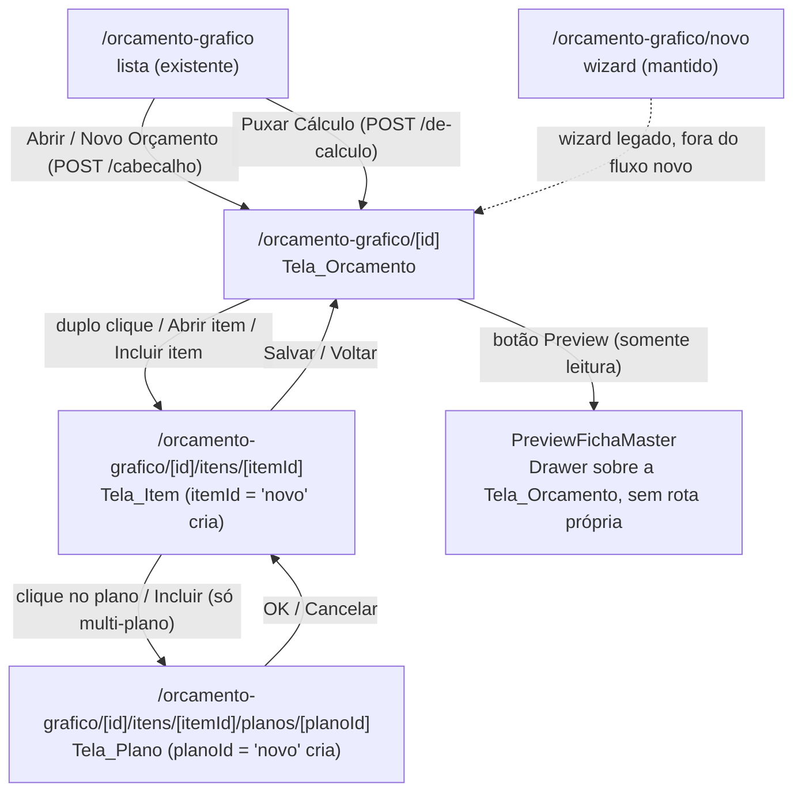
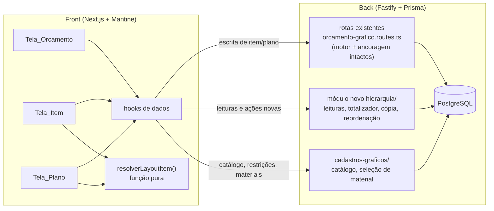

# Design Document — Orçamento Gráfico: hierarquia Orçamento → Item → Plano

## Overview

Esta reforma separa, no front do Orçamento Gráfico, os três níveis de dados que hoje estão misturados no `EditorItem` (8 âncoras numa só página) e no modal `PlanosDoItem`:

| Nível | Tela | Rota | Conteúdo |
|---|---|---|---|
| Orçamento | Tela_Orcamento | `/orcamento-grafico/[id]` | cabeçalho, Grid_Itens, Painel_Dados_Item (somente leitura), abas Fechamento e Comissões |
| Item | Tela_Item | `/orcamento-grafico/[id]/itens/[itemId]` | dados comuns do produto; em plano único, também os campos do plano implícito; em multi-plano, o Grid_Planos |
| Plano | Tela_Plano | `/orcamento-grafico/[id]/itens/[itemId]/planos/[planoId]` | especificação de um plano (só multi-plano) |

Princípios de projeto, herdados dos requisitos e da visão aprovada (`.kiro/steering/orcamento-grafico-visao-front-calcgraf.md`, `docs/orcamento-grafico-wireframe-hierarquia.md`):

1. **O cadastro manda, o nome não.** A decisão plano único × multi-plano e o conjunto de campos visíveis saem de uma **função pura** (`resolverLayoutItem`) que lê atributos do `ProdutoGrafico` e do `TipoPlanoGrafico`. Nenhum `if (nome === ...)` em lugar algum.
2. **O motor não muda.** `calcularOrcamentoGrafico` e `ancorarCustoCalcgraf` ficam intactos. Todo campo novo é aditivo e **nunca entra no input do motor** nem nas colunas de custo.
3. **Back aditivo e isolado.** Rotas novas ficam em um módulo novo (`src/modules/orcamento-grafico/hierarquia/`), com `empresaId` explícito em todo `where`. Mudanças em `orcamento-grafico.routes.ts` se limitam a: (a) extrair o `select` de hidratação do item para um módulo compartilhado e (b) aceitar campos aditivos nos schemas Zod de item e plano (somente depois de D1/D3 decididas).
4. **Entrega em 4 fases**, cada uma precedida de wireframe em texto confirmado pelo usuário (R19.7, R19.9). Nada é commitado (R19.8).
5. **Schema só com decisão.** `schema.prisma` + `prisma/migrate-prod.ts` idempotente no mesmo commit, e somente depois de D1/D3 (e das lacunas G2/G3, ver seção "Decisões abertas") estarem registradas por escrito pelo usuário.
6. **Tema adaptativo e sem marca legada.** Só tokens Mantine; nenhum texto visível cita o sistema de origem.

### Achados no código real que moldam o design

Estes pontos foram verificados nos arquivos e mudam ou refinam premissas dos requisitos. Os que exigem decisão do usuário estão em "Decisões abertas" e em "Riscos e pontos a confirmar".

| # | Achado | Onde | Consequência no design |
|---|---|---|---|
| A1 | `ancorarCustoCalcgraf` e `preservarEngenhariaDoItem` são funções internas de `orcamento-grafico.routes.ts` (não exportadas). | `routes.ts` ~l. 560-690 | Não há como (nem se deve) chamá-las de fora. O novo módulo **não recalcula** nada; copia valores persistidos e só lê. |
| A2 | O item guarda **uma** `quantidade` (Int). Não existe persistência de 1 a 10 tiragens por item. A grade multi-tiragem do wizard é simulação (`POST /:id/itens/:itemId/simular-tiragens`, não persiste) e `variacoes` é Json do orçamento. | `schema.prisma` `ItemOrcamentoGrafico`; `routes.ts` ~l. 6449 | O Fechamento da Fase 1 agrupa por `quantidade` persistida. R6.2 ("Tiragens: 1 a 10 valores") fica como **lacuna G1**. |
| A3 | `reconsolidarItemComPlanos` (chamada por POST/PUT/DELETE de plano) recompõe `custoProducao` do item como **soma dos planos**. Em item puxado de cálculo, os planos materializados têm custo 0 (planos "fiéis" entram como detalhamento). | `routes.ts` ~l. 6557 | Gravar qualquer plano de item ancorado pode derrubar o custo ancorado. Mitigação: save sem mudança não chama a API; aviso antes da 1ª alteração; reordenar usa rota nova sem reconsolidação. **Risco R-ANC**. |
| A4 | Item puxado de cálculo já nasce com 1+ `PlanoCalculoGrafico` (0/1 plano na origem vira "Plano 1"), mesmo quando o produto é de plano único. | `planosParaMaterializar` ~l. 1363 | Dado legado "plano único com planos persistidos". A tela decide por cadastro (R8.4), não mostra grid, **não apaga** os planos e informa quantos existem. **Risco R-LEG**. |
| A5 | A regra atual `planoFixoDoCatalogo` trata como "fixo" também o **único** tipo permitido quando nenhum é `fixo`. R8.4 manda classificar só por `TipoPlanoGrafico.fixo`. | `editor/catalogo/catalogo-puro.ts` l. 175 | A função nova segue R8.4. Produto com 1 tipo não fixo muda de "plano único" (editor atual) para multi-plano. Confirmado em 17/11/2026 (P3). |
| A6 | `aproveitamento_manual` é coluna **fora do client Prisma** (lida/gravada por SQL raw). O `GET /:id` o anexa depois do `findFirst`. | `routes.ts` ~l. 3580-3591, 6229 | Todo `select` novo de item deve usar o mesmo anexo. Extrair `ITEM_SELECT_HIDRATACAO` + `anexarAproveitamentoManual` para módulo compartilhado (R20.2). |
| A7 | Não existe `GET /:id/itens/:itemId` nem `GET .../planos`. O front lê item e planos do `GET /:id`. | `routes.ts` | Rotas de leitura novas (item e plano) usando o select compartilhado. |
| A8 | Não existe endpoint de comissões do orçamento gráfico. `GET /vendas/comissoes` é do módulo de vendas (pedidos). | `venda.routes.ts` | Rota nova somente leitura; fonte proposta: `Vendedor.comissao` × `valorTotalConsolidado`. R5.6 cobre o caso "back não expõe". |
| A9 | `ProdutoGrafico` não tem atributo "possui Altura da Tampa" (R7.1) e `TipoPlanoGrafico` não tem flags de "prevê capa externa / microondulado / capa interna" (R8.5, R10.4-10.6). Só existe `fibraDefault`. | `schema.prisma` | **Lacuna G2.** A função pura aceita esses atributos como tri-estado (`true`/`false`/`null`) e trata `null` como "mostrar" (não-regressão). |
| A10 | `NC` precisa de campos sem coluna (espessura, formato, fibra, tira/retira, frete/kg, pacotes, créditos ICMS/IPI, unidades) e de marca "provisório" em `PrecoMateriaPrima`, que hoje não existe. | `schema.prisma` `SuporteGrafico`, `PrecoMateriaPrima` | **Lacuna G3**; bloqueia a Fase 4. |
| A11 | O teste `texto-visivel-sem-marca-legada.test.ts` já existe, varre o módulo recursivamente, mas usa a regex `/calcgraf|calcgraph|g-?print/i` e não informa a linha. R17.1 exige também "Calcograf", "PHTech", e acento/espaço/hífen; R17.4 exige linha. | front, `orcamento-grafico/` | Fase 0: estender o teste existente (não criar outro). Pastas novas dentro de `orcamento-grafico/` entram sozinhas na varredura (R17.3). |
| A12 | `ajusteCorteMicroMm` tem faixas diferentes: item 0 a 100,00 (R8.9); plano −99,99 a 99,99 (R10.5). | requisitos | Dois validadores parametrizados pelo mesmo `validarFaixa`. Conferir se a diferença é intencional (P5). |
| A13 | A Ficha Master já existe e é lida hoje pelo editor. Modelos: `FichaGraficaProduto` (`cartao`, `gramatura`, `numCores`, `coresDescricao`, `acabamentos`, `matrizManual`, `imagemFaca`, `modeloFacaId`) e `ArteRevisaoProduto` (`estado` RASCUNHO/EM_APROVACAO/APROVADA/REPROVADA/OBSOLETA, `imagens[]` até 4), ambos por `[empresaId, produtoId]`. A Pré-Impressão grava a ficha em rascunho no `PedidoProposta` e a publica no `Produto` quando o cliente aprova a arte (`pre-impressao.service.ts`). A rota de leitura **já existe**: `GET /orcamento-grafico/:id/ficha-master` (`orcamento-grafico.routes.ts`), com `empresaId` explícito e 404 de mensagem fixa. No front é consumida por `EditorItem` (estado `fichaMaster`) e desenhada por `editor/PainelPreview.tsx`. | `schema.prisma` ~l. 4255-4300; `routes.ts` ~l. 2950-3060; `EditorItem.tsx` l. 163-297, 864 | O Preview_Ficha_Master **reutiliza** rota e `PainelPreview`; nenhuma rota nova na Fase 1. O upload da faca (`ProdutoEspecificacao` + `PATCH /:id/imagem-faca`) deixa de ser exibido na Tela_Orcamento (R21.8). |
| A14 | O vínculo com a Ficha Master é pelo `Produto` (cadastro de estoque), não pelo `ProdutoGrafico`. `OrcamentoGrafico.produtoId` aponta para o `Produto`; `ItemOrcamentoGrafico` só tem `produtoGraficoId` (sem relação com `Produto`). A rota atual devolve só a **1ª** imagem da arte aprovada (`imagens[0]`) e não devolve foto do produto. | `schema.prisma` (`OrcamentoGrafico.produtoId`, `ItemOrcamentoGrafico.produtoGraficoId`) | O preview é **por orçamento**, não por item (ver G5). A "imagem do produto" não tem fonte definida (G5). |

## Architecture

### Mapa de rotas e navegação (front, Next.js App Router)



Regras de navegação:

- **Título e migalhas (R1.1).** Cada tela mostra `Orçamento {numero}`, `Item — {nome do produto}`, `Plano — {nome}`. A migalha `Orçamento › Item › Plano` usa `next/link`; o rótulo do nível vem do cadastro/registro carregado, nunca de string fixa de produto.
- **Entrada (R1.6, R2.5).** O Grid_Itens usa `router.push` (com `prefetch` da rota do item ao focar a linha) para chegar à Tela_Item em até 2 s. A tela renderiza esqueleto enquanto carrega.
- **Guarda de registro inexistente (R1.9).** Se `GET` do item/plano responde 404 (inexistente ou de outra empresa), a tela **volta à origem** com `router.replace` e exibe a mensagem "Registro não encontrado." Nenhum dado é alterado. Orçamento 404 volta para a lista.
- **Alterações não salvas.** Tela_Item e Tela_Plano mantêm `dirty` e pedem confirmação ao sair (`beforeunload` + diálogo próprio nas navegações internas). Cancelar na Tela_Plano descarta tudo e retorna sem chamada à API (R10.10).
- **Estado de sessão (R16.7, R16.8).** Token e empresa só via `@/lib/authStorage` (`getAuthToken`, sessionStorage por aba). Nenhum `localStorage` direto. O axios `api` já usa `withCredentials: false`. Nenhuma tela escuta `storage` para recarregar.
- **Novo item.** `?novoItem=1` (hoje usado por `NovoOrcamentoModal`) passa a redirecionar para `/itens/novo` quando a Fase 2 estiver entregue. Antes disso, continua abrindo o editor atual (R19.6).

### Substituição do `EditorItem` (estratégia por fases)

O `EditorItem` (`[id]/EditorItem.tsx`, 8 âncoras definidas em `editor/ancoras.ts`) **não é reaproveitado como está** (R1.5). Troca em duas etapas, para nunca quebrar o fluxo existente (R19.6):

| Etapa | Estado |
|---|---|
| Fase 1 | Existe a rota `/itens/[itemId]`, mas é uma **ponte**: carrega `GET /:id` e hospeda o `EditorItem` atual dentro da página (antes era modal). Serve só para o Grid_Itens ter para onde navegar (R1.6, R2.5). Nenhum comportamento de cálculo muda. O arquivo ganha o comentário `@deprecated ponte até a Fase 2`. |
| Fase 2 | A ponte é trocada pela Tela_Item de verdade. `EditorItem.tsx`, `editor/ancoras.ts`, `editor/ancoras.test.ts`, `IndiceAncoras.tsx` e `useScrollSpy.ts` são removidos. As seções reaproveitáveis viram blocos da Tela_Item (ver "Componentes"). |
| Fase 3 | `PlanosDoItem.tsx` e `PlanosDoItemComCatalogo.tsx` (modal) são trocados por Grid_Planos + Tela_Plano. A lógica de formulário do modal é movida, não reescrita (defaults de catálogo, validação, troca de suporte). |

Consequência para R19.1: os critérios R1.3, R1.4, R1.5, R1.7 e R1.8 dependem de Tela_Item/Tela_Plano e só podem ficar completos nas Fases 2 e 3. Ver "Fases" e ponto P1.

### Convivência com o wizard `/novo` e o `ItemWizardModal`

Decisão de design (R "Fora de escopo", item 2): **o wizard `/orcamento-grafico/novo` e o `ItemWizardModal` permanecem** até que Tela_Item e Tela_Plano cubram a criação de orçamento e item de ponta a ponta, **e** o usuário peça a remoção. Esta spec não os remove. Pontos de contato:

- `StepRevisao`, `StepCores`, `StepAcabamentos` etc. continuam sendo usados pelo wizard e por `useCalculoAoVivo`/`itemFormShared`. Os módulos puros `itemFormShared.ts` (`itemParaForm`, `montarPayloadItem`, `salvarItem`) são **reutilizados sem alteração** pela Tela_Item, garantindo o mesmo conjunto de campos de engenharia no payload (R15.3).
- `NovoOrcamentoModal` e "Puxar Cálculo" na lista seguem iguais; só o destino pós-criação muda (ver "Novo item").

### Visão em camadas



Regra de ouro das escritas: **item e plano continuam sendo gravados pelas rotas existentes** (`PUT /:id/itens/:itemId`, `POST/PUT/DELETE .../planos`). O módulo novo só **lê**, **totaliza**, **copia valores já persistidos** e **reordena**. Isso mantém o caminho do motor e da ancoragem exatamente como está.

### Estrutura de pastas

```
Front  src/app/(interna)/orcamento-grafico/
  [id]/page.tsx                         Tela_Orcamento (enxuta; handlers de ações extraídos sem mudar comportamento)
  [id]/_orcamento/                      CabecalhoOrcamento, GridItens, PainelDadosItem, AbaFechamento, AbaComissoes,
                                        PreviewFichaMaster (+ hook useFichaMaster),
                                        AcoesOrcamento (proposta, e-mail, recusa, aprovar, amostras, OP — código movido)
  [id]/_layout/resolver-layout-item.ts  função pura + testes
  [id]/_layout/reaplicar-layout.ts      troca de produto (R7.8)
  [id]/_validacao/validar-faixa.ts      validadores numéricos puros
  [id]/itens/[itemId]/page.tsx          Tela_Item (ponte na Fase 1)
  [id]/itens/[itemId]/_item/            BlocoComum, BlocoFormato, BlocoPlanoUnico, BlocoAcabamentos(+Restricoes/Materiais),
                                        GridPlanos, AcondicionamentoBloco, BotaoPropriedades
  [id]/itens/[itemId]/planos/[planoId]/page.tsx   Tela_Plano
  [id]/itens/[itemId]/planos/[planoId]/_plano/    BlocosPorTipoPlano, SuporteComNc, pilha-desfazer.ts
  [id]/_hooks/                          useOrcamentoHierarquia, useFechamentoTotalizador, useComissoes, useDadosItem,
                                        useLayoutItem, usePlanosDoItem, useRestricoesMateriais
  texto-visivel-sem-marca-legada.test.ts (existente; estendido na Fase 0)

Back   src/modules/orcamento-grafico/hierarquia/
  hierarquia.routes.ts                  registrado em server.ts com prefixo /api/orcamento-grafico
  item-select.ts                        ITEM_SELECT_HIDRATACAO + anexarAproveitamentoManual (fonte única de hidratação)
  fechamento-totalizador.service.ts     agregação pura + leitura
  comissoes.service.ts
  dados-item.service.ts                 DTO do Painel_Dados_Item
  item-copia.service.ts                 cópia de item sem recálculo
  planos-ordem.service.ts               reordenar / restaurar / copiar plano
  suporte-nc.service.ts                 Fase 4
```

Todo código novo de tela fica **dentro** de `orcamento-grafico/` para ser varrido automaticamente pelos testes estáticos de marca legada e de cores fixas (R17.3, R18.2).

## Components and Interfaces

### 1. Função pura de resolução de layout do Item

Arquivo: `[id]/_layout/resolver-layout-item.ts`. Sem React, sem rede, sem `Date`/`Math.random`. Decide a estrutura (plano único × multi-plano) e os campos visíveis **somente** a partir de atributos do cadastro. A entrada não contém `nome` nem `codigo`, de propósito: o compilador impede a comparação por nome (R7.9, R20.4).

```ts
export type ModoFormato = 'TRES_DIMENSOES' | 'DUAS_DIMENSOES' | 'ABERTO_FECHADO' | 'SANFONA_ABAS' | 'PAGINA'

export type CampoFormato =
  | 'comprimento' | 'largura' | 'altura' | 'abaCola' | 'abaFechamento' | 'alturaTampa'
  | 'formatoFinal' | 'formatoFechado' | 'formatoAberto'

export type CampoPlanoUnico =
  | 'cores' | 'processoImpressao' | 'coberturaTinta' | 'fabricante' | 'suporte' | 'fornecido'
  | 'microondulado' | 'fibra' | 'montagem' | 'formatoCorte' | 'ajusteCorteMicro'

/** Tri-estado: true = o cadastro prevê; false = não prevê; null/undefined = cadastro não informa (mostrar). */
export interface PrevisaoBlocos {
  capaExterna?: boolean | null
  microondulado?: boolean | null
  capaInterna?: boolean | null
  fibra?: boolean | null
}

export interface EntradaLayoutItem {
  produto: {
    modoFormato: string | null | undefined          // string, para aceitar valor inválido vindo do cadastro (R7.12)
    formatoPadraoLargura: number | null
    formatoPadraoAltura: number | null
    exibeRestricoes: boolean
    exibeInformacoesComplementares: boolean
    semImpressao: boolean
    possuiAlturaTampa?: boolean | null              // atributo ainda inexistente no cadastro (lacuna G2)
  }
  /** Tipos de plano PERMITIDOS ao produto (catalogo.planos), na ordem do catálogo. */
  tiposPlano: ReadonlyArray<{
    id: string
    fixo: boolean
    fibraDefault?: string | null
    previsao?: PrevisaoBlocos | null                // lacuna G2
  }>
}

export interface LayoutItem {
  versao: 1
  /** false quando modoFormato ausente/desconhecido: tela mostra aviso e bloqueia gravação (R7.12). */
  cadastroCompleto: boolean
  motivoIncompleto: 'MODO_FORMATO_AUSENTE' | 'MODO_FORMATO_DESCONHECIDO' | null
  estrutura: 'PLANO_UNICO' | 'MULTI_PLANO'
  tipoPlanoFixoId: string | null                    // primeiro tipo com fixo = true, na ordem do catálogo
  gridPlanos: boolean                               // true ⇔ MULTI_PLANO
  formato: {
    campos: readonly CampoFormato[]                 // ordem canônica
    padrao: { largura: number; altura: number } | null   // só se ambos > 0 (R7.5)
    formatoPendenteDeWireframe: boolean             // SANFONA_ABAS / PAGINA (ver pendência P4)
  }
  planoUnico: {
    campos: readonly CampoPlanoUnico[]              // [] quando MULTI_PLANO
    somenteLeitura: readonly CampoPlanoUnico[]      // montagem e formatoCorte (R8.8)
  }
  impressaoVisivel: boolean                         // !semImpressao (R7.6)
  informacoesComplementaresVisiveis: boolean        // R7.7
  restricoes: 'EXPANDIDA' | 'RECOLHIDA'             // R11.7/11.8: sempre presente, recolhida se exibeRestricoes = false
}

export function resolverLayoutItem(entrada: EntradaLayoutItem): LayoutItem
```

Regras (tabela de decisão, toda em constantes de dados, sem ramificação por nome):

| Atributo do cadastro | Efeito |
|---|---|
| `tiposPlano.some(t => t.fixo)` | `PLANO_UNICO`, `gridPlanos=false`, `planoUnico.campos` preenchido. Caso contrário `MULTI_PLANO`, `gridPlanos=true`, `planoUnico.campos=[]` (R1.3, R1.7, R6.9, R6.10, R8.4). |
| `modoFormato = TRES_DIMENSOES` | `comprimento, largura, altura, abaCola, abaFechamento` + `alturaTampa` somente se `possuiAlturaTampa === true` (R7.1). |
| `modoFormato = DUAS_DIMENSOES` | `formatoFinal` (R7.2). |
| `modoFormato = ABERTO_FECHADO` | `formatoFechado, formatoAberto` (R7.3). |
| `modoFormato = SANFONA_ABAS` ou `PAGINA` | `campos` vazio e `formatoPendenteDeWireframe=true` até o wireframe da Fase 2 listar os campos (R7.4; pendência P4). |
| `modoFormato` ausente/diferente dos 5 | `cadastroCompleto=false`, `campos=[]` (R7.12). |
| `formatoPadraoLargura > 0` **e** `formatoPadraoAltura > 0` | `formato.padrao` preenchido; caso contrário `null` (R7.5). |
| `semImpressao` | remove `cores, processoImpressao, coberturaTinta` de `planoUnico.campos`; `impressaoVisivel=false` (R7.6). |
| `previsao.microondulado === false` do tipo fixo | remove `microondulado, ajusteCorteMicro` (R8.5). `null/undefined` mantém (não-regressão). |
| `previsao.fibra === false` do tipo fixo | remove `fibra` (R8.5), avaliado de forma independente de microondulado. `fibraDefault` serve só de valor inicial do campo, não de regra de visibilidade, porque "vazio" não distingue "não prevê" de "ainda não preenchido". |
| `exibeInformacoesComplementares` | campo visível ⇔ `true` (R7.7). |
| `exibeRestricoes` | `EXPANDIDA` se `true`, `RECOLHIDA` se `false` (R11.7, R11.8). |

Ordem canônica das listas é fixa (ordem das uniões acima), o que torna a saída comparável por igualdade profunda e a função idempotente (R20.3).

Funções auxiliares puras no mesmo diretório:

- `resolverBlocosPlano(tipo: { previsao?: PrevisaoBlocos | null }): { capaExterna: boolean; microondulado: boolean; capaInterna: boolean }` — usada pela Tela_Plano (R10.4 a R10.8). `null/undefined` ⇒ `true`.
- `resolverPadroesIniciais({ default: DefaultProdutoPlano | null, atividadesDoCatalogo })` — devolve cores, processo, cobertura e atividades pré-marcadas para item novo ou plano novo (R8.3, R8.4, R10.11). Reusa `aplicarDefaultsEmVazios` e `aplicarDefaultsEmPlano` já existentes em `catalogo-puro.ts` (não duplica).
- `reaplicarLayoutAoTrocarProduto(form, layoutNovo, padroes)` — R7.8: mantém valores dos campos que continuam visíveis; preenche formato padrão **apenas** em campo de formato vazio; devolve `{ form, ocultos }`, e `camposParaGravar(form, layout)` descarta os ocultos antes do payload.

Contrato com o back: o `DadosItemPainel.estrutura` (ver endpoints) usa a mesma regra `some(fixo)`. Para impedir divergência entre as duas implementações (front TS e back TS, repositórios separados), os dois testam o **mesmo vetor de casos** (`vetores-layout.json`, copiado nos dois repos).

### 2. Validadores numéricos puros

Arquivo `[id]/_validacao/validar-faixa.ts`. Trabalha sobre a **string digitada** (aceita vírgula ou ponto), sem aritmética de ponto flutuante para contar casas:

```ts
export interface EspecFaixa { min: number; max: number; minExclusivo?: boolean; maxExclusivo?: boolean; casas: number }
export type ResultadoFaixa = { ok: true; valor: number } | { ok: false; motivo: 'VAZIO' | 'NAO_NUMERICO' | 'ABAIXO' | 'ACIMA' | 'CASAS' }
export function validarFaixa(entrada: string | number | null | undefined, spec: EspecFaixa): ResultadoFaixa
```

Presets (constantes): `DIMENSAO_MM` (>0, ≤99.999,99, 2 casas; R7.11, R10.2 usa 0,00 a 99.999,99), `AJUSTE_MICRO_ITEM` (0 a 100,00; R8.9), `AJUSTE_MICRO_PLANO` (−99,99 a 99,99; R10.5), `PARAM_MATERIAL` (>0, ≤99.999,99; R11.5, R11.6), `COBERTURA_PERC` (0 a 100, 2 casas; R10.3), `NC_GRAMATURA` (1 a 2.000), `NC_CUSTO_KG` (0,01 a 999.999,99), `NC_FRETE_KG` (0 a 999.999,99), `NC_CREDITO_PERC` (0 a 100), `NC_ESPESSURA_MICRAS` (0 a 10.000), `TIRAGEM` (inteiro 1 a 999.999.999). `parseCores('5x0')` valida `N x M` com N e M de 0 a 12 (R10.3).

### 3. Pilha de Desfazer do Grid_Planos (R9.7)

Arquivo `_plano/pilha-desfazer.ts`, reducer puro. Cada entrada guarda a **operação inversa**, não o estado inteiro:

```ts
type OperacaoInversa =
  | { tipo: 'EXCLUIR_PLANO'; planoId: string }                                     // desfaz Incluir/Copiar
  | { tipo: 'RECRIAR_PLANO'; snapshot: PlanoSnapshot; posicaoApos: string | null } // desfaz Excluir
  | { tipo: 'RESTAURAR_ORDEM'; ordemAnterior: string[] }                           // desfaz Trocar/Reordenar
export const LIMITE_DESFAZER = 20
export function empilhar(pilha: readonly OperacaoInversa[], op: OperacaoInversa): OperacaoInversa[]   // descarta a mais antiga acima de 20
export function desempilhar(pilha: readonly OperacaoInversa[]): { op: OperacaoInversa | null; pilha: OperacaoInversa[] }
```

Quando `RECRIAR_PLANO` gera um plano com **id novo**, o reducer remapeia o id antigo nas entradas restantes (`remapearId(pilha, idAntigo, idNovo)`), para que desfazer em cadeia continue correto.

### 4. Nome da cópia de plano (R9.5)

`gerarNomeCopia(nomeOriginal: string, nomesExistentes: readonly string[], limite = 60): string` — `"<nome> (Cópia)"`, depois `"(Cópia 2)"`, `"(Cópia 3)"`…; compara sem diferenciar maiúsculas/minúsculas e sem acento; trunca **o nome base** (nunca o sufixo) para caber em 60 caracteres. O resultado nunca coincide com um nome existente.

### 5. Telas e componentes

**Tela_Orcamento** (`[id]/page.tsx`)

| Componente | Responsabilidade | Dados |
|---|---|---|
| `CabecalhoOrcamento` | Série, Número, Data (dd/mm/aaaa), Cliente Principal (código, nome, busca), checkbox "Reforma Tributária 2027" (R2.1, R2.2). Edição pelo `EditarCabecalhoModal` existente. | `GET /:id` (cabeçalho apenas) |
| `GridItens` | Colunas item, Cálculo, Linha de Produto, Tipo de Produto, Tiragens, Descrição, Status. Ações Incluir, Abrir, Copiar, Excluir; estado vazio com "Incluir item"; menu "Mais ações" mantém Relatório do item, Encaixe e Emitir OP (não perder função). Padrão de grids de `.kiro/specs/padronizacao-grids/requirements.md` (R2.12). | `GET /:id/itens-resumo` |
| `PainelDadosItem` | Somente leitura. Seções por estrutura: multi-plano (Especificações Gerais, Tipos de Plano, Acabamentos de produto, Itens Diversos); plano único (Formato, Suporte, Cores, Acabamento, Itens Diversos). Seção sem dado mantém o título e mostra "Sem informação cadastrada." (R3.5). Erro com "Tentar novamente" e sem dados do item anterior (R3.7). Sem seleção: orientação (R3.6). | `GET /:id/itens/:itemId/dados-item` |
| `AbaFechamento` | Grid `Tiragem, Margem, C.Marg., Valor Unitário, Valor Total`; lista de itens sem cálculo + aviso; mensagem sem valores; erro com valores anteriores mantidos (R4.7). Mantém, em seção recolhida "Detalhe do fechamento", o `FechamentoOrcamento` atual (4 sub-abas e `PUT /:id/fechamento`) para não perder a edição de margem/desconto do orçamento (R19.6). | `GET /:id/fechamento-totalizador` |
| `AbaComissoes` | Uma linha por comissão, valores como vêm do back (R5.3); carregando até 10 s; vazio e erro distintos (R5.5 a R5.7). `keepMounted` nas duas abas para preservar estado ao alternar (R5.8). | `GET /:id/comissoes` |
| `PreviewFichaMaster` | Botão "Preview" no cabeçalho/barra de ações (ícone `IconPhoto`, fora do Grid_Itens) que abre um `Drawer` somente leitura. Mostra, com o `PainelPreview` existente, a imagem de **corte** (`imagemFaca`) e a **arte**, mais os dados gráficos (cartão, gramatura, nº de cores, cores, acabamentos, matriz) e a origem da ficha (Produto, Rascunho da Pré-Impressão ou Orçamento). Sem upload, sem edição, sem chamada ao motor (R21). | `GET /:id/ficha-master` (existente) |
| `AcoesOrcamento` | Proposta PDF/e-mail, enviar, aprovar, recusar, copiar versão, reaproveitar, amostras, conversão: **código movido** de `page.tsx`, sem mudar chamadas. | rotas existentes |

**`PreviewFichaMaster` (decisão de 17/11/2026, substitui o antigo P2).**

- **Origem do produto.** O preview é **por orçamento**: usa `OrcamentoGrafico.produtoId` (o `Produto` ligado ao orçamento). A rota já aplica a prioridade 1) `FichaGraficaProduto` + arte `APROVADA` mais recente do produto, 2) ficha em rascunho do `PedidoProposta` de origem (com `arteUrl` do 1º anexo de imagem), 3) só `imagemFaca` do orçamento, e devolve `origem: PRODUTO | RASCUNHO | ORCAMENTO | VAZIO`. O item selecionado no Grid_Itens **não** muda o preview, porque `ItemOrcamentoGrafico` não tem vínculo com `Produto` (A14). Preview por item exigiria um vínculo novo (G5), fora da Fase 1.
- **Rota de leitura.** Reutiliza `GET /api/orcamento-grafico/:id/ficha-master`, **sem alteração**: `authenticate`, `empresaId` explícito em `orcamentoGrafico`, `fichaGraficaProduto`, `arteRevisaoProduto`, `pedidoProposta` e `anexoPedidoProposta`; orçamento inexistente ou de outra empresa responde `404 { message: "Orçamento não encontrado" }` com texto fixo e sem eco de campos (R21.7). Imagens grandes (`imagemFaca`, `imagens`) só saem nessa rota de detalhe, nunca em listagem.
- **Estado vazio (R21.5).** Quando `origem = VAZIO` (ou todos os campos nulos), o drawer mostra "Este produto ainda não tem Ficha Master nem arte. Elas são cadastradas pela Pré-Impressão." e o botão segue habilitado. Erro de rede mostra mensagem distinta com "Tentar novamente" (R21.6); a Tela_Orcamento continua utilizável.
- **Carregamento.** A rota só é chamada ao abrir o drawer (`useFichaMaster(id, aberto)`), com `AbortController`; a arte por anexo usa `${API_BASE}${arteUrl}?token=` via `getAuthToken` de `@/lib/authStorage`. Nenhum `localStorage` direto.
- **Fase.** Fase 1 (Tela_Orcamento). Texto visível sem marca legada e só tokens Mantine (borda `--mantine-color-default-border`, texto `dimmed`).
- **D2.** O botão "Propriedades/Preview" do Item/Plano (R13) **continua decisão aberta**. Hipótese de trabalho, **pendente de confirmação**: ele abrirá este mesmo `PreviewFichaMaster` (mesmo componente e rota). Até a confirmação, segue o painel de aviso (R13.2).

O que sai da Tela_Orcamento (R1.2): `ProdutoEspecificacao` (upload da imagem da faca; `PATCH /:id/imagem-faca` permanece no back, sem uso na tela), `PlanosDoItemComCatalogo` expandido por item, `BreakdownBar` e o detalhe por item. O upload **não** vira ação de linha nem bloco da Tela_Item: a imagem de corte vem da Ficha Master gravada pela Pré-Impressão. "Estrutura de custo" passa a viver na Tela_Item, reaproveitando `SecaoEstruturaCusto`/`ResumoKpis`.

**Tela_Item** (`itens/[itemId]/page.tsx`) — a partir da Fase 2

| Bloco | Origem | Observação |
|---|---|---|
| `BlocoComum` | Produto (fixo, vira título), Tipo de Produto, Descrição (≤200), Sigla Acabado (≤60, com busca), Tributação, Tiragens, Modelos (1 a 999, padrão 1) | R6.2. Reaproveita `SecaoProduto`. |
| `BlocoFormato` | campos de `layout.formato.campos` | Cada campo valida com `DIMENSAO_MM`; erro no próprio campo e gravação bloqueada (R7.11). |
| `AcabamentosDeProduto` | atividades do produto marcáveis (`catalogo.atividades`, grupo ATIVIDADES) | R6.3. Reaproveita `SecaoAcabamentos`. |
| `Acondicionamento` | duas listas + Conteúdo por volume (1 a 999.999) | R6.4; grupo ACONDICIONAMENTO do catálogo. |
| `BlocoPlanoUnico` | só se `estrutura = PLANO_UNICO`; `layout.planoUnico.campos` | Cores, processo (+Pré, cadeado), cobertura, fabricante, suporte (+NC na Fase 4), fornecido, microondulado, fibra, montagem e formato de corte somente leitura (R8.8), ajuste corte micro (R8.9), `BotaoPropriedades`. |
| `BlocoAcabamento` | atividades do plano fixo + `RestricoesEMateriais` | R8.3, R11. |
| `GridPlanos` | só se `estrutura = MULTI_PLANO` | R9. |
| `ComplementosDoItem` | Itens Diversos, Itens Fornecidos, Campos Livres, Observação (≤2.000), Obs. Áreas de Op (≤2.000) | R6.5; reaproveita `SecaoItensComplementares`. Edições não salvas sobrevivem à abertura dos painéis (estado no pai). |
| `MargemDoItem` | seleção de margem do item (reaproveita `SecaoFechamento`/`previa-margem`) | **Lacuna G4**: R6 não cita onde se edita a margem do item; sem ele o Fechamento nunca muda. Proposta: manter este bloco compacto. |
| `BotaoPropriedades` | botão "Propriedades/Preview" ao lado de Ajuste Corte Micro (mm) | R13: abre painel de aviso até D2 (ver D2). Hipótese pendente: abrir o `PreviewFichaMaster`. |

**Tela_Plano** (`.../planos/[planoId]/page.tsx`) — Fase 3: cabeçalho do plano (Tipo, Nome 1 a 100, Ocorrências 1 a 99, Tiragem), medidas (Montagem, Corte, Formato Aberto, Formato Final C×L×A×AltTampa), `Cores`, `Processo` (+Pré, cadeado), `Cobertura`, blocos `capaExterna`/`microondulado`/`capaInterna` conforme `resolverBlocosPlano`, `BlocoAcabamento` do plano. Botões OK e Cancelar. **Nenhum campo de Item** (R1.4).

### 6. Hooks de dados

O módulo já usa hooks com `useState/useEffect` + `api` (axios) — por exemplo `useCatalogoItem`, `useSelecaoMaterial`, `useCalculoAoVivo`. Os novos seguem o mesmo padrão (sem introduzir outro gerenciador de cache) e devolvem `{ dados, carregando, erro, recarregar }`.

| Hook | Chamada | Detalhe |
|---|---|---|
| `useOrcamentoHierarquia(id)` | `GET /:id` + `GET /:id/itens-resumo` | Fornece cabeçalho, itens e a função `notificarAlteracaoItem()` que dispara o recarregamento do Fechamento. |
| `useFechamentoTotalizador(id)` | `GET /:id/fechamento-totalizador` | Mantém o último valor bom em erro (R4.7); reexecuta em até 2 s após `notificarAlteracaoItem` (R4.4). |
| `useComissoes(id)` | `GET /:id/comissoes` com `timeout: 10000` | Separa `vazio` de `erro` (R5.5 a R5.7). |
| `useDadosItem(id, itemId)` | `GET .../dados-item` | Descarta resposta de seleção antiga (corrida entre cliques, R3.4). |
| `useLayoutItem(produtoGraficoId)` | `catalogoApi.produto` (já usado por `useCatalogoItem`) + `resolverLayoutItem` | Recalcula em até 500 ms ao trocar produto (R7.8). Memoiza por atributos. |
| `usePlanosDoItem(id, itemId)` | `GET .../planos` + ações | Aplica a ação otimista só **depois** da resposta de sucesso; em falha mantém o estado anterior (R9.11). |
| `useRestricoesMateriais(acabamentoId)` | catálogo do plano (preferencial) ou `GET /cadastros/catalogo/atividade/:id` | Cache por atividade; "Tentar novamente" (R11.3). |

### 7. Interfaces do back (rotas)

Todas autenticadas (`authenticate`) e com `empresaId` **explícito**, nunca só `request.prismaScoped` (um SUPER_ADMIN contorna o escopo automático; ver `ATENCAO-pontos-verificar.md` §2.1). Entidades filhas (item, plano) são filtradas pelo pai: `where: { id, orcamentoId, empresaId }` e, para plano, `item: { orcamentoId, empresaId }`. Registro de outra empresa responde **404 com a mesma mensagem** do inexistente, sem eco de campos (R16.3, R16.4).

| Método e caminho | Situação | Fase | Requisitos | Observação |
|---|---|---|---|---|
| `GET /:id/itens-resumo` | novo | 1 | R2.3, R2.4, R16.6 | Sem `resultadoCalculo` (leve). Campos: `id, sequencia, calculo, linhaProduto, tipoProduto, tiragem, descricao, status, op`. |
| `GET /:id/itens/:itemId/dados-item` | novo | 1 | R3, R16 | DTO com nomes resolvidos (suporte, atividades, planos). |
| `GET /:id/fechamento-totalizador` | novo | 1 | R4, R15.7, R16.6 | Lê só colunas persistidas; **não** chama o motor (R4.9). |
| `GET /:id/comissoes` | novo | 1 | R5 | Somente leitura, valores calculados no back. |
| `GET /:id/ficha-master` | **existente, sem alteração** | 1 | R21 | Preview da Ficha Master do orçamento. Já filtra `empresaId`; 404 de texto fixo. Teste de isolamento novo cobre a rota (P-13). |
| `POST /:id/itens/:itemId/copiar` | novo | 1 | R2.8 | Cópia sem recálculo; ver abaixo. |
| `DELETE /:id/itens/:itemId` | existente | 1 | R2.9 | Confirmação é do front. |
| `GET /:id/itens/:itemId` | novo | 1 (ponte) / 2 | R20.2 | `ITEM_SELECT_HIDRATACAO` + `aproveitamentoManual`. |
| `GET /:id` | **ajustado** | 1 | R20.2 | Só troca o `select` literal de itens pela constante compartilhada. Sem mudança de contrato. |
| `PUT /:id/itens/:itemId`, `POST /:id/itens`, `POST .../calcular` | existente | 2 | R6.6, R6.7, R15 | Inalterados. Campos aditivos de D3 entram **somente** depois da decisão. |
| `GET /:id/itens/:itemId/planos` e `.../planos/:planoId` | novo | 3 | R10.14, R20.2 | Mesmo select de plano do `GET /:id` + `especificacao` (D1). |
| `POST .../planos` | **ajustado** | 3 | R9.3, R9.5 | Aceita `posicaoApos?: uuid` (inserção logo abaixo; usado por Copiar e por desfazer Excluir). Desloca `sequencia` em duas fases dentro de `$transaction` (a restrição única `[itemId, sequencia]` impede `+1` direto). |
| `PUT/DELETE .../planos/:planoId` | existente | 3 | R9.4, R9.6 | Inalterados. |
| `PATCH .../planos/reordenar` | novo | 3 | R9.8 | Corpo `{ ordem: uuid[] }`, deve ser permutação exata dos planos do item (senão 400). Não reconsolida custo (a soma não muda). |
| `GET /cadastros/catalogo/atividade/:id` | novo | 2 | R11.1, R11.2 | Restrições e materiais (com `tipoParam`) de uma atividade fora do catálogo do plano. |
| `PUT/DELETE/GET /cadastros/selecao-material` | existente | 2 | R11.12 | Seleção de material/restrição gravada na estrutura atual; não recalcula. |
| `POST /suportes-nao-cadastrados` | novo | 4 | R12 | Transação: `SuporteGrafico` + `PrecoMateriaPrima` provisório. Depende de G3. |
| `GET /precos-mp?provisorio=true` | **ajustado** | 4 | R12.4 | Filtro do comprador. |
| `PUT /precos-mp/:id` | **ajustado** | 4 | R12.4 | Aceita `provisorio: false` ao regularizar. |

**`GET /:id/fechamento-totalizador`**

```ts
interface FechamentoTotalizadorDTO {
  orcamentoId: string
  linhas: Array<{
    tiragem: number                      // quantidade persistida, ordem crescente
    margemPerc: number | null            // Σ(valorTotal·margemSelecionada) / Σ valorTotal  (ponderada pelo preço)
    contribuicaoMarginalPerc: number | null   // Σ CM$ / Σ valorTotal × 100; null se algum item da linha não tem CM persistida
    valorUnitario: number                // valorTotal / tiragem (4 casas; o front formata conforme R4.8)
    valorTotal: number                   // Σ valorTotal dos itens da linha (2 casas)
    custoProducao: number                // Σ custoProducao dos itens da linha (2 casas)
    itens: number
  }>
  itensSemCalculo: Array<{ id: string; sequencia: number; descricao: string | null }>
  quantidadeSemCalculo: number
}
```

- Item "com custo calculado" ⇔ `custoProducao != null` **e** `valorTotal != null`. Os demais entram em `itensSemCalculo` e ficam fora de **todas** as linhas (R4.5).
- Os "lançamentos" (materiais computados, itens diversos) já estão incorporados em `custoProducao`/`valorTotal` persistidos pelas rotas de item (ver comentários "soma ADITIVA ... Req 6.3/6.6" em `routes.ts`). O totalizador soma o persistido; não reaplica nada (premissa A-LANC, ponto a confirmar).
- Duas linhas nunca repetem tiragem; itens com a mesma tiragem somam na mesma linha (R4.2, R4.3). A CM% é lida de `resultado_calculo->>'contribuicaoMarginalValor'` por SQL parametrizado (sem materializar o Json inteiro).
- Agregação em função pura `agregarFechamento(itens)` (testável sem banco).

**`POST /:id/itens/:itemId/copiar`** — dentro de `$transaction`: (1) lê o item e seus planos com `empresaId` explícito; (2) cria o novo item com `sequencia = max+1` (mesma regra do `POST /:id/itens`) copiando **todas as colunas persistidas**, inclusive `resultadoCalculo`, `custoProducao`, `valorTotal`, `margemSelecionada` e `calculoGraficoOrigemId` (a âncora acompanha a cópia), exceto id, timestamps e o binário de encaixe; (3) copia `aproveitamento_manual` por SQL raw (A6); (4) cria os planos com ids novos e os mesmos valores; (5) copia as linhas de `SelecaoMaterial` e reescreve `selecaoId` dentro de `materiaisAcabamento`; (6) reconsolida o cabeçalho com a função pura `consolidarOrcamento`. **Não chama o motor.** O custo do item copiado é idêntico ao do original.

**`GET /:id/comissoes`**

```ts
interface ComissoesDTO { linhas: Array<{ origem: 'VENDEDOR'; descricao: string; percentual: number; base: number; valor: number }> }
```
Fonte **confirmada em 17/11/2026 (P6)**: `comissao = Vendedor.comissao (percentual) × OrcamentoGrafico.valorTotalConsolidado`, calculada no back e arredondada a 2 casas; o front só exibe (R5.3). Uma linha por vendedor do orçamento (`origem: 'VENDEDOR'`, `percentual`, `base = valorTotalConsolidado`, `valor`). Sem vendedor, ou vendedor sem percentual (nulo ou 0): `linhas: []` e o front mostra o estado vazio (R5.6). `empresaId` explícito no orçamento e no vendedor.

**`GET /:id/itens/:itemId/dados-item`**

```ts
interface DadosItemPainelDTO {
  itemId: string
  estrutura: 'PLANO_UNICO' | 'MULTI_PLANO'      // regra some(fixo) sobre os tipos permitidos do produto (vetores compartilhados)
  planosPersistidos: number                      // informa dado legado em plano único (R-LEG)
  secoes: Array<{ chave: string; titulo: string; linhas: string[] }>   // linhas vazias ⇒ o front mostra "Sem informação cadastrada."
}
```
Para multi-plano, cada plano vira **uma linha de texto** (suporte, cores, formato, acabamentos), conforme R3.2.

**Demais DTOs das rotas novas**

```ts
// GET /:id/itens-resumo (Fase 1) — leve, sem resultadoCalculo
interface ItemResumoDTO {
  id: string
  sequencia: number
  calculo: number | null              // número do cálculo de origem (numeroCalcgraf ?? numero); null se item criado do zero
  linhaProduto: string | null
  tipoProduto: string | null
  tiragens: number[]                  // quantidade persistida (A2: hoje 1 valor); o front formata "6.000" e junta com " / " (R2.3)
  descricao: string | null
  status: string                      // rótulo já resolvido no back (ex.: "Liberado")
  op: { id: string; numero: number } | null
  temCalculo: boolean                 // custoProducao != null && valorTotal != null (mesma regra do totalizador)
}

// POST /:id/itens/:itemId/copiar (Fase 1)
interface CopiarItemRespostaDTO { itemId: string; sequencia: number; planosCopiados: number }

// POST .../planos com posicaoApos (Fase 3) — acréscimo ao corpo existente
interface CriarPlanoExtra { posicaoApos?: string }      // uuid de um plano do mesmo item; ausente = final

// PATCH .../planos/reordenar (Fase 3)
interface ReordenarPlanosBody { ordem: string[] }       // permutação exata dos ids dos planos do item
interface ReordenarPlanosResposta { planos: Array<{ id: string; sequencia: number }> }

// POST /suportes-nao-cadastrados (Fase 4, depende de G3)
interface SuporteNcBody {
  nome: string                        // 1..120
  gramatura: number                   // 1..2000
  espessuraGm?: number | null
  espessuraMicras?: number | null     // 0..10000
  formatoLarguraMm?: number | null
  formatoAlturaMm?: number | null
  fibra?: string | null
  tiraRetira?: boolean | null
  tipoSuporteConsumoTintaId?: string | null
  coefTinta?: number | null
  unidadeCustoKg?: boolean | null
  unidadeCalculoFl?: boolean | null
  custoKg: number                     // 0,01..999.999,99
  freteKg?: number | null             // 0..999.999,99
  pacotesCom?: number | null
  creditoIcmsPerc?: number | null     // 0..100
  creditoIpiPerc?: number | null      // 0..100
  confirmarExistente?: boolean        // true = usar o suporte já existente em vez de criar (R12.7)
}
type SuporteNcResposta =
  | { resultado: 'CRIADO'; suporteId: string; precoId: string; provisorio: true }
  | { resultado: 'DUPLICADO'; suporteId: string; nome: string; gramatura: number }   // front oferece "usar existente" ou cancelar
```

## Data Models

> Os campos de schema abaixo são **propostas**. Nada é aplicado antes de D1, D3 e das lacunas G2/G3 estarem decididos por escrito pelo usuário. Os nomes de tabela e coluna SQL devem ser conferidos contra os `@@map`/`@map` reais de `schema.prisma` na hora de implementar.

### Tipos TypeScript do front

```ts
// Item como a Tela_Item enxerga (hidratado por ITEM_SELECT_HIDRATACAO; R20.2)
interface ItemTela {
  id: string
  orcamentoId: string
  sequencia: number
  produtoGraficoId: string | null
  tipoPlanoId: string | null                     // plano implícito do plano único
  tipoEmbalagemId: string | null
  descricao: string | null                       // ≤200
  siglaAcabado: string | null                    // ≤60
  tributacaoId: string | null
  tiragens: number[]                             // 1..10 inteiros 1..999.999.999 (G1: hoje 1 valor)
  modelos: number                                // 1..999, padrão 1
  medidas: Record<string, number | null>         // Json existente. Atenção: o motor lê L, A, P (+ largura, altura)
  // campos de D3 (formato fechado/aberto/final, altura da tampa): ver "Opções D3"; null quando não informados
  formato: FormatoItem
  informacoesComplementares: string | null       // ≤1.000
  observacao: string | null                      // ≤2.000
  obsAreasOp: string | null                      // ≤2.000
  acondicionamento: { listaA: string[]; listaB: string[]; conteudoPorVolume: number | null }   // 1..999.999
  atividadesProduto: string[]                    // acabamentos de produto (ids)
  planoUnico: PlanoUnicoTela | null              // só quando layout.estrutura = PLANO_UNICO
  aproveitamentoManual: number | null            // coluna fora do client Prisma (A6)
  formatoCorteLarguraMm: number | null
  formatoCorteAlturaMm: number | null
  papelId: string | null
  calculoGraficoOrigemId: string | null          // marca item ancorado (R-ANC)
  custoProducao: number | null                   // somente leitura na tela
  valorTotal: number | null                      // somente leitura na tela
  planosPersistidos: number                      // informa R-LEG
}

interface FormatoItem {
  comprimento: number | null; largura: number | null; altura: number | null
  abaCola: number | null; abaFechamento: number | null; alturaTampa: number | null
  formatoFinal: { largura: number | null; altura: number | null } | null
  formatoFechado: { largura: number | null; altura: number | null } | null
  formatoAberto: { largura: number | null; altura: number | null } | null
}

interface PlanoUnicoTela {
  cores: string | null                           // "NxM", N e M 0..12
  processoImpressaoId: string | null; pre: boolean; cadeado: boolean
  coberturaTintaPerc: number | null              // 0..100, 2 casas
  fabricanteId: string | null
  suporteId: string | null; fornecido: boolean
  microondulado: boolean | null; fibra: string | null
  montagem: string | null                        // somente leitura (calculado)
  formatoCorte: { larguraMm: number; alturaMm: number } | null   // somente leitura (calculado)
  ajusteCorteMicroMm: number | null              // 0..100,00 (R8.9)
  atividadesPlano: string[]
}

// Plano como a Tela_Plano e o Grid_Planos enxergam (multi-plano)
interface PlanoTela {
  id: string
  itemId: string
  sequencia: number                              // ordem persistida; única por [itemId, sequencia]
  tipoPlanoId: string
  nome: string                                   // 1..100
  ocorrencias: number                            // 1..99
  tiragem: number | null                         // 1..999.999.999; null = "(padrão)" = tiragem do item
  montagem: string | null
  corte: { larguraMm: number | null; alturaMm: number | null } | null
  formatoAberto: { largura: number | null; altura: number | null } | null
  formatoFinal: { comprimento: number | null; largura: number | null; altura: number | null; alturaTampa: number | null } | null  // 0,00..99.999,99
  cores: string | null; processoImpressaoId: string | null; pre: boolean; cadeado: boolean; coberturaTintaPerc: number | null
  capaExterna: BlocoSuporte | null               // só se resolverBlocosPlano.capaExterna
  microondulado: (BlocoSuporte & { sentidoOnda: string | null; ajusteCorteMicroMm: number | null }) | null   // −99,99..99,99
  capaInterna: (BlocoSuporte & { cores: string | null; processoImpressaoId: string | null; coberturaTintaPerc: number | null }) | null
  atividades: string[]
  custoProducao: number | null                   // legado do plano; não editável
}
interface BlocoSuporte { fabricanteId: string | null; suporteId: string | null; fornecido: boolean; fibra: string | null }

// Linha do Grid_Planos (derivada de PlanoTela; nomes resolvidos no back/catálogo)
interface LinhaGridPlanos { id: string; nome: string; suporte: string; cores: string; formato: string; acabamento: string /* nomes separados por vírgula */ }

// Estado de edição local da Tela_Item / Tela_Plano
interface EstadoEdicao<T> { original: T; atual: T; dirty: boolean; errosPorCampo: Record<string, string>; ocultosDescartaveis: string[] }
```

`LayoutItem`, `EntradaLayoutItem`, `PrevisaoBlocos`, `EspecFaixa`, `OperacaoInversa` já estão definidos em "Components and Interfaces".

### Mapeamento campo → persistência

| Grupo | Onde grava hoje | Observação |
|---|---|---|
| Campos comuns do item (descrição, sigla, tributação, tiragem, modelos, observações, acondicionamento) | colunas existentes de `ItemOrcamentoGrafico` | `montarPayloadItem`/`salvarItem` (`itemFormShared.ts`) reutilizados sem alteração (R15.3). |
| Dimensões 3D (comprimento, largura, altura, abas) | Json `medidas` com **as duas convenções** `{L, A, P, largura, altura}` | Lição já registrada: variável ausente vira 0 no motor e o encaixe explode. A tela nunca grava só `largura/altura`. |
| Formato fechado/aberto/final e altura da tampa | **sem coluna** | Decisão **D3**. |
| Plano único (cores, processo, cobertura, fabricante, suporte, fibra, microondulado, ajuste micro) | colunas achatadas existentes do item | R8.6. Os que não têm coluna entram em D3. |
| Plano multi-plano: nome, ocorrências, tiragem, formato, cores, suportes etc. | colunas existentes de `PlanoCalculoGrafico` onde existirem; o restante | Decisão **D1**. |
| Atividades e seleção de material/restrição | `SelecaoMaterial` e estruturas atuais | R11.12; não recalcula. |
| Ordem dos planos | `PlanoCalculoGrafico.sequencia` | Rota nova de reordenação (duas fases em `$transaction`). |

### Opções para as decisões abertas (com recomendação; **nada decidido**)

**D1 — campos de plano sem coluna (ocorrências, tiragem do plano, montagem, formato de corte, formato aberto/final, processo, cobertura, fabricante, fornecido, fibra, capa externa, micro, capa interna, sentido da onda, ajuste micro).**

| | (a) Json aditivo `especificacao` em `PlanoCalculoGrafico` | (b) Colunas novas em `PlanoCalculoGrafico` |
|---|---|---|
| Migração | 1 `ADD COLUMN IF NOT EXISTS ... JSONB` | ~16 a 25 colunas, cada uma idempotente |
| Evolução | Campo novo não exige migração | Cada campo novo exige schema + `migrate-prod.ts` |
| Consulta/índice | Fraca (filtros por campo exigem SQL Json) | Boa |
| Validação | Só no Zod (back) e na tela; o banco aceita qualquer coisa | Tipos e limites no banco |
| Risco para o motor | Nenhum: o motor não lê `especificacao` | Nenhum, desde que o motor continue ignorando as colunas |
| Round-trip (R20.1, R20.5) | Exige schema Zod com `versao` e `null` explícito | Natural |

**Recomendação: (a).** Menor risco de produção (uma coluna), nenhum campo precisa ser consultado por filtro e o Json já é padrão no módulo (`medidas`, `variacoes`, `resultadoCalculo`). Condição: o schema Zod de `especificacao` é versionado (`versao: 1`) e os campos ausentes retornam `null` (R20.5). Revisar para (b) somente se surgir necessidade de relatório por campo.

**D3 — Formato Fechado/Aberto/Final e Altura da Tampa no Item.**

| | (a) Colunas novas em `ItemOrcamentoGrafico` | (b) Chaves novas no Json `medidas` |
|---|---|---|
| Migração | 8 colunas (largura/altura de fechado, aberto e final; altura da tampa; ver SQL) | Nenhuma |
| Risco para o motor | Baixo: o motor lê `medidas`, não as colunas novas | **Médio**: `medidas` alimenta as variáveis das fórmulas de planificação (`L`, `A`, `P`); chave nova com nome que colida com variável de fórmula muda o encaixe silenciosamente |
| Round-trip e `select` (A6) | Cada coluna precisa entrar em `ITEM_SELECT_HIDRATACAO` (um só ponto) | Já vem com `medidas` |
| Visibilidade/validação | Tipos no banco | Só no Zod |

**Recomendação: (a).** Mantém `medidas` exclusivo do motor e elimina o risco de colisão com variáveis de fórmula. Custo: uma migração aditiva de 8 colunas. Se o usuário preferir (b), as chaves devem usar prefixo que não colida com variáveis de fórmula (ex.: `fmt_`) e o teste de igualdade de custo (P-11) passa a cobrir também esse caso.

**G2 — flags de cadastro que hoje não existem.**

| Entidade | Campo proposto | Tipo | Efeito |
|---|---|---|---|
| `ProdutoGrafico` | `possuiAlturaTampa` | `Boolean?` | `true` mostra Altura da Tampa em `TRES_DIMENSOES` (R7.1) |
| `TipoPlanoGrafico` | `prevCapaExterna`, `prevMicroondulado`, `prevCapaInterna`, `prevFibra` | `Boolean?` cada | Define blocos da Tela_Plano (R10.4 a R10.6) e campos do plano único (R8.5) |

**Recomendação:** `Boolean?` **sem default** (`null` = "cadastro não informa" ⇒ mostrar, preservando não-regressão), mais um passo de cadastro para o usuário marcar os tipos existentes. Alternativa mais barata: derivar da lista de atividades/suportes do `DefaultProdutoPlano`, mas isso esconde a regra no dado e foi descartado por ser frágil. **Sem G2 decidida, Tela_Plano mostra todos os blocos e o item de plano único mostra todos os campos** (comportamento seguro).

**G3 — campos do NC e marca de provisório.**

| Entidade | Campos propostos |
|---|---|
| `SuporteGrafico` | `espessuraGm`, `espessuraMicras`, `formatoLarguraMm`, `formatoAlturaMm`, `fibra`, `tiraRetira`, `unidadeCustoKg`, `unidadeCalculoFl`, `pacotesCom` (já existem: `coefTinta` e vínculo com tipo de suporte) |
| `PrecoMateriaPrima` | `provisorio Boolean @default(false)`, `freteKg`, `creditoIcmsPerc`, `creditoIpiPerc` (já existe `precoUnitario`, que recebe "Custo por Kg") |

**Opções:** (A) colunas novas nas duas entidades (recomendada: o comprador filtra e regulariza por `provisorio`, e os créditos serão consultados); (B) um Json `complementoNc` em `PrecoMateriaPrima` mais só `provisorio` como coluna. **Recomendação: (A) para `provisorio`, `freteKg` e créditos; (B) aceitável para os campos puramente descritivos (espessura, formato, fibra, tira/retira, pacotes).** Em ambas, **o motor não lê nenhum campo novo** (R12.10): os créditos e o frete entram no cadastro, mas só passam a influenciar custo por decisão futura explícita.

### Esboço de SQL idempotente para `prisma/migrate-prod.ts`

> **NÃO APLICAR antes da decisão.** Esboço para a opção recomendada (D1 a, D3 a, G2, G3 A). `schema.prisma` e `migrate-prod.ts` vão no **mesmo commit** e rodam 2 vezes seguidas sem erro. Sem `DROP`, sem `RENAME`, sem `SET NOT NULL`.

```sql
-- D1 (a): especificação aditiva do plano
ALTER TABLE plano_calculo_grafico ADD COLUMN IF NOT EXISTS especificacao JSONB;

-- D3 (a): formato e altura da tampa no item
ALTER TABLE item_orcamento_grafico ADD COLUMN IF NOT EXISTS formato_fechado_largura_mm DECIMAL(10,2);
ALTER TABLE item_orcamento_grafico ADD COLUMN IF NOT EXISTS formato_fechado_altura_mm  DECIMAL(10,2);
ALTER TABLE item_orcamento_grafico ADD COLUMN IF NOT EXISTS formato_aberto_largura_mm  DECIMAL(10,2);
ALTER TABLE item_orcamento_grafico ADD COLUMN IF NOT EXISTS formato_aberto_altura_mm   DECIMAL(10,2);
ALTER TABLE item_orcamento_grafico ADD COLUMN IF NOT EXISTS formato_final_largura_mm   DECIMAL(10,2);
ALTER TABLE item_orcamento_grafico ADD COLUMN IF NOT EXISTS formato_final_altura_mm    DECIMAL(10,2);
ALTER TABLE item_orcamento_grafico ADD COLUMN IF NOT EXISTS altura_tampa_mm            DECIMAL(10,2);

-- G2: flags de cadastro (nulas = "não informa")
ALTER TABLE produto_grafico      ADD COLUMN IF NOT EXISTS possui_altura_tampa  BOOLEAN;
ALTER TABLE tipo_plano_grafico   ADD COLUMN IF NOT EXISTS prev_capa_externa    BOOLEAN;
ALTER TABLE tipo_plano_grafico   ADD COLUMN IF NOT EXISTS prev_microondulado   BOOLEAN;
ALTER TABLE tipo_plano_grafico   ADD COLUMN IF NOT EXISTS prev_capa_interna    BOOLEAN;
ALTER TABLE tipo_plano_grafico   ADD COLUMN IF NOT EXISTS prev_fibra           BOOLEAN;

-- G3: NC e preço provisório
ALTER TABLE suporte_grafico      ADD COLUMN IF NOT EXISTS espessura_gm         DECIMAL(10,4);
ALTER TABLE suporte_grafico      ADD COLUMN IF NOT EXISTS espessura_micras     DECIMAL(10,2);
ALTER TABLE suporte_grafico      ADD COLUMN IF NOT EXISTS formato_largura_mm   DECIMAL(10,2);
ALTER TABLE suporte_grafico      ADD COLUMN IF NOT EXISTS formato_altura_mm    DECIMAL(10,2);
ALTER TABLE suporte_grafico      ADD COLUMN IF NOT EXISTS fibra                VARCHAR(40);
ALTER TABLE suporte_grafico      ADD COLUMN IF NOT EXISTS tira_retira          BOOLEAN;
ALTER TABLE suporte_grafico      ADD COLUMN IF NOT EXISTS unidade_custo_kg     BOOLEAN;
ALTER TABLE suporte_grafico      ADD COLUMN IF NOT EXISTS unidade_calculo_fl   BOOLEAN;
ALTER TABLE suporte_grafico      ADD COLUMN IF NOT EXISTS pacotes_com          INTEGER;
ALTER TABLE preco_materia_prima  ADD COLUMN IF NOT EXISTS provisorio           BOOLEAN NOT NULL DEFAULT FALSE;
ALTER TABLE preco_materia_prima  ADD COLUMN IF NOT EXISTS frete_kg             DECIMAL(14,4);
ALTER TABLE preco_materia_prima  ADD COLUMN IF NOT EXISTS credito_icms_perc    DECIMAL(7,4);
ALTER TABLE preco_materia_prima  ADD COLUMN IF NOT EXISTS credito_ipi_perc     DECIMAL(7,4);
CREATE INDEX IF NOT EXISTS idx_preco_materia_prima_provisorio ON preco_materia_prima (empresa_id, provisorio) WHERE provisorio = TRUE;
```

Notas: `BOOLEAN NOT NULL DEFAULT FALSE` em `ADD COLUMN IF NOT EXISTS` é seguro (o Postgres preenche as linhas existentes sem reescrever o dado). Nenhuma coluna nova tem `NOT NULL` sem default. A migração local de `prisma migrate dev` e `npx tsx prisma/migrate-prod.ts` duas vezes seguidas são pré-requisitos do commit (steering `database-migrations`).

## Decisões abertas e riscos

### Decisões abertas consolidadas

| ID | Decisão | Opções | Recomendação | Bloqueia |
|---|---|---|---|---|
| D1 | Persistência dos campos de plano sem coluna | (a) Json `especificacao`; (b) colunas | (a) | Fase 3 (R9, R10, R14.1) |
| D2 | Conteúdo do botão Propriedades/Preview | Hipótese (não confirmada): abrir o mesmo `PreviewFichaMaster` do orçamento (corte e arte da Ficha Master) | Aguardar confirmação do usuário; se confirmada, reutilizar componente e rota, sem recomendar conteúdo novo | R13 além do aviso |
| D3 | Persistência de Formato Fechado/Aberto/Final e Altura da Tampa | (a) colunas; (b) Json `medidas` | (a) | R7.1 a R7.4 completos na Fase 2 |

**D2 até a decisão (mantida aberta em 17/11/2026).** A decisão de 17/11/2026 criou o Preview da Ficha Master na Tela_Orcamento (R21), mas **não** fechou D2. Hipótese anotada: o botão do Item/Plano abrirá o mesmo `PreviewFichaMaster`; **pendente de confirmação**. O botão "Propriedades/Preview" fica ao lado de Ajuste Corte Micro (mm) na Tela_Item (plano único) e na Tela_Plano. O clique abre um painel de aviso ("Este recurso ainda não está disponível.") sem nenhum dado de corte ou de produto, com controle de fechar. Fechar devolve a tela exatamente como estava; o clique não grava nem recalcula (R13.2 a R13.5). Quando D2 for decidida, o conteúdo entra na mesma fase, sem mudar o botão.

### Lacunas (não decididas)

| ID | Lacuna | Efeito enquanto aberta | Proposta |
|---|---|---|---|
| G1 | R6.2 pede 1 a 10 tiragens por item; hoje existe uma `quantidade` (A2). | Fechamento agrupa pela `quantidade` persistida; a tela de item mostra 1 tiragem. | Decidir se as tiragens 1..10 passam a ser persistidas (nova coluna Json `tiragens` ou tabela filha) ou se R6.2 se limita a 1 valor na Fase 2. Qualquer opção exige que o motor receba só **uma** quantidade por cálculo (sem alterar o motor): a grade multi-tiragem continua simulação. |
| G2 | Flags de cadastro `possuiAlturaTampa` e previsão de blocos do tipo de plano (ver Data Models). | Altura da Tampa não aparece; todos os blocos aparecem. | Colunas `Boolean?`, `null` = mostrar. |
| G3 | Campos do NC e marca de provisório. | Fase 4 bloqueada. | Opção (A) das colunas. |
| G4 | Onde se edita a margem do item (R6 não cita). Sem isso o Fechamento nunca muda. | Bloco compacto "Margem do item" proposto na Tela_Item. | Reaproveitar `SecaoFechamento`/`previa-margem` num bloco recolhível e **não** criar edição de margem na Tela_Orcamento. |
| G5 | Preview por item e "imagem do produto". `ItemOrcamentoGrafico` não tem vínculo com `Produto` (A14); a rota atual devolve só a 1ª imagem da arte aprovada (a revisão pode ter até 4) e nenhuma foto de produto (não existe campo na Ficha Master). | Fase 1 mostra corte, arte (1ª imagem) e dados gráficos do produto do orçamento. | Decidir depois, se o usuário pedir: (a) preview por item, com coluna nova de vínculo item→Produto (migração aditiva); (b) devolver todas as `imagens[]` da arte (campo aditivo na resposta); (c) definir qual imagem é a "do produto". Nada disso entra na Fase 1. |

### Pontos a confirmar

| ID | Ponto | Tratamento proposto |
|---|---|---|
| P1 | R1.3, R1.4, R1.5, R1.7 e R1.8 dependem de Tela_Item e Tela_Plano; R19.1 exigia R1 completo na Fase 1. | **Mantido em 17/11/2026:** R1.1, R1.2, R1.6 e R1.9 fecham na Fase 1; R1.3/1.4/1.5/1.7/1.8 completam nas Fases 2 e 3. R19.1 já reflete o recorte. |
| P2 | Imagens (corte, produto, arte) e o upload da faca. | **Alterado em 17/11/2026:** não há upload no grid nem na Tela_Item. As imagens vêm da Ficha Master gravada pela Pré-Impressão e são exibidas por um Preview somente leitura ligado ao **orçamento** (botão na Tela_Orcamento, R21, Fase 1). `ProdutoEspecificacao` sai da tela. Ver "PreviewFichaMaster" e G5. |
| P3 | Regra de plano fixo (A5): `TipoPlano.fixo` puro (R8.4) × regra atual do editor (único tipo permitido também vale como fixo). | **Confirmado em 17/11/2026:** seguir R8.4 (plano único só se algum `TipoPlanoGrafico` permitido é `fixo`). Medição (`docs/orcamento-grafico-hierarquia-p3-planos-fixos.md`): dos 11 produtos ativos da Carton Wega, só Invólucros (`CG-PROD-6`) muda para multi-plano. Se a Wega quiser mantê-lo como plano único, marcar o tipo "Invólucros" como `fixo` no cadastro antes da Fase 2. |
| P4 | Campos de `SANFONA_ABAS` e `PAGINA` (R7.4). | Wireframe da Fase 2 lista os campos; até lá `formatoPendenteDeWireframe = true` e nenhum campo de formato aparece para esses modos. |
| P5 | `ajusteCorteMicroMm` aceita 0..100,00 no item e −99,99..99,99 no plano. | Manter as duas faixas; confirmar se a diferença é intencional. |
| P6 | Fonte das comissões: `Vendedor.comissao` × `valorTotalConsolidado` (A8). | **Confirmado em 17/11/2026:** cálculo no back, 2 casas; sem vendedor ou percentual, `linhas: []` e estado vazio. Fórmula documentada no DTO. |
| P7 | T1 (cálculo 12992) está ligado a `CG-PROD-11` Impressos, que é multi-plano pela R8.4, mas a foto do cálculo tem 1 plano. | **Aberto.** Opções: (a) aceitar que T1 abre como multi-plano com 1 plano; (b) revincular o cálculo ao `CG-PROD-7` Impressos (aberto/fechado, `LÂMINA SIMPLES` fixo). Decisão do usuário pendente. O baseline de custo de T1 não depende da escolha (a classificação só afeta a tela). |

### Riscos

| ID | Risco | Mitigação |
|---|---|---|
| **R-ANC** | `reconsolidarItemComPlanos` (chamada por POST/PUT/DELETE de plano) recompõe `custoProducao` do item como soma dos planos. Em item puxado de cálculo, os planos têm custo 0 e a gravação de qualquer plano pode **derrubar o custo ancorado** (A3). | (1) Abrir e salvar sem mudança não chama a API de plano. (2) Item com `calculoGraficoOrigemId` mostra aviso antes da primeira alteração em plano ("O custo deste item vem de um cálculo anterior e pode mudar"). (3) Reordenar usa rota própria, sem reconsolidação. (4) Teste P-11 cobre "alterar plano de item ancorado" e registra o resultado. (5) **Opção que exige decisão do usuário:** fazer a reconsolidação preservar o custo quando o item tem origem de cálculo. Altera `reconsolidarItemComPlanos`, não o motor nem `ancorarCustoCalcgraf`; **não será feita sem aprovação**. |
| **R-LEG** | Plano único com `PlanoCalculoGrafico` persistidos (A4): o puxar cria "Plano 1" mesmo em produto de plano único. | A tela decide por cadastro (R8.4): sem Grid_Planos. Os planos persistidos **não são apagados** nem editados; o painel e a Tela_Item informam "N plano(s) legado(s) mantido(s) sem uso na tela". O motor continua somando como hoje. Item novo de plano único nunca cria plano (P-12). |
| R-SEL | Corridas de seleção no Grid_Itens (clique rápido entre itens). | Cada `useDadosItem` descarta respostas de requisições antigas (AbortController + contador de requisição). |
| R-HID | Campo novo fora de um `select` volta `null` e o recálculo o ignora em silêncio (bug já ocorrido com `aproveitamentoManual`). | `ITEM_SELECT_HIDRATACAO` único e teste de round-trip P-1 sobre as três leituras. |
| R-SESS | Estado de sessão por aba. | Somente `authStorage.ts` (R16.7, R16.8); teste estático proíbe `localStorage` direto. |
| R-MIG | Migração dessincronizada. | `schema.prisma` + `migrate-prod.ts` no mesmo commit, rodar 2×; só depois das decisões. |

## Error Handling

Princípio: **falha de leitura não apaga dado exibido; falha de gravação não altera estado persistido nem digitado.** Toda mensagem diz qual operação falhou e, quando houver, o campo e o motivo.

### Back (rotas novas ou alteradas)

| Situação | Resposta | Requisitos |
|---|---|---|
| Id inexistente **ou de outra empresa** (orçamento, item, plano, suporte, preço, cadastro) | `404 { message: "Registro não encontrado." }` idêntica nos dois casos, sem campos do registro nem `empresaId` | R16.3, R1.9 |
| Gravação referenciando id de outra empresa | `404`, nada gravado | R16.4 |
| Corpo inválido (Zod) | `400 { message: "Dados inválidos — campo: motivo", issues: [{ campo, motivo }] }` pelo handler Zod global já existente | R6.8, R7.11, R8.9, R10.12, R11.6, R12.5, R12.6, R20.6 |
| Reordenação que não é permutação exata dos planos do item | `400` com a lista de ids faltantes/sobrando; nada gravado | R9.8 |
| Limite de 20 planos ao incluir ou copiar | `409 { message: "Limite de 20 planos por item." }` | R9.12 |
| Falha em operação de várias escritas (copiar item, reordenar, NC) | `$transaction` reverte tudo; `500` com mensagem genérica sem eco de dados | R2.10, R9.11, R12.8 |
| Colisão de número/sequência (P2002) | Repete a leitura do máximo uma vez; persistindo, `409` | R2.8 |
| Fechamento com item sem custo | Não é erro: o item vai para `itensSemCalculo` | R4.5 |
| `reconsolidarItemComPlanos` em item ancorado | Não é erro; aviso no front antes da alteração (R-ANC) | R15.7 |

### Front (por tela)

| Tela / ação | Falha | Comportamento | Requisitos |
|---|---|---|---|
| Rota `/[id]` | 404 do orçamento | `router.replace('/orcamento-grafico')` + "Registro não encontrado." | R1.9 |
| Rota do item ou do plano | 404 | `router.replace` à origem + mensagem; nenhum dado alterado | R1.9 |
| Grid_Itens | Falha ao carregar | Mensagem "Não foi possível carregar os itens." + "Tentar novamente"; mantém a lista anterior | R2.10 |
| Copiar / Excluir item | Falha | Mensagem com a operação; grid inalterado; ação disponível para nova tentativa | R2.10 |
| Painel_Dados_Item | Falha | Mensagem + "Tentar novamente"; **limpa** os dados do item anterior | R3.7 |
| Painel_Dados_Item | Seleção rápida entre itens | Resposta de requisição antiga é descartada | R3.4 |
| Fechamento | Falha na atualização | Mantém últimos valores, aviso "os totais podem estar desatualizados" + "Tentar novamente" | R4.7 |
| Fechamento | Todos sem cálculo / sem itens | Mensagem "não há valores a totalizar", sem linhas | R4.6 |
| Comissões | Carregando | Indicador até resposta ou **10 s** (`timeout: 10000` no axios) | R5.4 |
| Comissões | Resposta vazia (sucesso) | Estado vazio "Não há comissões a exibir." | R5.5, R5.6 |
| Comissões | Erro, rede ou timeout | Mensagem **distinta do vazio** + "Tentar novamente"; Fechamento e o resto seguem utilizáveis | R5.7 |
| Tela_Item: salvar | Campo obrigatório, faixa ou erro do servidor | Nada gravado; valores digitados mantidos; erro no campo com o motivo | R6.8, R7.11, R8.7, R8.9, R14.7 |
| Tela_Item: cadastro incompleto (`modoFormato` ausente/desconhecido) | — | Nenhum campo de formato, mensagem "cadastro do produto incompleto", gravação bloqueada, demais valores mantidos | R7.12 |
| Troca de produto | Campo antes visível agora oculto | Valor do oculto não é enviado ao salvar | R7.8 |
| Grid_Planos: Incluir, Copiar, Excluir, Reordenar | Falha | Grid volta ao estado anterior; mensagem "operação não salva"; ação disponível; ação otimista só **depois** da resposta de sucesso | R9.11 |
| Grid_Planos: 20 planos | Incluir/Copiar | Mensagem do limite; nada criado | R9.12 |
| Tela_Plano: OK | Validação | Erro junto de cada campo; formulário aberto; nada gravado | R10.12 |
| Tela_Plano: OK | Falha de gravação | Mensagem "o plano não foi gravado"; formulário aberto; grid inalterado | R10.13 |
| Tela_Plano: Cancelar | — | Descarta e volta sem chamada à API | R10.10 |
| Restrições e Materiais | Falha ao carregar | Mensagem na área + "Tentar novamente"; seleções existentes intactas | R11.3 |
| Parâmetro de material | Valor inválido | Erro no campo; não grava; mantém o valor anterior | R11.6 |
| Seleção de restrição/material | Falha ao gravar | Mensagem e **rollback** da seleção | R11.13 |
| NC | Validação | Campos destacados; dados preservados | R12.5, R12.6 |
| NC | Duplicata (nome + gramatura) | Diálogo "usar existente" ou "cancelar"; nada criado | R12.7 |
| NC | Falha de criação | Nenhum dos dois registros criado; formulário aberto com dados | R12.8 |
| Preview da Ficha Master | Orçamento sem ficha, sem arte e sem imagem de faca (`origem = VAZIO`) | Estado vazio com orientação (cadastro pela Pré-Impressão); botão continua habilitado | R21.5 |
| Preview da Ficha Master | Falha de rede, tempo esgotado ou 5xx | Mensagem distinta do vazio + "Tentar novamente"; Tela_Orcamento utilizável | R21.6 |
| Preview da Ficha Master | 404 (orçamento inexistente ou de outra empresa) | `router.replace` à lista com "Registro não encontrado."; nenhuma imagem mantida em tela | R21.7, R1.9 |
| Propriedades/Preview | Clique antes de D2 | Painel de aviso; sem gravação nem recálculo | R13.2 a R13.5 |
| Saída com alteração pendente | — | Confirmação (`beforeunload` e diálogo interno) | R10.10 |

Regra de mensagem: nunca mostrar `stack` nem corpo cru do servidor; o texto vem de `message` do handler Zod ou de mensagens fixas por operação. Nenhuma mensagem cita o sistema de origem (R17).

## Testing Strategy

**Abordagem dupla.** Testes unitários cobrem exemplos, integrações e erros; testes de propriedade (fast-check, já usado no projeto) cobrem as funções puras. **Não** se escreve PBT para renderização de tela, IaC, CRUD simples nem chamadas externas: esses casos usam exemplos, snapshots e testes estáticos.

**Convenções de execução.**

- Front: `npx vitest run <arquivo> --pool=threads --maxWorkers=1` (o pool padrão `forks` dá timeout nesta máquina).
- Back: `npx vitest run <arquivo> --reporter=dot` (o reporter `basic` foi removido nesta versão do vitest).
- Propriedades: no mínimo **100 iterações** (`{ numRuns: 100 }`) e um comentário de tag por teste no formato `Feature: orcamento-grafico-hierarquia-item-plano, Property N: <texto>`.
- Cada propriedade de "Correctness Properties" tem **um único** teste de propriedade.
- Nenhuma propriedade é implementada à mão; usa-se `fast-check`.

### Testes unitários (exemplos, bordas e integrações)

| Alvo | Arquivo (proposto) | Cobertura |
|---|---|---|
| `resolverLayoutItem` | `[id]/_layout/resolver-layout-item.test.ts` | **Vetores compartilhados** `vetores-layout.json`: cada vetor tem `entrada` e `saidaEsperada` (estrutura, campos de formato, campos do plano único, `restricoes`). O mesmo arquivo é copiado para o back e lido por `dados-item.service.test.ts`, que verifica a regra `some(fixo)` de `estrutura`. Um teste de integridade compara o hash dos dois arquivos para impedir divergência. Casos: 5 modos de formato × `semImpressao` × `exibeRestricoes` × `exibeInformacoesComplementares`; `modoFormato` ausente e desconhecido (R7.12); `formatoPadrao` com um valor 0; flags G2 `true/false/null`. |
| `validarFaixa` e `parseCores` | `_validacao/validar-faixa.test.ts` | Limites exatos de cada preset (0, 0,01, 99.999,99, 100.000,00), vírgula e ponto, 3 casas, vazio, texto, `-0`. |
| `pilha-desfazer` | `_plano/pilha-desfazer.test.ts` | Empilhar até 21 ações (a mais antiga sai), desempilhar em ordem inversa, `remapearId` após `RECRIAR_PLANO`. |
| `gerarNomeCopia` | `_plano/gerar-nome-copia.test.ts` | "(Cópia)", "(Cópia 2)", "(Cópia 3)"; nome de 60 caracteres; nome já terminado em "(Cópia)"; maiúsculas e acento. |
| `agregarFechamento` | `fechamento-totalizador.service.test.ts` (back) | Um item, dois itens com tiragem igual, tiragens diferentes, item sem cálculo, nenhum item com cálculo, CM ausente em um item (`null` na linha). |
| `consolidarOrcamento` na cópia | `item-copia.service.test.ts` | Cópia sem chamada ao motor (mock do motor sem chamadas), `sequencia = max+1`, `aproveitamento_manual` copiado. |
| Rotas de leitura | `hierarquia.routes.test.ts` | 200 do próprio, 404 idêntico para inexistente e de outra empresa, SUPER_ADMIN sem vazamento. |
| Reordenar | `planos-ordem.service.test.ts` | Permutação válida, id faltando, id repetido, id de outro item; inserção `posicaoApos` desloca `sequencia` em duas fases sem violar `[itemId, sequencia]`. |
| NC | `suporte-nc.service.test.ts` | Criação transacional, duplicata (nome sem diferenciar caixa + gramatura), rollback se o preço falhar, `empresaId` do pai. |
| Painel de aviso (D2) | teste de componente | Abrir, ver aviso, fechar, campos intactos, nenhuma chamada de rede. |
| `PreviewFichaMaster` (R21) | teste de componente (front) | Botão no cabeçalho e ausente nas linhas do Grid_Itens; a rota só é chamada ao abrir; renderiza corte, arte e dados para `origem` PRODUTO, RASCUNHO e ORCAMENTO; estado vazio para `VAZIO`; erro distinto com "Tentar novamente"; nenhum `input[type=file]` na Tela_Orcamento. |
| `GET /:id/ficha-master` (R21.7) | `ficha-master.routes.test.ts` (back) | 200 do próprio orçamento; 404 idêntico (mensagem fixa) para inexistente e de outra empresa, inclusive SUPER_ADMIN; ficha e arte de outra empresa para o mesmo `produtoId` não vazam; arte só `APROVADA`. |
| Comissões (R5) | `comissoes.service.test.ts` (back) | `Vendedor.comissao × valorTotalConsolidado` com 2 casas; sem vendedor e percentual nulo/0 devolvem `linhas: []`; vendedor de outra empresa não é lido. |
| Fluxo existente | `fluxo-existente.test.ts` (back, integração) | Criar orçamento, puxar cálculo, editar item, calcular, salvar, enviar proposta, aprovar e gerar Pedido de Venda (R19.6, R19.10). |

### Testes de propriedade (fast-check)

Mapa direto para "Correctness Properties" (P-1 a P-17). Geradores principais:

- `arbProdutoCadastro`: `modoFormato` entre os 5 valores + valores inválidos, 3 booleanos, largura/altura padrão (inclusive 0 e `null`), `possuiAlturaTampa` tri-estado, 0 a 4 tipos de plano com `fixo`.
- `arbItemValido` e `arbPlanoValido`: todos os campos nos limites de `validar-faixa`, com `null` em campos opcionais.
- `arbItensDoFechamento`: 0 a 15 itens, tiragens repetidas, `custoProducao`/`valorTotal` nulos ou não, CM nula ou não.
- `arbListaPlanos` e `arbOperacoes` (incluir, copiar, excluir, reordenar) para pilha e permutação.
- `arbTextoVisivel`: texto com Marca_Legada em caixa mista, com acento, hífen e espaço (apenas as variações definidas em R17.1: "Calcgraf", "Calcograf", "G-Print", "GPrint", "PHTech"), misturado a texto sem marca.
- Em propriedades que tocam o banco (P-7, P-11, P-12, P-13, P-15), usar **Prisma mock em memória** ou transação de teste revertida, com `numRuns` menor (30) e registro da decisão; a lógica pura continua em 100.

### Teste de igualdade de `custoProducao` e `precoVenda` (R15.8, R15.9)

**Objetivo:** provar, com diferença 0,00, que as novas rotas e telas não alteram custo nem preço.

**Itens de teste** (definidos aqui, conforme R15.8):

| Item de teste | Origem | Estrutura | Valor de referência já validado |
|---|---|---|---|
| T1 | cálculo migrado **12992** (rótulo, orçamento de repetição), produto `CG-PROD-11` Impressos | **Multi-plano** pela R8.4 (nenhum tipo permitido é `fixo`), com **1 plano** na foto. Revincular ao `CG-PROD-7` ou aceitar multi-plano com 1 plano segue **aberto** (P7) | `custoProducao` **5.192,05**; valor total **15.084,04** (mesmo valor do Pedido de Venda gerado na validação de 23/10/2026) |
| T2 | cálculo migrado **13296**, produto `CG-PROD-1` Cartuchos (tipo CARTUCHO `fixo`) | **Plano único** | `custoProducao` **357,14**; valor total **477,46** |
| T3 | cálculo migrado **11122**, produto `CG-PROD-2` Cartucho Composto | **Multi-plano** (2 planos na foto) | `custoProducao` **60.407,80**; valor total **100.744,92** |
| T4 | cálculo migrado **12540**, produto `CG-PROD-2` Cartucho Composto | **Multi-plano** (2 planos na foto) | `custoProducao` **9.236,32**; valor total **18.150,00** |
| T5 | **sintético multi-plano** | Multi-plano com 2 ou mais `PlanoCalculoGrafico` e custos > 0 | `baseline` gravado na Fase 0 |

Classificação medida em 17/11/2026 (leitura do cadastro da Carton Wega; detalhe em `docs/orcamento-grafico-hierarquia-p3-planos-fixos.md`). **T2 é o único plano único**; T1, T3, T4 e T5 são multi-plano. Cada cálculo migrado tem uma única tiragem, então o baseline de T1 a T4 tem uma linha por item.

Obrigatório: no mínimo **1 plano único e 1 multi-plano**. Plano único é coberto por T2 e multi-plano por T3, T4 e T5 (T5 é item criado em fixture com planos reais; não depende de acervo). Se T2 deixar de ser plano único por alteração de cadastro, a Fase 0 deve criar um item sintético de plano único para manter a cobertura.

**Valores medidos x validados.** A coluna `custo_producao` de `calculo_grafico` é menor que o `custoProducao` da foto (`resultado_calculo.custos.custoProducao`) nos quatro itens: 5.104,36 contra 5.192,05 (T1), 354,83 contra 357,14 (T2), 59.110,80 contra 60.407,80 (T3) e 9.068,14 contra 9.236,32 (T4). A diferença é o crédito de IPI já descrito no steering. O baseline do teste usa o valor da foto, que foi o validado contra o legado.

**Protocolo.**

1. **Fase 0:** gerar o `baseline` de cada item com o código **antes** da reforma: `custoProducao`, `precoVenda` e `valorTotal` por tiragem, mais `resultadoCalculo` (`custos.custoProducao`). Gravar em `custo-baseline.fixture.ts`. Os valores acima servem de conferência cruzada, e o `baseline` é a fonte do teste (inclusive `precoVenda`, que não está registrado por item).
2. Para cada item, executar na ordem: (a) `GET /:id` + abrir; (b) `PUT /:id/itens/:itemId` **sem** alteração de dados; (c) `POST .../calcular`; (d) gravar campos informativos (D1/D3, seleção de material, restrições); (e) copiar item; (f) `GET fechamento-totalizador`.
3. Após cada passo comparar `custoProducao` e `precoVenda` com o `baseline` usando **igualdade exata de centavos** (valores convertidos para inteiro de centavos; diferença 0).
4. Em divergência, o teste **falha** e informa o item, o passo, o valor esperado e o valor obtido (R15.9).
5. Registrar também o resultado do passo "gravar plano em item ancorado" (R-ANC) sem exigir igualdade, como medição para a decisão do usuário.

### Testes estáticos

- **Marca legada (R17).** Estender `texto-visivel-sem-marca-legada.test.ts` (existente; não criar outro): a regex passa a cobrir `calcgraf|calcograf|calcgraph|g[\s-]?print|phtech` após normalização (minúsculas, remoção de acento, hífen e espaço tratados), informa **caminho, linha e trecho** de cada ocorrência (R17.4) e varre recursivamente todo `orcamento-grafico/`, de modo que pastas novas entram sozinhas (R17.3). Ignora comentários de código e nomes de identificadores técnicos (`ancorarCustoCalcgraf`, `calculoGraficoOrigemId`), que não são Texto_Visivel. Incluir casos de fixture: "Calcograf", "PHTech", "G Print", "g-print", "CÁLCGRAF".
- **Cores fixas (R18).** Novo teste `sem-cores-fixas.test.ts` que varre os arquivos novos/alterados e falha em `#hex`, `rgb(`, `rgba(`, `white`, `black`, `dark-N`, `gray-N` em `style`, `bg`, `c`, `color`, `backgroundColor`, `borderColor`; aceita `var(--mantine-color-*)`, `*-light`, `*-filled`, `*-light-color` e cores semânticas por token.
- **Sessão (R16.7).** Teste estático proíbe `localStorage` e `sessionStorage` diretos nas telas novas (somente `@/lib/authStorage`).
- **Sem alteração do motor (R15.1).** Teste de hash/`git diff` guard que falha se `calcularOrcamentoGrafico` ou `ancorarCustoCalcgraf` mudarem sem registro (ver nota de ferramental abaixo).

### Round-trip de hidratação (R20.1, R20.2)

Teste de integração parametrizado: para cada `select` que hidrata telas (`GET /:id`, `GET /:id/itens/:itemId`, `GET .../planos/:planoId`), gravar um item/plano com **todos** os campos preenchidos (incluindo `aproveitamentoManual`, formato de corte, `papelId`) e conferir que o valor volta igual. Cada campo de `ITEM_SELECT_HIDRATACAO` é listado em um mapa; o teste falha se uma coluna do modelo marcada como "engenharia" não estiver no mapa (impede o bug de campo ausente de um `select`).

### Isolamento por empresa (R16)

Para cada rota nova ou alterada, com duas empresas (A e B) e um usuário SUPER_ADMIN logado na empresa A: leitura, gravação e exclusão de registros da B retornam **404 idêntico ao inexistente**, sem campos do registro, e o registro permanece intacto. Fechamento e `itens-resumo` retornam apenas itens da empresa da sessão. NC e criação de plano gravam `empresaId` do pai.

### Front: componentes e navegação

Testes de componente (Vitest + Testing Library) para: título e migalhas por nível (R1.1), Grid_Itens (estado vazio, ações habilitadas por seleção, formato de tiragens), Painel_Dados_Item (seções por estrutura, mensagens de vazio e erro), abas (estado preservado, R5.8), Grid_Planos (habilitação dos botões, R9.2), formulário do plano (blocos por `resolverBlocosPlano`). QA E2E (Playwright/pytest do projeto) cobre o fluxo existente a cada fase (R19.6).

**Ferramental.** O guard de "motor intacto" compara o hash do trecho de código das duas funções (ou o resultado de `git diff --stat` do arquivo no CI local) e é registrado como verificação, não como PBT.

## Fases de entrega (Fases 1 a 4)

**Regras comuns a todas as fases.**

1. **Pré-requisito:** wireframe em texto da fase, tomado de `docs/orcamento-grafico-wireframe-hierarquia.md`, **confirmado pelo usuário** antes de qualquer código (R19.7, R19.9).
2. Nada é commitado nem enviado (R19.8). `schema.prisma` + `migrate-prod.ts` só entram no mesmo commit quando o usuário pedir e as decisões estiverem registradas.
3. **Critério de saída comum (R19.6, R19.10):** o fluxo existente permanece funcional e com valores iguais: **criar orçamento, puxar cálculo, editar item, calcular, salvar item, enviar proposta e aprovar gerando Pedido de Venda.** Se qualquer ação falhar, a fase não é entregue e se informa qual ação e o motivo.
4. Testes da fase verdes: `texto-visivel-sem-marca-legada.test.ts` com 0 violações (R17.2), teste de cores fixas, teste de igualdade de custo (R15.8) e os testes da própria fase.

### Fase 0 (preparação, sem tela)

- Estender o teste de marca legada (A11) e criar o teste de cores fixas.
- Gerar `custo-baseline.fixture.ts` dos itens T1 a T5 **antes** de qualquer alteração. A classificação por `TipoPlano.fixo` já foi medida (T2 plano único; T1, T3, T4, T5 multi-plano); a fixture a registra e o teste a confere.
- Extrair `ITEM_SELECT_HIDRATACAO` + `anexarAproveitamentoManual` para `item-select.ts` e trocar o `select` literal do `GET /:id` (R20.2); round-trip verde.
- Produtos afetados pela regra de plano fixo (P3): já listados (só `CG-PROD-6` Invólucros muda para multi-plano); reconferir no cadastro antes de gerar o baseline.
- P3 e P6 estão confirmados (17/11/2026). Pendente apenas P7 (T1), que não bloqueia a Fase 0.

### Fase 1 — Tela_Orcamento

| Entrega | Requisitos |
|---|---|
| Cabeçalho, Grid_Itens e ações (Incluir, Abrir, Copiar, Excluir) | R2, R1.2 |
| Painel_Dados_Item (`dados-item`) | R3 |
| Aba Fechamento (`fechamento-totalizador`), sem tocar o motor | R4 |
| Aba Comissões (`comissoes`) | R5 |
| Botão Preview + `PreviewFichaMaster` (rota existente `ficha-master`; remoção do upload da faca da tela) | R21, R1.2 |
| Ponte `/itens/[itemId]` que hospeda o `EditorItem` atual | R1.6 |
| Guarda de registro inexistente | R1.9 |
| Back: `itens-resumo`, `dados-item`, `fechamento-totalizador`, `comissoes`, `copiar`, `GET item` | R16, R20 |

**Observação P1.** Esta fase fecha R1.1, R1.2, R1.6 e R1.9 por inteiro. **R1.3, R1.4, R1.5, R1.7 e R1.8 só completam nas Fases 2 e 3**, porque dependem de Tela_Item e Tela_Plano. O usuário precisa aceitar esse recorte para a Fase 1 ser considerada entregue (R19.1).

**Pré-requisitos:** wireframe da Tela 1 **aprovado em 17/11/2026** (visual moderno, padrões do sistema: Mantine, tokens adaptativos, padrão de grids); P1, P2 e P6 respondidos. O wireframe deve incluir o botão Preview no cabeçalho.
**Critério de saída:** R2, R3, R4, R5 e R21 atendidos; Fechamento igual à soma persistida dos itens (P-5); T1 a T5 sem diferença (P-11); isolamento verde (P-13); fluxo existente funcional.

### Fase 2 — Tela_Item e plano único

| Entrega | Requisitos |
|---|---|
| `resolverLayoutItem`, `validar-faixa`, `reaplicar-layout` | R7, R8, R20.3, R20.4 |
| Tela_Item completa (blocos comum, formato, acabamentos, acondicionamento, complementos, margem do item) | R6, R7 |
| Item de plano único (campos do plano, Montagem e Formato de Corte somente leitura) | R8 |
| Restrições e Materiais, `tipoParam`, seleção | R11 |
| Botão Propriedades/Preview com painel de aviso | R13 (aviso) |
| Remoção de `EditorItem`, `ancoras`, `IndiceAncoras`, `useScrollSpy` | R1.5 |

**Pré-requisitos:** wireframe da Tela 2 confirmado; **D3** decidida (para formato fechado, aberto, final e Altura da Tampa; sem D3 esses campos ficam fora e R7.1 a R7.4 não fecham); G1, G2 e G4 respondidas; P4 respondida (SANFONA_ABAS e PAGINA); P5 confirmada. Migração só depois de D3/G2 registradas.
**Critério de saída:** R6, R7, R8 e R11 atendidos; o `EditorItem` removido sem perda de função (amostras, relatório, OP e encaixe permanecem no menu de ações); T1 a T5 sem diferença nos passos (a) a (d); plano único não cria `PlanoCalculoGrafico` (P-12); fluxo existente funcional.

### Fase 3 — Grid_Planos e Tela_Plano

| Entrega | Requisitos |
|---|---|
| Grid_Planos (Incluir, Copiar, Excluir, Reordenar, Desfazer) | R9 |
| Tela_Plano (blocos por tipo, padrões do `DefaultProdutoPlano`, OK e Cancelar) | R10 |
| Rotas: leituras de plano, `posicaoApos`, `reordenar` | R9.5, R9.8, R10.14 |
| Troca de `PlanosDoItem*` (modal) | R1.3, R1.4 |

**Pré-requisitos:** wireframe da Tela 3 confirmado; **D1** decidida (R19.3); G2 decidida para a previsão de blocos; aprovação do usuário sobre a mitigação R-ANC.
**Critério de saída:** R9 e R10 atendidos; R1.3, R1.4, R1.5, R1.7 e R1.8 completos (fecha a observação P1); reordenar persiste (P-10); desfazer inverte (P-9); item de teste T5 sem diferença; item ancorado coberto por medição; fluxo existente funcional.

### Fase 4 — Suporte Não Cadastrado (NC)

| Entrega | Requisitos |
|---|---|
| Formulário NC, `POST /suportes-nao-cadastrados`, filtro e regularização de preço provisório | R12 |
| Botão NC nos campos de suporte (plano único e três blocos do plano) | R12.1 |

**Pré-requisitos:** wireframe do NC confirmado; **G3** decidida e migração registrada; decisão de D2 é independente (R19.5).
**Critério de saída:** R12 atendido; sem duplicata (P-15); motor intacto (o suporte novo é consumido como qualquer suporte); fluxo existente funcional.

### Quando D2 for decidida

O conteúdo de Propriedades/Preview entra como entrega à parte (R19.5), com wireframe próprio, sem alterar custo (P-11).

## Correctness Properties

*Uma propriedade é uma característica ou comportamento que deve valer em todas as execuções válidas de um sistema; é uma declaração formal do que o sistema deve fazer. As propriedades fazem a ponte entre as especificações legíveis por pessoas e as garantias de corretude verificáveis por máquina.*

**Reflexão de redundância (feita antes de escrever as propriedades).**

- Os critérios 1.3, 1.7, 6.9, 6.10, 8.4 e 20.3 convergem na mesma função: viram **P-2** (idempotência) e **P-4** (campos exibidos), sem propriedade própria para a estrutura.
- 7.1 a 7.6 e 7.8 formam uma só família ("campos = conjunto do modo; ocultos não são gravados"): **P-4**.
- 7.9 e 20.4 são o mesmo enunciado: **P-3**.
- 6.7, 8.10, 14.4, 15.2 e 15.7 são "custo e preço iguais antes e depois": **P-11**. A seleção de restrição/material (11.12) e a gravação de campos informativos entram como operações da mesma propriedade.
- 8.6 e 15.6 são o mesmo enunciado: **P-12**.
- 16.1 a 16.6 viram **P-13**; a criação com `empresaId` do pai (12.9, 16.5) fica em **P-15** para o NC.
- 20.1, 20.2, 20.5 e 14.5/14.6 viram **P-1** (round-trip, `null` preservado, todos os `select`).
- 20.6 (falha mantém persistido) é coberta por P-1 estendida com "gravação rejeitada não altera o persistido".
- 4.2 a 4.6 viram **P-5**. A propriedade de ordenação/unicidade de tiragens fica dentro de P-5.
- Critérios de interface (títulos, estados vazios, botões, contraste, tema, sessão, fases) **não** são propriedades: usam exemplos, testes estáticos ou verificação manual (ver Testing Strategy).

### Property 1: Round-trip de item e plano

*Para qualquer* item ou plano válido, gravar pela API e ler de volta por `GET /:id`, `GET /:id/itens/:itemId` e `GET .../planos/:planoId` devolve, em cada campo editável, valor igual ao gravado (igualdade estrita para texto, inteiros, booleanos, listas e ids; diferença absoluta máxima de 0,0001 para decimais), incluindo `aproveitamentoManual`, formato de corte e `papelId`; campos sem valor voltam `null` (nunca `0`, texto vazio ou padrão); e uma gravação rejeitada por validação ou falha deixa o persistido inalterado.

**Validates: Requirements 20.1, 20.2, 20.5, 20.6, 14.5, 14.6**

### Property 2: Idempotência da resolução de layout

*Para qualquer* cadastro de Produto_Grafico e lista de tipos de plano, aplicar `resolverLayoutItem` duas vezes sobre a mesma entrada produz resultados profundamente iguais (decisão Plano_Unico/Multi_Plano e listas ordenadas de campos visíveis).

**Validates: Requirements 20.3, 1.3, 1.7, 8.4**

### Property 3: Independência de nome no layout

*Para quaisquer* dois cadastros de Produto_Grafico que difiram apenas em nome, código ou linha de produto, `resolverLayoutItem` produz a mesma decisão de estrutura e o mesmo conjunto de campos visíveis.

**Validates: Requirements 7.9, 20.4**

### Property 4: Campos exibidos e ocultos nunca gravados

*Para qualquer* combinação de `modoFormato` (os 5 valores e valores inválidos), `semImpressao`, `exibeRestricoes`, `exibeInformacoesComplementares`, `formatoPadraoLargura/Altura` e flags G2, o layout contém **exatamente** os campos do modo (TRES_DIMENSOES, DUAS_DIMENSOES, ABERTO_FECHADO), remove Cores/Processo/Cobertura quando `semImpressao`, preenche `formato.padrao` somente se largura e altura forem ambas > 0, e sinaliza cadastro incompleto sem nenhum campo de formato para modo ausente ou desconhecido; e, para qualquer formulário e qualquer troca de layout, `camposParaGravar` nunca inclui campo oculto, enquanto os valores dos campos que continuam visíveis são preservados e um campo de formato já preenchido não é sobrescrito pelo padrão.

**Validates: Requirements 7.1, 7.2, 7.3, 7.4, 7.5, 7.6, 7.7, 7.8, 7.12, 8.5**

### Property 5: Soma do Fechamento por tiragem

*Para qualquer* conjunto de itens de um orçamento, `agregarFechamento` devolve exatamente uma linha por tiragem distinta (em ordem crescente) cujo `valorTotal` é a soma dos `valorTotal` dos itens **com custo calculado** daquela tiragem, enquanto os itens sem custo calculado aparecem somente em `itensSemCalculo` e não entram em nenhuma linha; se nenhum item tem cálculo, não há linhas.

**Validates: Requirements 4.2, 4.3, 4.5, 4.6**

### Property 6: Fechamento é pura leitura

*Para qualquer* conjunto de itens persistidos, `GET /:id/fechamento-totalizador` não chama `calcularOrcamentoGrafico` nem `ancorarCustoCalcgraf` e deixa inalteradas todas as colunas persistidas de itens e planos; chamadas repetidas devolvem o mesmo resultado.

**Validates: Requirements 4.9**

### Property 7: Cópia preserva valores e custo

*Para qualquer* item (com ou sem planos), `POST /:id/itens/:itemId/copiar` cria um item com `sequencia` igual ao maior existente mais 1, com todos os valores persistidos iguais aos do original (inclusive `custoProducao`, `valorTotal`, `calculoGraficoOrigemId`, `aproveitamentoManual` e a seleção de material), com planos de ids novos e valores iguais, sem chamar o motor; e a cópia de um plano preserva todos os campos do original, que permanece inalterado.

**Validates: Requirements 2.8, 9.5**

### Property 8: Nome de cópia único e limitado a 60

*Para qualquer* nome original e qualquer lista de nomes existentes, `gerarNomeCopia` devolve um nome com no máximo 60 caracteres, diferente (sem diferenciar maiúsculas e acento) de todos os existentes, que mantém o sufixo "(Cópia)" ou "(Cópia N)" completo.

**Validates: Requirements 9.5**

### Property 9: Desfazer é a inversa da operação e limitado a 20

*Para qualquer* sequência de operações de Grid_Planos (incluir, copiar, excluir, reordenar), aplicar a operação inversa guardada restaura o conjunto de planos e a ordem anteriores, desfazer repetido percorre as ações em ordem inversa, e a pilha nunca excede 20 entradas (a mais antiga é descartada).

**Validates: Requirements 9.7**

### Property 10: Reordenar é permutação e persiste

*Para qualquer* item com N planos e qualquer lista `ordem`, a rota de reordenação aceita somente permutação exata dos ids do item (caso contrário 400 e nada gravado); quando aceita, a leitura seguinte devolve os planos nessa ordem, sem repetir nem perder plano, e `custoProducao` do item não muda.

**Validates: Requirements 9.8**

### Property 11: Cálculo inalterado

*Para qualquer* item de teste (no mínimo um plano único e um multi-plano, incluindo os cálculos migrados 12992, 13296, 11122 e 12540) e qualquer sequência de abrir, salvar sem alteração, calcular, copiar, gravar campos informativos (D1/D3), selecionar restrição ou material e consultar o Fechamento, `custoProducao` e `precoVenda` de cada tiragem permanecem iguais aos do `baseline` anterior à reforma, com diferença de 0,00 em centavos; e para item ancorado, salvar com campos de engenharia omitidos usa os valores persistidos.

**Validates: Requirements 6.7, 8.10, 11.12, 14.4, 15.2, 15.4, 15.7, 15.8, 15.9**

### Property 12: Plano único nunca cria plano

*Para qualquer* item de plano único e qualquer gravação feita pelas novas telas (criar, salvar, calcular), o número de `PlanoCalculoGrafico` do item não aumenta; planos legados já persistidos permanecem intactos.

**Validates: Requirements 8.6, 15.6**

### Property 13: Isolamento por empresa

*Para qualquer* rota nova ou alterada, qualquer id de registro de outra empresa (orçamento, item, plano, suporte, preço) e qualquer perfil (incluindo SUPER_ADMIN), leituras e gravações respondem 404 com a mesma mensagem usada para id inexistente, sem campo do registro nem `empresaId` no corpo, o registro permanece sem alteração, e as listagens (itens, planos, Fechamento) contêm somente registros da empresa da sessão.

**Validates: Requirements 1.9, 16.1, 16.2, 16.3, 16.4, 16.6, 21.7**

### Property 14: Validadores de faixa

*Para qualquer* texto e qualquer preset de faixa (dimensão, ajuste micro de item, ajuste micro de plano, parâmetro de material, cobertura, tiragem, campos do NC), `validarFaixa` aceita somente números dentro do mínimo e do máximo (respeitando limites exclusivos) com no máximo as casas decimais permitidas, aceita vírgula ou ponto, e rejeita vazio, não numérico, abaixo, acima e excesso de casas com o motivo correspondente; e `parseCores` aceita somente `NxM` com N e M inteiros de 0 a 12.

**Validates: Requirements 7.11, 8.9, 10.2, 10.3, 10.5, 11.5, 11.6, 12.5, 12.6**

### Property 15: Suporte NC sem duplicata e com empresa do pai

*Para qualquer* conjunto de suportes existentes e qualquer solicitação de NC, se já existir suporte da mesma empresa com o mesmo nome (sem diferenciar maiúsculas) e a mesma gramatura, nenhum registro é criado e a resposta oferece o existente; caso contrário, suporte e preço provisório são criados juntos com `provisorio = true` e `empresaId` lido do registro pai, e se uma das criações falhar nenhuma permanece.

**Validates: Requirements 12.3, 12.4, 12.7, 12.8, 12.9, 16.5**

### Property 16: Texto visível sem marca legada

*Para qualquer* texto visível que contenha "Calcgraf", "Calcograf", "G-Print", "GPrint" ou "PHTech", com qualquer combinação de maiúsculas, acento, hífen ou espaço entre as partes, o detector de marca legada o encontra e informa caminho, linha e trecho; e *para qualquer* texto sem esses termos não há ocorrência.

**Validates: Requirements 17.1, 17.4**

### Property 17: Sem cores fixas

*Para qualquer* trecho de estilo de tela, o detector de cores fixas reprova hexadecimal, `rgb()`/`rgba()`, `white`/`black`, `dark-N` e `gray-N` e aceita somente tokens adaptativos do Mantine e cores semânticas por token `*-light`, `*-filled` ou `*-light-color`.

**Validates: Requirements 18.1, 18.2**

## Notas de consistência do documento

- Numeração mantida: achados **A1 a A14**, lacunas **G1 a G5**, pontos **P1 a P7**, riscos **R-ANC** e **R-LEG**, decisões **D1, D2, D3**. Propriedades usam **Property 1 a 17** (citadas como P-1 a P-17 em Testing Strategy, Fases e Riscos).
- Decisões do usuário de 17/11/2026 incorporadas: Tela 1 aprovada; P2 alterado (preview da Ficha Master no orçamento, R21); P6 e P3 confirmados; P1 mantido. Em aberto: D1, D2 (hipótese: abre o mesmo preview), D3, G1 a G5 e P7 (T1). As opções e recomendações estão em "Data Models" e "Decisões abertas e riscos". O esboço de SQL **não deve ser aplicado** antes da decisão registrada pelo usuário. O Preview da Ficha Master (Fase 1) não exige schema nem migração.
- Fora do escopo desta spec e intocados: `calcularOrcamentoGrafico`, `ancorarCustoCalcgraf`, importação do acervo e commits.
