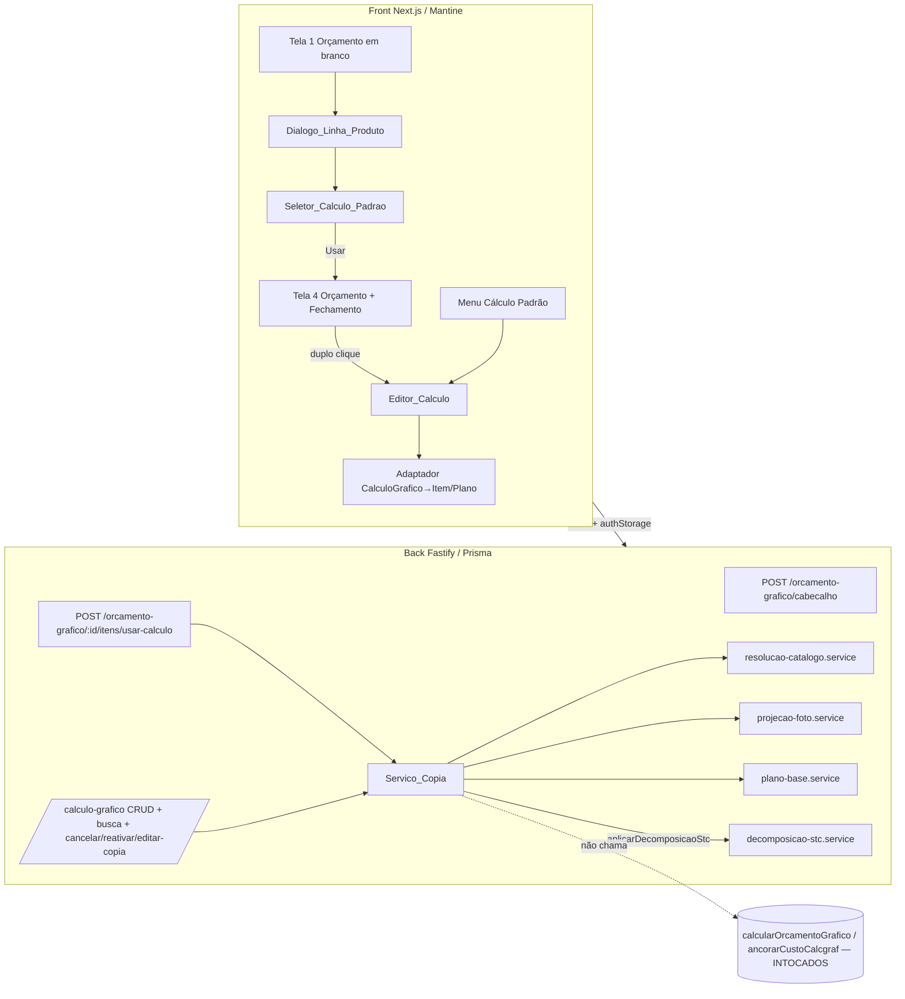
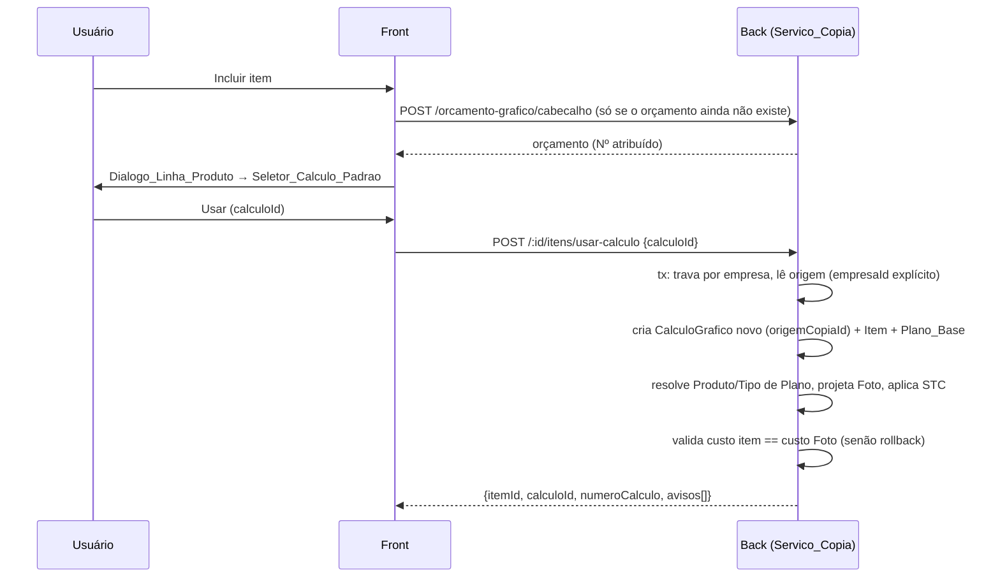

# Design Document — Orçamento Gráfico: paridade do fluxo legado

## Overview

O orçamento passa a seguir dois momentos separados: **Orçamento** (comercial) e **Cálculo Padrão** (biblioteca de engenharia). O item do orçamento é um `CalculoGrafico` próprio, criado por **cópia** do Cálculo Padrão escolhido. Editar o item nunca altera o padrão de origem.

Princípios do design:

1. **Motor intocado.** `calcularOrcamentoGrafico` e `ancorarCustoCalcgraf` não mudam (o `hierarquia/motor-guard.ts` continua passando). A cópia **não chama o motor**: grava custo, valor, margem, CM e CEV lidos da Foto.
2. **Um serviço de cópia, três usos.** "Usar" (item de orçamento), "Copiar" (item) e "Editar cálculo migrado/ancorado" (Menu Cálculo Padrão) usam o mesmo `Servico_Copia`.
3. **Aditivo.** Só colunas novas nulas/com default. Nenhum custo gravado é alterado.
4. **Dirigido por cadastro.** Produto, tipo de plano, campos visíveis e padrões vêm de `ProdutoGrafico`, `TipoPlanoGrafico` e `DefaultProdutoPlano`. Nenhum nome de produto no código.

### Pontos já existentes que o design reaproveita

| Existente | Uso nesta feature |
|---|---|
| `copiarCalculoParaItem(calc, novaQuantidade?)` (routes.ts) | Fonte da engenharia copiada para o item. Passa a ser chamada pelo `Servico_Copia`, sem alteração de comportamento. |
| `POST /orcamento-grafico/de-calculo` e `POST /:id/itens/de-calculo` | Mantidos. O fluxo novo ("Usar") chama o `Servico_Copia`; as rotas antigas ficam como estão (compatibilidade). |
| `ancorarCustoCalcgraf` (`calculoGraficoOrigemId` → `custosCalcgraf`) | **Não alterar.** Continua ancorando calcular/salvar do item. |
| `aplicarDecomposicaoStc(resultado, custosCalcgraf)` | Chamada pelo `Servico_Copia` para a Decomposição STC. |
| `mapearFotoPlanos` / `materializarPlanosDoCalculo` | Base para montar o Plano_Base. |
| `criarCalculoGrafico`, `buscarCalculosGraficos`, `obterCalculoGrafico` | Numeração, busca (Seletor/Menu/Listagem) e leitura. |
| `GET /calculo-grafico/:id/memoria-stc` | Fonte do Pré-Cálculo em PDF (Fase 3). |
| `OrcamentoGrafico.serie`, `dataOrcamento`, `linhaProdutoId` | Cabeçalho do orçamento em branco. |

## Architecture



### Fluxo "Usar" (Fase 1)



## Components and Interfaces

### Backend (`src/modules/orcamento-grafico/`)

**`calculo-grafico/calculo-copia.service.ts`** — `Servico_Copia`.

```ts
type ModoCopia = 'ITEM' | 'PADRAO' | 'EDICAO'

interface CopiarCalculoParams {
  empresaId: string          // da sessão
  usuarioId: string
  origemId: string
  modo: ModoCopia
  orcamentoId?: string       // obrigatório quando modo = 'ITEM'
  novaQuantidade?: number
}

interface CopiarCalculoResultado {
  calculoId: string
  numeroCalculo: number
  itemId?: string            // só em 'ITEM'
  avisos: AvisoCopia[]
}

type AvisoCopia =
  | { codigo: 'PRODUTO_NAO_RESOLVIDO' | 'TIPO_PLANO_NAO_RESOLVIDO'; campo: 'produtoGraficoId' | 'tipoPlanoId' }
  | { codigo: 'FOTO_SEM_CAMPOS'; campos: Array<'margemSelecionada' | 'margem' | 'cm' | 'cev'> }
  | { codigo: 'DECOMPOSICAO_INDISPONIVEL' }
  | { codigo: 'PLANO_BASE_NAO_PREENCHIDO' }
```

Comportamento: executa tudo em **uma** `prisma.$transaction`. Falha de cópia, de item ou divergência de custo reverte tudo. Falhas de resolução e de Foto incompleta **não** abortam (geram aviso). Falha ao montar o Plano_Base também não aborta o item (aviso `PLANO_BASE_NAO_PREENCHIDO`, req. 8.6), pois roda dentro de um `savepoint` (try/catch em torno de `tx.$executeRaw SAVEPOINT`/`ROLLBACK TO`) ou, equivalente, é gravado por último e a falha é capturada antes do commit sem tocar nos demais registros.

**Numeração por empresa.** Dentro da transação: `SELECT pg_advisory_xact_lock(hashtext($empresaId))`, depois `max(numero) + 1` filtrado por `empresaId`. O lock serializa cópias concorrentes da mesma empresa; `@@unique([empresaId, numero])` continua como rede de segurança (P2002 → uma repetição). Como o número é `max+1` e não uma sequence, um rollback não consome número (req. 10.12). Mesmo padrão de `criarCalculoGrafico`, com o lock a mais.

**Guarda de empresa.** Lê o origem com `findUnique({id})` apenas para distinguir 404 (não existe) de 403 (outra empresa), como `/de-calculo` já faz; nenhum campo do origem de outra empresa é devolvido. Todo registro criado recebe o `empresaId` do **cálculo de origem** (req. 17.3). Toda query filtra `empresaId` explicitamente.

**`calculo-grafico/resolucao-catalogo.service.ts`** (funções puras sobre listas já carregadas):

```ts
resolverProdutoGrafico(calc, produtosAtivos): { id: string | null; motivo?: 'ZERO' | 'MULTIPLOS' }
resolverTipoPlano(produto, defaults, tiposPlano): { id: string | null; motivo?: 'ZERO' | 'MULTIPLOS' }
```

- Produto: candidatos = `ProdutoGrafico` ativos da empresa com `tipoEmbalagemId == calc.tipoEmbalagemId`. Se houver mais de um, desempata pelo nome normalizado (sem acento, minúsculo) igual a `calc.produto`. Resolvido só se sobrar **exatamente 1**. O caso `CG-PROD-7` ("Impressos (aberto/fechado)") sai desse cadastro; o código não cita o nome.
- Tipo de plano: candidatos = `DefaultProdutoPlano` do produto. 1 candidato → ele. Mais de 1 → filtra `TipoPlanoGrafico.fixo`; se sobrar 1, ele. Senão não resolvido.
- Não resolvido nunca é "chutado": o campo fica `null` e vai um aviso.

**`calculo-grafico/projecao-foto.service.ts`** (puro):

```ts
projetarFoto(foto): {
  margemSelecionada: number | null
  margemPerc: number | null
  cmPerc: number | null
  cevPerc: number | null
  faltantes: Array<'margemSelecionada' | 'margem' | 'cm' | 'cev'>
}
```

Lê os valores da Foto rica (`versaoFoto: 2`: faixa selecionada de `margens`, `valorContMarginal`/CM, `cev`) sem arredondar. Os nomes exatos dos campos seguem `foto-rica.types.ts` (confirmar na tarefa de implementação). Valor ausente → `null` + entrada em `faltantes`.

**`calculo-grafico/plano-base.service.ts`** (puro + gravação):

```ts
montarPlanoBase(calc, foto): {
  nome: 'Base'
  suporte: { nome, gramatura } | null
  formatoCorte: { larguraMm, alturaMm } | null
  cores: Array<{ nome, cobertura }>
  coberturaTinta: number | null
  atividades: string[]
  custoPlano: number | null          // R$, 2 casas
}
```

Campo ausente fica `null`/lista vazia: sem default, sem zero, sem inferência (req. 8.5).

**Rotas novas** (todas `authenticate`, empresaId explícito, 404 idêntico para inexistente/outra empresa nas rotas de leitura/alteração):

| Rota | Função |
|---|---|
| `POST /orcamento-grafico/:id/itens/usar-calculo` | `Servico_Copia` modo `ITEM`. 201 `{itemId, calculoId, numeroCalculo, avisos}`; 403 outra empresa; 404 inexistente. |
| `POST /orcamento-grafico/:id/itens/:itemId/copiar` | Já existe (`item-copia.service`). Passa a criar também o `CalculoGrafico` novo e vincular (Req. 7.10). |
| `POST /calculo-grafico/:id/incluir` | Cria Cálculo Padrão novo em branco (`origem = VIZOR`, status RASCUNHO). |
| `POST /calculo-grafico/:id/copiar` | `Servico_Copia` modo `PADRAO`. |
| `POST /calculo-grafico/:id/editar` | Se `origem = MIGRADO_CALCGRAF` **ou** há custo ancorado (`custoProducao` e `valorTotal` gravados com `custosCalcgraf`/Foto do sistema anterior), `Servico_Copia` modo `EDICAO` e devolve o cálculo novo; senão devolve o próprio id sem copiar. |
| `POST /calculo-grafico/:id/cancelar` / `reativar` | Atualiza `cancelado`, `statusAnterior`, `status`. |
| `GET /calculo-grafico` | Já existe; ganha filtro `cancelado` e `semCliente` e paginação 50 (Menu) / 20 (Listagem). Teto 500 no Seletor. |
| `GET /calculo-grafico/:id/pre-calculo.pdf` | Fase 3. pdfkit, sem marca legada. |

**Orçamento em branco.** Nada de back novo: o orçamento só nasce em `POST /orcamento-grafico/cabecalho` (já existente), chamado por "Salvar" ou "Incluir item". O Nº usa `max(numero) + 1` por empresa e série dentro de transação com o mesmo advisory lock (req. 1.3/1.10). O Front deixa de chamar a rota ao abrir.

### Frontend (`src/app/(interna)/orcamento-grafico/`)

| Arquivo | Mudança |
|---|---|
| `NovoOrcamentoModal.tsx` | Deixa de ser "cria e redireciona". Vira abertura de **rascunho em memória** (série, data America/Sao_Paulo, Nº "auto"). A chamada a `/cabecalho` só ocorre em Salvar/Incluir item. |
| `[id]/page.tsx` (+ componente novo `DialogoLinhaProduto.tsx`) | "Incluir item" abre o diálogo de linha → seletor. |
| `[id]/BuscaCalculoModal.tsx` | Vira `SeletorCalculoPadrao`: filtros e colunas da Tela 3, ação "Usar" → `usar-calculo`. |
| `biblioteca-calculos/page.tsx` | Renomeada no menu para "Cálculo Padrão" (Fase 2). Compartilha o componente de filtros/colunas com o Seletor (`_calculo-padrao/FiltrosCalculo.tsx`, `ColunasCalculo.tsx`). |
| `_calculo-padrao/EditorCalculo.tsx` | Fase 2. Casca do editor + **adaptador**. |
| `_calculo-padrao/adaptadorCalculo.ts` | Funções puras `calculoParaItemForm` / `itemFormParaCalculo`. Reaproveitam `itemFormShared.ts`. |
| `listagem-calculos/page.tsx`, `pre-calculo/page.tsx` | Fase 3. |

**Adaptador do Editor_Calculo.** O editor reutiliza os componentes de Item e Plano existentes (`itens/[itemId]/_item/*`, `BlocoPlanoUnico`, TelaPlano) sem criar tela nova. O adaptador converte `CalculoGrafico ⇄ forma do item` e injeta um "repositório" (`salvar`, `carregarPlanos`, `salvarPlano`) que aponta para `/calculo-grafico/:id/...` em vez de `/orcamento-grafico/:id/itens/:itemId/...`. Quando o editor abre a partir de um item do orçamento, o repositório aponta para o cálculo **do item** (`item.calculoGraficoId`), nunca para o padrão de origem. Visibilidade de campos e padrões vêm do `ProdutoGrafico` carregado (`modoFormato`, `exibeRestricoes`, `exibeInformacoesComplementares`, `semImpressao`, `formatoPadrao*`, `DefaultProdutoPlano`).

**Sessão e tema.** Token e empresa só via `authStorage`. Cores só por tokens Mantine. Os testes já existentes (`sem-cores-fixas.test.ts`, `sessao-sem-storage-direto.test.ts`, `texto-visivel-sem-marca-legada.test.ts`) passam a incluir os arquivos novos. Troca de empresa invalida as queries (`queryClient.clear()` + refetch) e limpa o rascunho em memória.

## Data Models

### Colunas aditivas

`CalculoGrafico`:

| Coluna | Tipo | Observação |
|---|---|---|
| `origemCopiaId` (`origem_copia_id`) | `String?` | Id do Cálculo Padrão de onde esta cópia nasceu. Sem `@relation` (padrão do módulo). |
| `cancelado` | `Boolean @default(false)` | Marcação de cancelado. |
| `statusAnterior` (`status_anterior`) | `String? @db.VarChar(20)` | Status antes do cancelamento; restaurado em "Reativar". |
| índice | `@@index([empresaId, cancelado])`, `@@index([empresaId, origemCopiaId])` | Filtro do Seletor e rastreio de cópias. |

`ItemOrcamentoGrafico` (decisão a confirmar, ver abaixo):

| Coluna | Tipo | Observação |
|---|---|---|
| `calculoGraficoId` (`calculo_grafico_id`) | `String?` | O cálculo **próprio** do item. `calculoGraficoOrigemId` (já existe) continua sendo o Cálculo Padrão de origem e a chave da ancoragem. |

Decisão de modelagem: os requisitos pedem que o item aponte para o cálculo novo **e** para a origem. Hoje só existe `calculoGraficoOrigemId`. Em vez de reinterpretar essa coluna (o que mudaria a entrada de `ancorarCustoCalcgraf`), o design adiciona `calculoGraficoId`. Se o time preferir manter só `origemCopiaId` em `CalculoGrafico`, a alternativa é achar o cálculo do item por `CalculoGrafico.itemId`; fica mais frágil, por isso não foi escolhida.

`tipoPlanoId` do item: o Plano_Base grava `tipoPlanoId` (coluna já existe em `PlanoCalculoGrafico`). Se `ItemOrcamentoGrafico` não tiver a coluna, ela entra na mesma migração como `String?` (confirmar no schema antes de implementar).

### Schema + `migrate-prod.ts` (mesmo commit)

```sql
ALTER TABLE calculo_grafico ADD COLUMN IF NOT EXISTS origem_copia_id TEXT;
ALTER TABLE calculo_grafico ADD COLUMN IF NOT EXISTS cancelado BOOLEAN NOT NULL DEFAULT false;
ALTER TABLE calculo_grafico ADD COLUMN IF NOT EXISTS status_anterior VARCHAR(20);
CREATE INDEX IF NOT EXISTS calculo_grafico_empresa_cancelado_idx ON calculo_grafico (empresa_id, cancelado);
CREATE INDEX IF NOT EXISTS calculo_grafico_empresa_origem_copia_idx ON calculo_grafico (empresa_id, origem_copia_id);
ALTER TABLE item_orcamento_grafico ADD COLUMN IF NOT EXISTS calculo_grafico_id TEXT;
```

Todas nulas ou com `DEFAULT`; nenhuma linha existente é rejeitada e nenhum valor de custo é tocado (req. 18.5/18.6). Sem `ADD CONSTRAINT`. A unicidade `(empresa_id, numero)` já existe e é preservada.

### Plano_Base (somente exibição)

Persistido como uma linha de `PlanoCalculoGrafico` (`nome = 'Base'`) com:
- `especificacao = { versao: 1, base: true, somenteExibicao: true, suporte, formatoCorte, cores, coberturaTinta, atividades, custoPlano }`;
- `resultadoCalculo = null` e colunas `custo*` nulas.

Risco conhecido: a reconsolidação do item por planos (trecho de `orcamento-grafico.routes.ts` que usa `somaPlanos`, ~linha 6509) trocaria o custo do item pela soma dos planos. Para o Plano_Base não alterar valor, essa reconsolidação passa a **ignorar** planos com `especificacao.somenteExibicao === true` (filtro de uma linha, fora de `calcularOrcamentoGrafico` e de `ancorarCustoCalcgraf`). Um teste cobre: item com e sem Plano_Base têm o mesmo custo e valor (req. 8.3). O front trata `somenteExibicao` como leitura (campos desabilitados na TelaPlano).

## Fases

| Fase | Entrega | Requisitos |
|---|---|---|
| **1** | Schema+migração; `Servico_Copia`; resolução; projeção; STC; Plano_Base; rota `usar-calculo`; rota `copiar` com cálculo próprio; Telas 1–4 (orçamento em branco, observações da empresa, diálogo de linha, seletor, grade, painel, Fechamento); testes de regressão do 12992. | 1–9, 16–18, 20 |
| **2** | Menu Cálculo Padrão (incluir/editar/copiar/cancelar/reativar); editar migrado gera cópia; Editor_Calculo + adaptador; dirigido por cadastro (19); backfill do orçamento nº 3 (script dry-run por padrão). | 10–13, 19 |
| **3** | Listagem de Cálculos; Pré-Cálculo em PDF. | 14, 15 |

Backfill (Req. 13): `scripts/backfill-orcamento-3.ts`, `--empresa <id>` obrigatório, `DATABASE_URL_PROD` por env, dry-run por padrão, `--apply` para gravar. Reutiliza `resolucao-catalogo`, `projecao-foto` e `plano-base` (mesmas funções puras do serviço). Uma transação; reverte se o 12992 sair de R$ 5.192,05 / R$ 15.084,04. Segunda execução altera 0 registros (só escreve onde o campo difere do valor calculado).


## Correctness Properties

*Uma propriedade é uma característica ou comportamento que deve valer em todas as execuções válidas de um sistema; é uma afirmação formal sobre o que o sistema deve fazer. As propriedades fazem a ponte entre a especificação legível por pessoas e as garantias de correção verificáveis por máquina.*

As propriedades abaixo valem para as funções puras do `Servico_Copia` e para o serviço executado sobre um banco de teste. Propriedades redundantes foram consolidadas (ver reflexão no prework).

### Property 1: Numeração por empresa é max+1 e sem repetição
*Para qualquer* conjunto de números existentes por empresa (e série, no caso de orçamento) e qualquer número de criações concorrentes, o próximo número é `max+1` calculado só sobre a empresa (ou 1 se vazio), e dois registros da mesma empresa nunca recebem o mesmo número.
**Validates: Requirements 1.3, 1.10, 5.1, 5.3, 10.5**

### Property 2: A cópia é um cálculo novo e fiel
*Para qualquer* Cálculo Padrão de origem, a cópia tem número maior que o maior da empresa, `origemCopiaId` igual ao id da origem, e todos os campos de engenharia e o custo de produção idênticos aos da origem. Copiar duas vezes gera dois números distintos entre si e distintos do da origem.
**Validates: Requirements 5.1, 5.2, 5.3, 10.6, 11.1, 11.5**

### Property 3: A origem permanece intacta
*Para qualquer* cópia criada e *para qualquer* edição, salvamento ou descarte aplicado à cópia, todos os campos persistidos da origem (número, engenharia, Foto, custo) permanecem idênticos aos anteriores à cópia.
**Validates: Requirements 5.6, 11.2, 20.2**

### Property 4: Atomicidade da criação
*Para qualquer* ponto de falha injetado durante a criação do cálculo, do item ou do Plano_Base de cópia, a contagem de `CalculoGrafico` e de `ItemOrcamentoGrafico` da empresa fica igual à anterior à tentativa e o número não é consumido.
**Validates: Requirements 5.4, 5.5, 6.13, 10.12, 11.6**

### Property 5: Guarda de empresa na cópia
*Para qualquer* origem de empresa diferente da sessão, a operação retorna 403 sem criar registro e sem revelar campos da origem. *Para qualquer* id inexistente, retorna 404. *Para qualquer* cópia bem-sucedida, todo registro criado carrega o `empresaId` da origem.
**Validates: Requirements 5.7, 5.8, 17.3, 17.4, 20.5**

### Property 6: Resolução única de produto e tipo de plano
*Para qualquer* cadastro e cálculo, `produtoGraficoId`/`tipoPlanoId` só são preenchidos quando existe exatamente 1 candidato ativo; com 0 ou 2 ou mais candidatos o campo fica nulo e o resultado traz o aviso indicando qual identificador ficou vazio. Os demais dados do item são preservados.
**Validates: Requirements 6.1, 6.2, 6.3**

### Property 7: Projeção da Foto sem alteração de valor
*Para qualquer* Foto, `margemSelecionada`, margem, CM e CEV do item são iguais aos da Foto, sem arredondamento; cada campo ausente na Foto fica nulo e aparece em `faltantes`.
**Validates: Requirements 6.4, 6.5**

### Property 8: Decomposição STC fecha com o custo
*Para qualquer* Foto com custos por componente, `MD + CT + SE` do item difere do custo de produção da Foto em no máximo R$ 0,01; sem componentes, o item mantém o custo total e o aviso de decomposição indisponível.
**Validates: Requirements 6.6, 6.7**

### Property 9: Regra da sigla
*Para qualquer* lista de siglas de um cálculo, a sigla exibida/gravada é "(vários)" quando há mais de uma sigla distinta e a própria sigla quando há exatamente uma.
**Validates: Requirements 4.9, 6.9, 6.10**

### Property 10: Custo e valor do item são os da Foto
*Para qualquer* cálculo migrado copiado, custo de produção e valor do item são iguais aos da Foto com diferença R$ 0,00, sem invocar o motor. *Para qualquer* divergência injetada, a criação é cancelada sem item parcial e retorna erro de divergência de custo.
**Validates: Requirements 6.12, 9.6, 9.7, 20.3**

### Property 11: Ancoragem preservada ao calcular e salvar
*Para qualquer* item com `calculoGraficoOrigemId` válido, o custo de produção após calcular ou salvar é igual ao custo do cálculo de origem (diferença R$ 0,00). *Para qualquer* item sem origem, ou com origem inexistente, o custo vem do motor sem ancoragem e sem erro.
**Validates: Requirements 9.4, 9.5, 20.6**

### Property 12: Plano_Base fiel, vazio onde falta, sem efeito no valor
*Para qualquer* cálculo copiado, cada campo do Plano_Base presente na origem é copiado e cada campo ausente fica vazio, sem default, zero ou inferência. *Para qualquer* item, reconsolidar com ou sem o Plano_Base resulta no mesmo custo e valor.
**Validates: Requirements 8.1, 8.2, 8.3, 8.4, 8.5**

### Property 13: Busca de cálculos (Seletor, Menu e Listagem)
*Para qualquer* acervo e *para quaisquer* filtros preenchidos, o resultado é exatamente o conjunto de cálculos da empresa da sessão que atendem a todos os filtros ao mesmo tempo (texto por trecho, sem diferenciar caixa e acento; Nº cálculo por valor exato), com cancelados omitidos quando o filtro está desmarcado e somente cancelados quando marcado, ordenado por número decrescente e limitado a 500. A paginação de 50 (Menu) e 20 (Listagem) cobre o mesmo resultado sem repetir nem perder linhas.
**Validates: Requirements 4.3, 4.4, 4.5, 4.6, 4.7, 4.8, 10.2, 10.3, 10.9, 14.2, 14.4**

### Property 14: Isolamento de consultas por empresa
*Para qualquer* par de empresas com registros de mesmo número ou código, qualquer consulta, busca, leitura por id ou alteração feita na sessão da empresa A devolve apenas registros de A (inclusive para SUPER_ADMIN) e retorna 404 para registros de B, sem alterá-los.
**Validates: Requirements 10.10, 10.11, 14.3, 17.1, 17.2, 17.5, 17.6**

### Property 15: Cancelar e reativar é ida e volta; ações dependem do status
*Para qualquer* cálculo não cancelado, cancelar e depois reativar restaura `status` e `cancelado` aos valores originais e mantém o registro. As ações permitidas são Incluir/Editar/Copiar/Cancelar para não cancelados e somente Reativar/Copiar para cancelados.
**Validates: Requirements 10.4, 10.7, 10.8**

### Property 16: Decisão de edição por origem
*Para qualquer* cálculo, "Editar" cria cópia (rascunho, origem VIZOR) sse a origem é migrada ou há custo ancorado; caso contrário abre o próprio cálculo sem copiar nem consumir número.
**Validates: Requirements 11.1, 11.4**

### Property 17: Adaptador do Editor_Calculo e validação
*Para qualquer* `CalculoGrafico` válido, converter para a forma do item e voltar produz o mesmo cálculo. *Para qualquer* Tiragem fora de 1 a 999.999.999, sigla com mais de 60 caracteres ou plano acima do limite de 20, a validação rejeita e aponta o campo.
**Validates: Requirements 12.1, 12.2, 12.4, 12.10**

### Property 18: Visibilidade e padrões vêm do cadastro
*Para qualquer* `ProdutoGrafico`, os campos visíveis e valores iniciais do editor são função exclusiva de `modoFormato`, `exibeRestricoes`, `exibeInformacoesComplementares`, `semImpressao`, `formatoPadrao*` e do plano fixo (`DefaultProdutoPlano`/`TipoPlanoGrafico.fixo`); trocar o produto reavalia tudo, sem comparar nome de produto.
**Validates: Requirements 12.3, 12.7, 19.1, 19.2, 19.3, 19.4, 19.5, 19.6, 19.7, 19.8**

### Property 19: Totalizador do Fechamento e formatação
*Para qualquer* orçamento, o Valor Total do Fechamento por tiragem é a soma dos valores dos itens daquela tiragem, e os valores dos itens permanecem inalterados. Valor Unitário usa 5 casas, Margem e C.Marg. 2 casas, Valor Total R$ com 2 casas; o modelo do Pré-Cálculo em PDF usa os mesmos valores com 2 casas e nenhum texto contém marca do sistema legado.
**Validates: Requirements 7.4, 7.6, 15.3, 15.4**

## Error Handling

| Situação | Resposta | Efeito |
|---|---|---|
| Origem inexistente | 404 `Cálculo não encontrado` | Nada criado |
| Origem de outra empresa | 403 `Acesso negado: cálculo de outra empresa` | Nada criado, sem eco de campos |
| Leitura/alteração de registro de outra empresa (Menu, Listagem, PDF) | 404 idêntico ao inexistente | Nada alterado |
| Falha na transação de cópia | 500 `A operação não foi concluída` | Rollback total; número não consumido |
| P2002 em `(empresaId, numero)` | 1 repetição; persistindo, 409 | Rollback |
| Divergência custo item × Foto | 422 `Divergência de custo na cópia` | Rollback, nenhum item parcial |
| Produto/Tipo de plano não resolvido | 201 + aviso `*_NAO_RESOLVIDO` | Item criado com campo nulo |
| Foto sem margem/CM/CEV | 201 + aviso `FOTO_SEM_CAMPOS` | Campos ausentes vazios |
| Foto sem custos por componente | 201 + aviso `DECOMPOSICAO_INDISPONIVEL` | Mantém custo total |
| Falha ao montar Plano_Base | 201 + aviso `PLANO_BASE_NAO_PREENCHIDO` | Item sem Plano_Base, valor intacto |
| Validação Zod | 400 `Dados inválidos — campo: motivo` (handler global existente) | Front mostra cada campo |
| Erro de rede/servidor na UI | Mensagem específica por tela (reqs. 2.5, 4.11, 12.11, 14.7, 15.7) | Filtros e dados digitados preservados |
| Cadastro do Produto_Grafico não carrega | Mensagem + bloqueio de salvar (19.10) | Dados digitados preservados |
| PDF sem Foto nem STC | `Cálculo sem memória de cálculo disponível` | Sem arquivo |
| Troca de empresa com falha de recarga | Limpa dados anteriores + "Tentar novamente" (16.7) | Sem dado da empresa anterior |

Mensagens visíveis nunca citam o sistema legado nem fornecedores.

## Testing Strategy

**PBT é aplicável.** O núcleo (numeração, resolução, projeção, decomposição, Plano_Base, busca, totalizador, adaptador, visibilidade por cadastro) é lógica pura ou serviço sobre banco de teste. Telas, infraestrutura e backfill usam testes de exemplo e de integração.

**Biblioteca:** `fast-check` com `vitest`, já usados no projeto. Mínimo de **100 iterações** por propriedade. Cada propriedade é implementada por **um** teste, com o comentário `Feature: orcamento-grafico-paridade-fluxo-legado, Property N: <texto>`. Sem implementar PBT do zero.

**Propriedades × arquivos**
- Back puros: `calculo-copia.service.test.ts` (P1, P2, P4–P5 com mock de `tx`), `resolucao-catalogo.service.test.ts` (P6), `projecao-foto.service.test.ts` (P7), `decomposicao-stc.service.test.ts` (P8, já existe; estender), `plano-base.service.test.ts` (P9, P12), `busca-calculos.test.ts` (P13, P14), `calculo-status.service.test.ts` (P15, P16).
- Back com banco de teste: P3, P4, P10, P11 e P12 (não alteração de valor) rodam o serviço real sobre o Prisma de teste. P11 estende o teste de ancoragem existente.
- Front: `adaptadorCalculo.test.ts` (P17), `camposDoProduto.test.ts` (P18), `fechamentoTotais.test.ts` e `formatacao.test.ts` (P19), seguindo o padrão de `itemFormShared.roundtrip.test.ts`.

**Testes de exemplo e borda**
- **Regressão do 12992:** custo R$ 5.192,05, valor R$ 15.084,04, Margem 47,62%, C.Marg. 55,01%, VU 3,77101, nos três momentos (puxar, editar, salvar).
- Orçamento em branco: 0 chamadas de API até salvar; Nº "auto"; data America/Sao_Paulo.
- Modal "Observações da Empresa": abre com texto não branco; não abre com vazio.
- Diálogo de linha: sem linhas ativas, falha de carga, `Cancelar` abre o seletor sem filtro.
- Falha injetada no Plano_Base: item criado com aviso.

**Integração e smoke**
- `migrate-prod.ts` executado duas vezes em banco de teste sem erro; inserção de `(empresaId, numero)` duplicado é rejeitada; custos existentes inalterados.
- Backfill: dry-run não grava; `--apply` duas vezes altera 0 registros na segunda; falha reverte; ausência de `empresaId` ou de connection string sai com código ≠ 0.
- **Motor-guard:** `hierarquia/motor-guard` continua verde (hashes de `calcularOrcamentoGrafico` e `ancorarCustoCalcgraf` inalterados).
- Testes estáticos do front estendidos aos arquivos novos: sem marca legada, sem cores fixas, sem `localStorage`/`sessionStorage` direto, sem nomes fixos de produto/linha.
- Suíte do módulo `orcamento-grafico` com 0 falhas antes de cada fase ser dada como concluída.
- QA E2E (`test_03_orcamento_grafico.py`) atualizado para o novo fluxo ao fim da Fase 1.

**Pontos a confirmar ao implementar:** nomes exatos dos campos de margem/CM/CEV em `foto-rica.types.ts`; existência de `tipoPlanoId` em `ItemOrcamentoGrafico`; ponto exato da reconsolidação por `somaPlanos` onde entra o filtro `somenteExibicao`.
