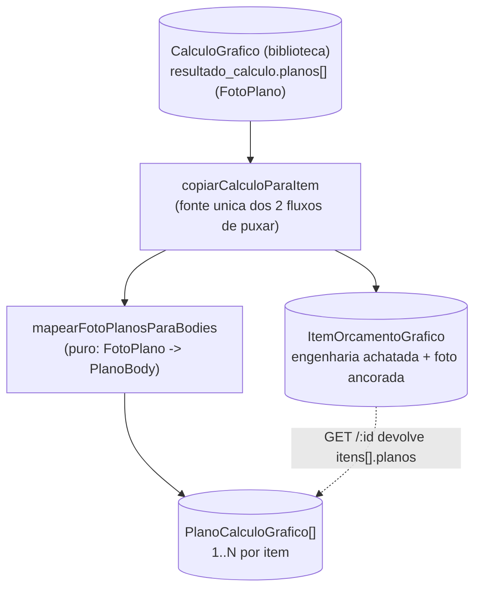

# Design — Planos fiéis ao Calcgraf no Orçamento Gráfico

## Visão geral

O orçamento gráfico do Calcgraf organiza a engenharia de cada item em
**Planos** (a janela "Tipo de Plano"): cada plano é uma folha/componente físico
com seu próprio suporte, cores, formato e acabamentos. Um item pode ter 1 plano
(cartucho/lâmina simples) ou vários (Cartucho Composto = Tampa+Fundo; Frente+
Costa). No Calcgraf **todo cálculo tem ao menos 1 plano** — nunca zero.

O Vizor já possui a estrutura de planos (`PlanoCalculoGrafico` + rotas CRUD +
`PlanosDoItem.tsx`), mas o fluxo de **"Puxar Cálculo"** da biblioteca
(`POST /:id/itens/de-calculo` e `POST /de-calculo`) **não materializa os planos**
— ele copia só a engenharia achatada no item. Resultado: um item puxado de um
cálculo multi-plano (ex.: 11121, Cartucho Composto, 2 planos) aparece como
"Nenhum plano neste item", divergindo do Calcgraf.

Este design corrige isso **reorganizando dado que já existe** — a foto rica de
cada cálculo migrado já contém `resultado_calculo.planos[]` (confirmado em
produção: 0 dos 7.951 migrados sem plano; 1.976 com 2+; 5.975 com 1). Nenhuma
re-exportação do SQL Server nem re-migração é necessária.

### Fatos confirmados na base restaurada (Calcgraf) e na foto rica (Vizor/prod)

| Métrica | Valor |
|---|---|
| Cálculos vigentes no Calcgraf | 8.062 |
| Com **0 planos** | **0** (nunca) |
| Com 1 plano | 6.051 (75%) |
| Com 2+ planos | 2.011 (25%) |
| Migrados no Vizor cuja foto já tem `planos[]` | 7.951 de 7.951 (0 sem) |
| Exemplo: cálculo 11121 (Cartucho Composto) | **2 planos** na foto |

Distribuição por linha de produto (Calcgraf):

| Linha | Total | 1 plano | 2+ planos |
|---|---|---|---|
| CARTUCHO | 4.934 | 4.785 | 149 |
| CARTUCHO COMPOSTO | 1.994 | 201 | **1.793** |
| LÂMINAS (Impressos) | 706 | 670 | 36 |
| LÂMINA SIMPLES | 252 | 250 | 2 |
| SACOLA | 176 | 145 | 31 |

## Escopo

**Dentro do escopo:**
1. Ao **puxar um cálculo** (criar item de orçamento novo OU adicionar item a um
   orçamento existente), materializar os `PlanoCalculoGrafico` a partir de
   `foto.planos[]` quando houver 2+ planos; e expor o plano único quando houver 1.
2. **Backfill** opcional/idempotente dos planos nos itens de orçamento já puxados
   antes desta mudança (só RASCUNHO — orçamentos enviados/aprovados são foto
   congelada e não se mexe).
3. Garantir que o **custo do item continua batendo** (não-regressão da ancoragem
   Calcgraf): os planos entram como detalhamento/exibição; a ancoragem do total
   permanece a fonte de verdade do custo do item puxado.
4. O GET do orçamento passa a devolver `itens[].planos` para o front hidratar a
   seção "Planos do Cálculo" sem chamada extra.

**Fora do escopo (não mexer agora):**
- Unificar o editor de item com a edição de planos numa só tela (reforma de UX).
  Fica como follow-up. Hoje a seção "Planos do Cálculo" já existe na tela de
  detalhe — basta vir preenchida.
- Recalcular/alterar a fórmula do motor. O custo continua ancorado no valor real.
- Re-exportar dados do SQL Server.

## Arquitetura



### Princípio de não-regressão

- A **ancoragem do custo** (valor real do Calcgraf no item) é preservada: o
  `custoProducao`/`valorTotal` do item continuam vindo da foto ancorada, NÃO da
  soma dos planos. Os planos são **detalhamento de engenharia/exibição** — não
  recalculam o total do item puxado (isso evitaria reintroduzir a divergência de
  ~5% do motor que a ancoragem resolveu).
- Itens de **plano único**: criar o `PlanoCalculoGrafico` "Plano 1" é opcional
  (ver Decisão D1). O item achatado já representa o plano único corretamente.

## Componentes e mudanças

### 1. Backend — mapeador puro `FotoPlano → PlanoBody`

Novo arquivo `calculo-grafico/foto-planos.service.ts` (função PURA, testável):

```ts
import type { FotoPlano } from './foto-rica.types'

export interface PlanoMapeado {
  nome: string
  suporteDescricao: string | null   // nome do suporte da foto (texto)
  gramatura: number | null
  numCores: number                  // derivado de coresFV ("2x0" -> 2)
  formatoLarguraMm: number | null   // parse de formatoAberto "284 x 488"
  formatoAlturaMm: number | null
  aproveitamento: number | null
  tiragem: number | null
}

/** Converte os planos da foto rica em bodies prontos para persistir.
 *  PURA: não resolve cadastro (suporteId fica null; o nome textual é
 *  preservado para exibição). Resiliente a campos ausentes. */
export function mapearFotoPlanos(planos: FotoPlano[] | undefined): PlanoMapeado[]
```

Detalhes de parsing (resilientes, sem lançar):
- `formatoAberto`/`formatoCorte` "284 x 488" → largura/altura (regex `(\d+)\s*x\s*(\d+)`).
- `coresFV` "2x0", "6x0", "4/0" → numCores = soma dos dois lados (frente+verso)
  ou o maior lado quando só um tem valor. Fallback 0.
- Campos nulos permanecem nulos (NUNCA inventa).

### 2. Backend — materializar planos no puxar (`copiarCalculoParaItem`)

`copiarCalculoParaItem` hoje retorna `{ dadosItem, fotoResultado }`. Passa a
retornar também `planosDaFoto: PlanoMapeado[]` (derivado de
`calc.resultadoCalculo.planos`). As duas rotas que chamam o helper
(`POST /:id/itens/de-calculo` e `POST /de-calculo`) passam a, **após criar o
item**, criar os `PlanoCalculoGrafico` correspondentes — reutilizando o mesmo
padrão de `dadosPersistenciaPlano` já usado pela rota "reaproveitar".

Regra de criação (Decisão D1):
- `planosDaFoto.length >= 2` → cria todos os planos (fiel ao multi-plano).
- `planosDaFoto.length <= 1` → cria **1 plano "Plano 1"** com a engenharia do
  item (para o item nunca aparecer "sem plano", espelhando o Calcgraf).

Os planos criados a partir da foto gravam `custoSuporte/Impressao/Acabamento = 0`
por ora (a foto rica traz esses subtotais em seções separadas — `suportes[]`,
`impressao[]`, `acabamentos[]` — cuja atribuição por plano é incremento futuro).
O custo exibido do item permanece a ancoragem. Isso é consistente com o
`fechamentoDoResultado` atual do `plano-calculo.service.ts` (que já zera esses
três por falta de granularidade no `ResultadoOrcamento`).

### 3. Backend — GET do orçamento devolve `itens[].planos`

O `GET /:id` do orçamento passa a incluir, para cada item, a lista de
`PlanoCalculoGrafico` (ordenada por `sequencia`), no formato que o
`PlanosDoItem.tsx` já espera via `planosIniciais`. Multi-tenant: filtro
`empresaId` explícito.

### 4. Backend — backfill idempotente dos itens já puxados

Script `scripts/backfill-planos-itens-orcamento.ts` (versionado, não `_tmp-`):
- Para cada `ItemOrcamentoGrafico` de orçamento **RASCUNHO** que tenha
  `calculoGraficoOrigemId` e **0 planos**, lê a foto do cálculo-origem, mapeia
  `foto.planos[]` e cria os `PlanoCalculoGrafico`.
- Idempotente: se o item já tem planos, ignora.
- Flags `--empresa`, `--dry-run`. Nunca toca orçamento não-RASCUNHO.

### 5. Frontend — nenhuma mudança estrutural

`PlanosDoItem.tsx` já renderiza `planosIniciais`. Basta o GET passar a devolver
`itens[].planos`. A página de detalhe (`[id]/page.tsx`) já monta o componente.
(Possível ajuste menor: garantir que `planosIniciais` é lido do novo campo.)

## Modelo de dados

**Nenhuma mudança de schema.** `PlanoCalculoGrafico` já existe com todos os
campos necessários (`sequencia`, `nome`, `suporteId`, `gramatura`,
`formatoLarguraMm/AlturaMm`, `numCores`, `custoSuporte/Impressao/Acabamento`).
Como não há `ALTER TABLE`, não há alteração em `migrate-prod.ts`.

## Decisões de design

- **D1 — Plano único também materializa "Plano 1"?** SIM. Para o item nunca
  exibir "Nenhum plano" (fidelidade ao Calcgraf, onde todo cálculo tem ≥1 plano)
  e para dar base visual consistente. Alternativa (não escolhida): só materializar
  quando 2+. Rejeitada porque mantém a sensação de "está faltando" no caso comum.
- **D2 — Suporte do plano fica como texto ou resolve `suporteId`?** Texto (nome
  da foto) por ora; `suporteId` fica null. Resolver o cadastro por nome é um
  de-para frágil (nomes divergem Calcgraf↔Vizor) e é incremento futuro. O
  `PlanosDoItem` já exibe o nome e permite o operador escolher o suporte.
- **D3 — Planos recalculam o total do item?** NÃO. O total do item puxado é a
  ancoragem Calcgraf (diferença zero). Planos são detalhamento. Isso protege a
  não-regressão de custo já validada.
- **D4 — Backfill mexe em orçamentos enviados/aprovados?** NÃO. Só RASCUNHO.
  Documentos comerciais emitidos são foto congelada.

## Property / correctness

- **P1 (conservação):** `mapearFotoPlanos(foto.planos).length === foto.planos.length`
  quando a foto tem 2+ planos; e um plano "Plano 1" quando 0/1 (D1).
- **P2 (não-inventar):** campo da foto ausente/null ⇒ campo mapeado null (nunca
  valor fabricado).
- **P3 (não-regressão de custo):** criar planos NÃO altera `item.custoProducao`
  nem `item.valorTotal` (continuam a ancoragem).
- **P4 (idempotência do backfill):** rodar 2× não duplica planos.
- **P5 (parsing de formato):** `"284 x 488"` → `{284, 488}`; entrada inválida →
  `{null, null}` sem lançar.

## Testes

- `foto-planos.service.test.ts` (vitest + fast-check): P1, P2, P5 — golden com o
  11121 (2 planos: Cartão 181g 284×488 e Cartão 230g 284×488) + property de
  parsing/conservação.
- Teste de integração do puxar: item do 11121 nasce com 2 planos; item de
  cartucho simples nasce com 1 plano; custo do item inalterado (P3).

## Verificação

- `get_diagnostics` limpo nos arquivos tocados.
- Backfill rodado com `--dry-run` antes do `--apply`.
- Validar na tela: puxar o 11121 → seção "Planos do Cálculo" mostra 2 planos.

## Impacto / rollback

- Aditivo. Não altera schema. Não altera o motor. Não altera o custo do item.
- Rollback: reverter o código das rotas de puxar e do GET; os planos criados
  ficam inertes (a seção já tolera lista vazia). O backfill é idempotente e só
  acrescenta planos em RASCUNHO.
