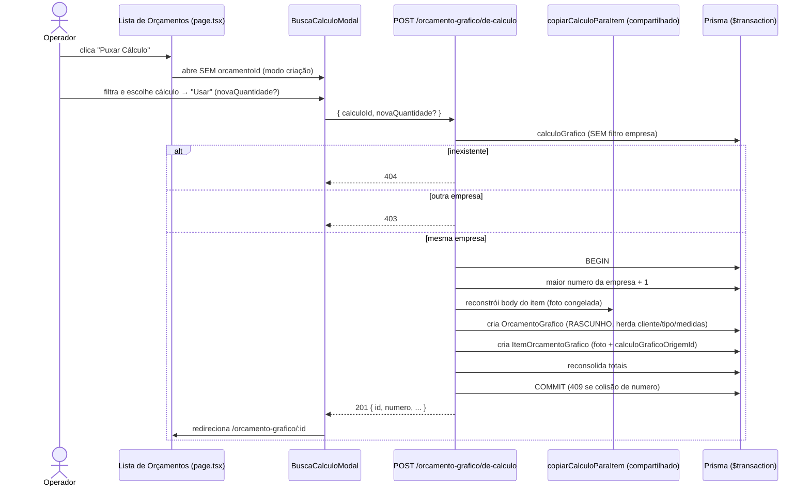

# Design Document

## Overview

Esta feature fecha um gap de FLUXO: hoje o operador só consegue "Puxar Cálculo"
(reaproveitar um `CalculoGrafico` da Biblioteca por cópia da foto congelada)
quando o orçamento JÁ existe, via `POST /api/orcamento-grafico/:id/itens/de-calculo`
e o componente `BuscaCalculoModal` (que recebe `orcamentoId` por prop). Falta
oferecer o mesmo reaproveitamento LOGO no ponto de criação, quando o orçamento
ainda não existe — igual ao "Localiza o Cálculo Padrão" do Calcgraf.

Princípio-mestre: **reaproveitar o que já existe**. Não há motor novo, não se
reescreve a cópia de foto, não se toca o PCP. A engenharia de cópia da foto
congelada (`registroParaEngenharia` → `calculoParaItemBody` →
`dadosPersistenciaItem`) já está validada e permanece a mesma; o que muda é
oferecer um caminho que cria o orçamento rascunho e o primeiro item numa
operação única, e adaptar a UI para começar a partir da lista de orçamentos.

### Decisão de design (abordagem A vs B)

O gap é: puxar um cálculo quando AINDA NÃO existe orçamento. Duas abordagens
foram consideradas:

- **(A) Rota backend atômica nova** `POST /api/orcamento-grafico/de-calculo`:
  numa única transação, cria o `OrcamentoGrafico` rascunho (herdando
  cliente/tipoEmbalagem/medidas do cálculo, número sequencial) e o
  `ItemOrcamentoGrafico` copiado da foto, retornando o orçamento criado (com
  `id`) para o front redirecionar.
- **(B) Só frontend, duas chamadas**: o modal, ao "Usar" sem `orcamentoId`,
  primeiro cria o orçamento via `POST /orcamento-grafico` (que HOJE exige
  `tipoEmbalagemId` + `medidas` → precisaria buscar antes via
  `GET /calculo-grafico/:id`) e depois chama `/itens/de-calculo`.

**Escolha: abordagem (A).** Justificativa, preferindo a mais simples e de menor
risco:

1. **Atomicidade.** Em B, se a 2ª chamada (`/itens/de-calculo`) falhar, o
   sistema fica com um **orçamento órfão** (criado, sem item) — exatamente o
   estado que o Requirement 7 e as propriedades de correção querem impedir. Em A,
   orçamento + item nascem na mesma transação Prisma (`$transaction`): ou os dois
   existem, ou nenhum.
2. **Isolamento garantido no backend.** A verificação cross-tenant (404
   inexistente / 403 de outra empresa) e a gravação do `empresaId` real do
   cálculo ficam num único ponto do servidor, não dependem de orquestração do
   cliente.
3. **Menos ida-e-volta e menos acoplamento de UI.** B obriga o front a conhecer
   os campos exigidos por `POST /orcamento-grafico` (tipoEmbalagem/medidas) e a
   buscá-los do cálculo antes — reintroduzindo lógica que a rota A já encapsula.
4. **Reúso real.** A rota A usa internamente a MESMA lógica de cópia de foto do
   `/itens/de-calculo` (ver "Serviço compartilhado de cópia" abaixo), sem
   duplicar o motor.

## Architecture



O fluxo "dentro de um orçamento existente" (`/:id/itens/de-calculo`) permanece
inalterado. A rota nova é um irmão no mesmo arquivo de rotas.

## Components and Interfaces

### Backend

**Rota nova — `POST /api/orcamento-grafico/de-calculo`**
(em `src/modules/orcamento-grafico/orcamento-grafico.routes.ts`)

Assinatura:

```
POST /api/orcamento-grafico/de-calculo
Body: { calculoId: string (uuid), novaQuantidade?: number (int > 0) }
→ 201 { orçamento criado, com id, numero, ... }  (orcamentoGraficoSelect)
→ 404 cálculo inexistente
→ 403 cálculo de outra empresa
→ 409 colisão de número por empresa
```

Fluxo interno (espelha o guard multi-tenant já usado em `/itens/de-calculo`):

1. Carrega `calculoGrafico` por id **sem** filtro de empresa → distingue 404
   (inexistente) de 403 (empresa diferente), conforme Req 6.2/6.3.
2. Carrega o cálculo COMPLETO isolado por `empresaId` (`obterCalculoGrafico`).
3. Dentro de `prisma.$transaction`:
   - gera `numero = (maior numero da empresa) + 1`;
   - cria `OrcamentoGrafico` RASCUNHO herdando os campos do cálculo (ver
     "Herança de campos");
   - reconstrói o body do item (`registroParaEngenharia` →
     `calculoParaItemBody`; `novaQuantidade` sobrepõe a tiragem quando > 0) e
     cria o `ItemOrcamentoGrafico` por CÓPIA da foto
     (`dadosPersistenciaItem(itemBody, fotoResultado)`), gravando
     `calculoGraficoOrigemId = calc.id` (rastreabilidade);
   - reconsolida os totais do orçamento.
4. `P2002` na criação do orçamento (unique `empresaId,numero,versao`) → 409 sem
   persistir (a transação faz rollback do item junto).

**Serviço compartilhado de cópia** (reúso, sem duplicar o motor): a lógica de
"a partir de um `CalculoGrafico`, reconstruir o body do item e os dados de
persistência da foto" é idêntica à já existente no handler `/itens/de-calculo`.
Para não duplicar, extrai-se um helper interno
`copiarCalculoParaItem(calc, novaQuantidade)` que retorna
`{ dadosItem, fotoResultado }` reaproveitando `registroParaEngenharia`,
`calculoParaItemBody` e `dadosPersistenciaItem`. As duas rotas
(`/itens/de-calculo` e `/de-calculo`) passam a chamar esse helper. Isso mantém
uma única fonte da regra de cópia (evita a dívida de "duas versões da mesma
lógica" descrita no steering ATENCAO §4).

### Frontend

**`BuscaCalculoModal` — suportar DOIS modos** (mínima mudança, aditiva):

```ts
interface BuscaCalculoModalProps {
  opened: boolean
  onClose: () => void
  orcamentoId?: string            // AGORA opcional
  onUsado?: () => void            // modo 1 (dentro do orçamento)
  onCriado?: (orcamentoId: string) => void  // modo 2 (a partir da criação)
}
```

- **Modo 1 — dentro de um orçamento** (`orcamentoId` presente): comportamento
  ATUAL inalterado. "Usar" chama `POST /orcamento-grafico/:id/itens/de-calculo`
  e dispara `onUsado()`.
- **Modo 2 — a partir da criação** (`orcamentoId` ausente): "Usar" chama a rota
  nova `POST /orcamento-grafico/de-calculo` com `{ calculoId, novaQuantidade? }`;
  no 201, dispara `onCriado(res.data.id)`.

O corpo da busca, os filtros, a paginação, o campo opcional de Nova_Quantidade e
a tabela de resultados são os mesmos nos dois modos. Só a ação do botão "Usar"
ramifica por presença de `orcamentoId`.

**Lista de Orçamentos** (`src/app/(interna)/orcamento-grafico/page.tsx`):
adicionar o botão **"Puxar Cálculo"** ao lado de "Novo Orçamento" no header. Ele
abre o `BuscaCalculoModal` em modo criação; no `onCriado(id)`, faz
`router.push('/orcamento-grafico/' + id)`. "Novo Orçamento" (fluxo em branco)
permanece como caminho alternativo (Req 1.3).

### Arquivos tocados

| Camada | Arquivo | Mudança |
|---|---|---|
| Back | `orcamento-grafico.routes.ts` | Rota nova `POST /de-calculo` + extração do helper `copiarCalculoParaItem` (reúso na rota existente) |
| Front | `[id]/BuscaCalculoModal.tsx` | `orcamentoId` opcional; `onCriado`; ramificação do botão "Usar" |
| Front | `orcamento-grafico/page.tsx` | Botão "Puxar Cálculo" no header + estado do modal + redirect |

Nada no schema Prisma muda — `calculoGraficoOrigemId` em `ItemOrcamentoGrafico`
e o model `CalculoGrafico` já existem. Sem migração. PCP intocado.

## Data Models

Nenhuma entidade nova. Entidades envolvidas (já existentes):

- **`CalculoGrafico`** (origem): fornece `clienteId`, `clienteNome`,
  `tipoEmbalagemId`, `medidas` (Json), `quantidade`, e `resultadoCalculo` (FOTO
  congelada), além dos campos de engenharia copiados pelo mapeamento.
- **`OrcamentoGrafico`** (criado): `numero` sequencial por empresa
  (`@@unique([empresaId, numero, versao])`), `status = RASCUNHO`, `clienteId`,
  `tipoEmbalagemId`, `medidas`, `quantidade`, `empresaId`.
- **`ItemOrcamentoGrafico`** (criado): item com a foto copiada e
  `calculoGraficoOrigemId` (rastreabilidade).

### Herança de campos (CalculoGrafico → OrcamentoGrafico / ItemOrcamentoGrafico)

| Destino | Campo | Origem no cálculo | Regra |
|---|---|---|---|
| Orçamento | `clienteId` / `clienteNome` | `calc.clienteId` / `calc.clienteNome` | herda se existir; senão `null` (Req 4.1/4.2) |
| Orçamento | `tipoEmbalagemId` | `calc.tipoEmbalagemId` | sempre herda (Req 4.3) |
| Orçamento | `medidas` | `calc.medidas` (foto) | sempre herda (Req 4.4) |
| Orçamento | `quantidade` | `novaQuantidade` ?? `calc.quantidade` | Nova_Quantidade sobrepõe (Req 5) |
| Orçamento | `numero` | `max(numero da empresa) + 1` | sequencial (Req 3.3) |
| Orçamento | `status` | — | `RASCUNHO` (Req 3.1) |
| Orçamento | `empresaId` | empresa corrente | multi-tenant (Req 6.4) |
| Item | engenharia + `resultadoCalculo` | foto congelada do cálculo | cópia sem recálculo (Req 3.2) |
| Item | `quantidade` | `novaQuantidade` ?? `calc.quantidade` | Req 5.2/5.3 |
| Item | `calculoGraficoOrigemId` | `calc.id` | rastreabilidade (Req 3.4) |
| Item | `empresaId` | empresa corrente | multi-tenant (Req 6.4) |

## Correctness Properties

*Uma propriedade é uma característica ou comportamento que deve valer para todas
as execuções válidas do sistema — uma afirmação formal sobre o que o sistema
deve fazer. Propriedades são a ponte entre a especificação legível por humanos e
garantias de correção verificáveis por máquina.*

As propriedades abaixo focam na lógica do servidor (criação atômica + herança +
isolamento). Os critérios de UI (botões, navegação, estados de tela) são
validados por testes de exemplo/e2e (ver Testing Strategy), não por PBT.

### Property 1: Criação é atômica e isolada

*Para qualquer* `Calculo_Biblioteca` válido da empresa corrente, puxar o cálculo
produz **exatamente um** `OrcamentoGrafico` com status RASCUNHO e **exatamente
um** `ItemOrcamentoGrafico`, nunca um sem o outro, ambos gravados com o
`empresaId` da empresa corrente. Se a criação falhar (ex.: colisão de número),
nenhum dos dois é persistido.

**Validates: Requirements 3.1, 6.4, 7.2**

### Property 2: Foto copiada sem recálculo

*Para qualquer* `Calculo_Biblioteca`, o `ItemOrcamentoGrafico` criado tem
`resultadoCalculo` igual à Foto_Congelada do cálculo e os campos de engenharia
iguais aos do cálculo, sem que o motor de cálculo seja executado.

**Validates: Requirements 3.2**

### Property 3: Rastreabilidade da origem

*Para qualquer* `Calculo_Biblioteca` usado, o `ItemOrcamentoGrafico` criado tem
`calculoGraficoOrigemId` igual ao `id` do cálculo de origem.

**Validates: Requirements 3.4**

### Property 4: Número sequencial único por empresa

*Para qualquer* estado de `OrcamentoGrafico` existentes de uma empresa, o número
gerado é igual ao maior número existente dessa empresa mais um, e permanece único
dentro da empresa.

**Validates: Requirements 3.3**

### Property 5: Herança de cliente, tipo de embalagem e medidas

*Para qualquer* `Calculo_Biblioteca`, o `OrcamentoGrafico` criado herda o
`tipoEmbalagemId` e as `medidas` do cálculo; e herda o cliente do cálculo quando
este possui cliente, ficando sem cliente quando o cálculo não possui.

**Validates: Requirements 4.1, 4.2, 4.3, 4.4**

### Property 6: Resolução da quantidade

*Para qualquer* `Calculo_Biblioteca` e Nova_Quantidade, a quantidade do
`ItemOrcamentoGrafico` (e do `OrcamentoGrafico`) é igual à Nova_Quantidade quando
esta é maior que zero, e igual à quantidade do cálculo quando a Nova_Quantidade é
omitida.

**Validates: Requirements 5.2, 5.3**

### Property 7: Isolamento na escrita (cross-tenant nunca cria)

*Para qualquer* `Calculo_Biblioteca` pertencente a uma empresa diferente da do
operador, a tentativa de puxar o cálculo responde com acesso negado (403) e não
cria nenhum `OrcamentoGrafico` nem `ItemOrcamentoGrafico`. Um `calculoId`
inexistente responde com recurso não encontrado (404), também sem criar nada.

**Validates: Requirements 6.2, 6.3**

### Property 8: Isolamento na busca

*Para qualquer* conjunto de `Calculo_Biblioteca` de empresas distintas, a
Busca_Calculo executada no contexto de uma empresa retorna somente cálculos
daquela empresa.

**Validates: Requirements 6.1**

## Error Handling

| Situação | Código | Comportamento |
|---|---|---|
| `calculoId` inexistente | 404 | Mensagem "Cálculo não encontrado"; nada criado (Req 6.2). |
| Cálculo de outra empresa | 403 | Mensagem "Acesso negado: cálculo de outra empresa"; nada criado (Req 6.3). |
| Colisão de número (`P2002` em `empresaId,numero,versao`) | 409 | Mensagem "Número de orçamento já existe para esta empresa"; transação revertida (orçamento + item), sem duplicado (Req 7.2). |
| Body inválido (Zod) | 400 | Mensagem de campo (`calculoId` uuid; `novaQuantidade` inteiro positivo). |
| Falha inesperada na transação | 500 (propagado) | Transação revertida; o front exibe mensagem de erro e **não** redireciona ao detalhe (Req 7.1). |

Isolamento multi-tenant (steering ATENCAO §2.1): todas as consultas de escrita
usam `empresaId` EXPLÍCITO (nunca apenas `prismaScoped`, que faz bypass para
SUPER_ADMIN). A verificação cross-tenant lê o cálculo primeiro sem filtro de
empresa, exclusivamente para distinguir 404 de 403, e só então opera com o
`empresaId` correto.

Frontend: no modo criação, uma resposta de erro (403/404/409/400/500) mostra uma
notificação com a mensagem do backend e mantém o operador no modal/lista, sem
navegar — satisfazendo Req 7.1.

## Testing Strategy

Abordagem dupla: testes de exemplo/edge para comportamento concreto e de UI, e
testes de propriedade para as invariantes universais da lógica de criação.

### Testes de propriedade (backend)

- Biblioteca: **fast-check** (já usado no projeto — ver `calibracao/pbt-*.test.ts`).
- Alvo: a lógica de criação (helper `copiarCalculoParaItem` + a orquestração da
  rota), testada com um Prisma mockado/in-memory para manter o custo baixo e
  permitir 100+ iterações sem tocar banco real (padrão dos testes do módulo).
- Mínimo de **100 iterações** por propriedade.
- Cada teste referencia a propriedade do design via comentário no formato:
  **Feature: orcamento-puxar-calculo-biblioteca, Property {número}: {texto}**.
- Uma propriedade → um teste de propriedade. As 8 propriedades acima viram 8
  testes. Geradores cobrem os edge-cases listados na prework: cálculo sem
  cliente (Property 5), Nova_Quantidade omitida/positiva (Property 6), id
  inexistente e cálculo de outra empresa (Property 7), vários estados de "maior
  número atual" incluindo empresa sem nenhum orçamento (Property 4), e colisão de
  número forçada (Property 1).

### Testes de exemplo / edge / UI

- **Backend (integração, 1–3 exemplos):** criação feliz (201 com `id`/`numero`);
  404 (id inexistente); 403 (cálculo de outra empresa); 409 (colisão de número).
  Reaproveitam a infraestrutura de teste já existente do módulo orçamento.
- **Frontend (render/interação ou e2e):** botão "Puxar Cálculo" presente ao lado
  de "Novo Orçamento" (Req 1.1/1.3); clicar abre o modal (Req 1.2); mudar filtro
  reseta a página (Req 2.3); paginação exibida quando `total > tamanho` (Req
  2.4); estado "nenhum cálculo encontrado" (Req 2.5); campo de Nova_Quantidade
  presente (Req 5.1); após 201 redireciona para `/orcamento-grafico/:id` (Req
  3.5); em erro, mostra notificação e não navega (Req 7.1). A suíte de QA e2e
  (`tests/e2e-qa/test_03_orcamento_grafico.py`) pode ganhar um caso cobrindo o
  fluxo "Puxar Cálculo" ponta a ponta.

Nenhum teste novo é necessário para a Busca_Calculo em si (filtros/paginação já
cobertos pela spec da Biblioteca); esta feature apenas reusa a busca e confirma
que os mesmos filtros estão disponíveis no modo criação.
