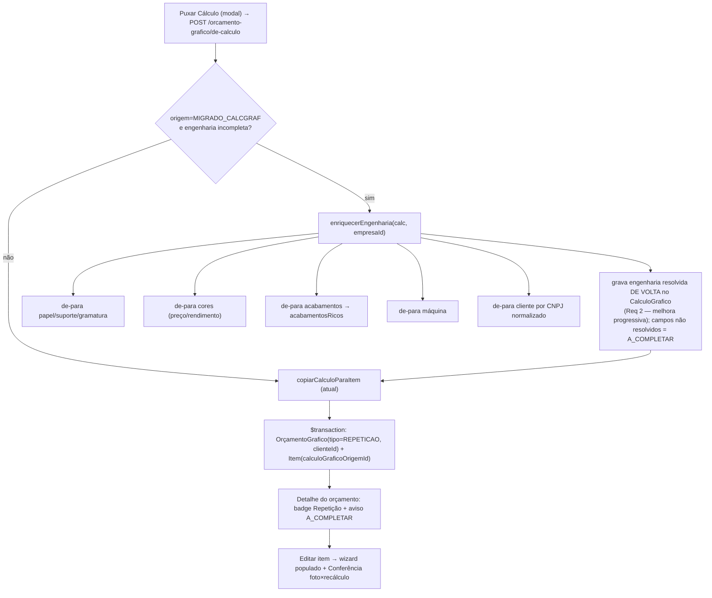

# Design Document

## Overview

Transforma o "Puxar Cálculo" (feature `orcamento-puxar-calculo-biblioteca`, já no
ar) num **orçamento de repetição com engenharia completa**: ao puxar um
`CalculoGrafico` migrado, o Vizor **completa a engenharia estruturada a partir da
própria foto rica** (de-para para os cadastros do Vizor), marca o orçamento como
**REPETIÇÃO**, localiza o **cliente por CNPJ**, e deixa o item editável e
recalculável — com **conferência foto × recálculo** antes de ir ao cliente.

Princípios inegociáveis:
- **A foto (`resultadoCalculo`) é imutável.** O enriquecimento só preenche
  CAMPOS DE ENGENHARIA estruturados; nunca altera `resultadoCalculo`/
  `valorTotal`/`custoProducao` gravados (o valor que bate 100% com o Calcgraf).
- **Nunca inventar valor.** O que o de-para não resolver com segurança fica
  `A_COMPLETAR` (visível ao operador).
- **Multi-tenant explícito** (`empresaId` em toda query; nunca só `prismaScoped`).
- **Não tocar o PCP; não reescrever o motor.**

Decisão aprovada: o enriquecimento roda **no momento de puxar**
(`POST /orcamento-grafico/de-calculo`), para o orçamento nascer pronto e a
conferência rodar de cara.

## Investigação que fundamenta o design (confirmada em dados reais)

- **Cliente**: o Vizor NÃO tem o código do Calcgraf. O de-para é por **CNPJ
  normalizado** (só dígitos) — 8/8 clientes de 2026 casaram. O CNPJ não está na
  foto hoje → o exportador passa a incluir `clienteDoc`/`clienteCodigo`.
- **Engenharia do migrado incompleta**: `papel_id`/`gramatura`/`suporte_id`/
  `maquina_id`/`acabamentos_ricos` nulos; `cores` com `precoKg=0`. A foto rica,
  porém, tem os NOMES (suporte, tintas, acabamentos, planos) → base do de-para.
- **Vizor já tem "Repetição"** parcial: `OrcamentoGrafico.produtoId` + Alert no
  `StepRevisao`. Estendemos o conceito para repetição por CÁLCULO (novo campo
  `tipo`).

## Architecture

O enriquecimento é um SERVIÇO PURO-ish (resolve cadastros por `empresaId`) e é
chamado DENTRO da rota de puxar, antes de `copiarCalculoParaItem`.

## Data Models

Mudanças de dados (schema + migrate-prod no mesmo commit).

Aditivas, idempotentes (steering database-migrations):

1. **`OrcamentoGrafico.tipo`** (`VARCHAR(12)`, default `'NOVO'`) — `NOVO |
   REPETICAO`. (Coexiste com `produtoId`, que é repetição por produto cadastrado.)
2. **`CalculoGrafico.engenhariaCompleta`** (`Boolean`, default `false`) — marca
   que a engenharia estruturada já foi resolvida (evita reexecutar o de-para).
3. **`CalculoGrafico.engenhariaPendentes`** (`Json?`) — lista de campos
   `A_COMPLETAR` que o de-para não resolveu (ex.: `["papel","maquina"]`), para a
   UI sinalizar.
4. **`CalculoGrafico.clienteDoc`** (`VARCHAR(20)?`) e **`clienteCodigo`**
   (`Int?`) — documento/código do cliente vindos do Calcgraf (populados pelo
   exportador da foto rica; `clienteDoc` é a chave do de-para por CNPJ).

`ItemOrcamentoGrafico.calculoGraficoOrigemId` já existe (rastreabilidade).
`CalculoGrafico.clienteNome` já existe.

migrate-prod.ts: `ADD COLUMN IF NOT EXISTS` para os 5 campos. Rodar 2× local
(idempotência) — aqui o Postgres local está indisponível, então roda no deploy
do Render (padrão do projeto), testado por `get_diagnostics` + build.

## Components and Interfaces

### Backend

**`foto-rica.types.ts`** — estender `FotoRicaCalculo.cabecalho` com
`clienteDoc?: string | null` e `clienteCodigo?: number | null`.

**`exportar-calculos-acervo-rico.mjs`** — incluir `n.CNPJCPF` (→ `clienteDoc`) e
`h.CodNome` (→ `clienteCodigo`) no SELECT dos cabeçalhos; re-exportar e
re-gravar os 7.951 (idempotente — só acrescenta o documento; NÃO altera valores/
foto). Script de gravação por `pg` direto (npx tsx trava).

**`enriquecimento-engenharia.service.ts`** (novo, submódulo calculo-grafico) —
`enriquecerEngenharia(empresaId, calc): { campos, pendentes }`:
- lê a `FotoRicaCalculo` (`calc.resultadoCalculo`);
- **papel/suporte/gramatura**: nome do suporte do 1º plano/suporte da foto →
  `SuporteGrafico`/`PrecoMateriaPrima` (tipo PAPEL, mesma empresa, match por nome
  normalizado); gramatura do plano;
- **cores**: para cada cor da foto, resolve `precoKg`/`rendimentoM2Kg` no cadastro
  de tinta (`PrecoMateriaPrima` tipo TINTA por nome) — preserva `coberturaPercent`
  da foto;
- **acabamentos**: cada acabamento da foto (nome) → `AcabamentoGrafico` →
  `acabamentosRicos` (com `acabamentoId`);
- **máquina**: nome da impressão da foto → `CentroProducao` (IMPRESSAO) por nome;
- **cliente**: `clienteDoc` normalizado (só dígitos) → `cliente.cpf_cnpj`
  normalizado, mesma empresa → `clienteId`;
- cada resolução falha vira item em `pendentes` (nunca valor inventado);
- NÃO toca `resultadoCalculo`. `empresaId` EXPLÍCITO em toda query.
- **Match por nome**: normalização (trim, maiúsculas, sem acento, colapsa
  espaços). Ambíguo (2+ candidatos) ou zero → pendente (nunca "chuta").

**`calculo-grafico.service.ts`** — `garantirEngenhariaCompleta(empresaId, id)`:
se `engenhariaCompleta=false`, roda `enriquecerEngenharia`, grava os campos
resolvidos DE VOLTA no `CalculoGrafico` (Req 2), seta `engenhariaCompleta=true`
quando não restam pendentes essenciais, e grava `engenhariaPendentes`. Idempotente.

**Rota `POST /orcamento-grafico/de-calculo`** (estende a existente) — antes de
`copiarCalculoParaItem`, chama `garantirEngenhariaCompleta`; grava
`tipo='REPETICAO'` e `clienteId` resolvido no orçamento. Mantém atomicidade
(transação) e 404/403/409 atuais.

**Conferência** — `GET /orcamento-grafico/:id/itens/:itemId/conferencia` (ou
embutir no retorno do recálculo existente `/:id/itens/:itemId/calcular`): compara
`resultadoCalculo` ORIGINAL do item (foto) × resultado recalculado pelo motor,
por componente (MD/CT/SE/C.PROD/valor) + desvio %; ≤0,5% = confere. NÃO grava
nada na foto.

### Frontend

- **Lista/Detalhe do orçamento**: badge "Repetição" quando `tipo=REPETICAO`.
- **`ItemWizardModal`/`itemParaForm`**: já popula os campos — agora virão
  preenchidos (engenharia completada). Exibir chip "A completar" nos campos
  pendentes (de `engenhariaPendentes`).
- **`StepRevisao`**: já lista erros por campo (feito). Adicionar o painel de
  **Conferência** (Calcgraf × Vizor × desvio) quando o item vem de cálculo.
- **Relatório/Proposta**: indicar "Repetição" + nº do cálculo de origem.

### Arquivos tocados (resumo)

| Camada | Arquivo | Mudança |
|---|---|---|
| Back schema | `schema.prisma` + `migrate-prod.ts` | `tipo`, `engenhariaCompleta`, `engenhariaPendentes`, `clienteDoc`, `clienteCodigo` |
| Back | `calculo-grafico/enriquecimento-engenharia.service.ts` | novo — de-para |
| Back | `calculo-grafico/calculo-grafico.service.ts` | `garantirEngenhariaCompleta` |
| Back | `orcamento-grafico.routes.ts` | `/de-calculo` chama enriquecimento + grava tipo/cliente; conferência |
| Back | `foto-rica.types.ts` | `clienteDoc`/`clienteCodigo` |
| Back script | `exportar-calculos-acervo-rico.mjs` + gravação pg | incluir CNPJ/código do cliente |
| Back script | `enriquecer-engenharia-lote.ts` | lote prioritário (366) + relatório |
| Front | `orcamento-grafico/[id]/page.tsx` + `ItemWizardModal.tsx` + `StepRevisao.tsx` | badge Repetição, chips A_COMPLETAR, painel Conferência |

## Correctness Properties

### Property 1: Foto imutável
*Para qualquer* enriquecimento/edição/conferência de um `CalculoGrafico` ou item,
`resultadoCalculo` (foto), `valorTotal` e `custoProducao` originais permanecem
inalterados.
**Validates: Requirements 1.5, 2.2, 6.5**

### Property 2: Nunca inventa valor (A_COMPLETAR)
*Para qualquer* campo de engenharia cujo de-para não resolva com segurança
(zero ou múltiplos candidatos), o campo fica em `engenhariaPendentes` e NÃO
recebe valor atribuído.
**Validates: Requirements 1.3, 5.3**

### Property 3: Enriquecimento idempotente
*Para qualquer* `CalculoGrafico`, reexecutar o enriquecimento não altera campos
já resolvidos nem duplica dados; um cálculo com `engenhariaCompleta=true` não
reexecuta o de-para.
**Validates: Requirements 2.1, 2.3, 3.4**

### Property 4: De-para de cliente por CNPJ normalizado
*Para qualquer* cálculo com `clienteDoc`, o cliente resolvido é aquele cujo
`cpf_cnpj` normalizado (só dígitos) é igual ao `clienteDoc` normalizado, na mesma
empresa; sem documento ou sem match → sem cliente + A_COMPLETAR.
**Validates: Requirements 7.1, 7.2, 7.3**

### Property 5: Tipo e rastreabilidade
*Para qualquer* orçamento criado por puxar cálculo, `tipo=REPETICAO` e o item tem
`calculoGraficoOrigemId` = id do cálculo; criado em branco → `tipo=NOVO`.
**Validates: Requirements 4.1, 4.2, 4.3**

### Property 6: Conferência de desvio
*Para qualquer* item vinculado a cálculo, a conferência classifica "confere"
se e somente se o desvio total ≤ 0,5%; caso contrário, alerta.
**Validates: Requirements 6.1, 6.2, 6.3**

### Property 7: Isolamento multi-tenant
*Para qualquer* operação de enriquecimento/de-para/criação, só são lidos/gravados
registros da `empresaId` do cálculo; cálculo de outra empresa é recusado sem
alterar dados.
**Validates: Requirements 7.4, 8.1, 8.2, 8.3, 8.4**

## Error Handling

| Situação | Comportamento |
|---|---|
| Campo de engenharia não resolve (0 ou 2+ candidatos) | vira `A_COMPLETAR`; orçamento criado mesmo assim (editável) |
| Cliente sem documento ou sem match | orçamento sem cliente; cliente em `A_COMPLETAR` |
| Recalcular com pendência essencial (papel/gramatura) | mensagem por campo (já implementado no handler Zod) |
| Cálculo de outra empresa | 403, nada criado/alterado |
| Desvio foto×recálculo > 0,5% | alerta com motivo; operador escolhe o valor da proposta |

## Testing Strategy

- **Property tests (fast-check, 100+ iter, Prisma mockado)** para as 7
  propriedades; tag `Feature: orcamento-repeticao-engenharia-completa, Property N`.
- **Exemplos/integração**: puxar cálculo migrado → orçamento REPETICAO com
  engenharia completa + cliente por CNPJ; cálculo sem match → A_COMPLETAR;
  conferência ≤0,5% vs >0,5%.
- **Lote**: dry-run do enriquecedor nos 366 + relatório (resolvidos × pendentes).
- Verificação por `get_diagnostics` (tsc trava); vitest `--reporter=dot`.
