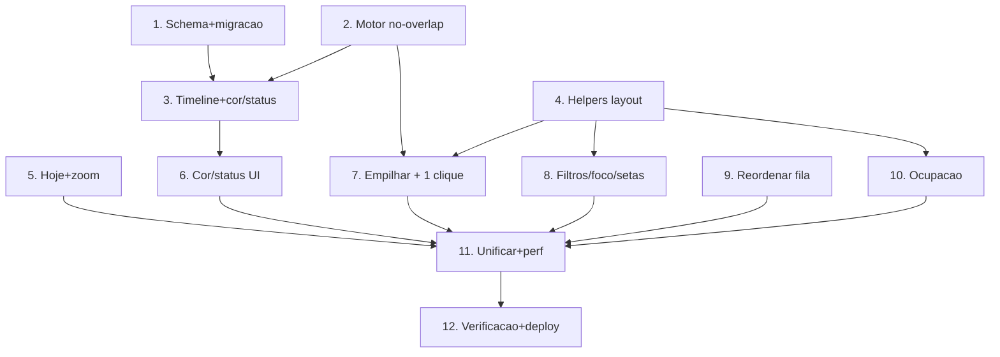

# Implementation Plan — Melhorias no Gantt de Produção (PCP)

## Overview

Ordem: schema+migração → motor puro (no-overlap, com não-regressão testada) →
rota timeline estendida + rota de cor/status → helpers de layout (front) →
features de UI (ancorar hoje/zoom, cor/status, empilhar, filtros/foco/setas,
reordenar, ocupação) → unificação de telas + performance → verificação.
Backend e frontend são repos SEPARADOS. Schema + `migrate-prod.ts` no MESMO
commit (steering database-migrations). Tudo aditivo (não-regressão).

## Tasks

- [x] 1. Schema da cor/status por OP + migração (`VisioFab.Wms.Back`)
  - [x] 1.1 Em `prisma/schema.prisma`, `OrdemProducao`: adicionar
    `corGantt String? @map("cor_gantt") @db.VarChar(9)` e
    `statusGanttObs String? @map("status_gantt_obs") @db.VarChar(120)`
    (NÃO tocar o campo existente `cor`).
  - [x] 1.2 `prisma/migrate-prod.ts`: dois `ALTER TABLE ordem_producao ADD
    COLUMN IF NOT EXISTS ...` idempotentes. `npx prisma generate`. Testar
    `npx tsx prisma/migrate-prod.ts` 2× local se o Postgres estiver acessível;
    senão, idempotência garantida por `IF NOT EXISTS` (roda no Render).
  - _Requisitos: 3.4, 3.8, 10.3_

- [x] 2. Motor no-overlap puro + não-regressão (`VisioFab.Wms.Back`)
  - [x] 2.1 `timeline-agenda.service.ts`: `resolverNoOverlap(etapasDoCentro,
    turno, excecoes)` (capacidade finita: 1 por vez; travadas = ponto fixo;
    não travadas empurradas para `max(inicio, cursorLivre)` respeitando turno).
    Integrar em `calcularInicioPorFila`/`calcularAgenda` com flag `noOverlap`
    (default true na rota).
  - [x] 2.2 `timeline-agenda.service.test.ts`: Properties — sem colisão ⇒
    saída idêntica (não-regressão); saída nunca tem sobreposição na mesma
    raia; travadas preservadas; determinismo. Manter os testes atuais verdes.
  - _Requisitos: 4.2, 4.3, 4.5, 4.6, 10.1_

- [x] 3. Rota timeline estendida + rota de cor/status (`VisioFab.Wms.Back`)
  - [x] 3.1 `GET /pcp/timeline`: incluir `corGantt`/`statusGanttObs` no
    `select` da OP e no payload (`corGantt`, `statusObs`). Aditivo.
  - [x] 3.2 `PATCH /api/pcp/ordens-producao/:id/gantt`: Zod (cor regex
    `^#([0-9a-fA-F]{6}|[0-9a-fA-F]{8})$` ou null; status ≤120 ou null);
    `findFirst({ id, empresaId })` (404 cross-empresa); `update` +
    `LogOrdemProducao`; permissão `podeMover`.
  - [x] 3.3 `get_diagnostics` limpo nos arquivos tocados.
  - _Requisitos: 3.2, 3.3, 3.4, 3.5, 3.6, 3.7, 10.2_

- [x] 4. Helpers puros de layout do Gantt (`VisioFab.Wms.Front`)
  - [x] 4.1 Criar `src/app/(interna)/pcp/gantt/gantt-layout.ts`:
    `empilharBarras` (lane assignment / interval partitioning →
    `subLinha`/`maxSubLinhas`), `ocupacaoPorDia` (usa porta JS de
    `janelaDoDia`), e util de pontos para as setas (fim/início por barra).
  - [x] 4.2 Teste unitário (vitest) dos helpers puros (empilhar sem colisão de
    sub-linha; ocupação por dia correta). Se o runner de teste do front for
    pesado, no mínimo `get_diagnostics` + validação por build.
  - _Requisitos: 4.1, 7.1, 9.1_

- [x] 5. Abrir no "agora" + navegação/zoom (`VisioFab.Wms.Front`)
  - [x] 5.1 Auto-scroll inicial para a linha "agora" (flag `jaAncorou`) +
    botão **"Hoje"**.
  - [x] 5.2 Zoom contínuo: `pixelsPorMinuto` estado contínuo; botões −/+
    (clamp) e `Ctrl+wheel` ancorado no cursor (preserva o instante sob o
    mouse). SegmentedControl define ppm base e coexiste.
  - [x] 5.3 Auto-refresh 60s NÃO reseta scroll/zoom.
  - _Requisitos: 2.1, 2.2, 2.3, 2.4, 2.5_

- [x] 6. Cor única padrão + editor de cor/status por OP (`VisioFab.Wms.Front`)
  - [x] 6.1 `COR_PADRAO` única; `getOpColor` passa a usar `op.corGantt ||
    COR_PADRAO` (remover ciclo de 20 cores).
  - [x] 6.2 Editor no menu do bloco: `ColorInput` + `TextInput` (status) +
    Salvar/Limpar; `PATCH .../gantt`; otimista + `carregar()`.
  - [x] 6.3 Render do selo de status no bloco + linha no tooltip.
  - _Requisitos: 3.1, 3.2, 3.3, 3.5, 3.6_

- [x] 7. Empilhamento visual + resolver conflito 1 clique (`VisioFab.Wms.Front`)
  - [x] 7.1 Aplicar `empilharBarras` por raia: altura da raia =
    `maxSubLinhas * SUBLINHA_H`; posicionar cada barra na sua `subLinha`
    (nunca sobrepor). Ajustar `raiaTop`/offsets e coluna de rótulos.
  - [x] 7.2 Botão "Resolver conflitos" (por raia e/ou global): `PATCH
    /pcp/etapas/reordenar` por início + `carregar()`.
  - _Requisitos: 4.1, 4.4_

- [x] 8. Filtros + foco da OP + setas de dependência reais (`VisioFab.Wms.Front`)
  - [x] 8.1 `MultiSelect` de centros e tipos (populados do payload) + `Select`
    de indicador + "Limpar filtros". Aplicar como visual-only na montagem de
    raias/timeline.
  - [x] 8.2 `opEmFoco`: clicar realça a OP (demais `opacity 0.25`).
  - [x] 8.3 Overlay `<svg>` com setas da OP focada (bezier + marker; suporta
    "para trás"), coordenadas do mapa `raiaTop`/`barLeft`.
  - _Requisitos: 5.1, 5.2, 5.3, 5.4, 5.5, 5.6_

- [x] 9. Reordenar fila arrastando no Gantt (`VisioFab.Wms.Front`)
  - [x] 9.1 Toggle "Reagendar | Reordenar fila" no cabeçalho. Em "Reordenar
    fila", arrastar bloco sobre outro da mesma raia → nova ordem →
    `PATCH /pcp/etapas/reordenar` → `carregar()`.
  - [x] 9.2 Coexistência com âncoras e com o drag temporal (não se anulam).
  - _Requisitos: 6.1, 6.2, 6.3, 6.4_

- [x] 10. Ocupação por máquina (`VisioFab.Wms.Front`)
  - [x] 10.1 Mini-faixa de ocupação no rótulo da raia (média do período) com
    cor (verde/âmbar/vermelho); usa `ocupacaoPorDia`. Sem query extra.
  - _Requisitos: 7.1, 7.2, 7.3, 7.4_

- [x] 11. Unificação de telas + performance (`VisioFab.Wms.Front`)
  - [x] 11.1 `/pcp/timeline/gantt/page.tsx` → `redirect('/pcp/gantt')`; link em
    `/pcp/timeline/page.tsx` aponta para `/pcp/gantt`; conferir `ModuleSidebar`.
  - [x] 11.2 Virtualização por faixa vertical visível (render só raias no
    viewport + buffer) OU `content-visibility`/`contain`; memoizar helpers.
  - _Requisitos: 8.1, 8.2, 8.3, 8.4, 9.1, 9.2, 9.3_

- [x] 12. Verificação final e deploy
  - [x] 12.1 Backend: testes do motor verdes (atuais + no-overlap),
    `get_diagnostics` limpo, `prisma generate` OK.
  - [x] 12.2 Frontend: `get_diagnostics` limpo + `npm run build` (Next) OK.
  - [x] 12.3 Commits separados (back: schema+migrate+motor+rotas; front: UI).
    Atualizar o steering `pcp-modulo.md` com o novo estado do Gantt. Validação
    visual com o usuário.
  - _Requisitos: 10.1, 10.2, 10.3_

## Task Dependency Graph



```json
{
  "waves": [
    { "wave": 1, "tasks": ["1", "2", "4"] },
    { "wave": 2, "tasks": ["3"] },
    { "wave": 3, "tasks": ["5", "6", "7", "8", "9", "10"] },
    { "wave": 4, "tasks": ["11"] },
    { "wave": 5, "tasks": ["12"] }
  ]
}
```

## Notes

- Aditivo e não-regressivo: sem usar as features novas, motor e render são os
  de hoje (Property 1 do motor + cor padrão + sem filtro/foco).
- Multi-tenant: `empresaId` EXPLÍCITO na rota nova e no reordenar.
- Schema + `migrate-prod.ts` SEMPRE no mesmo commit; testar 2× local quando
  possível (Postgres local costuma estar off — idempotência por IF NOT EXISTS).
- Edição aplicada em `/pcp/gantt`; `/pcp/timeline` (lista) permanece como visão
  complementar; `/pcp/timeline/gantt` vira redirect.
- Padrão de mercado: Bryntum/DHTMLX (stack layout, event color, dependency
  lines), Preactor/Opcenter/PlanetTogether (capacidade finita/no-overlap),
  MS Project (setas FS, zoom ancorado).
```
