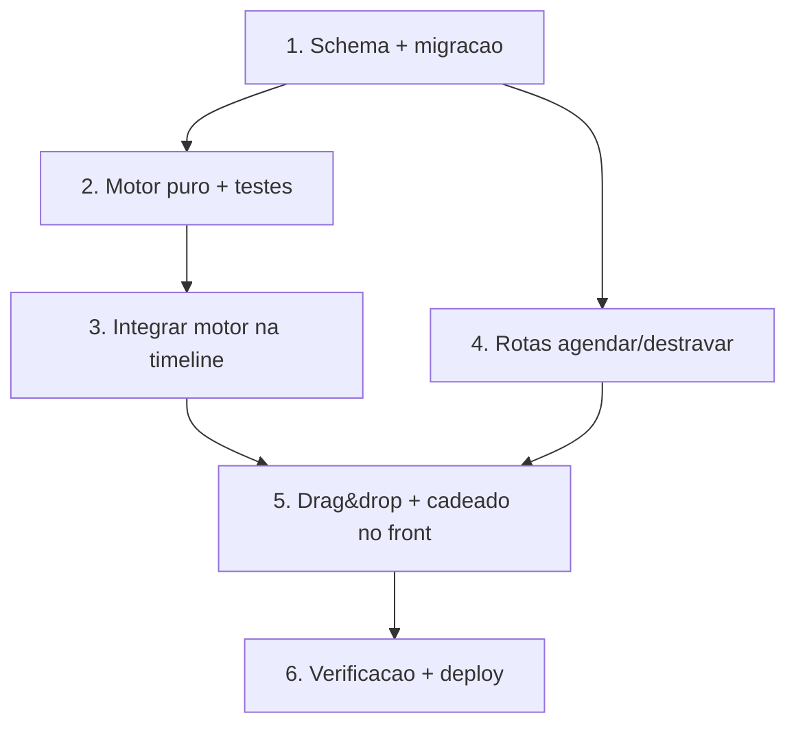

# Implementation Plan

## Overview

Plano da Spec B (item 4 da reunião): travar/mover blocos no Gantt. Ordem:
schema+migração primeiro, depois o motor puro (com não-regressão testada),
então as rotas e por fim o drag & drop no front. Invariante: sem trava =
timeline idêntica à atual. Schema + migrate-prod no MESMO commit.

## Tasks

- [x] 1. Schema da âncora + migração (`VisioFab.Wms.Back`)
  - [x] 1.1 `EtapaOrdemProducao` ganhou `inicioAgendadoManual DateTime?` e
    `agendaTravada Boolean @default(false)`.
  - [x] 1.2 `migrate-prod.ts`: `ADD COLUMN IF NOT EXISTS` dos 2 campos
    (idempotente). `prisma generate` OK. NOTA: `npx tsx migrate-prod.ts` 2×
    local NÃO rodou — Postgres local indisponível nesta máquina (confirmado:
    "Can't reach database server at localhost:5432"); a idempotência é
    garantida pela cláusula `IF NOT EXISTS` (mesmo padrão do arquivo) e roda no
    deploy do Render. schema+migrate no mesmo commit.
  - _Requisitos: 1.1, 1.2, 1.3, 6.2_

- [x] 2. Motor de agendamento puro + não-regressão (`VisioFab.Wms.Back`)
  - [x] 2.1 `src/modules/pcp/timeline-agenda.service.ts`: núcleo puro
    (`calcularFimComTurno`, `calcularInicioPorFila`, `calcularTimelineOp`,
    `calcularAgenda`) com a regra da âncora (travada = ponto fixo; não travada
    pula janelas ocupadas por travadas do mesmo centro).
  - [x] 2.2 `timeline-agenda.service.test.ts` (vitest): **7/7** cobrindo P1–P6
    (não-regressão, âncora respeitada, fim no turno, ocupa janela, destrave,
    determinismo).
  - _Requisitos: 4.1, 4.2, 4.3, 4.4, 4.5, 6.1_

- [x] 3. Integrar o motor puro na rota da timeline (`VisioFab.Wms.Back`)
  - [x] 3.1 `timeline-producao.routes.ts`: `select` ganhou `agendaTravada` +
    `inicioAgendadoManual`; a cascata inline foi substituída por `calcularAgenda`;
    os 2 campos expostos no payload de cada etapa (aditivo). Detecção de
    conflitos preservada. Fallback defensivo para a cascata local mantido.
  - [x] 3.2 `get_diagnostics` limpo; não-regressão apoiada no teste P1.
  - _Requisitos: 4.1, 4.3, 4.4, 6.1, 6.5_

- [x] 4. Rotas de edição de agenda (`VisioFab.Wms.Back`)
  - [x] 4.1 `PATCH /etapas/:id/agendar` (body `{ inicio, centroProducaoId? }`):
    valida por `{ id, ordemProducao: { empresaId } }`; 409 se etapa/OP
    finalizada; grava `agendaTravada=true` + `inicioAgendadoManual`; move de
    centro quando pedido (reusa regra do `/mover`); `LogOrdemProducao`.
  - [x] 4.2 `PATCH /etapas/:id/destravar`: limpa a âncora (false/null) + log.
  - [x] 4.3 Permissão `podeMover` (planejador/admin). Zod no `inicio`.
    `get_diagnostics` limpo.
  - _Requisitos: 2.1, 2.2, 2.3, 2.4, 2.5, 3.1, 3.2, 3.4, 6.3, 6.4_

- [x] 5. Drag & drop + cadeado no Gantt (`VisioFab.Wms.Front`)
  - [x] 5.1 `pcp/gantt/page.tsx`: arraste por pointer events (delta →
    minutos via `ppmRef`; snap 15min); ao soltar, `PATCH /pcp/etapas/:id/agendar`;
    offset otimista + rollback em erro; `carregar()` recalcula.
  - [x] 5.2 Cadeado no bloco travado + menu (Travar/Destravar) + tooltip com a
    data manual e "🔒 Travado".
  - [x] 5.3 `get_diagnostics` limpo; `npm run build` (next) **✓ Compiled**.
  - _Requisitos: 3.1, 3.2, 3.3, 3.5, 5.1, 5.2, 5.3, 5.4_

- [x] 6. Verificação final e deploy
  - [x] 6.1 Backend: testes do motor 7/7, diagnostics limpos, `prisma generate`
    OK. Frontend: build Next OK (342 páginas). Migração local não rodou
    (Postgres off) — roda no Render.
  - [x] 6.2 Commits: backend (schema+migrate+motor+rotas) e frontend separados.
    Validação manual (travar/mover/destravar + não-regressão) fica com o usuário.
  - _Requisitos: 6.1, 6.2_

## Task Dependency Graph



```json
{
  "waves": [
    { "wave": 1, "tasks": ["1"] },
    { "wave": 2, "tasks": ["2", "4"] },
    { "wave": 3, "tasks": ["3"] },
    { "wave": 4, "tasks": ["5"] },
    { "wave": 5, "tasks": ["6"] }
  ]
}
```

## Notes

- Schema + `migrate-prod.ts` SEMPRE no mesmo commit (steering
  database-migrations); testar `npx tsx prisma/migrate-prod.ts` 2× local.
- A âncora é aditiva: sem trava, a timeline é a de hoje (Property 1 garante).
- Edição aplicada na tela `/pcp/gantt`; `/pcp/timeline/gantt` segue read-only.
- Backend e frontend são repos SEPARADOS (commits/pushes independentes).
- Escopo manual (travar/mover + motor respeita); otimização automática global
  fica fora.
