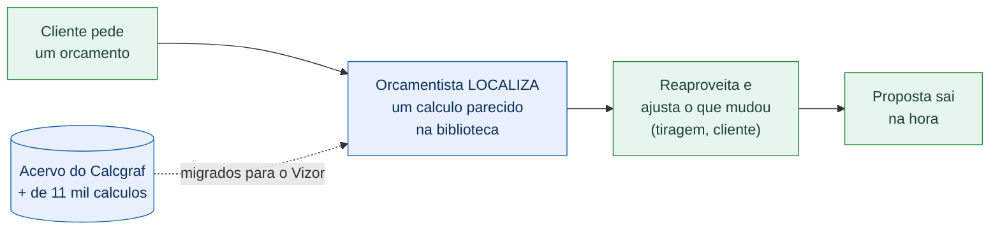

# Biblioteca de Cálculos Gráficos — visão para a diretoria

**Carton Wega · Vizor ERP**

---

## O problema de hoje

Cada vez que chega um pedido, o orçamentista **refaz o cálculo do zero** — mesmo
quando a empresa já orçou um trabalho praticamente igual antes. Isso custa tempo,
depende da memória de quem está na máquina e abre espaço para divergência de
preço entre um orçamento e outro.

No sistema antigo (Calcgraf), existem **mais de 11 mil cálculos** acumulados ao
longo dos anos — um acervo valioso de engenharia que, numa migração mal feita,
simplesmente se perderia.

## O que a Biblioteca de Cálculos entrega

Uma "estante" de cálculos prontos dentro do Vizor. O orçamentista **procura um
cálculo parecido, reaproveita e ajusta** — em vez de começar do zero.

## Ganhos para o negócio

| Antes (Calcgraf) | Agora (Vizor) |
|---|---|
| Refazer o cálculo a cada pedido | Localizar um cálculo pronto e reaproveitar |
| Conhecimento na cabeça do operador | Acervo consultável por qualquer pessoa autorizada |
| Risco de preço divergir entre orçamentos | Cada cálculo é uma **foto fiel**, que não muda sozinha |
| Histórico preso no sistema antigo | **+11 mil cálculos** migrados, sem perder nada |

**Resumo em uma frase:** menos retrabalho, mais padronização de preço e o acervo
histórico preservado — tudo dentro do Vizor, junto do orçamento, da OP e do
estoque.

## Como o orçamentista usa (3 passos)

1. Abre um orçamento e clica em **"Localizar Cálculo"**.
2. Filtra por cliente, produto, descrição ou número (inclusive o número antigo
   do Calcgraf).
3. Escolhe o cálculo → ele entra como item do orçamento, pronto para ajustar a
   tiragem e enviar a proposta.

## Segurança e confiança

- Cada cálculo reaproveitado é uma **cópia independente** (foto): corrigir um
  cálculo da biblioteca **não** altera propostas já emitidas — proteção
  comercial e fiscal.
- Dados de **cada empresa ficam isolados** — um cliente nunca enxerga o acervo do
  outro.
- A migração do acervo é **conferível**: traz todos os cálculos válidos e gera um
  relatório do que precisou de atenção, sem "sumir" com nenhum registro.

## Status

| Item | Situação |
|---|---|
| Tela da Biblioteca + busca | ✅ No ar |
| "Localizar Cálculo" no orçamento | ✅ No ar |
| Migração dos +11 mil cálculos do Calcgraf | 🟡 Em andamento (próxima etapa) |

> Observação: a estante abre vazia até a migração do acervo rodar — a
> funcionalidade já está pronta; falta carregar o histórico.

---

*Diagramas técnicos detalhados (para a equipe de desenvolvimento) ficam em
`docs/fluxo-calculo-grafico-orcamento.md` e nas imagens em `docs/diagramas/`.*
