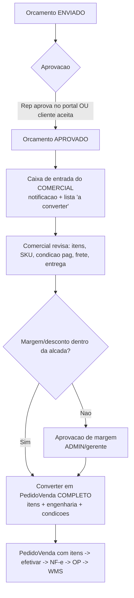

# Estudo — Comunicação do Orçamento Gráfico com o Setor Comercial

> Pergunta do usuário: hoje o orçamento gráfico se comunica com o **representante**
> (Portal do Representante). Como seria a comunicação também com o **setor
> comercial** (interno), que é quem transforma o orçamento aprovado em **pedido
> real**? O Vizor está preparado?
>
> Fontes: código atual do Vizor (orçamento gráfico, portal do representante,
> pedido de venda), base restaurada do Calcgraf (levantamento já feito nos docs
> `calcgraf-*`), e padrões de mercado (MIS/ERP gráfico: CERM, PrintXpand, Gelato;
> e Quote-to-Order genérico: SAP, Oracle, NetSuite). Data: 26/10/2026.

---

## 1. Resposta curta

**O Vizor NÃO está totalmente preparado ainda.** A espinha dorsal existe (o
orçamento aprovado já gera um `PedidoVenda` com rastreabilidade de origem), mas
há um **vão real entre o orçamento gráfico e o setor comercial**:

1. O `PedidoVenda` gerado na aprovação nasce **só com o cabeçalho** (cliente,
   vendedor, valor total). **Não traz os itens** (`ItemPedidoVenda`) nem a
   engenharia do cálculo — então o comercial recebe um "pedido fantasma" de valor
   cheio e precisa **re-digitar os itens** para conseguir efetivar/faturar.
2. **Não existe um papel/caixa de entrada do COMERCIAL** entre "orçamento
   aprovado" e "pedido efetivado". Quem aprova o orçamento hoje é o mesmo usuário
   do orçamento (ou o representante via portal), não há um hand-off explícito
   para o setor comercial revisar/completar/confirmar.
3. **Sem notificação ao comercial** quando um orçamento é aprovado (o portal do
   representante tem notificações; o comercial interno não tem).
4. A **aprovação de margem/desconto** (gate comercial clássico do Quote-to-Order)
   não existe para o orçamento gráfico.

Ou seja: o conceito que você descreveu — "é o setor comercial que transforma o
orçamento em pedido real" — é exatamente o padrão de mercado (Quote-to-Order com
hand-off para CSR/comercial), e é **onde o Vizor tem a maior lacuna hoje**.

---

## 2. Como funciona HOJE no Vizor

### 2.1 Orçamento gráfico (máquina de estados)

```
RASCUNHO → ENVIADO → APROVADO → (gera PedidoVenda RASCUNHO)
                   → RECUSADO
                   → VENCIDO
```

- `POST /orcamento-grafico/:id/enviar` — RASCUNHO → ENVIADO (exige preço).
- `POST /orcamento-grafico/:id/aprovar` — ENVIADO → APROVADO. **Se** o orçamento
  tem `clienteId` **e** existe uma `TabelaPreco` ativa na empresa, cria um
  `PedidoVenda` (status RASCUNHO, `origemPedido = 'ORCAMENTO_GRAFICO'`,
  `orcamentoOrigemId = <id do orçamento>`).
- `POST /orcamento-grafico/:id/recusar` — ENVIADO → RECUSADO (reflete na
  solicitação do Portal do Representante, se houver).

### 2.2 O que o PedidoVenda gerado tem HOJE (e o que falta)

| Campo do PedidoVenda | Preenchido na aprovação? |
|---|---|
| empresaId, numero, clienteId, vendedorId | ✅ |
| tabelaPrecoId (primeira ativa) | ✅ |
| valorTotal (consolidado do orçamento) | ✅ |
| status = RASCUNHO, origemPedido, orcamentoOrigemId | ✅ |
| **itens (`ItemPedidoVenda`)** | ❌ **NÃO cria nenhum item** |
| produtos/SKU de cada item | ❌ |
| quantidades, preço unitário por item | ❌ |
| condição de pagamento, frete, entrega | ❌ |

**Consequência prática:** o `PedidoVenda` nasce com `valorTotal = X` mas
`itens = []`. Para efetivar (emitir NF-e, separar no WMS), o comercial precisa
abrir o pedido e **recriar os itens manualmente** — retrabalho e risco de
divergência entre o que foi orçado e o que foi vendido.

### 2.3 Caminho do Representante (já existe)

O Portal do Representante (`/api/portal-rep/*`) tem:
- `SolicitacaoOrcamentoRep` — o representante pede um orçamento.
- O ADMIN/comercial **calcula** a solicitação (`.../solicitacoes-orcamento/:id/calcular`).
- Notificações (`NotificacaoRep`) ao representante em cada transição.
- Pipeline (orçamento → PV → OP → produção → expedição) visível ao representante.

Repare: o representante é **externo** e tem um fluxo rico de ida-e-volta. O
**comercial interno** — que seria o dono da conversão em pedido — **não tem um
fluxo equivalente**.

---

## 3. Como o Calcgraf faz (base restaurada)

No Calcgraf (levantado em `docs/calcgraf-*`):
- Um **Orçamento** é cabeçalho + N itens; cada item é um **Cálculo** com status
  próprio ("Proposta"), aba **Fechamento** e aba **Comissões**.
- A ligação do orçamento aprovado com a produção é feita pelo elo
  `CalculoHeader.CodOpItemEstrutura = OpItemEstrutura.Codigo` — ou seja, o
  cálculo "vira" item de OP quando o pedido é fechado. O cálculo COMPLETO
  (planos, tintas, acabamentos, atividades) é carregado para a OP, não só o
  valor.
- O Calcgraf tem **Comissões por agente** no próprio orçamento (o Vizor usa um
  CEV único hoje — comissão detalhada está fora do MVP).

**Lição do Calcgraf:** quando o orçamento aprovado vira pedido/OP, **toda a
engenharia e os itens viajam junto** — não só o total. É isso que falta no
hand-off do Vizor.

---

## 4. Como o mercado faz (Quote-to-Order / MIS gráfico)

Padrões consolidados (SAP Lead-to-Cash, Oracle Quote-to-Order, NetSuite
Estimate→Sales Order, CERM/PrintXpand MIS):

1. **A conversão carrega TUDO para o documento operacional.** "Commercial intent
   becomes operational truth": ao converter o orçamento em pedido, os itens,
   quantidades, preços, condições e premissas de desconto/frete são **trazidos
   integralmente** para o sales order. (Sage/Cleverence, Oracle.)
   *Conteúdo reformulado para compliance de licenciamento.*

2. **Hand-off explícito entre quem vende e quem cumpre.** O Quote-to-Order
   "garante a passagem eficiente entre times de vendas e fulfillment" — há um
   ponto formal onde o comercial/CSR assume. (Oracle.)

3. **CSR converte com um clique, sem redigitar.** "Quando o cliente aprova a
   cotação, um CSR escreve as informações da cotação em um pedido com o clique de
   um botão" — e o CPQ elimina a re-entrada manual de dados entre sistemas.
   (Oracle, Everstage.)

4. **Gate de aprovação de margem/desconto ANTES de virar pedido.** O
   Quote-to-Cash tem aprovações (desconto/margem/freight) que, uma vez aprovadas,
   seguem para o pedido. (Cflow, SAP: "once the quote passes all required
   approvals".) *Conteúdo reformulado.*

5. **No MIS gráfico, o "job bag"/OP nasce do estimate** com BOM, substrato,
   acabamentos e specs — um único registro do quote à expedição (CERM,
   PrintXpand, Gelato: "single data model", "every job's data visible from a
   single record"). *Conteúdo reformulado.*

Em resumo: o mercado trata o **comercial como o dono do hand-off**, e a conversão
é **sem redigitação** + **com gate de aprovação**. O Vizor tem o gancho de
origem, mas a conversão é incompleta e o hand-off não é formal.

---

## 5. Gaps do Vizor (priorizados)

| # | Gap | Impacto | Esforço |
|---|-----|---------|---------|
| **G1** | Aprovação gera PedidoVenda **sem itens** — comercial redigita | **Alto** (retrabalho + divergência orçado×vendido) | Médio |
| **G2** | Sem **notificação/caixa de entrada do comercial** quando orçamento é aprovado | Alto (hand-off invisível) | Baixo |
| **G3** | Sem **gate de aprovação de margem/desconto** antes de virar pedido | Médio (governança comercial) | Médio |
| **G4** | PedidoVenda gerado não traz condição de pagamento, frete, entrega do orçamento | Médio | Baixo |
| **G5** | Vínculo item do orçamento → **Produto/SKU** do pedido inexistente (orçamento gráfico usa `TipoEmbalagem`, não `Produto`) | Alto (bloqueia faturamento real) | Alto |
| **G6** | Sem papel/perfil **COMERCIAL** dedicado (hoje: ADMIN/SUPERVISOR/OPERADOR) | Baixo | Baixo |

### Observação adicional (divergência de enum `origemPedido`)

Encontrada ao investigar: o backend grava `origemPedido = 'ORCAMENTO_GRAFICO'` no
pedido criado pela aprovação, mas o enum do frontend (`OrigemPedido` em
`vendas/.../types.ts`) só conhece `'MANUAL' | 'ECOMMERCE' | 'EDI' | 'ORCAMENTO'`.
Resultado: o comercial **nem consegue filtrar** na tela de Pedidos os pedidos que
vieram do orçamento gráfico (o valor gravado não bate com nenhuma opção do
filtro). É um bug pequeno de alinhamento de enum, mas sintomático do hand-off
incompleto — vale corrigir junto com G2.

### Observação sobre G5 (a lacuna estrutural mais profunda)

O orçamento gráfico trabalha com `TipoEmbalagem` (Cartucho, Sacola…) +
engenharia (suporte/cores/acabamentos), **não com `Produto` (SKU)**. Já o
`PedidoVenda`/`ItemPedidoVenda` exige `produtoId` (FK para `Produto`, que é usado
em OP, estoque, NF-e). Para a conversão trazer itens de verdade, é preciso
decidir **como o item gráfico vira um Produto** — criar um SKU "sob demanda" a
partir do cálculo, ou vincular a um Produto genérico de serviço gráfico. Essa
decisão destrava o faturamento real e é pré-requisito do G1 completo.

---

## 6. Proposta de fluxo-alvo (orçamento → comercial → pedido real)



Princípios (do mercado): **sem redigitação** (os itens vêm do orçamento),
**hand-off formal** (caixa de entrada + notificação do comercial), **gate de
margem** opcional por alçada, e **a engenharia viaja junto** (como no Calcgraf,
para a OP nascer completa).

---

## 7. Recomendação de sequência (se o usuário quiser implementar)

1. **Decisão G5** (workshop rápido): como o item gráfico vira Produto/SKU no
   pedido. Sem isso, G1 fica pela metade. Opções: (a) Produto "serviço gráfico"
   genérico por item; (b) criar SKU sob demanda a partir do cálculo (com
   salvaguardas anti-colisão já discutidas em `calcgraf-fase-produtos-plano.md`).
2. **G1 + G4** (uma spec): a aprovação passa a criar `ItemPedidoVenda` a partir
   dos itens do orçamento (produto resolvido por G5, quantidade, preço unitário),
   e copia condição de pagamento/frete/entrega. Tira o retrabalho do comercial.
3. **G2** (notificação do comercial): reusar o padrão de `NotificacaoRep` para um
   `NotificacaoComercial` (ou uma aba "Orçamentos a converter" no módulo Vendas)
   — hand-off visível.
4. **G3** (gate de margem): alçada de desconto/margem antes de converter, reusando
   o `RegraAprovacao`/`SolicitacaoAprovacao` que já existe no módulo Vendas.
5. **G6**: avaliar um perfil COMERCIAL (ou só usar permissão por módulo VENDAS).

> Nenhuma dessas mudanças foi implementada neste estudo — é um diagnóstico +
> roadmap. O próximo passo natural é transformar os itens 1–3 numa spec
> (`orcamento-grafico-handoff-comercial` ou similar).

---

## 8. Conclusão

- **Comunicação com o representante:** ✅ madura (portal, solicitação,
  notificação, pipeline).
- **Comunicação com o comercial interno:** ⚠️ **incompleta**. Existe o gancho
  (orçamento aprovado → PedidoVenda com origem rastreável), mas o pedido nasce
  **sem itens**, **sem hand-off formal** e **sem gate de margem** — exatamente as
  três coisas que o mercado considera o núcleo do Quote-to-Order.
- **O Vizor está preparado para evoluir?** Sim — a fundação (status do orçamento,
  `origemPedido`/`orcamentoOrigemId`, módulo de Vendas com `RegraAprovacao`) já
  existe. O que falta é a **conversão completa (itens + engenharia)** e o
  **hand-off comercial**, com a decisão estrutural do G5 (item gráfico → SKU)
  como pré-requisito.
