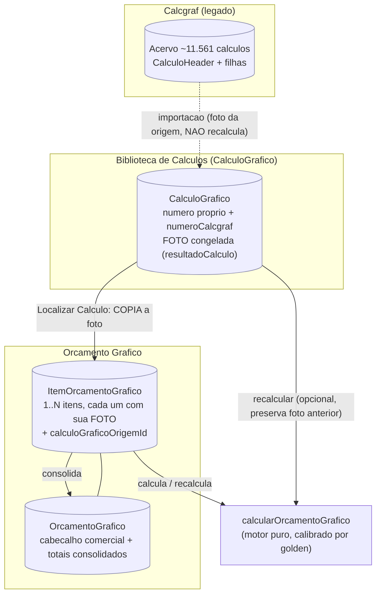
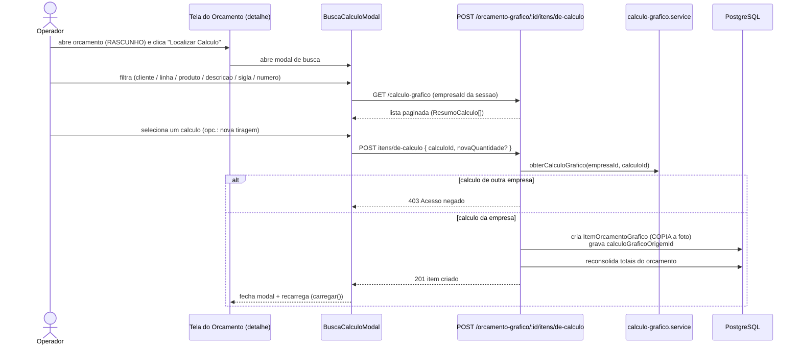
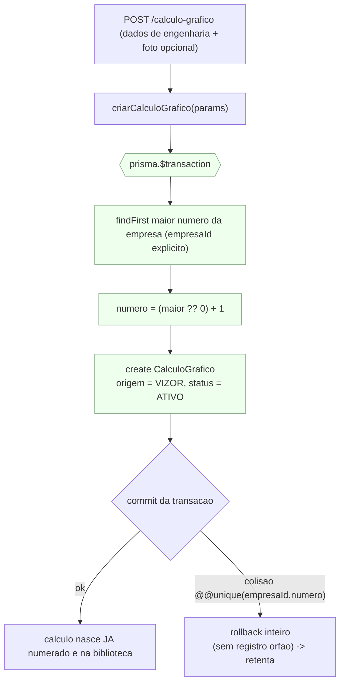
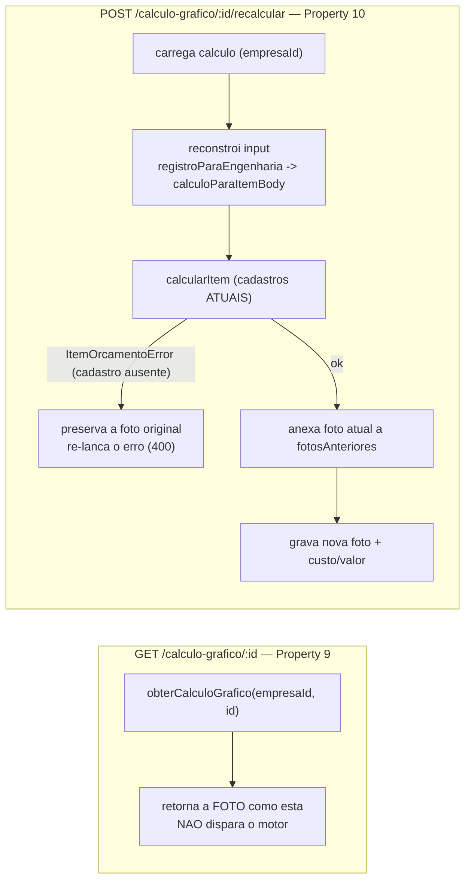
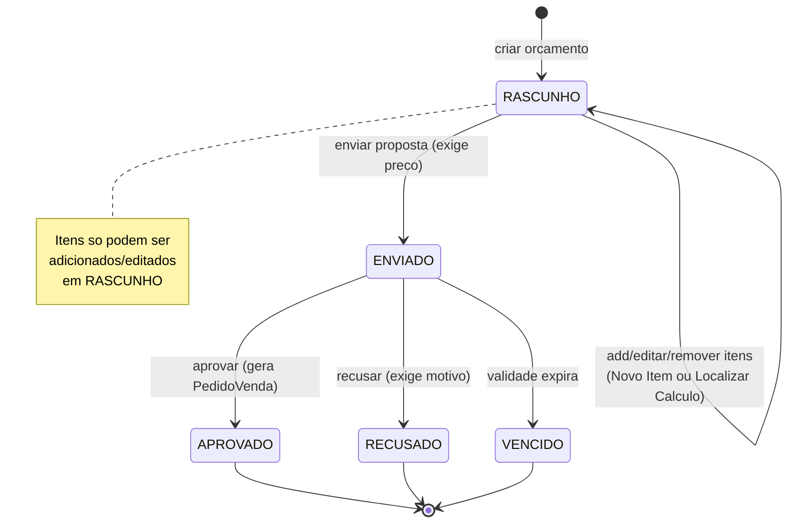
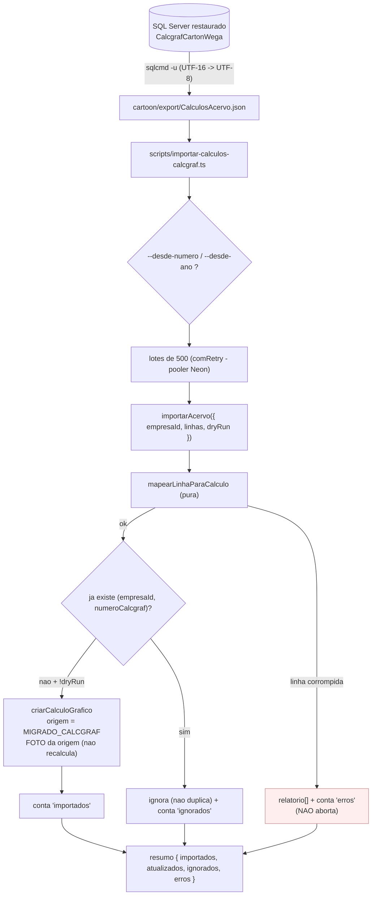
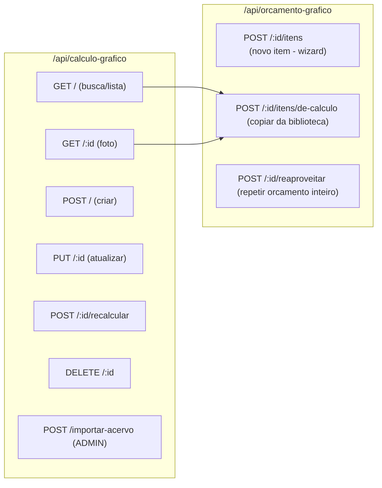

# Fluxo — Cálculo Gráfico + Orçamento (Vizor / Carton Wega)

Este documento descreve, em diagramas Mermaid, como o **Orçamento Gráfico** e a
**Biblioteca de Cálculos Gráficos** (`CalculoGrafico`) se encaixam — o
equivalente Vizor ao fluxo "Orçamento usa Cálculo" + "Localiza o Cálculo Padrão"
do Calcgraf.

Conceito central: o **Cálculo Gráfico** é uma peça de engenharia reutilizável e
independente do orçamento (tem número próprio, fica localizável na biblioteca). O
**Orçamento** é o documento comercial, composto por 1..N **itens**. Um item pode
nascer do zero (wizard) ou ser **copiado** de um cálculo da biblioteca (foto
congelada — cópia, não vínculo).

Specs relacionadas: `.kiro/specs/biblioteca-calculos-graficos/`,
`.kiro/specs/orcamento-grafico/`. Isolamento multi-tenant: `empresaId` explícito
em toda query.

---

## 1. Visão geral (entidades e caminhos)

**Pontos-chave**
- A biblioteca (`CalculoGrafico`) e o item (`ItemOrcamentoGrafico`) compartilham
  o mesmo *shape* de engenharia (tipo, suporte, cores, acabamentos, faca/
  montagem, matriz, tinta). O mapeamento é único e testado
  (`calculoParaItemBody` / `itemBodyParaCalculo`).
- "Localizar Cálculo" **copia** (foto congelada). Editar o cálculo da biblioteca
  depois **não** altera itens já criados.
- A importação do acervo preserva a foto **da origem** (não roda o motor).

---

## 2. Fluxo do operador — Orçamento usando a biblioteca ("Localiza o Cálculo")

Alternativa (fluxo clássico, sem biblioteca): o botão **"Novo Item"** abre o
`ItemWizardModal` (Tipo → Medidas → Papel → Cores → Dados Técnicos →
Acabamentos → Diversos → Revisão) e cria o item calculando no backend. Os dois
caminhos coexistem.

---

## 3. Criar um Cálculo novo na biblioteca (numeração própria atômica)

Invariante (Property 5): nunca existe um cálculo com número mas fora da
biblioteca — a numeração e a gravação acontecem na **mesma** transação.

---

## 4. Ler (foto congelada) vs Recalcular (preserva histórico)

Regra: **leitura nunca recalcula**. Recalcular é uma ação explícita que **soma**
a foto anterior ao histórico (`fotosAnteriores`) antes de gravar a nova — a foto
original nunca é perdida.

---

## 5. Máquina de estados do Orçamento (comercial)

Observação: o **Cálculo Gráfico** (biblioteca) tem seu próprio `status`
(`ATIVO` / `RASCUNHO` / `ARQUIVADO`) independente do status comercial do
orçamento — a busca padrão lista `ATIVO`.

---

## 6. Migração do acervo Calcgraf → Biblioteca (idempotente, resiliente)

Invariantes do importador:
- **Idempotência** (Property 11): reimportar não duplica — colisão por
  `(empresaId, numeroCalcgraf)` é ignorada e mantida inalterada.
- **Conservação** (Property 12): `importados + atualizados + ignorados + erros ==
  total de linhas`.
- **Foto da origem** (Req 6.2): a migração **não** roda o motor — grava os
  agregados de custo/valor que vieram do Calcgraf (igual ao tratamento do 7343).

> Pendência conhecida: o exportador SQL Server → JSON ainda não foi escrito; o
> `brutoParaLinha` do script é tolerante, mas os nomes de coluna devem ser
> conferidos contra o export real antes do `--apply` em produção. Rodar sempre
> `--dry-run` primeiro.

---

## 7. Mapa de rotas (resumo)

