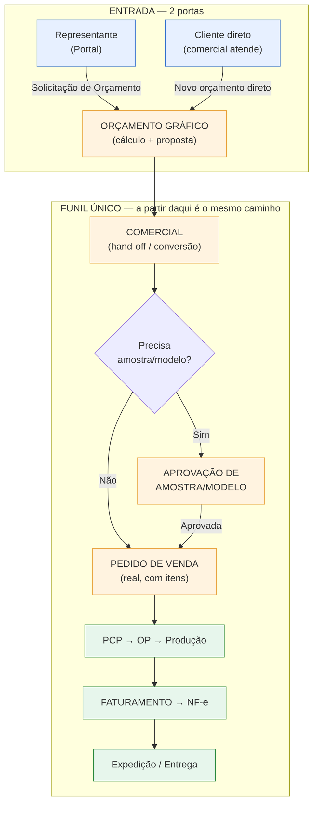
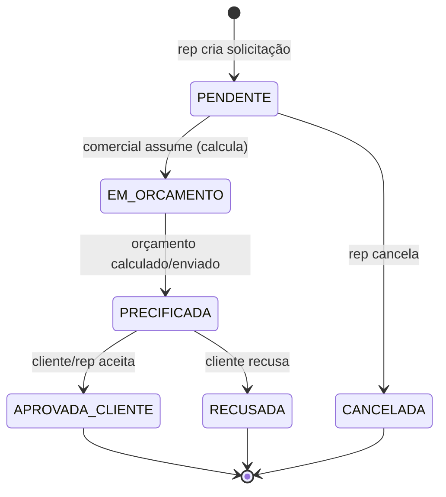
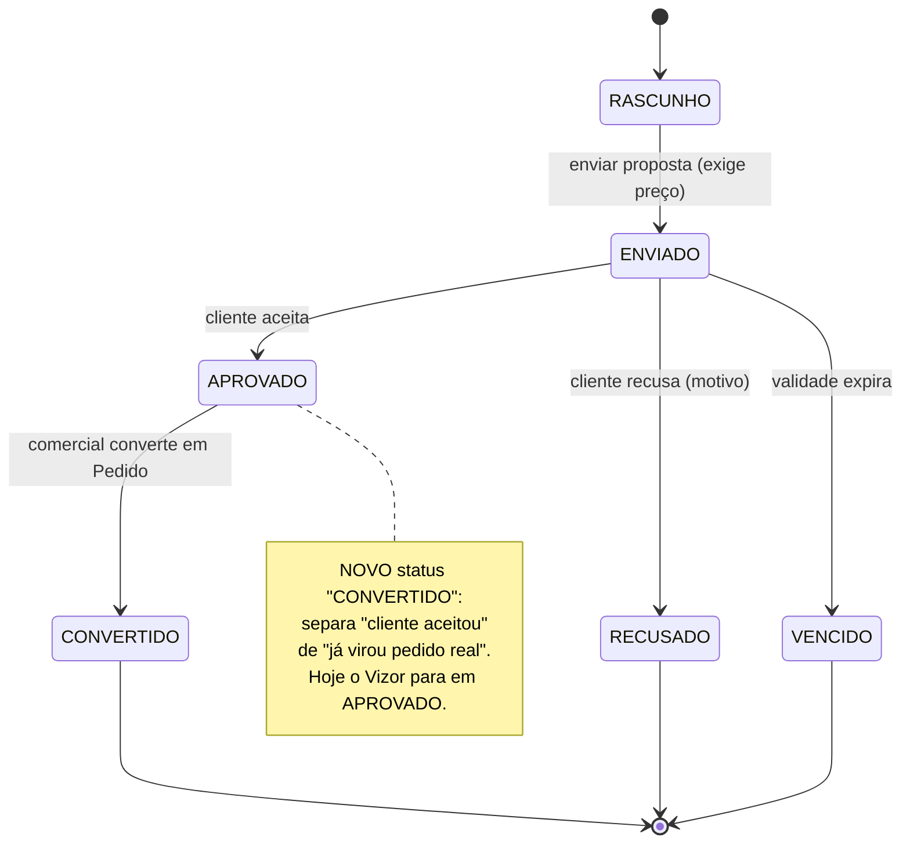
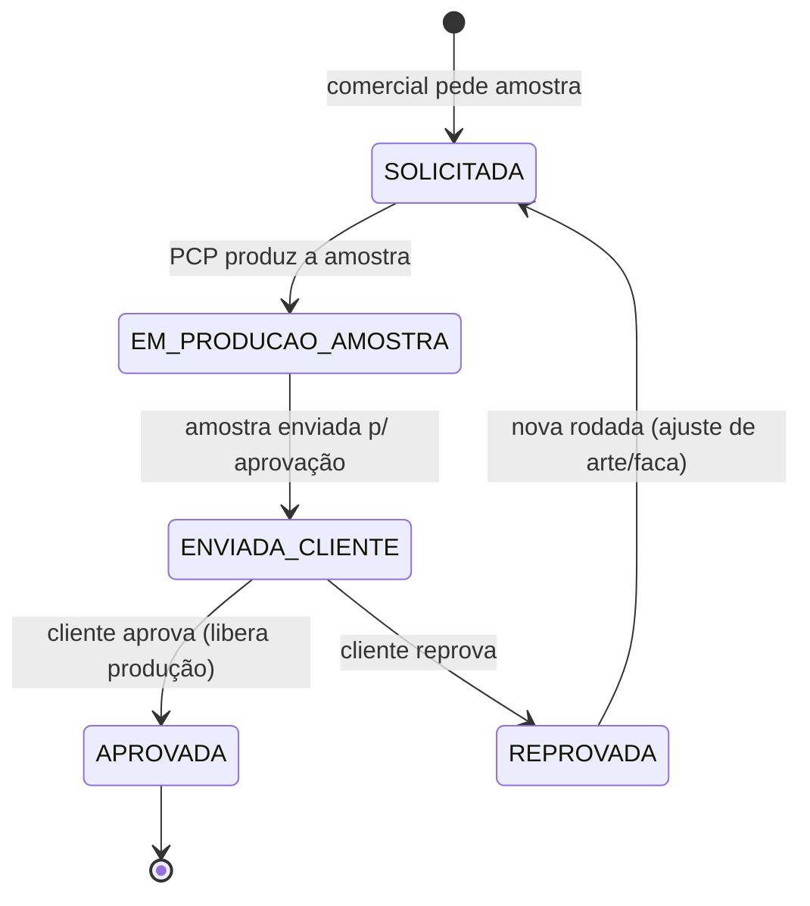
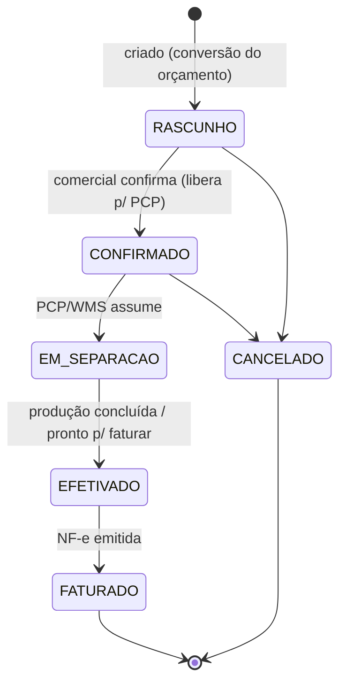
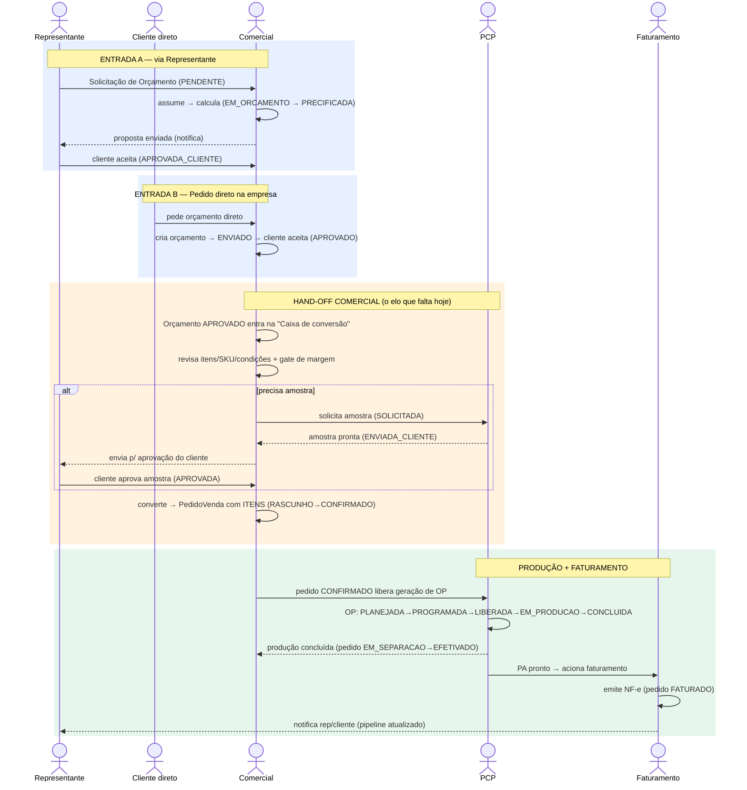
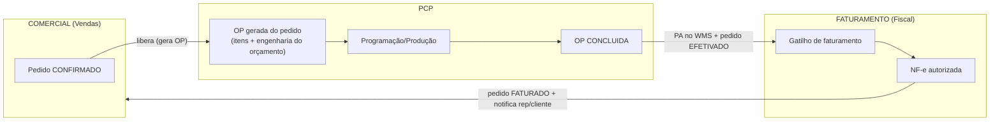

# Fluxo Comercial — Orçamento → Comercial → PCP → Faturamento (desenho alvo)

> Desenho de fluxo DEFINIDO (com status claros) da comunicação entre:
> Representante (externo) e Pedido direto na empresa · Orçamento Gráfico ·
> Aprovação de Modelos/Amostras · Estágios do Pedido · Comercial ↔ PCP ↔
> Faturamento.
>
> Base: código atual do Vizor + Calcgraf (levantamento) + padrões de mercado
> (Quote-to-Order SAP/Oracle/NetSuite; MIS gráfico CERM/PrintXpand). Este é o
> documento de desenho que vira a spec `orcamento-grafico-handoff-comercial`.
> Data: 26/10/2026. **Nada aqui foi implementado — é o blueprint.**

---

## 0. Atores e responsabilidades

| Ator | Onde atua | Responsabilidade no fluxo |
|------|-----------|---------------------------|
| **Representante** (externo) | Portal do Representante | Solicita orçamento, acompanha pipeline, aprova proposta pelo cliente, aprova amostra/modelo |
| **Cliente direto** | (atendido pelo comercial) | Compra direto da empresa, sem representante |
| **Comercial** (interno) | Módulo Vendas | **Dono do hand-off**: converte orçamento aprovado em pedido real, controla amostras, libera para produção |
| **PCP** | Módulo PCP | Recebe o pedido liberado, gera OP, programa, produz |
| **Faturamento** | Módulo Fiscal | Emite NF-e quando a produção conclui / pedido efetivado |

Regra de ouro (mercado + Calcgraf): **na conversão, a engenharia e os itens
viajam junto** — o pedido e a OP nascem completos, sem redigitação.

---

## 1. Visão macro (as duas portas de entrada + o funil único)



As duas portas (representante e direto) **convergem no orçamento gráfico** e, a
partir do comercial, seguem o **mesmo funil** — status unificados.

---

## 2. Máquinas de estado (status claros de cada etapa)

### 2.1 Solicitação do Representante (`SolicitacaoOrcamentoRep` — já existe)



### 2.2 Orçamento Gráfico (`OrcamentoGrafico` — já existe, a ESTENDER)



### 2.3 Aprovação de Amostra/Modelo (`AprovacaoAmostra` — NOVO)



Tipos de amostra (campo `tipo`): `DIGITAL` (PDF/prova de cor), `FISICA`
(protótipo cortado/colado), `FACA` (aprovação do gabarito/GCad). Cada rodada
guarda anexo (arte/foto) + quem aprovou + quando.

### 2.4 Pedido de Venda — estágios (`PedidoVenda` — já existe)



> Os 6 status (`RASCUNHO/CONFIRMADO/EM_SEPARACAO/EFETIVADO/FATURADO/CANCELADO`)
> **já existem** no Vizor. O que falta é o pedido **nascer completo** (com itens)
> e o gatilho de cada transição ficar claro (ver seção 4).

### 2.5 Ordem de Produção (`OrdemProducao` — já existe, inalterada)

```
RASCUNHO → PLANEJADA → PROGRAMADA → LIBERADA → EM_PRODUCAO → CONCLUIDA
(+ CANCELADA)
```

---

## 3. Fluxo ponta a ponta com os dois caminhos de origem



---

## 4. Gatilhos de transição (quem dispara o quê)

| De → Para | Quem dispara | Pré-condição | Efeito colateral |
|-----------|--------------|--------------|------------------|
| Solicitação PENDENTE → EM_ORCAMENTO | Comercial | — | cria/vincula OrcamentoGrafico |
| Orçamento ENVIADO → APROVADO | Rep (portal) ou Comercial | tem preço | entra na caixa de conversão + **notifica comercial** |
| Amostra SOLICITADA → ... → APROVADA | Comercial pede, PCP produz, Cliente aprova | — | libera conversão quando exigida |
| Orçamento APROVADO → CONVERTIDO | **Comercial** | margem dentro da alçada (ou aprovada) | cria PedidoVenda **com itens** |
| Pedido RASCUNHO → CONFIRMADO | Comercial | itens + cliente + tabela preço OK | libera geração de OP |
| Pedido CONFIRMADO → EM_SEPARACAO | PCP/WMS | OP gerada | — |
| OP última etapa CONCLUIDA | Chão (apontamento) | todas etapas concluídas | PA entra no WMS + pedido → EFETIVADO |
| Pedido EFETIVADO → FATURADO | Faturamento | NF-e autorizada | atualiza pipeline do rep |

**Gate de margem (G3):** na transição APROVADO → CONVERTIDO, se o desconto/margem
sair da alçada do comercial, abre `SolicitacaoAprovacao` (modelo já existente no
módulo Vendas) para o gerente/ADMIN liberar antes de virar pedido.

---

## 5. Comunicação Comercial ↔ PCP ↔ Faturamento (o "tubo" de status)



Pontos de integração (já existem parcialmente):
- **Comercial → PCP:** pedido CONFIRMADO gera OP. Hoje existe
  `POST /ordens-producao/gerar-de-pedido` (geração de OP a partir de Pedido de
  Venda). O elo precisa carregar a **engenharia do orçamento gráfico** para a OP
  nascer completa (como o Calcgraf faz via `CalculoHeader.CodOpItemEstrutura`).
- **PCP → Faturamento:** ao concluir a OP, o PA entra no WMS (NotaEntrada tipo
  PRODUCAO) e o pedido vai a EFETIVADO. O faturamento emite a NF-e de saída
  (módulo fiscal já existe). Falta o **gatilho automático** "OP concluída →
  pedido pronto para faturar" com notificação ao comercial.
- **Faturamento → Representante/Cliente:** NF-e autorizada atualiza o **pipeline**
  do portal do representante (que já cruza PV + OP). Falta disparar a notificação
  no FATURADO.

---

## 6. Painel de status unificado (visão do comercial)

Uma tela só, por pedido/orçamento, mostrando o estágio corrente de ponta a ponta:

```
[Solicitação/Orçamento] → [Amostra] → [Pedido] → [OP/Produção] → [Faturamento] → [Entrega]
   PRECIFICADA ✓            APROVADA ✓   CONFIRMADO   EM_PRODUCAO 62%   —            —
```

Cada "bolinha" é um status das máquinas de estado acima. É o mesmo conceito do
**pipeline do representante** (já existe), mas voltado ao **comercial interno** e
incluindo o estágio de **amostra/modelo** (novo).

---

## 7. Novas entidades e campos (resumo para a spec)

| Entidade | Novo/Existe | Campos-chave |
|----------|-------------|--------------|
| `OrcamentoGrafico` | existe → **+status CONVERTIDO** | `status`, `pedidoVendaId` |
| `PedidoVenda` | existe → **nascer com itens** | gerar `ItemPedidoVenda` na conversão |
| `AprovacaoAmostra` | **NOVO** | `orcamentoId`/`pedidoId`, `tipo` (DIGITAL/FISICA/FACA), `status`, `rodada`, `anexoUrl`, `aprovadoPor`, `aprovadoEm`, `motivoReprova` |
| `NotificacaoComercial` | **NOVO** (espelha `NotificacaoRep`) | `tipo`, `titulo`, `mensagem`, `referencia`, `lida` |
| `ConversaoOrcamentoLog` | **NOVO** (auditoria) | `orcamentoId`, `pedidoVendaId`, `usuarioId`, `margemAplicada`, `aprovadaPor` |
| `origemPedido` (enum) | **corrigir** | alinhar back (`ORCAMENTO_GRAFICO`) × front (`ORCAMENTO`) |

Pré-requisito estrutural (G5 do estudo anterior): **como o item gráfico
(`TipoEmbalagem` + engenharia) vira `Produto`/SKU** no `ItemPedidoVenda`. Decisão
a tomar no início da spec (Produto "serviço gráfico" genérico vs SKU sob demanda).

---

## 8. Faseamento sugerido (ondas)

1. **Onda 1 — Conversão completa + hand-off:** status CONVERTIDO; conversão cria
   `ItemPedidoVenda`; caixa "Orçamentos a converter" + `NotificacaoComercial`;
   corrigir enum `origemPedido`. (Resolve G1, G2, G4 do estudo.)
2. **Onda 2 — Aprovação de Amostra/Modelo:** `AprovacaoAmostra` com rodadas,
   anexos e aprovação pelo cliente/rep; bloqueia conversão quando exigida.
3. **Onda 3 — Gate de margem:** alçada de desconto/margem na conversão (reusa
   `RegraAprovacao`/`SolicitacaoAprovacao`). (Resolve G3.)
4. **Onda 4 — Elo PCP completo + gatilho de faturamento:** OP nasce com a
   engenharia do orçamento; "OP concluída → pronto para faturar" + notificações
   ponta a ponta no painel unificado.

---

## 8.1 Decisões do usuário (26/10/2026)

- **D1 — item gráfico → SKU (escolha: opção B):** na conversão, criar um
  **Produto/SKU de verdade sob demanda** a partir do cálculo (não um produto
  genérico). Com **salvaguardas anti-colisão** (nunca criar/editar um `Produto`
  que já tenha OP, estrutura, estoque ou pedido vinculado — só SKUs realmente
  novos), reaproveitando o padrão já estudado em
  `docs/calcgraf-fase-produtos-plano.md`.
- **D2 — amostra obrigatória quando houver amostra, mas CONFIGURÁVEL pelo
  comercial:** a exigência de aprovação de amostra tem **dois níveis**:
  1. **Padrão da empresa** (Configuração do Comercial, tabela `Parametro`,
     ex. `comercial.exigir-amostra`): `SEMPRE` | `NUNCA` | `QUANDO_MARCADO`.
  2. **Override por orçamento/pedido:** o comercial marca/desmarca
     `exigeAmostra` no documento, sobrepondo o padrão.
  - **Sugestão automática:** quando o `[TipoOp]` do cálculo for `NOVO`/`ALTERAÇÃO`
    (não `REPETIÇÃO`), o sistema **sugere** amostra por padrão (o comercial
    confirma). Repetição não sugere (já foi aprovada antes).
  - **Regra de bloqueio:** quando `exigeAmostra = true`, a conversão
    APROVADO → CONVERTIDO (e/ou a liberação para PCP) só é permitida após a
    `AprovacaoAmostra` chegar em `APROVADA`.

## 9. Conclusão

O fluxo-alvo unifica as duas portas (representante e direto) num funil único com
status claros em cada camada: **Solicitação → Orçamento → (Amostra) → Pedido →
OP → Faturamento → Entrega**. O comercial é o dono explícito do hand-off
(conversão sem redigitação + gate de margem), e a comunicação com PCP e
Faturamento é por gatilhos de transição auditáveis que alimentam um painel de
status unificado — o mesmo que o representante enxerga no portal. A base do Vizor
já suporta a maior parte; as peças novas são: status CONVERTIDO, conversão com
itens, `AprovacaoAmostra`, `NotificacaoComercial` e o gatilho de faturamento.
