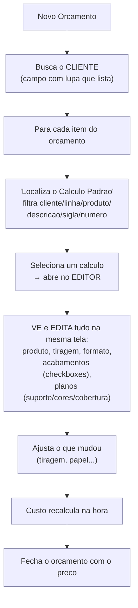
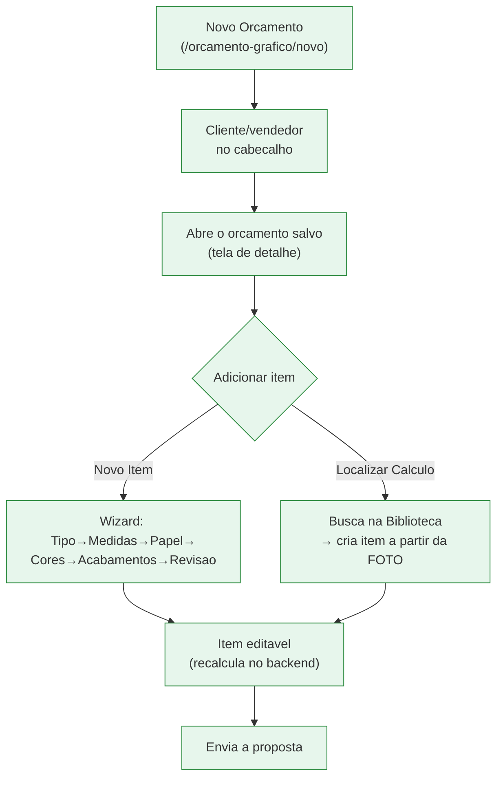

# Fluxo de Orçamento + Cálculo — Calcgraf vs Vizor (adaptação do operador)

Documento de comparação do fluxo que o operador da Carton Wega conhece no
Calcgraf com o fluxo equivalente no Vizor, para guiar as melhorias de adaptação
(reduzir o estranhamento na virada).

## Como o operador faz HOJE no Calcgraf

No Calcgraf, **LOCALIZAR e EDITAR o cálculo são a MESMA tela** (o "Editor"). "Abrir
o cálculo" = editar.

## Como está HOJE no Vizor

No Vizor, **LOCALIZAR (ver a foto na biblioteca)** e **USAR/EDITAR (item do
orçamento)** são momentos separados. A foto do cálculo é histórico congelado; o
item é a cópia editável.

## Comparação ponto a ponto

| Etapa | Calcgraf | Vizor hoje | Gap | Ação |
|---|---|---|---|---|
| Buscar cliente no orçamento | lupa que lista | campo texto no cabeçalho | pequeno | — |
| Localizar cálculo | tela "Cálculo Padrão" | Biblioteca + "Localizar Cálculo" no item | ✅ equivalente | — |
| **Ver engenharia do cálculo** | editor rico | só resumo (card) | **GRANDE** | #1 enriquecer detalhe |
| "Usar em orçamento" da lista | seleciona → editor | hoje só navega | médio | #2 criar item direto |
| Reaproveitar no item | no editor | "Localizar Cálculo" cria item | médio | coberto por #2 |
| Editar o item | no editor | no wizard de item | médio | aceitável |
| Filtro por cliente | lista clientes | texto livre; 32/7951 têm cliente | pequeno | #3 manter texto |

## Por que o Vizor separa "ver" de "editar" (e por que é melhor)

No Calcgraf, editar o cálculo-padrão altera o template; o histórico do que foi
orçado fica diluído. No Vizor, cada cálculo da biblioteca é uma **foto
congelada** (não muda sozinho), e reaproveitar faz uma **cópia** editável no
orçamento — então corrigir um cálculo não reescreve propostas já emitidas
(segurança comercial/fiscal). O custo dessa escolha é ter dois passos; mitigamos
deixando a tela de detalhe RICA e o "Usar em orçamento" imediato.

## Plano de adaptação (ordem de impacto para o operador)

1. **Enriquecer "Detalhes do Cálculo"** (frontend; dado já migrado): produto,
   tiragem, formato, lista de acabamentos, cores + cobertura, custo/valor — o
   mais perto possível do editor do Calcgraf.
2. **Ativar "Usar em orçamento"** direto da biblioteca (criar o item na hora).
3. **Filtro cliente**: manter texto livre; foco visual em produto/descrição/
   número (o acervo quase não tem cliente — 32/7951).

## Observação sobre o filtro de cliente (investigação 21/10/2026)

O campo "Cliente" da Biblioteca é um `TextInput` de digitação livre (não um
dropdown que lista). Além disso, só **32 de 7.951** cálculos migrados têm cliente
(o Calcgraf registrou o acervo quase todo como "sem cliente definido"). Logo, o
filtro por cliente é pouco útil para os migrados — a busca real é por
**produto / descrição / linha / número (Vizor ou Calcgraf)**. Mantido como texto
livre (serve aos 32 + cálculos novos do Vizor).
